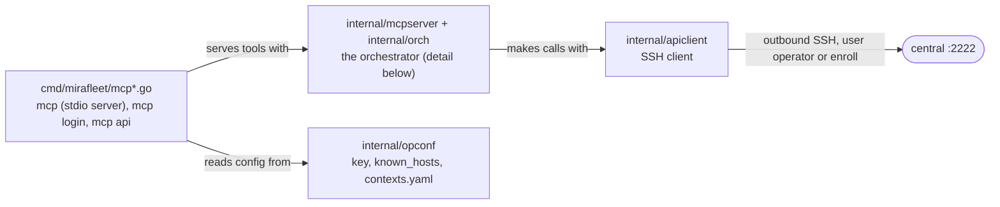
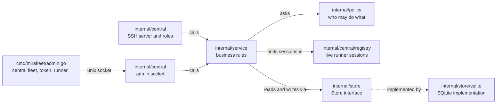
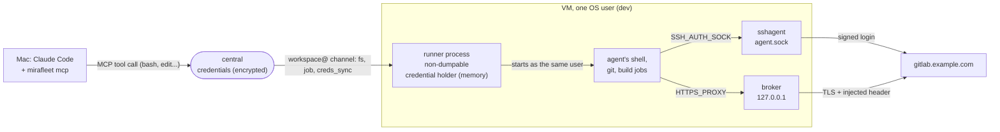
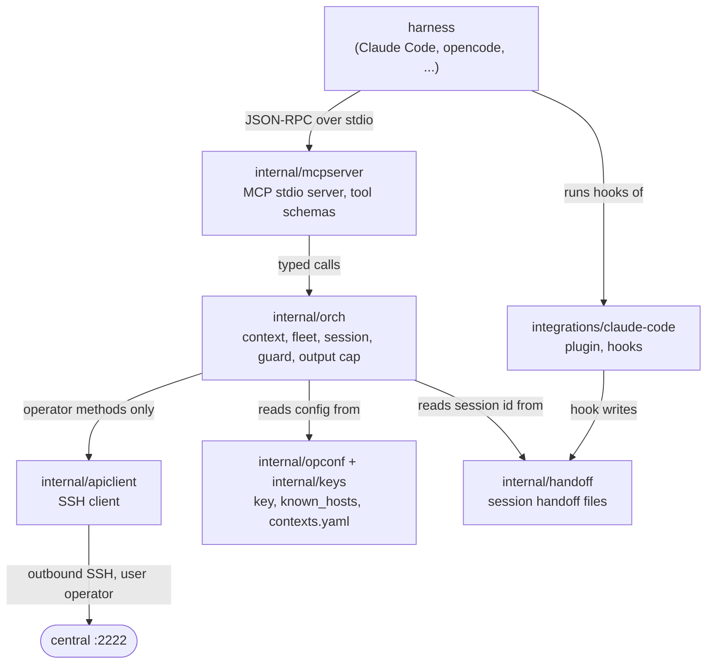
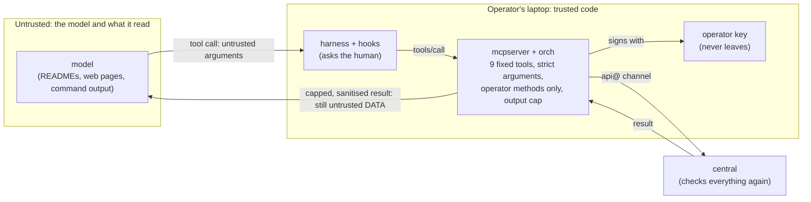
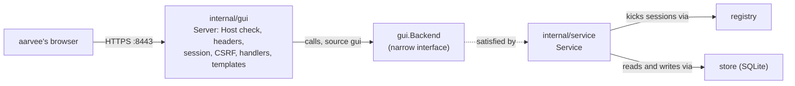
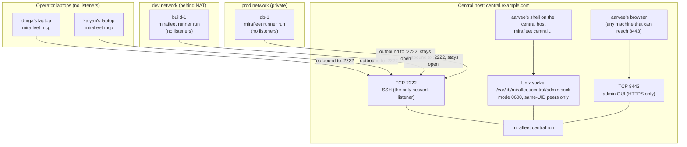
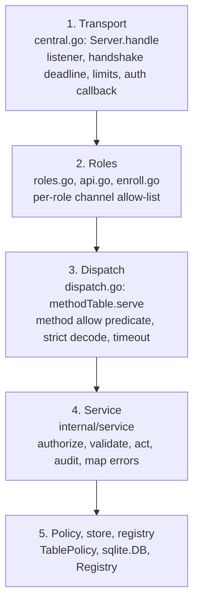
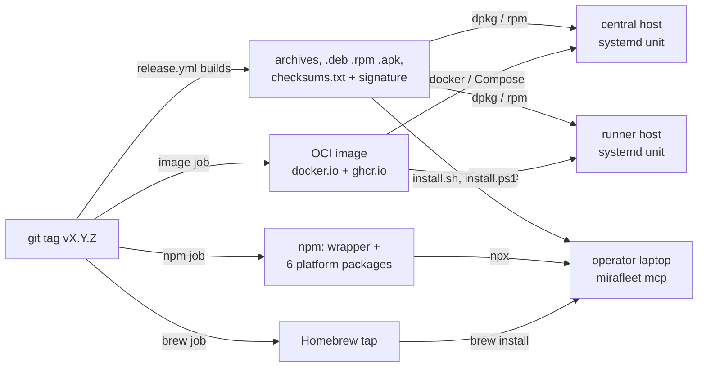

# 3. Architecture

## What you will learn

- The three programs in the system (central, runner, operator tools) and what each one is
  responsible for.
- Which side listens on a network port (only central) and why runners never accept inbound
  connections.
- Where the trust boundaries are, and which key or secret lives on which machine.
- How the code inside central is layered, so you know where a new feature belongs.
- The orchestrator on the operator's machine (`orch`, `mcpserver`, integrations) and why the
  model on the other side of MCP is treated as untrusted input.
- The admin GUI: a second front end inside central, which listener it uses (`0.0.0.0:8443` by
  default), why it calls the same service as the CLI and which packages it may import.
- Which platforms are supported (including where the keys live on each), and why mirafleet ships
  as one static binary.
- How the parts reach a machine (packages, image, Compose, operator channels) and the protocol
  level rule for mixed versions (M6).
- The M7 host-mode runner: `hostx`, `fsops`, `sshagent`, `broker` and `secrets`, how central
  holds credentials and delivers them to a runner's memory, and where those secrets live.

This chapter is the map. It shows which programs exist, what each part of them is responsible for,
who is allowed to talk to whom, and where every secret lives. The next chapter,
[Flows](04-flows.md), walks through what happens at run time. If a term is new, look it up in the
[glossary](glossary.md); the background ideas (SSH, keys, SQLite, contexts) are explained in
[Background](02-background.md).

### Words you will meet

| Word | Plain meaning |
|---|---|
| **principal** | The verified identity behind a connection: its kind (`admin`, `operator`, `runner` or `enroll`) plus its id. |
| **front end** | One of the doors into central's logic: the operator API (`api@mirafleet` channels), the admin socket, the enroll channels and, since M4, the admin GUI. The first three have their own method table; the GUI calls the service directly. |
| **`hello`** | The smallest operator method. It does nothing but answer, so a client can check that its connection and key work. |
| **DTO** | "Data transfer object": a plain struct that only carries data between layers, such as `api.Request` or `store.Runner`. It has no behaviour. |
| **role** | What the SSH user name selects after login: `runner`, `operator` or `enroll`. |
| **dispatch** | Picking the handler for something that arrived: first the role (by SSH user), then the method (by name, from a table). |

## The running example

Everything in this guide uses the same fictional company, **MIRASTACK LABS**:

- Central runs on `central.example.com:2222`.
- There are two fleets: `dev` and `prod`.
- Runners are `build-1` (in `dev`) and `db-1` (in `prod`).
- Operators (a person's registered key and machine, driven by a person or an AI agent) are `durga`
  and `kalyan`.
- **aarvee** is the admin, with a shell on the central host and runs `mirafleet central ...` there.
- For workspace mode: aarvee creates `dev` as a **workspace** fleet (with `build-1` as a workspace
  runner), and durga's Claude Code opens a workspace on it, runs `go test` and reads and writes
  files ([chapter 1](01-what-is-mirafleet.md#the-workspace-running-example)). `prod` stays an
  actions fleet, with `db-1` and the `tail-logs` action.

## The big picture

*Look at the direction of the arrows: every connection points at central. Nothing points at a
runner or an operator's laptop.*

1. Claude Code starts `mirafleet mcp`; the plugin's hooks run beside it. The LLM API key and the SSH key stay on the laptop.
2. `mcp` dials central `:2222` as SSH user `operator`; each request is one `api@` channel.
3. Central checks the key and the policy against SQLite, then acts.
4. Runners dial OUT to central (user `runner`). Nothing listens on a runner.
5. Central sends work back down that same connection: an `exec@` channel (actions fleet) or a
   `workspace@` channel (workspace fleet, where the runner drives containerd locally).
6. aarvee runs the admin CLI on central. It uses a local unix socket, never the network.

### In detail

In one sentence: **operators and runners both dial out to central; central is the only thing that
listens, and every request passes through it.**

- The operator's SSH key and the AI provider's API key both stay on the operator's machine. Central
  never sees the AI key, and a runner never sees either.
- The "channel" (step 2) is one request/response lane inside the single SSH connection, so one
  connection can carry several requests at once.
- Step 5 is the trick that lets a runner sit behind a firewall: the runner opened the connection, so
  central can open new channels inside it without any inbound rule.
- Step 6: the admin CLI never touches the network. It writes to a file-like socket that only the
  user running central can open (details below).

## One binary, three roles

mirafleet is one program, `mirafleet` (see `cmd/mirafleet/main.go`). The first argument picks the
role:

| Command | Role | Runs on | Needs |
|---|---|---|---|
| `mirafleet central init`, `central run` | **Central**: the server in the middle | one Linux host | its data directory (default `/var/lib/mirafleet/central`) |
| `mirafleet central fleet ...`, `token ...`, `runner ...`, `operator ...`, `exec`, `audit` | **Admin CLI**: talks to the *running* central over a local socket | the central host | a running central |
| `mirafleet runner join`, `runner run` | **Runner**: sits on a fleet server | each Linux server in a fleet | its data directory (default: root `/var/lib/mirafleet/runner`, other users `$XDG_CONFIG_HOME/mirafleet`; the packaged service user passes `-data /var/lib/mirafleet/runner`) and either an `actions.yaml` or (workspace mode) a `workspace.yaml` |
| `mirafleet runner tls-init`, `tls-front`, `workspace list`, `workspace prune` | **Runner helpers** for workspace mode | the workspace runner's host | the runner's `workspace.yaml` (list, prune) or a new directory (tls-init) |
| `mirafleet mcp` (or `mcp serve`), `mcp login`, `mcp context`, `mcp api`, `mcp hook` | **Orchestrator**: what an operator's machine runs | laptop (Linux, macOS, Windows) | a config directory with the operator key |

`mirafleet mcp` with no subcommand is the MCP stdio server that a harness such as Claude Code
launches (built in M5). `mcp login` registers the machine, `mcp context` switches between
centrals, `mcp hook claude-code EVENT` is what the plugin's hooks run, and `mcp api METHOD [JSON]`
still makes one raw call, which is how the older flows in this guide can be exercised by hand.
(`mcp api` also takes `-in FILE` and `-out FILE`, to send a file body to `workspace.write_file`
or `workspace.exec` and to save the body of `workspace.read_file`.) There is also a hidden command, `mirafleet workspace-init`,
that is not for people: it is the first process (PID 1) inside every workspace container.

### Why one static binary?

A *static* binary carries everything it needs inside the one file.

- **Easy to install.** Copy one file to a server and run it. There is no runtime (no Python, no
  JVM) to install, and no shared libraries to match to the operating system version.
- **Easy to build for many targets.** The rule `CGO_ENABLED=0 go build ./...` must keep working
  (see `CLAUDE.md`). Without C code, the Go compiler can produce binaries for Linux, macOS and
  Windows from one machine. This is why the database is `modernc.org/sqlite` (SQLite translated to
  Go) and not the usual C version.
- **One version everywhere.** Central, runners and operator tools come from the same build, so
  they always agree on the wire format. There is no "runner v1.2 cannot talk to central v1.4"
  matrix to manage.
- **Small attack surface.** No scripting layer, no plugin loader, no package manager on the
  runner that could be tricked into running something else.

The price is that the operator laptop also carries the (unused) central code. The project accepts
this, but keeps the dependency graph honest: only `cmd/mirafleet/central_linux.go` imports
`internal/store/sqlite`, so macOS and Windows builds of the binary never link SQLite at all.
`server_linux.go` holds the runner commands, and `server_other.go` is the stub for other systems.

## Components and their responsibilities

The animated picture above is the overview. The three diagrams below show the *components*, one
machine at a time. Package names are the real directories under `internal/`; the table further
down names the functions.

**The operator's laptop**

**The central host**

**The runner host**

*Look at the arrows that reach central: all start on the laptop or the runner. The single dotted
arrow is central re-using a connection the runner opened.*

### Central

Central is `mirafleet central run`. It is a long-running Linux process that owns the database and
is the only component with a view of the whole fleet. Its parts:

| Part | Package / file | Responsibility |
|---|---|---|
| **SSH server** | `internal/central/central.go` (`Server.Start`, `Server.handle`) | Accepts TCP connections, runs the SSH handshake (the key exchange that sets up the encrypted connection) with a deadline, authenticates the key, limits how many handshakes can be in progress. |
| **Roles** | `internal/central/roles.go` (`Server.dispatch`, `serveRunner`), `api.go` (`serveOperator`), `enroll.go` (`serveEnroll`) | After authentication, the SSH **user** name picks the role: `runner`, `operator` or `enroll`. Each role has its own handler and its own allow-list of SSH channel types. |
| **Dispatch** | `internal/central/dispatch.go` (`methodTable`) | Turns a request such as `action.run` into a handler call. A method that is not in the table for this front end is refused, whoever asks. |
| **Admin socket** | `internal/central/admin_unix.go` (`ServeAdmin`, `adminConn`), `adminclient.go` (`AdminCall`) | A Unix socket (a file that processes on the same machine connect to, instead of a network port) at `<data>/admin.sock` (mode `0600`). Same framing and the same dispatcher as the operator API, but with the `admin` principal. It exists so admin commands can reach the live connections (revoke has to kick a connected runner). |
| **Service** | `internal/service` (`Service`) | The one place where business rules live: check policy, validate input, change state, write audit, map errors to wire errors. The SSH server, the admin socket and the GUI all call it. |
| **Admin GUI** | `internal/gui` (`Server`), wired by `cmd/mirafleet/central_gui_linux.go` (`startGUI`) | An HTTPS server inside the central process. Renders HTML pages for aarvee, handles login, sessions and CSRF, and turns each click into a `service` call with source `gui`. Details in [The admin GUI](#the-admin-gui-m4) below. |
| **Policy** | `internal/policy` (`TablePolicy`) | A small fixed table: who may do what. Denies by default. |
| **Registry** | `internal/central/registry` (`Registry`, `Session`) | In-memory list of runners that are connected *right now*: their SSH connection, last heartbeat (the runner's "I am alive" message), live status, tombstones (in-memory "this runner id is dead" marks) for revoked runners, and (from the heartbeat) the runner's slots, executor and secure runtime. It is also how central runs an action (`exec@`) or a workspace operation (`workspace@`) on a runner. |
| **Store** | `internal/store` (interface), `internal/store/sqlite` (`DB`) | Persistence. The interface offers domain-level operations (`Enroll`, `SetRunnerStatus`, ...), each atomic and each writing its audit row in the same transaction. SQL stays inside `sqlite`. |
| **Audit** | `audit` table in the store; `Store.RecordAudit` | Append-only record of every state change and every action. Triggers (database rules that run automatically) in the schema abort any `UPDATE` or `DELETE`. |
| **Workspace handlers** | `internal/central/workspace_handlers.go` | Decode the six `workspace.*` operator methods and three admin ones strictly, call the service, map to DTOs. They also read the *body frame* of `write_file` and `exec` stdin, but only after the service has authorised the call. |
| **Workspace service** | `internal/service/workspace*.go` | Placement (`workspace_sched.go`), open/close (`workspace.go`), exec/read/write/list (`workspace_ops.go`), admin (`workspace_admin.go`), and the housekeeping: the **reaper** and **reconcile** (`workspace_reaper.go`). |
| **Auth** | `internal/auth` (`KeyAuth`, `Principal`) | Looks a presented key up in the store, applies the user-to-role binding, and carries the identity in `ssh.Permissions.Extensions`. |

Two small helpers sit beside these:

- `internal/central/conns.go` (`OperatorConns`) tracks live operator connections by operator id so
  that revoking an operator can close them.
- `internal/central/hslimit.go` (`hsLimiter`) counts handshakes in progress per source address, and
  globally, so a flood of half-open connections is cut off before any cryptography is done.

#### Limits you can tune (`central.Config`)

Central has a handful of tunable limits (handshake timeout, handshakes in progress per IP and
overall, enroll rate limits and deadline, heartbeat-write interval). They are fields of
`central.Config` in `internal/central/central.go`; a zero value means "use the default". The one
table of all limits, with their current values and the reason for each, is
[Protocols, section 7.9](07-protocols.md#79-limits).

These limits are a backstop, not denial-of-service protection: a central exposed to the internet
still needs a firewall in front of the SSH port.

### Runner

The runner is `mirafleet runner run`. It is deliberately small and does four things
(`internal/runner/runner.go`):

1. **Dial-out loop** (`Runner.Run`): connects to central, and when the connection drops, waits and
   tries again with exponential backoff (1 s up to 60 s, with +/-20 % jitter, so many runners do not
   all retry at the same second).
2. **Heartbeat** (`Runner.heartbeat`): sends an SSH global request (a message about the connection
   as a whole, not about one channel) called `heartbeat@mirafleet` right after connecting and then
   every 15 s (`heartbeatEvery` in `cmd/mirafleet/server_linux.go`). The payload is hostname, OS,
   architecture, version and labels; a workspace runner adds its slots, executor, secure
   runtime and image patterns.
3. **Actions guard** (`internal/actions`, `Set.Plan` and `Set.Run`): in actions mode, the only
   code that ever starts a process (a workspace runner has no guard; see below). It reads the allowlist `actions.yaml` from the runner's own disk (default
   `/etc/mirafleet/actions.yaml`). **This guard, not central, is the security boundary.** Even a
   fully compromised central can only ask for actions that the runner's own file allows.
4. **Local JSONL audit** (`internal/audit`, `Writer`): appends one JSON line per event to
   `<data>/audit.jsonl` (mode `0600`), so the runner keeps its own record even if central's copy is
   lost or disputed.

**Channels on the runner connection.** The runner opens no channels toward central, and central
opens only `exec@mirafleet` (actions runners) or `workspace@mirafleet` (workspace runners) toward
the runner. A runner without an actions file refuses `exec@`; one without a workspace config
refuses `workspace@`. The SSH library on the runner rejects every other channel type. The runner
has no listening socket toward the network (the package comment of `internal/runner` says so).
The one exception is the egress proxy below, which listens only *inside a container's own
network namespace*.

#### The workspace runner (M3)

`mirafleet runner run` takes **exactly one** of `-actions FILE` or `-workspace FILE`. One runner is
one fleet and one mode. With `-workspace` the runner does not start the actions guard at all;
instead `runner.serveWorkspace` (`internal/runner/workspace.go`) serves `workspace@mirafleet`
channels through a **`workspace.Executor`**, the Go interface in `internal/workspace`:
`Create`, `Exec`, `ReadFile`, `WriteFile`, `Destroy`, `List`. Everything above the interface
(scheduling, slots, TTL, audit, policy) is the same whatever sits below it. Two executors exist:

| Executor | Package | What it does | Default? |
|---|---|---|---|
| `containerd` | `internal/workspace/ctrd` (Linux only) | Runs the container itself through the containerd Go client; builds the OCI spec; reads and writes files with `os.Root` (confined to the workspace directory; the `host` executor does not use `os.Root`, see below); runs the egress proxy. | yes |
| `opensandbox` | `internal/workspace/osb` | Speaks HTTPS to an [OpenSandbox](02-background.md#29-containers-containerd-and-opensandbox) server on the same host, through a TLS front, with mutual TLS. No SDK. | opt-in per fleet |

Beside them: `internal/workspace/wsconfig` (loads and validates `workspace.yaml`),
`internal/workspace/egress` (the proxy), `internal/workspace/initproc` (the tiny PID 1 that
runs inside each container, started as `mirafleet workspace-init`) and
`internal/workspace/fake` (an in-memory executor for tests).

*Look at the containerd socket: whoever can talk to it controls the host. That is why the runner
re-validates everything and builds the container itself.*

Facts to remember about a workspace runner:

- **Slots.** `concurrent: N` in `workspace.yaml` is the number of workspaces the runner accepts.
  It is sent in each heartbeat (`slots`, plus `executor`, `secure_runtime` and image patterns), so
  central can place new workspaces. The runner also has its own limit of N as a second gate.
- **Central is not trusted.** The runner rebuilds the entire container spec from a fixed
  template. Central supplies only the image, limits within the runner's caps, the network mode
  and allowlisted environment names. There is no field for "privileged", "host network" or "host
  mount".
- **Local admin.** `mirafleet runner workspace list` and `prune` talk to the executor directly,
  with no central involved, so they still work after the runner was revoked.
- **Root-equivalent.** A workspace runner can reach the containerd socket. See trust boundary 7
  below.

### Host mode: the M7 runner

M7 adds a third executor, `host`, selected by `executor: host` in `workspace.yaml`
([chapter 1, 1.4a](01-what-is-mirafleet.md#14a-host-mode-remote-development-on-a-vm-m7)). Everything
above the `workspace.Executor` interface (scheduling, sticky sessions, slots, the reaper, audit,
policy, the `workspace.*` methods) is reused. What is new sits below it and beside it. Host mode is
**Linux only**: `internal/workspace/hostx` has `_linux` files and a `doc_other.go` stub, and
`mirafleet runner` refuses to start elsewhere anyway.

| Component | Package / file | Job |
|---|---|---|
| **hostx** | `internal/workspace/hostx` | The `host` executor. Start-up hardening (`harden_linux.go`), session directories and cleanup (`sessions.go`, `sweep.go`), foreground `bash` with output capture (`exec_linux.go`), background jobs (`job_linux.go`, supervised by the hidden `mirafleet host-shim job` of `cmd/mirafleet/host_shim_linux.go`), XDG default paths (`xdg.go`), file operations through `fsops` (`files.go`). |
| **fsops** | `internal/workspace/fsops` | A pure Go package (no OS-specific hooks) that implements the file tools: read, write, edit, multi-edit, notebook edit, ls, glob, grep. It runs inside the runner process, as the runner's user, so OS permissions are the boundary. Pure so that container mode could reuse it later. |
| **sshagent** | `internal/workspace/sshagent` | The restricted per-session ssh-agent ([chapter 2, 2.14](02-background.md#214-host-mode-background-secrets-you-can-use-but-not-read-m7)): `List` and `Sign` only, user-auth requests only, host binding. |
| **broker** | `internal/workspace/broker` | The local HTTPS proxy: per-session CA with name constraints (`ca.go`), credential injection (`cred.go`), registry token exchange (`registry.go`). |
| **secrets** | `internal/secrets` | AES-256-GCM seal/open, the key from `MIRAFLEET_SECRETS_KEY`, the key-check value, `Rekey`. Central only: a test (`deps_test`) keeps `secrets`, `hostx`, `broker` and `sshagent` out of the orchestrator and macOS/Windows builds. |
| **Credential holder** | `internal/runner/creds.go` | The runner's **in-memory** set of delivered credentials. Replaced atomically on each `creds_sync`. |
| **Host ops glue** | `internal/runner/hostops.go`, `internal/runner/events.go` | Dispatches the new ops (`workspace.fs`, jobs, output paging) to hostx; wires a session's agent socket, broker and environment; sends aggregated usage events. |
| **Credential service** | `internal/service/credentials.go` | Central's logic: set, list (masked), delete, assign, unassign, rotate, delivery, placement by credentials, the GitLab self-rotation client. |
| **Dispatch** | `internal/service/{fsdispatch.go,jobs.go}`, `internal/central` | Routes `workspace.fs`, `workspace.job_*` and `workspace.output_read` to the runner (same ownership, confirm and audit checks as `workspace.exec`). |
| **Events** | `internal/service/events.go` | Ingests runner usage events as audit rows with source `runner`. |
| **GUI** | `internal/gui/handlers_credentials.go` | The **Credentials** page at `/credentials`. |
| **Operator side** | `internal/orch`, `internal/mcpserver/{tools_fs,tools_bash,tools_ws}.go` | The new MCP tools, the upload/download transfer, and `.mirafleet.yaml` fields `remote` and `workdir`. |

*Look at where the credentials sit: encrypted on central, in memory in the runner, and the shell
reaches them only through the agent socket and the broker.*

Facts to remember about a host runner:

- **One OS user, one runner.** `runner join` and `runner run` run as an ordinary unprivileged user
  (say `dev`). The runner refuses to start as uid 0, with any Linux capability, or if `$HOME` or the
  state directory is group- or world-writable. Its config and state default to that user's XDG
  directories (`$XDG_CONFIG_HOME/mirafleet`, `$XDG_STATE_HOME/mirafleet`), so it needs nothing outside
  the home directory. A second runner on the same VM is a second user (`qa`), enrolled separately.
- **Config.** `workspace.yaml` takes `executor: host` plus an optional `host:` block (`root`, `cleanup.delete_after`,
  `job_max`, `corporate_ca_file`). A host runner takes no image, no resource limits and no egress
  list: the VM and its firewall are the boundary.
- **Directories.** Each session gets `<root>/sessions/<slug>` (mode `0700`; `<slug>` derives from
  the session id). A project may share a named directory instead: `workdir: NAME` in
  `.mirafleet.yaml` resolves to `<root>/work/<name>` (names match `^[a-z0-9][a-z0-9._-]{0,62}$`,
  host fleets only, symlinks refused). Closing a workspace stops its processes and closes its
  agent socket and broker session, but **keeps the directory**; reopening the same session
  reattaches. The runner labels workspaces `mirafleet.session` and `mirafleet.workdir`, so
  reattach is by session. A second open of a session that is still held is refused
  (`ErrRefused`). The directory is `<root>/sessions/<slug>`, or `<root>/work/<name>` for a shared workdir; the labels are
  `mirafleet.session`, `mirafleet.workdir` and `mirafleet.credentials`. The credential scope of the
  open is saved as `creds_scope` in the session state directory, so a re-adopted session gets the
  same, never a wider, set.
- **One operator at a time.** A host runner is held by the operator who has live workspaces on it.
  Another operator's `workspace_open` gets a `conflict` error, `busy: runner build-1 is in use by durga`, and placement skips the
  runner. The hold is released when the last live workspace ends. It is enforced inside the store's
  reserve transaction, with no extra table.
- **Credentials are placed.** A fleet with credentials requested only places on a runner that holds
  every one of them; asking for a credential on a non-host fleet is a bad request.
- **Restart safe.** Background jobs survive a runner restart (the systemd unit uses
  `KillMode=process`) and the runner re-adopts open sessions and running jobs when it starts.
- **Guarded host fleets** are allowed. Guarding means only the typed `confirm` equal to the fleet
  name for mutating tools.

#### Where the credentials flow (the short version)

Central stores each credential encrypted. The admin assigns it to a runner or to a whole fleet; the
effective set of a runner is the **union** of both. Central pushes that set to each connected host
runner on connect and on every change, as a `creds_sync` operation inside the already-authenticated
SSH connection. The runner keeps the values in memory only, and swaps the whole set atomically.
[Flow 34](04-flows.md#34-credential-assign-delivery-use-and-rotation) follows one credential
from the GUI to a `git push`.

### Operator side

On an operator's machine, a stack of packages turns the model's tool calls into calls to central.
The **orchestrator** is the name for the layers between the harness and the SSH client.

*Look at the only arrow that leaves the laptop: it starts in `apiclient`, and `orch` is the only
code that may call `apiclient`.*

| Package | Responsibility |
|---|---|
| `cmd/mirafleet/mcp*.go` | Routing only. `mcp login ADDR -name NAME -code -` registers this machine; `mcp api METHOD [JSON]` makes one raw call (a debugging tool); `mcp` or `mcp serve` is the stdio server (`mcp_serve.go`: flags `-context`, `-fleet`, `-session`, `-project-dir`); `mcp context list\|use\|remove`; `mcp hook claude-code EVENT`. |
| `internal/mcpserver` | The only package that imports the MCP SDK. Defines the nine tools (`tools_list.go`, `tools_ws.go`): name, JSON Schema, annotations, handler. Decodes arguments strictly, maps errors to `{"error":{"code","message"}}`, sends progress, caps list sizes. It knows nothing about SSH. |
| `internal/orch` | No MCP code. **Resolves** the context, fleet and session of a call (`Resolve`, `SessionFor`); keeps **one SSH connection per context** (`pool.go`: lazy dial, pinned host key, keepalive, redial); makes typed calls (`FleetsList`, `WorkspaceExec`, ...) through one private `call` that refuses anything but operator methods; applies the client-side time limits (`CallLimit`); sanitises and caps output (`Sanitize`, `CapOutput`). |
| `internal/handoff` | A small file that carries the harness's session id from a hook to the server (see [flow 20](04-flows.md#20-session-resolution-and---resume-reattach)). |
| `internal/apiclient` | The SSH client: `Dial`, `Call` (one request per `api@mirafleet` channel), `Join` and `Register` (the enroll channels), and the host-key checks (`PinnedHash`, `KnownHosts`). Pure Go, so it builds on Windows and macOS. |
| `internal/opconf` | Finds and reads the operator's local configuration: `contexts.yaml` (which centrals, default fleets, output cap), the per-project `.mirafleet.yaml`, and the config and state directories for each OS. |
| `internal/keys` | Generates and loads the Ed25519 key and refuses a private key others can read (file modes on Linux and macOS, a DACL on Windows). |
| `integrations/<harness>/` | The only place harness-specific code lives. `claude-code/` has the plugin files and the hook handlers (`hook/hook.go`). `opencode/` and `generic/` are documentation and commands. |

Operators never connect to a runner. They send a request to central, and central decides.

**Import rules.** `internal/orch`, `internal/mcpserver` and the Claude Code hook package must
never link the server side (`internal/service`, `store`, `central`, `runner`, containerd or
SQLite). A test in `cmd/mirafleet/deps_test.go` (`TestOrchestratorDeps`) enforces it, so the
laptop binary stays small and the macOS and Windows builds never contain server code.

**The model is untrusted input.** The model on the other side of MCP is not a trusted
caller. It reads web pages, READMEs and command output written by strangers, and any of them can
steer it. So the boundary between the harness and `mcpserver` is a trust boundary, drawn below.
Two gates sit behind it: the fixed tool table plus `orch.call` refuse anything that is not an
operator method, and central refuses admin methods on `api@` channels whatever the key. Chapter 5
([section 5.11](05-security.md#511-prompt-injection-through-tool-output)) shows what this stops.

*Look at the last arrow: what comes back to the model is marked as data, because it may carry
text written by an attacker on a remote machine.*

### The admin GUI (M4)

The admin GUI is a web front end for aarvee. It lives **inside the central process**: not a second
program, not a separate service. `mirafleet central run` starts it unless you pass
`-gui-listen off`.

*Look at the middle: the GUI never reaches the registry or the store. Everything goes through
`gui.Backend`, which `*service.Service` satisfies.*

How it fits:

- **One code path.** A revoke clicked in the GUI runs `service.Lifecycle`, the same method as
  `mirafleet central runner revoke`, so it gets the same tombstone, kick, in-flight cancel and
  audit row (flow 8). The only differences are the audit `source` (`gui` instead of `cli`) and
  the principal, `auth.GUIAdmin(username, remote)`: kind `admin`, name = the GUI username, remote
  = the TCP peer. The policy is unchanged: an admin may do everything, and admin-only service
  methods still check the caller's kind a second time.
- **Narrow interface.** `internal/gui/backend.go` defines `Backend`, listing exactly the service
  methods the GUI uses, and asserts at compile time that `*service.Service` satisfies it. This is
  also the seam where an enterprise edition would add roles or single sign-on.
- **Import rules.** `internal/gui` must not import the SQLite package, `internal/central`, the
  registry, `apiclient`, `orch`, `mcpserver`, `modernc.org/*` or containerd. `TestGUIDeps` in
  `cmd/mirafleet/deps_test.go` enforces it. Only `cmd/mirafleet/central_linux.go` wires the GUI,
  so the macOS and Windows binaries do not contain it.
- **Listener.** `-gui-listen ADDR`, default `0.0.0.0:8443` (`gui.DefaultListen`), or `off`. It is
  **always TLS** (TLS 1.3 minimum), never plain HTTP. With `-gui-cert` and `-gui-key` (both or
  neither) it serves your certificate. Otherwise it generates a self-signed one on first start
  under `<data>/gui/` and logs its fingerprint. Every start logs the URL, the fingerprint and,
  for a bind that is not loopback, a notice on how to restrict it.
- **Why all interfaces by default?** So aarvee can open it from a laptop without extra steps. The
  price is that anyone on the network can reach the login page; chapter 5 section 5.12 shows why
  that is acceptable (and how to restrict it: `-gui-listen 127.0.0.1:8443` with `ssh -L`).
- **Host allowlist.** Before any routing, `Server.buildHandler` checks the `Host` header against
  the names and addresses central expects (`hostGuard` in `listen.go`; `-gui-host` adds names).
  Anything else gets `421`.
- **Rendering.** `html/template` files embedded in the binary (`internal/gui/templates/`), one per
  screen, plus a vendored htmx. A request is a full page, or, with the `HX-Request` header, just
  the fragment of that page. Nothing is loaded from the internet.
- **Files.** `handlers_*.go` hold one screen each, `routes.go` the route table, `middleware.go`
  the chain (headers, Host check, in-flight cap, body limits), `session.go`, `csrf.go` and
  `limiter.go` the account defences.

Order of events for one request: Host allowlist, in-flight cap (32), body and content-type limits,
route match, `requireAdmin` (session lookup through `service.GUIAuthenticate`), CSRF check on
`POST`, handler, service call, redirect. Chapter 4 follows a real click (flow 26).

### Shared building blocks

| Package | Why it exists |
|---|---|
| `internal/api` | The JSON request/response types, error codes, size and time limits, and the length-prefixed framing. Pure Go. See [Protocols](07-protocols.md). |
| `internal/transport` | The SSH vocabulary shared by both ends: channel names (`exec@mirafleet`, `workspace@mirafleet`, `api@mirafleet`, `join@mirafleet`, `register@mirafleet`), the request name `heartbeat@mirafleet`, the SSH user names, and the `Heartbeat`, `ExecRequest`, `ExecResult`, `WorkspaceRequest` and `WorkspaceResult` messages. |
| `internal/workspace` | Pure Go, no containers: the `Executor` interface, and the **one** set of input checks (`CleanPath`, `ValidArgv`, `FilterEnv` with its denylist, `MatchImage`). Central, the runner and the executors all call these; there is no second copy. |
| `internal/tokens` | Formats of join tokens (`mfj1.`) and registration codes (`mfr1.`), the host-key hash and the registration-code HMAC. Used by both central (to make and check) and the clients (to parse). |
| `internal/keys` | Generating and loading Ed25519 keys, refusing private keys that others can read, and the `known_hosts`-style pinning callback. |

## Deployment at MIRASTACK LABS

This is where each program runs and what is listening where.

*Look at who owns a listener box: only the central host has any. A runner can sit in a private
network with no inbound firewall rule at all.*

Facts to remember:

- **Only central listens.** It binds the SSH address given by `-listen` (default `0.0.0.0:2222`),
  creates the admin socket in its data directory and, since M4, serves the admin GUI over HTTPS on
  `-gui-listen` (default `0.0.0.0:8443`; `off` disables it). Runners and operator laptops still
  listen on nothing.
- **Runners never accept inbound connections.** A runner dials central and keeps that one TCP
  connection open. When central needs the runner to do something, it opens an SSH *channel* back
  over that same connection. The firewall rule for `db-1` therefore only has to allow *outgoing*
  traffic to `central.example.com:2222`. (NAT, "network address translation", is the router feature
  that lets many private machines share one public address; it lets traffic out but blocks
  unsolicited traffic in, which is exactly what a dial-out runner needs.)
- **Operators dial out too.** `durga` and `kalyan` run `mirafleet` on their laptops, which connect to
  central and make requests.
- **Admins act on the central host.** Lifecycle changes (approve, disable, enable, revoke), fleet
  and token creation, registration codes and audit reading are done by aarvee running
  `mirafleet central ...` on the central host itself. They go through the admin socket, never over
  the network. See [Security](05-security.md) for why. The admin GUI is the one exception to
  "never over the network": it is a web page, so it needs its own defences (login, sessions,
  CSRF, Host allowlist), covered in [section 5.12](05-security.md#512-attacking-the-gui). It runs
  the same service methods, with source `gui`.
- **Central needs no internet.** Only the operator side may need it (for the AI service). Central and
  runners talk only to each other, so private and air-gapped networks work.

## Trust boundaries

A trust boundary is a line where the data on one side cannot be assumed honest. The most important
rule: **each side checks everything that comes from the other side.**

*Look at each arrow into the central domain: each one passes through authentication and a
per-role channel allow-list. The only arrow out of central into a runner ends at the guard, not at
a shell.*

The boundaries, one by one:

1. **Network to central.** Anyone who can reach port 2222 can start an SSH handshake. Only the
   user name `enroll` accepts an unknown key, and then only for one `join@mirafleet` or
   `register@mirafleet` request, within `EnrollDeadline`, rate-limited. Users `runner` and
   `operator` require a key that is already in the database and not revoked.
2. **Operator to central.** An operator is trusted to ask for the ten operator methods (`hello`,
   `fleets.list`, `runners.list`, `action.run` and the six `workspace.*` methods) and nothing
   else. Admin and enroll methods are refused on the operator channel even if the key is valid.
   Even for its own workspace, an operator may only touch workspaces it owns; anybody else's id
   gets `not_found`.3. **Central to runner.** The runner trusts exactly one thing: central's host key, pinned in its
   `known_hosts` at join time. But it does **not** trust central's *requests*: every `exec`
   request still goes through the actions guard. A stolen central cannot run `rm -rf /` unless
   `actions.yaml` on that runner defines such an action. A workspace runner likewise re-checks
   every `workspace@mirafleet` request against its own `workspace.yaml` (image allowlist,
   limits, network modes, env allowlist) and builds the container spec itself, so a stolen
   central cannot ask for a privileged container or a host mount.
4. **Admin to central.** The admin socket has no password. Its protection is filesystem
   permission (`0600` in a `0700` directory) plus a check that the connecting process runs as the
   *same user id* as central (`checkPeer`). Anyone who is already that user on the central host
   is an admin.
5. **Central to its own database.** The database file and the host key are the crown jewels.
   They sit in a `0700` data directory, and the data directory is protected by an exclusive lock
   (`flock`, an operating-system lock on a file) so that two centrals never share it.
6. **Container boundary (workspace runners).** Inside a workspace the agent can run any command.
   The line that matters is between that container and the runner host: a user namespace,
   no capabilities, a read-only root, a seccomp filter, cgroup limits and an empty network
   (or an allowlisting proxy). Chapter 5, [section 5.9](05-security.md#59-the-workspace-container-boundary),
   covers each defence. Nothing the container does is trusted: on a container fleet the runner
   reads its files only through `os.Root` and re-checks every path. (A host-mode workspace has no
   container; its file tools are not confined, see chapter 5, section 5.14.)
7. **Runner host to containerd.** A runner that serves workspaces must reach the containerd
   socket, and **access to that socket is equivalent to root on the host**. A workspace runner
   is therefore a root-equivalent process: run it on a dedicated machine or VM, in its own
   containerd namespace, and never on a host that holds other secrets. This is why a runner
   takes exactly one of `-actions` or `-workspace`: the actions guard is never run as root just
   because containerd needs it.
8. **Model to MCP server (the operator's laptop).** The harness passes the model's tool calls
   to `mirafleet mcp`. Treat every argument as untrusted input, exactly as central treats a
   network request: the server decodes arguments strictly (unknown or mis-cased names are
   refused), offers only nine fixed tools, never reads local files, never forwards its own
   environment, and can reach only operator methods. Results flowing back are capped and
   sanitised, and the server's instructions label them as data. Hooks and the harness's approval
   prompt add convenience on top, but nothing relies on them: central enforces `confirm` itself.
   Chapter 5, [section 5.11](05-security.md#511-prompt-injection-through-tool-output), works
   through an attack.

Known limit, stated honestly in [ARCHITECTURE.md](../ARCHITECTURE.md): central is a single trust
point. If an attacker owns central, they can ask every runner to run any action that runner's
allowlist permits. The runner-side guard bounds the damage but cannot remove it.

## Where does each secret and key live?

| Secret or key | Created by | Lives on | Path or place | Who else knows it |
|---|---|---|---|---|
| **Central host key** (Ed25519 private) | `central init` (`keys.Generate`) | Central host | `<data>/host_ed25519`, mode `0600` | Nobody. Its *hash* is embedded in every join token and registration code so clients can pin central. |
| Central host public key | `central init` | Central host | `<data>/host_ed25519.pub` (public) | Runners and operators store it in their `known_hosts` after join/login. |
| **Runner private key** | `runner join` | The runner host | `<runner data>/runner_ed25519`, mode `0600` (data dir: root `/var/lib/mirafleet/runner`, other users `$XDG_CONFIG_HOME/mirafleet`; the packaged service passes `-data /var/lib/mirafleet/runner`) | Nobody. Central stores only the *public* key (`runners.pubkey`). |
| Runner `known_hosts` | `runner join` | The runner host | `<runner data>/known_hosts`, mode `0600` | Pins central's host key. Written only after the pinned join succeeded. |
| Runner `runner.yaml` | `runner join` (written last) | The runner host | `<runner data>/runner.yaml` | Central address, runner name, fleet. Its existence marks the directory as "joined". |
| Runner `actions.yaml` | The runner's admin | The runner host | `/etc/mirafleet/actions.yaml` (default for `-actions`) | Nobody else. This is the allowlist. |
| Runner local audit | `runner run` | The runner host | `<runner data>/audit.jsonl`, mode `0600` | Local copy only. |
| **Operator private key** | `mcp login` | The operator's machine | `operator_ed25519` in the config directory (per OS, table below), owner-only | Nobody. Central stores only the public key (`operators.pubkey`). The MCP server uses it to sign in but never puts it in a tool result. |
| Operator `known_hosts`, `contexts.yaml` | `mcp login` | The operator's machine | same directory | Pins central; names the centrals (contexts), default fleets and the output cap. No secrets. |
| `.mirafleet.yaml` (project default) | The project's authors | Inside a project (often committed) | the project root | Only `fleet` and `context` names. Never an address, key or cap, so a cloned repo cannot add a central. |
| Session handoff file | A Claude Code hook (SessionStart) | The operator's machine | `sessions/<hash>.json` in the state directory, owner-only | A session id such as `cc:<uuid>`. Not a secret: central still checks that the workspace belongs to the operator. |
| **Join token secret** | `token create` (`tokens.NewJoinToken`) | Printed **once** to aarvee, then carried by hand to the runner | Not stored in clear anywhere | Central stores only `SHA-256(secret)` in `join_tokens.secret_hash`. The runner uses the token once and never writes it to disk. |
| **Registration secret** (32 bytes) | `central init` (`InitRegistrationSecret`) | Central | `settings` table, key `registration_secret`, inside `<data>/mirafleet.db` (mode `0600`) | Nobody. Registration *codes* are derived from it every 60 seconds. Never logged, never audited. |
| Registration code (60 s) | `central operator code` | Shown to aarvee, passed to an operator | Not stored | Valid only in its own 60-second step. |
| Admin socket | `central run` | Central | `<data>/admin.sock`, mode `0600` | Same-UID processes only. |
| **GUI TLS key and certificate** | `central run` (first GUI start), unless aarvee passes `-gui-cert` / `-gui-key` | Central | `<data>/gui/tls.key` (`0600`) and `tls.crt`, in a `0700` directory | Nobody. The certificate's fingerprint is logged and shown on the Account screen so aarvee can check it. |
| **GUI setup token** | `service.EnsureGUISetup` (first start, or `central gui reset-admin`) | Central | Hash in table `gui_setup`; the clear token only in `<data>/gui/setup-token` (`0600`), deleted after setup | aarvee, who reads the file. Never logged, never audited. Single use, valid 24 h. |
| **GUI admin password hash** | The setup form or the Account screen | Central | `gui_admins.pw_hash`, an Argon2id string | Nobody. The password itself is never stored. |
| **GUI session token** | `service.GUILogin` / `CompleteGUISetup` | aarvee's browser only | Cookie `__Host-mf_session`; central stores only `SHA-256(token)` in `gui_sessions.token_hash` | Nobody. A copy of the database cannot be turned back into a cookie. |
| Data-dir lock | `central init` / `central run` | Central | `<data>/central.lock` (`flock`) | Keeps a second central off the same directory. |
| Runner `workspace.yaml` | The runner's admin | The runner host (workspace runners only) | `/etc/mirafleet/workspace.yaml` (`-workspace`) | Nobody else. This is the workspace-mode boundary: image allowlist, limits, network modes, env allowlist, executor settings. |
| **OpenSandbox API key** | The runner's admin (OpenSandbox's own key) | The runner host only | The file named by `opensandbox.api_key_file` in `workspace.yaml`; must be mode `0600` or `0400` and owned by the runner's user | Never in env or argv, never logged, never passed into a sandbox. The runner refuses to start if the file is missing or loose. |
| **Node CA and certificates** (OpenSandbox executor) | `mirafleet runner tls-init -dir DIR` | The OpenSandbox host (the same machine as the runner) | `ca.pem`, `front.pem`, `front-key.pem`, `client.pem`, `client-key.pem`, all mode `0600` in a `0700` directory | The CA's private key is discarded right after signing. The front holds its server key; the runner holds the client key (mTLS). The runner may also pin the front's public key (`pin_sha256`). |
| Workspace directories | `workspace.Create` | The workspace runner | `<containerd.root>/<ws_id>`, default `/var/lib/mirafleet/ws`; root-owned `0700` | The files an agent wrote. Not secret by design: **never put credentials in a workspace**. |
| **Secrets master key** (32 bytes) (M7) | `mirafleet central keygen` | Central host | `MIRAFLEET_SECRETS_KEY` in a `0600` environment file read by `central run` | Nobody. The database stores only a key-check value (an HMAC of a constant). If it is lost, every stored credential is lost. |
| **Credential values** (M7) | `central credential set` or the GUI | Central, then runner memory | `credentials.ciphertext` in `mirafleet.db` (AES-256-GCM); on a host runner **in memory only**, never on disk, in env or in argv | The runner that holds the assignment. The agent can use them through the agent socket and the broker, never read them. |
| Per-session CA, agent socket (M7) | The host runner, per session | The VM | CA key in runner memory only; `agent.sock` (`0600`) and the CA certificate `ca.pem` (public), in the session's private directory (`0700`) <!-- verify: exact location of the session state dir; docs/M7.md says $XDG_STATE_HOME/mirafleet/sessions/<sid>/, while the code (hostx.SessionDir, runner.SessionHooks) keeps agent.sock, ca.pem, ssh_config, out/ and jobs/ in the session directory the executor reports -->   | The agent's processes can connect to the socket and trust the CA; neither is a secret. |
| Host runner state (M7) | `runner join` as the runner's user | The VM | `$XDG_CONFIG_HOME/mirafleet` (config, enrolment key), `$XDG_STATE_HOME/mirafleet` (sessions, job logs, outputs, local audit) | The enrolment key is readable by the same OS user (an accepted gap, [5.14](05-security.md#514-host-mode-and-credentials-m7)). |
| **The agent's AI API key** | The operator | The operator's laptop only | Environment of Claude Code | Never sent to central, never to a runner, never into a workspace. The env denylist (`*_API_KEY`, `ANTHROPIC_*`, ...) refuses to forward such names. |

**Where the operator's files live, per operating system** (`internal/opconf`; setting
`MIRAFLEET_CONFIG_DIR` or `MIRAFLEET_STATE_DIR` to an absolute path overrides it):

| OS | Config directory (key, `known_hosts`, `contexts.yaml`) | State directory (handoff files) | How it is protected |
|---|---|---|---|
| Linux | `$XDG_CONFIG_HOME/mirafleet`, else `~/.config/mirafleet` | the user cache directory, `.../mirafleet` | directory `0700`, key `0600`, checked on load (`internal/keys/perm_unix.go`) |
| macOS | `~/Library/Application Support/mirafleet` | `~/Library/Caches/mirafleet` | the same |
| Windows | `%LocalAppData%\mirafleet` (not `Roaming`, which would copy the key to a profile server) | `%LocalAppData%\mirafleet\state` | a protected [DACL](glossary.md#d): owner is the current user; only that user, SYSTEM and Administrators are allowed; checked on load; anything else fails closed (`internal/keys/acl_windows.go`) |

There is no OS keychain, passphrase or ssh-agent support in M5. The MCP server never registers a
key: `mcp login` is a human step (the code comes in on standard input). Tool results go to the
AI provider, so they never contain key material, key fingerprints, local paths, environment
values, registration codes or `known_hosts` lines. If the operator has not logged in, the error
just says "run `mirafleet mcp login …`".

A good habit when reading the code: ask "which of these could this function see?". A function in
`internal/service` can reach the registration secret through the store but never logs it; the CLI
prints a join token alone on stdout and everything else on stderr so a script can capture only the
token; secrets are read from stdin (`-token -`, `-code -`) so they do not appear in `ps` output or
shell history.

## Layering inside central

Code in central is organised in layers. A layer may call the layer below it, never above. The
business layers do not skip the service: policy, store and registry are reached through it.

*Look at layer 5: it is only ever reached through layer 4.*

1. **Transport** (`central.go`). Accepts the TCP connection, takes a handshake slot from
   `hsLimiter`, runs `ssh.NewServerConn` with `HandshakeTimeout`, and calls `auth.KeyAuth` to
   authenticate the key. Only Ed25519 keys are accepted (`PublicKeyAuthAlgorithms`), with
   `MaxAuthTries` of 3. The result is a `Principal` packed into the connection's
   `ssh.Permissions.Extensions`.
2. **Roles** (`roles.go`, `api.go`, `enroll.go`). `Server.dispatch` reads the principal back out of
   the permissions (`auth.Decode`) and hands the connection to the handler for its kind
   (`serveRunner`, `serveOperator`, `serveEnroll`). Runners open no channels (`allowedChannels` is
   empty for them). Operators may open `api@mirafleet` channels, at most `api.MaxChannelsPerConn`
   (8) at a time. Enroll peers may open exactly one channel, `join@mirafleet` or `register@mirafleet`.
3. **Dispatch** (`dispatch.go`). Each front end has a `methodTable`: an `allowed` predicate and a
   map of handlers. The operator table serves `hello`, `fleets.list`, `runners.list`,
   `action.run` and the six workspace methods (`workspace.open`, `exec`, `read_file`,
   `write_file`, `close`, `list`). The admin table adds the admin methods (including
   `fleet.workspace_set`, `workspace.admin_list` and `workspace.kill`). An admin or enroll method sent on
   `api@mirafleet` is answered `forbidden` and never reaches a handler.
4. **Service** (`internal/service`). The single code path for every front end. A typical method
   calls `authorize` (policy plus a direct kind check for admin-only methods), validates the
   input, calls the store, and returns an error that `ToAPIError` turns into a fixed wire message
   so SQL text or file paths cannot leak.
5. **Policy / store / registry.** `TablePolicy.Authorize` is a pure function of principal kind and
   the operator's *current* status. The store does durable, atomic work. The registry holds the
   live connections. Nothing below the service calls `time.Now()`: the clock is injected
   (`service.Config.Now`), which makes the code testable.

**Two deliberate exceptions to "always through the service".** Authentication (`auth.KeyAuth`)
looks keys up in the store directly, because it runs during the handshake, before any principal
exists for the service to check. And `serveRunner` talks to the registry (and reloads the runner
from the store) directly, because registering a live session is connection plumbing, not a business
action a caller asked for. Everything a caller can *ask for* goes through the service.

Two design rules fall out of this layering, and you will see them again in
[Security](05-security.md):

- **Two independent gates, plus a third for admin-only calls.** The method table (layer 3) and the
  policy (layer 4) are two independent gates; admin-only calls add a direct check of the caller's
  kind as a third. If someone adds a handler and forgets one gate, the others still refuse.
- **Identity travels only in the connection's permissions** and is reloaded by id for each request.
  Handlers never trust a status captured at login: a revoked operator is found out on the next
  request.

## Platforms

| Component | Linux | macOS | Windows |
|---|---|---|---|
| `central` (including the admin CLI and `central init`) | yes | refuses to start | refuses to start |
| `runner` | yes | refuses to start | refuses to start |
| `mcp` (the orchestrator: MCP server, login, hooks) | yes | yes | yes (since M5: the key directory and file get a protected owner-only DACL, checked on load, and the loader fails closed if it is wrong) |

"Fails closed" means that when a safety check cannot be done, the program refuses instead of
carrying on unchecked.

`main.go` calls `requireServerOS` for `central` and `runner`, and `serverSupported` is a
compile-time constant per platform. The reasons are practical: the runner kills whole process
groups (a *process group* is a set of related processes that can be signalled together; the runner
uses `Setpgid` and `syscall.Kill(-pid, SIGKILL)`), central relies on `flock` and on Unix-socket
peer credentials (the kernel telling the server which user is on the other end), and containers
(M3) are a Linux feature (the containerd code is `//go:build linux`, and `server_linux.go` is the
only file that imports it). The admin socket's peer check has implementations for Linux and macOS;
on other systems it rejects every peer.

One detail: "client disconnect cancels an admin `exec`" (for example pressing Ctrl-C in
`mirafleet central exec`) works only on Linux, because it depends on a hang-up signal that macOS
does not report reliably. On other systems the request still ends at its own timeout.

## Distribution: how the parts reach a machine (M6)

The architecture above is the same however mirafleet is installed. What M6 adds is *where each
program comes from* and *who starts it*. It is still one static binary; the channels differ in
how they put it on a machine and what surrounds it.

*Look at the three kinds of target: only the central and runner hosts run a service. The
operator laptop just runs `mirafleet mcp` when a harness starts it.*

| Program | Packages (Linux) | Image and Compose | Operator channels |
|---|---|---|---|
| central | `mirafleet-central.service`, user `mirafleet`, data in `/var/lib/mirafleet/central`, config `/etc/mirafleet/central.env` | `central` plus a one-shot `central-init`, volume `/var/lib/mirafleet` | none |
| runner, actions mode | `mirafleet-runner.service`, user `mirafleet`, needs an `actions.yaml` | the image runs it; `deploy/compose/runner/` | none |
| runner, container workspaces | `mirafleet-runner-workspace.service`, runs as root, `After=containerd.service` | not supported (needs host containerd) | none |
| runner, host mode (M7) | a user unit and a `mirafleet-runner@.service` template, one OS user per runner | not supported (needs a real OS user) | none |
| `mirafleet mcp` | the binary is in the package too | the image is not used for this | Homebrew, `install.sh`, `install.ps1`, npm, archive, plugin marketplace |

<!-- verify: host-mode units (M7) are decided in docs/M6.md section 2.5 but not yet packaged on this branch -->

Four facts that connect back to the architecture:

- **Packages never start anything and never create runner users.** An admin enables the unit
  after editing `/etc/mirafleet/`. The scripts never delete `/var/lib/mirafleet`, even when you
  purge the package, so an uninstall cannot destroy the database or keys.
- **The central unit is sandboxed** (`ProtectSystem=strict`, writes only to
  `/var/lib/mirafleet/central`, no new privileges). It must still reach the same files as in
  [Where does each secret and key live?](#where-does-each-secret-and-key-live): the admin
  socket is in that directory, and the peer-UID check means admin commands run as the unit's
  user: `sudo -u mirafleet mirafleet central ...`. In a container: `docker exec <c> mirafleet central ...`.
- **The image is `FROM scratch` and runs as UID 65532.** It exposes 2222 and 8443; the GUI
  certificate lives in the volume, so its fingerprint survives restarts. The documented
  `docker run` and Compose files publish 8443 on `127.0.0.1` only. See
  [section 5.12](05-security.md#512-attacking-the-gui).
- **Central still needs no internet.** Packages and images are fetched by the admin, not by
  central. No channel adds a call home.

For the commands, see [chapter 10](10-operations.md); for the pipeline that builds all of this,
see [RELEASING.md](../RELEASING.md) and [the code tour](08-code-tour.md).

### Protocol levels

Central, runners and operators are separate programs that an admin upgrades one at a time, so for
a while they run different versions. To keep that safe, every release has a **protocol level**:
one integer equal to the minor version while the major version is 0 (`v0.6.x` is level 6). It
lives in `internal/protover` (`protover.Current`, `protover.Check`).

The rule: central at level N accepts runners and operators at N and N-1. Anything else is refused
with a message that names who must upgrade, such as "runner `db-1` is protocol 4, central needs 5
or 6: upgrade mirafleet on that runner" or "central is protocol 6, this runner is 7: upgrade
central first". A peer that sends no level counts as level 0 and is refused. Hence the **upgrade
order: central first, then runners, then operators**.

Without a rule, an old runner could meet a new central and fail in a confusing way halfway
through a request (a field it does not know, a method that moved). A refusal at connect time
turns that into one clear sentence.

Status: the rule is wired. The runner heartbeat and the operator `hello` carry `proto`; central
refuses a mismatch with the message, audits `runner.refused_version` for runners, and the runner
backs off to its maximum interval.

## Planned parts (not in the code yet)

M1, M2, M3 and M4 (the admin GUI) are done, and M5 (the orchestrator) and M7 (host mode and
credentials, above) are built. Not built yet: a container-mode version of the M7 file tools (the
`fsops` package is pure Go, so wiring it into `ctrd` is a small follow-up; the new tools return
`unsupported` on container fleets). M6 (release
packaging, systemd units, the package-manager and plugin-marketplace listings) is in the
repository but the first release is not published yet; see
[the distribution view](#distribution-how-the-parts-reach-a-machine-m6). Not built, by design: more than one GUI admin, roles,
single sign-on and two-factor login (enterprise features; `gui.Backend` is the seam). Workspace mode, the containerd executor
and the OpenSandbox executor are **built** (M3, [M3.md](../M3.md)). The MCP stdio server, the
Claude Code plugin and hooks, and the opencode and generic notes are **built** (M5,
[M5.md](../M5.md)). Also deferred: MCP elicitation (a prompt from the server to the human) and SSH
jump hosts per context.

## Check your understanding

1. Which processes in MIRASTACK LABS' deployment listen on a network port, and which do not?
2. Why can the firewall in front of `db-1` block all inbound traffic and mirafleet still work?
3. A developer wires the admin handler for `token.create` into the operator handler map by
   mistake. Which checks would still stop an operator from creating a join token?
4. Where is the registration secret stored, and what does `durga` actually receive when they
   register?
5. If central is fully compromised, what stops the attacker from running any command on `db-1`?
6. Why can a compromised central not make `build-1` start a privileged container with the host's
   `/etc` mounted? And why must the `build-1` host still be treated as sensitive?
7. A runner is started with both `-actions` and `-workspace`. What happens, and why?
8. Which package is the only one allowed to call `internal/apiclient`, and what does it refuse
   to send? Why is the model on the MCP side treated as untrusted input?
9. aarvee revokes `prod/db-1` from the GUI. Which code path runs, and how does the audit row show
   that it came from the GUI?
10. A VM has users `dev` and `qa`, each with its own runner. Why are they two runners and not one
    runner serving two users? Which Unix feature keeps `qa`'s tools out of `dev`'s files?
11. Where does the plaintext of a GitLab deploy key exist in a running host-mode system?

Answers

1. Only central listens: the SSH port (`0.0.0.0:2222` by default), the admin GUI's HTTPS port
   (`0.0.0.0:8443` by default, off with `-gui-listen off`) and the local Unix admin socket.
   Runners and operator machines listen on nothing; they dial out.
2. The runner opens the connection to central. Central then opens `exec@mirafleet` channels
   *inside* that connection, so no new inbound connection is ever needed.
3. The method table and the policy are two independent gates; admin-only calls add a direct check
   of the caller's kind as a third. Here all three still refuse. (a) The operator table's
   `allowed` predicate is `api.IsOperatorMethod`, which is false for `token.create`, so
   `methodTable.serve` answers `forbidden` before the handler map is even looked at. (b) Even if
   it got through, `TablePolicy` permits an operator only `hello`, `fleets.list`, `runners.list`
   and `action.run`. (c) `Service.CreateToken` calls `authorize(..., adminOnly=true)`, which
   requires `p.Kind == auth.KindAdmin` directly, independent of the policy.
4. In the central database, in the `settings` table under `registration_secret`, mode `0600`.
   Durga never receives the secret. Durga types or pipes a 60-second *code* derived from it and
   gets back the status `active`; their own private key never leaves their machine.
5. The runner's actions guard. It only runs actions defined in the runner's own `actions.yaml`,
   as an argv list without a shell, with parameters that fully match their regex. Central cannot
   change that file.
6. The runner builds the whole container spec itself from a fixed template, and re-checks the
   image, limits, network mode and env against its own `workspace.yaml`. Central's request has
   no field for privileges or mounts. But the runner can use the containerd socket, which is
   root-equivalent on that host, so the host must be dedicated and trusted.
7. The runner refuses to start. One runner is one fleet and one mode, and the actions guard must
   never be run as root just because containerd needs root.
8. `internal/orch`, through its one private `call`. It refuses every method that is not an
   operator method, so admin and enrol methods cannot be sent whatever the model asks. The model
   reads text written by strangers (READMEs, web pages, command output), so its tool arguments
   can be attacker-influenced; they are checked like network input.
9. The handler calls `service.Lifecycle` through `gui.Backend`, the same method as the CLI, so it
   gets the same tombstone, kick, in-flight cancel and single-transaction audit row. The row has
   `source` = `gui` and the actor is the GUI username (principal kind `admin`).
10. A host runner runs every tool as its own OS user, so a runner is exactly one user. Two users
   means two enrolments (two join tokens, two keys) and credentials assigned to each separately.
   Plain file permissions (home directories `0700`, session directories `0700`, sockets `0600`)
   keep them apart.
11. Briefly on central while it decrypts the value to push it, and in the memory of the one
    runner that holds the assignment (and in the agent's signing code). Never on disk
    in plaintext, never in an environment variable, argument list or child process.

Next: [4. Flows](04-flows.md).
