# 4. Flows

## What you will learn

- The exact order of events when central starts, when a runner joins, and when a runner connects.
- How an operator registers with the rotating code, and why two operators can use one code.
- Every check an `action.run` passes on its way from `durga`'s laptop to `db-1`'s guard, and both
  audit rows it leaves behind.
- What happens to work that is already running when a runner or an operator is revoked, and why the
  two revokes use opposite orders.
- How reconnecting, stale heartbeats and shutdown behave, and what you see when things fail.
- How a workspace is opened, placed on a runner and kept sticky; how `workspace.exec` and file
  transfers work (flows 12 to 14); and how closing, the TTL reaper, reconcile and revoke cascades
  clean up (flows 15 to 18).
- How one MCP `exec` tool call travels from the harness to a container and back, how the session
  handoff makes `--resume` reattach, what happens to a workspace when the harness exits, and how
  the guarded `confirm` prompt works (flows 19 to 23).
- How the admin GUI starts (first-start setup with a one-time token), how login and sessions
  work (idle and absolute expiry, survival across a restart, the generation check), how a revoke
  click reaches the same code as the CLI, how `reset-admin` recovers a lost password and why a
  join token is shown once (flows 24 to 29).
- How a **host-mode** workspace is opened and reattached, how `bash` keeps its full output and is
  paged, how a background job runs, how a credential travels from `credential set` to `git push`
  and is rotated, and how a restarted runner re-adopts its sessions and jobs (flows 30 to 36).

[Chapter 3](03-architecture.md) showed the parts. This chapter shows them moving: thirty-six flows,
each following one thing that really happens in mirafleet, from the command someone types to the
rows that end up in the database. Every flow starts with a one-sentence summary, then a diagram and
a numbered explanation that names the functions involved, so you can open the code and follow
along.

The diagrams use the names from the code as participant names (`Server`, `service.Service`,
`registry.Registry`, `sqlite.DB`, and so on). A few terms to keep handy, all in the
[glossary](glossary.md): **principal** (the verified identity behind a connection), **channel**
(one request/response lane inside an SSH connection), **tombstone** (an in-memory "this runner id is
dead" mark), **step** (one 60-second window of the registration code).

## The cast, again

| Name | Meaning in this chapter |
|---|---|
| `central.example.com:2222` | MIRASTACK LABS' central. Data dir `/var/lib/mirafleet/central`. |
| `dev`, `prod` | Fleets. `prod` is created with `-confirm` (a guarded fleet). |
| `build-1` (in `dev`), `db-1` (in `prod`) | Runners. |
| `durga`, `kalyan` | Operators. |
| aarvee | The admin: has a shell on the central host and runs as the same user as central. |

All the admin commands below (`mirafleet central fleet create ...` and friends) are clients of the
running central: each one connects to `<data>/admin.sock`, sends one request, prints the answer and
exits. Only `central init` works with central stopped.

---

## 1. `central init` and `central run`

**In one sentence:** `central init` prepares a data directory once, and `central run` starts the
server that listens for everyone else.

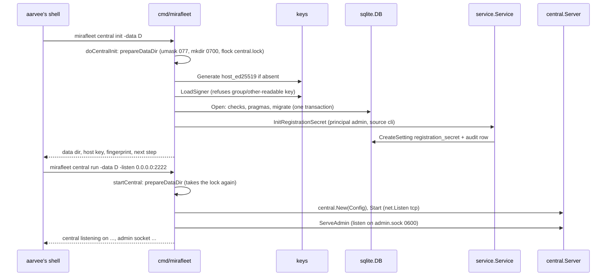

*Look at the lock and the umask: both come before anything is created on disk.*

1. **`centralInit`** parses `-data` (default `/var/lib/mirafleet/central`) and `-listen` (only used
   in the hint it prints), then calls **`doCentralInit`**. It is *offline*: it works whether or not
   a central is running, but it takes the same lock, so it cannot run while `central run` holds it.
2. **`prepareDataDir`** does three things in a fixed order. `syscall.Umask(0o077)` first: the
   *umask* removes permission bits from every file the process creates, so every file created
   afterwards (the database, `-wal`, `-shm`) is born `0600` and never briefly readable by others.
   Then `keys.EnsureDir` creates the directory with mode `0700`, or tightens it if it exists.
   Finally `lockDataDir` takes an exclusive, non-blocking `flock` (an operating-system lock on a
   file, released automatically if the process dies) on `<data>/central.lock`. A second central on
   the same directory would fight over the database and the admin socket, so it fails with
   "another central is already using ...".
3. **Host key.** If `<data>/host_ed25519` does not exist, `keys.Generate` creates an Ed25519 pair:
   the private key with mode `0600` (using `O_EXCL`, so it can never overwrite an existing key) and
   the public key. An existing key is **never** replaced: replacing it would break the pin every
   runner and operator holds. `init` is idempotent for the same reason.
4. **Open the database.** `loadCentral` loads the signer (`keys.LoadSigner` refuses a private key
   whose mode has any group/other bit), then calls `sqlite.Open`. `Open` refuses `:memory:` and
   symlinked database files (and symlinked `-wal`/`-shm` files). It opens the file with
   `O_NOFOLLOW`, which makes the operating system refuse to follow a symlink: otherwise an
   attacker who can write in the directory could plant a link named `mirafleet.db` pointing at some
   other file and trick central into opening or overwriting that file instead. `Open` then sets
   safety settings (pragmas) on every connection and runs the embedded migrations in one
   transaction. A database newer than this binary makes `Open` fail rather than guess. The pragma
   list and the transaction details are in [chapter 6](06-data-model.md).
5. **Build the services.** `loadCentral` then builds the `registry.Registry` (with `StaleAfter` =
   3 x 15 s = 45 s), the `OperatorConns` tracker and the `service.Service` with
   `policy.TablePolicy{}`.
6. **`Service.InitRegistrationSecret`** is called as the `auth.LocalAdmin(uid)` principal with source
   `cli`. It generates 32 random bytes and calls `Store.CreateSetting`, which inserts the
   `registration_secret` setting *and* its audit row in one transaction. If the setting already
   exists the store returns a conflict, and `doCentralInit` reports "already initialised;
   registration secret kept". The secret is never printed, logged or audited. Only `central operator
   rotate-secret` can overwrite it (via `PutSetting`).
7. **`central run`** (`centralRun` then `startCentral`) repeats steps 2 and 4 (lock, host key,
   database), then builds `central.New(central.Config{...})`. `New` rejects missing required
   fields, fills the defaults (the limits are in [section 7.9](07-protocols.md#79-limits)) and
   prepares the SSH server config: `PublicKeyCallback`, `PublicKeyAuthAlgorithms` limited to
   Ed25519, `MaxAuthTries` of 3.
8. **`Server.Start`** calls `net.Listen("tcp", listen)` and starts the accept loop. **`ServeAdmin`**
   then binds `admin.sock`: `listenUnix` does it under umask `077`, a stale socket from a crashed
   central is removed only after a failed dial proves nobody listens (and only while holding the
   lock), and the file is `chmod 0600`. The order matters: SSH first, admin socket second, because
   removing a stale socket is only safe under the lock.
9. `centralRun` logs the address and then blocks on `<-ctx.Done()` until SIGINT or SIGTERM (flow
   11).

**What would go wrong without the lock?** Two centrals on one directory would each keep their own
in-memory registry, so a `revoke` sent to one would never kick a runner connected to the other.

---

## 2. Creating a fleet and a join token

**In one sentence:** aarvee asks the running central, over its local admin socket, to create the
`prod` fleet (guarded) and a join token, and central records both with an audit row.

First the fleet:

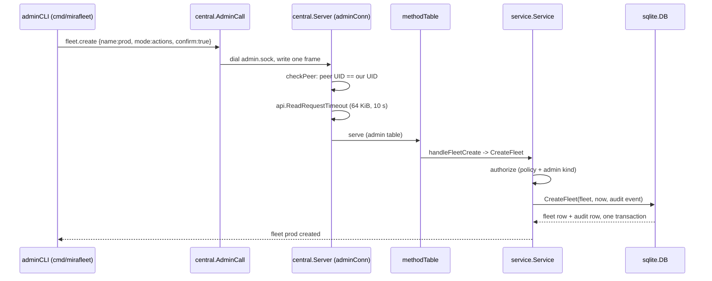

*Look at `sqlite.CreateFleet`: the fleet row and its audit row commit together.*

Then the token, which takes the same path through the socket, the peer check and the method table:

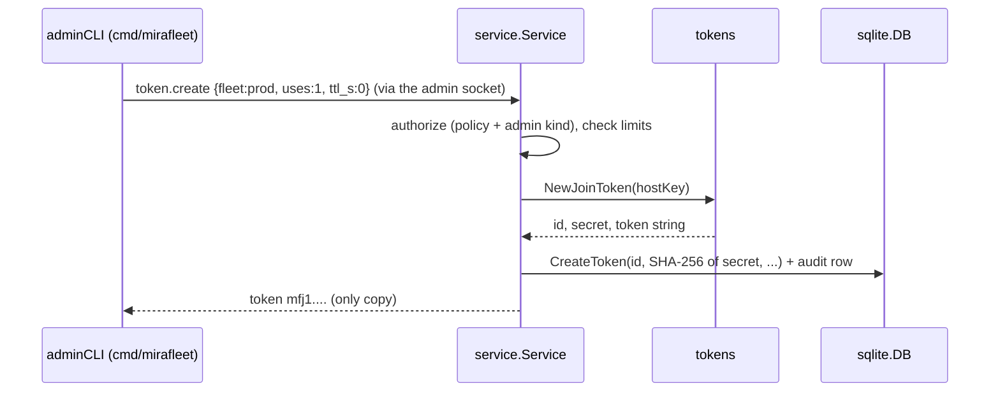

*Look at the last message: the full token exists in memory only until it is printed. The database
gets just a hash.*

1. **`adminCLI.fleetCreate`** parses the flags (`-mode`, `-confirm`) and calls `central.AdminCall`
   with the socket path `<data>/admin.sock`.
2. **`AdminCall`** builds an `api.Request` (version 1, random 16-hex id, method, params), refuses
   anything over `api.MaxRequestBytes` (64 KiB), dials the Unix socket (5 s timeout), writes one
   frame (4-byte length + JSON) and reads one frame back.
3. **`ServeAdmin`'s accept loop** calls `checkPeer` *before reading a single byte*. On Linux it asks
   the kernel for the peer's credentials (`SO_PEERCRED`) and requires the peer UID to equal
   `os.Getuid()`. A process running as another user is closed and logged.
4. **`adminConn`** reads the request with `api.ReadRequestTimeout`: the frame length is checked
   against 64 KiB *before* any allocation, and the whole request must arrive within 10 s
   (`api.RequestTimeout`). It builds a `callCtx` with principal `auth.LocalAdmin(uid)` and source
   `cli`, then calls `adminTable().serve`.
5. **`methodTable.serve`** applies the `allowed` predicate (admin table: `IsAdminMethod` plus
   `fleets.list`, `runners.list`, `action.run`), finds the handler, applies `api.ListTimeout` (10 s,
   but not for `action.run`) and calls it. `handleFleetCreate` decodes params strictly
   (`DisallowUnknownFields`).
6. **`Service.CreateFleet`**: `authorize` with `adminOnly` true. That means two gates: the policy
   (`TablePolicy` allows the admin kind everything) and a direct `p.Kind == auth.KindAdmin` check.
   An empty mode becomes `actions`; the name must match `^[a-z0-9][a-z0-9._-]{0,62}$`.
7. **`Store.CreateFleet`** inserts the fleet and the audit row (`fleet.create`, source `cli`, actor
   `uid:N`) in **one transaction**. Either both exist or neither does.
8. **`Service.CreateToken`** (for `mirafleet central token create -fleet prod`): limits are
   `DefaultTokenUses` 1 (max `MaxTokenUses` 1000), `DefaultTokenTTL` 24 h (max `MaxTokenTTL` 30
   days). There is no "unlimited". Labels are limited to 32 entries.
9. **`tokens.NewJoinToken`** draws 40 random bytes: 8 become the public id (16 hex chars), 32 become
   the secret. The token is `mfj1.<id>.<secret in base64url>.<host-key hash>`; the last part is the
   SHA-256 of central's host key, which is what lets the runner pin central later.
10. **`Store.CreateToken`** stores `SHA-256(secret)`, not the secret, plus fleet, labels, `auto_approve`,
    `max_uses`, `expires_at` and `created_by`, together with the audit row (`token.create`; the
    subject is the token *id*, params are uses/ttl/approve). The token string is **not** in the audit
    row.
11. The CLI prints the token **alone on stdout** and the human text ("token ... for fleet prod,
    expires ...; shown once") on stderr. So `TOKEN=$(mirafleet central token create -fleet prod)`
    captures only the token.

**Why hash the secret?** (`SHA-256` is a one-way function: easy to compute, practically impossible
to reverse.) If the database file leaks, the attacker gets hashes of 256-bit random
values. They cannot turn a hash back into a token that a runner would accept. This is the same idea as
password hashing, minus the slow hash: the secret is random and long, so a fast SHA-256 is enough.

---

## 3. A runner joins

**In one sentence:** a runner turns a one-time token into an enrolled but not yet trusted runner,
refusing to talk to any central whose host key does not match the hash inside the token.

Here aarvee joins `build-1` to the `dev` fleet.


*Look at where the host-key pin is checked: during the SSH handshake, before the token is sent.*

1. aarvee runs `token create` on central. It prints `mfj1.ID.SECRET.HASH` once (HASH pins central).
2. aarvee hands the token to the build-1 host by any channel, never through central.
3. `runner join` dials `:2222` as user `enroll`. A host key not matching HASH is refused (no TOFU).
4. It sends one `join@mirafleet` frame: token, runner name, labels.
5. `Store.Enroll`, one transaction: look up by ID, constant-time compare, check stale, insert.
6. Status is `pending` (`active` only if the token auto-approves). The enroll connection closes.
7. aarvee runs `runner approve dev/build-1`: status becomes `active`.
8. The runner reconnects as user `runner` with its own key and sends heartbeats.

### In detail

First the runner side and the handshake:

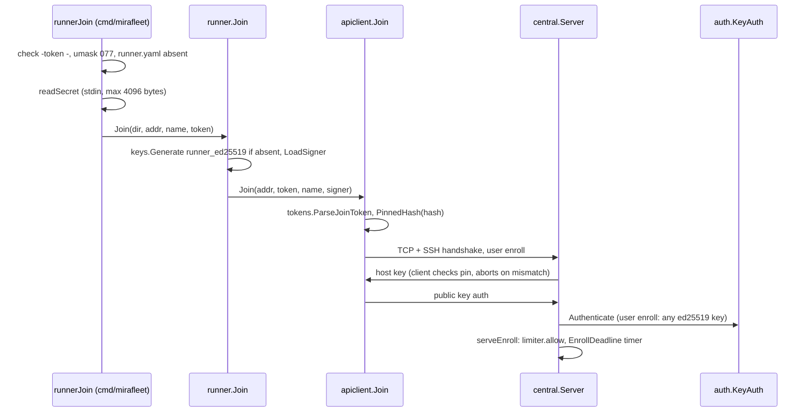

*Look at the message where the host key arrives: the pin is checked there, before the token is
sent.*

Then the enroll request itself:

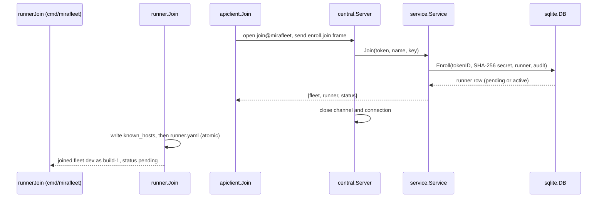

*Look at the last two messages on the runner: `runner.yaml` is written last, so a half-finished
join leaves the directory re-joinable.*

1. **`runnerJoin`** requires `-token -` (the literal dash: the token is read from standard input,
   never from the command line, where `ps` and shell history could see it). It sets umask `077`.
   It checks `runner.yaml` **before reading stdin or touching the network**: an already-joined
   directory returns `ErrAlreadyJoined`. Then `readSecret` reads at most 4096 bytes and trims them.
2. **`runner.Join`** validates the address (`net.SplitHostPort`) and the name
   (`keys.RunnerNameRE`), creates the data dir `0700`, generates `runner_ed25519` if it is
   absent and loads it with `keys.LoadSigner`.
3. **`apiclient.Join`** calls `tokens.ParseJoinToken` just to extract the host-key hash from the
   token, then `enroll`, which builds the **host-key callback** `PinnedHash(hash)`: during the SSH
   handshake the client hashes the key central presents and compares it, in constant time, with the
   hash in the token. If they differ, the handshake aborts with `ErrHostKeyMismatch`, and the
   token **never leaves the runner**. There is no "trust on first use" fallback. This is the whole
   point of putting the hash in the token.
4. **`apiclient.Dial`** connects with SSH user `enroll`, Ed25519 only, and a handshake timeout of
   `HandshakeTimeout` (30 s on the client).
5. **On central**, `Server.handle` first takes a slot from `hsLimiter.acquire` (global cap
   `MaxHandshakes`, per-IP cap `MaxHandshakesPerIP`), runs `ssh.NewServerConn` with a deadline of
   `HandshakeTimeout`, and the public-key callback calls `KeyAuth.Authenticate`. For user `enroll`,
   *any* Ed25519 key is accepted and becomes principal `Kind: enroll` with no id. The wrapper in
   `central.New` also stores the presented key in `Permissions.Extensions["mirafleet-pubkey"]` so
   the enrol code can register exactly that key.
6. **`serveEnroll`** asks `limiter.allow(p.Remote)`: first the per-IP token bucket
   (`EnrollRatePerMin`), then the global bucket (`EnrollGlobalRatePerMin`). It arms a timer so the
   connection dies `EnrollDeadline` after it was *accepted* (not after authentication), and
   `enrollKey` cross-checks that the stored key's fingerprint equals the principal's.
7. Only **one** channel is allowed. The first channel must be `join@mirafleet` or
   `register@mirafleet`; a second channel is rejected; a wrong first type closes the connection.
   `serveEnrollChannel` reads the request with `api.ReadRequestTimeout`, and `enrollCall` checks
   that it is an enroll method **and** matches the channel type (`enroll.join` on `join@mirafleet`).
8. **`Service.Join`** (principal kind must be `enroll`, again checked directly): key must be
   Ed25519, the name must be valid, `tokens.ParseJoinToken` must succeed, and the token's host-key
   hash must equal central's own (`hostHashEqual`, constant time). It hashes the secret with
   SHA-256 and calls the store.
9. **`Store.Enroll`, part 1: is the token good?** The checks run in a **fixed order so timing
   can't reveal which check failed**: a prober who measures response times learns nothing about
   which part of a guessed token was wrong. All of `Enroll` is one transaction.
   1. Look up the token by its public id.
   2. Compare `SHA-256(secret)` with the stored hash in constant time, *against a dummy hash when
      the id is unknown*, so "unknown id" and "wrong secret" take the same time.
   3. Consume one use with a conditional `UPDATE ... WHERE revoked_at IS NULL AND expires_at > now
      AND uses < max_uses`; if no row changes, the token is stale (expired, revoked or used up).
10. **`Store.Enroll`, part 2: may this key become a runner?**
    4. Refuse the key if it already belongs to an operator (checked only now, after the token
       proved valid, so a caller without a token learns nothing about operator keys).
    5. Read the fleet name, then insert the runner with the **token's** labels and status
       `pending` (or `active` if the token was made with `-approve`), and write the audit row
       `enroll.join` (source `enroll`).

    Because it is all one transaction, a failure at the last step (say, the name is taken) rolls
    back the token use too: nothing is consumed on any error.
11. **Identical errors.** Unknown id, wrong secret, expired, revoked, used up, malformed token, and
    a token that pins a different host key all return the same `errJoinRefused`
    (`unauthenticated`, "join refused"). The real reason is logged on central only. Only a name or
    key conflict returns `conflict`. So someone probing with guessed tokens cannot learn which ids
    exist. Failed joins are logged, not audited, so a flood of bad tokens cannot fill the audit
    table.
12. Central writes the framed answer `{fleet, runner, status}`, closes the channel and the connection
    (one request, one response).
13. Back on the runner, `runner.Join` writes `known_hosts` (a line `central.example.com:2222 ssh-ed25519
    AAAA...` holding the **verified** key) with `writeAtomic` (temp file, fsync, rename), and only
    then `runner.yaml`. `runnerJoin` prints the status; if it is not `active`, it says an admin must
    approve the runner.

**Why `pending` by default?** A join token is a bearer secret: anyone holding it can enrol. If it
leaks, the worst outcome is a pending runner nobody approved, which can heartbeat but never receive
work. See flow 5.

---

## 4. A runner connects, heartbeats and is registered

**In one sentence:** `mirafleet runner run` dials central, proves its key, sends a first heartbeat
(an "I am alive" message), and only then is registered as a live session that can receive work.

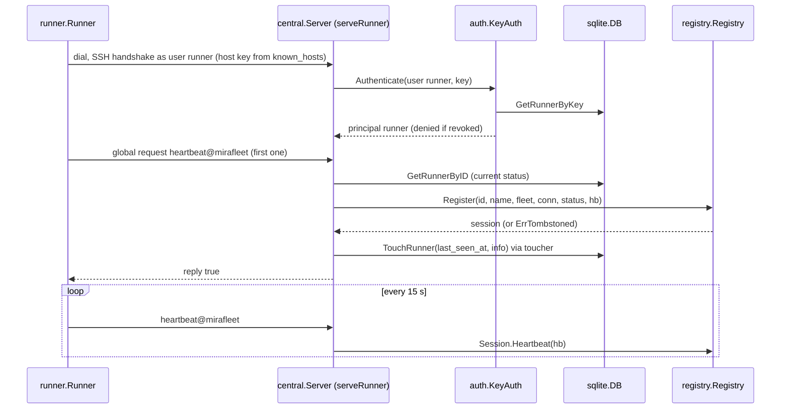

*Look at the `GetRunnerByID` message: the status is read again from the database at the moment of
registration, not reused from login.*

1. **`runnerRun`** loads `runner.yaml` (`runner.LoadConfig`: unknown fields are an error), the key
   (`keys.LoadSigner`), the allowlist (`actions.Load`) and opens `<data>/audit.jsonl`
   (`audit.Open`, mode `0600`). Then `runner.New(...).Run(ctx)`.
2. **`Runner.session`** dials with a 10 s dial timeout and a 30 s deadline for the handshake, using
   SSH user `runner`, its key, and `keys.PinnedHostKeys(known_hosts)` as the host-key callback. The
   known-hosts file is read on every attempt, and a key that is not listed is refused.
3. **Central authenticates.** `KeyAuth.Authenticate` for user `runner` looks the key up
   (`GetRunnerByKey`). Unknown key: denied. A runner whose status is `revoked`: denied. Pending and
   disabled runners are allowed to connect (they are visible, but cannot run actions). The peer
   sees only a generic denial; real errors are logged on central.
4. **`Server.handle`** decodes the principal (`auth.Decode`, which fails closed on missing or
   garbled values) and, for runners and operators, calls `hs.markAuthed(remote)`: from now on that
   source IP is exempt from the *per-IP* handshake cap while this connection lives. `dispatch`
   sends it to **`serveRunner`**.
5. `serveRunner` starts `rejectChannels` (runners may not open channels), arms a **guard timer** of
   `StaleAfter` (45 s): a connection that never sends a valid heartbeat is closed. Then it loops
   over global requests; anything other than `heartbeat@mirafleet` gets reply `false`.
6. The runner installs its `exec@mirafleet` handler *before* its first heartbeat, then sends the first
   heartbeat immediately (`Runner.heartbeat`: it waits up to 2 x `HeartbeatEvery` for the reply and
   closes the connection on timeout). That is why central registers a runner only on its **first
   heartbeat**: by then the runner is ready to accept an exec channel.
7. **`Server.register`** reloads the runner by id (`GetRunnerByID`), maps its status
   (`registryStatus`: active, pending, disabled; revoked has none and is refused) and calls
   **`Registry.Register`**. Under one registry lock it:
   - refuses an id that has a **tombstone** (`ErrTombstoned`);
   - lets a status recorded by `SetStatus` override the one passed in (this closes the race where
     an admin approves the runner between the database read and the registration);
   - inserts the session, replacing and closing an older session for the same id ("the new
     connection wins");
   - starts the `watch` goroutine (a lightweight background thread of Go code) that closes a connection silent for longer than `StaleAfter`.
   If registration fails, the runner gets reply `false` and the connection is closed.
8. **Recording `last_seen_at`.** `claimEdge` allows at most one connect write per `TouchInterval/10`
   (30 s) per runner, so a runner that flaps cannot hammer the database. The write itself goes
   through a `toucher`: a one-slot mailbox drained by a background goroutine, so a slow database
   never delays the heartbeat reply. `touchRunner` stores `hostname`, `os`, `arch` and `version`
   (each clipped to 256 bytes) and the time.
9. **Later heartbeats** call `Session.Heartbeat` (in-memory, free) and only write to the store when
   `TouchInterval` (5 min) has passed since the last write. A runner that is online for a week costs
   a few thousand tiny writes, not millions.
10. **Disconnect.** When the connection ends, the deferred function calls `Registry.Unregister`,
    marks the disconnect edge and queues a final `last_seen_at` write in the background.
11. The heartbeat's `labels` are informational only. The authoritative labels are the ones from the
    join token, stored by `Store.Enroll`.

---

## 5. Approve, disable, enable

**In one sentence:** aarvee changes a runner's stored status, and central updates the live session to
match, in that order.

All four lifecycle operations (`approve`, `disable`, `enable`, `revoke`) go through one function,
`Service.lifecycle`. This section covers the three that keep the connection; revoke is flow 8.

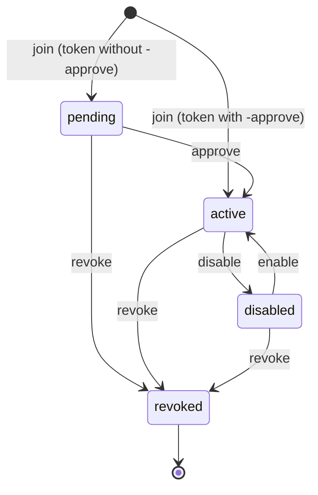

*Look at `revoked`: nothing leaves it. A revoked runner key can never be enrolled again.*

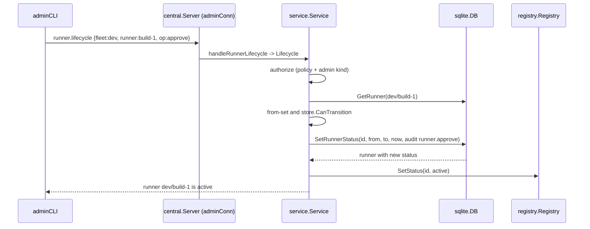

*Look at the order: the database commit comes first, the live session is updated second.*

1. `mirafleet central runner approve dev/build-1` becomes the admin-socket call `runner.lifecycle`
   with `op` set to one of `api.OpApprove`, `OpDisable`, `OpEnable`, `OpRevoke`. It is an admin
   method, so it exists only on the admin socket, never on `api@mirafleet`. A prompt-injected AI
   agent cannot approve its own runner, because it has no way to ask.
2. **`Service.lifecycle`** calls `authorize(..., adminOnly=true)`, picks the allowed "from" statuses
   and the target (`approve`: pending to active; `disable`: active to disabled; `enable`: disabled
   to active), parses `dev/build-1` with `store.ParseRef` and loads the runner with `GetRunner` (which
   hides revoked runners).
3. It checks the current status is in the allowed "from" set **and** `store.CanTransition` agrees,
   otherwise it answers `conflict` ("runner is active: cannot approve"). That is how a double
   approve is harmless.
4. It builds the audit event `runner.approve` with params `from` and `to`, and calls
   **`Store.SetRunnerStatus`**: one transaction that re-reads the status, updates it (with
   `updated_at`) and inserts the audit row. If something else changed the status in between, the
   transaction returns a conflict instead of overwriting.
5. Only after the commit does it call **`Registry.SetStatus(id, status)`**. This records the desired
   status *even if the runner is offline* (the `statuses` map; the next `Register` applies it) and
   updates the live session if there is one. If `SetStatus` fails, the service **kicks** the session:
   the runner reconnects and registers with the status in the database. Fail closed.
6. **What each state means for work.**
   - `pending`: the runner may heartbeat, so it shows as online, but `RunAction` refuses with
     `conflict` ("runner is pending") and `Registry.Exec` would return `ErrPending` anyway.
   - `disabled`: the connection stays up. New `action.run` calls are refused (`conflict`), but an
     action that already started is **not** interrupted: `RunAction` checked the status once at the
     start and the registry's status gate is only consulted when an exec begins.
   - `active`: runs actions.

---

## 6. An operator registers with the rotating code

**In one sentence:** `durga` and `kalyan` get access with a short-lived code that aarvee reads off
central, without aarvee ever handling their keys.


*Look at the clock: the code changes every 60 seconds, and any number of operators can use the
current one.*

1. Central keeps a 32-byte secret in SQLite, never logged. Only aarvee (the admin) can read codes.
2. Each 60 s window `s` (unix seconds / 60) has its own code: base32(HMAC-SHA256(secret, s)) + HASH.
3. durga runs `mcp login` with the code aarvee gave durga. Central recomputes this window's code and compares.
4. kalyan uses the same code in the same window and is accepted too. Codes are not single-use.
5. The window ends. The next window `s+1` has a brand-new code.
6. kalyan tries the old code in the next window: refused, with the same error as any wrong code.
7. HASH is central's host-key hash, so the code also pins central: no TOFU at first login.

### In detail

First aarvee shows the code:

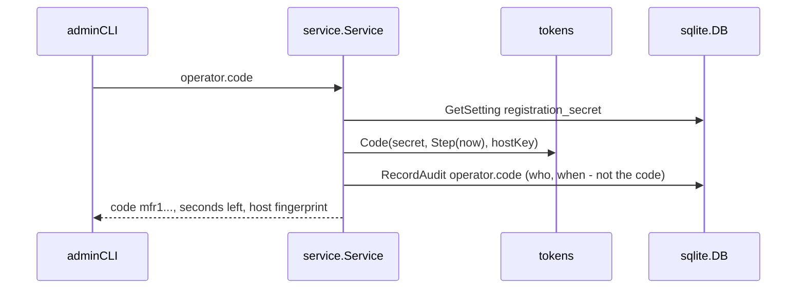

*Look at the audit message: it records who showed a code and when, never the code itself.*

Then aarvee tells durga the code out of band (chat or voice, within the window), and durga registers:

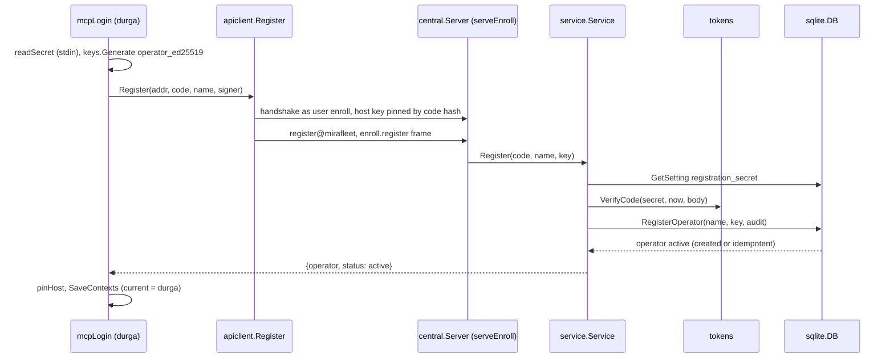

*Look at the `VerifyCode` message: the code is derived and checked by central itself, so there is
no clock to keep in sync with the laptop.*

1. **Showing the code.** `mirafleet central operator code` calls `operator.code`.
   `Service.OperatorCode` loads the 32-byte secret (`GetSetting`), computes the current step
   (`tokens.Step(now)` = unix seconds / 60) and returns `tokens.Code(secret, step, hostKey)`. The
   code is `mfr1.` + the first 26 characters of base32(HMAC-SHA256(secret, `"mirafleet-register-v1"` +
   step)) + `.` + the host-key hash, plus `SecondsLeft` and central's host-key fingerprint. Showing a
   code is **audited** (`operator.code`: who, when) and the audit write happens first: if it fails,
   the code is **not** returned. The code itself is never put in the audit row.
2. aarvee passes the code to `durga` in any way they like (chat, voice). A leaked code is
   useless once its 60-second window ends.
3. **`mcpLogin`** on Durga's laptop (`mirafleet mcp login central.example.com:2222 -name durga -code -`)
   requires `-code -`, validates the address and name, refuses on Windows (the key loader fails
   closed there), reads the code from stdin, creates the config dir (`opconf.EnsureDir`, `0700`) and
   generates `operator_ed25519` if it is missing (key comment = the name).
4. **`apiclient.Register`** parses the code only to get its host-key hash, pins central with
   `PinnedHash`, connects as user `enroll`, opens `register@mirafleet` and sends
   `enroll.register{code, name}`. The path through `Server.handle` and `serveEnroll` is the same as
   in flow 3 steps 5 to 7, with `ChanRegister` instead of `ChanJoin`.
5. **`Service.Register`**: principal must be `enroll`; the key must be Ed25519; the name must be a
   valid operator name; `tokens.ParseCode` must succeed; the code's host-key hash must equal central's.
6. **`tokens.VerifyCode(secret, now, body)`** recomputes the code for the *current* step and compares it
   in constant time. Previous and future steps are refused, so the window is exactly the 60 seconds
   of the step. Verification has no side effects, so **the same code verifies any number of times** in
   its step. That is deliberate: `durga` and `kalyan` can both register with the code shown at 10:03:12, as
   long as they both arrive before 10:04:00. Anything wrong (malformed, wrong host, wrong step, secret
   missing) returns the identical `errRegisterRefused` ("registration refused"), with the real
   reason in central's log.
7. **`Store.RegisterOperator`** inserts an `active` operator and its audit row (`enroll.register`,
   source `enroll`, subject = name, params = key fingerprint) in one transaction. It is idempotent per
   key: an already active key returns the existing operator with `created=false`. In that case the
   service still writes an audit row (message "already registered") through `RecordAudit`, so a
   repeat registration is never invisible. Conflicts: the key belongs to a revoked operator, or to a
   runner (a key may be a runner's or an operator's, never both, checked inside the transaction), or
   the name is held by a different active operator, or the key is registered under another name.
8. **No approval step.** Only aarvee, on the central host, can read the code, so having it *is* the
   approval. There is no pending operator state.
9. Back on the laptop, `pinHost` writes central's verified key into `known_hosts` (replacing any
   older line for the same address) and `SaveContexts` records `durga -> central.example.com:2222`
   as the current context. Later calls (`mcp api ...`) use `apiclient.KnownHosts`, so the pin from
   registration protects every future connection.
10. `central operator rotate-secret` replaces the secret (`PutSetting`, audited), which invalidates
    every code anyone was holding. Already-registered operators are unaffected.

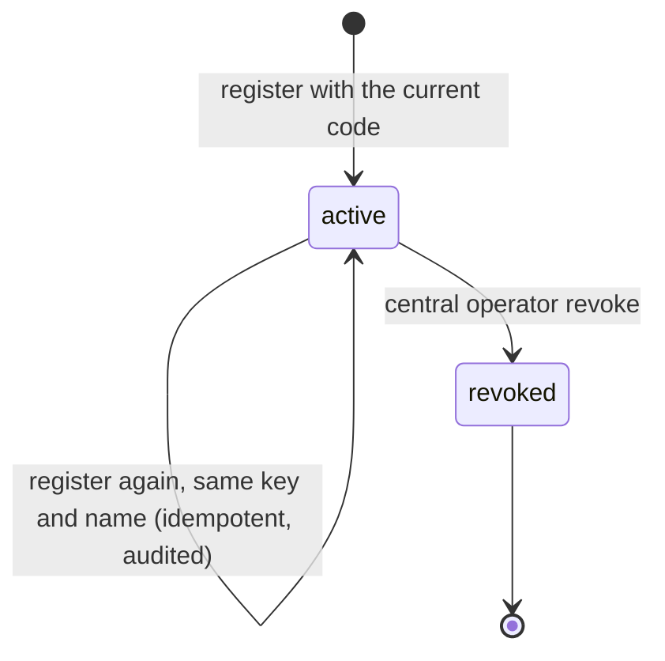

*Look at `revoked`: the key is dead. Registering the same key again is a conflict, but the name can be
given to a new key.*

---

## 7. `action.run`, end to end

**In one sentence:** durga asks `db-1` in `prod` to tail its logs, and the request crosses every
layer and every check, leaving two audit rows on central and two lines on the runner. This is the
most important flow in the system.


*Look at the two audit rows: one written before anything runs (`start`), one after (`ok` or a
failure outcome), both with the same `request_id`.*

1. durga's agent calls `action.run` (`prod/db-1`, `tail-logs`, `lines=200`) through `mirafleet mcp`.
2. `mcp` sends one frame (4-byte length + JSON) on an `api@` channel. The operator method table routes it.
3. `service.RunAction` checks policy, fleet mode, confirm "prod" (guarded fleet's name), runner active.
4. The audit row "start" is written first. If that fails, nothing runs (fail closed).
5. `registry.Exec` opens an `exec@` channel on the runner's own connection and sends the request.
6. The runner's actions guard checks `tail-logs` and regex-checks `lines=200` into an argv.
7. The process runs (no shell, own process group, timeout). The result JSON goes back.
8. The audit row "outcome" is written with the same `request_id`.
9. The response frame returns the same way: exit code, stdout, stderr.

### In detail

The command, from durga's laptop. The diagram above shows it as an agent's call; the MCP tool
`run_action` makes this same `action.run` request (flows 19 and 23 show the MCP side), and
`mcp api` is the hand-typed way to send it. The `"confirm":"prod"` is required because `prod` is a
guarded fleet:

```
mirafleet mcp api action.run '{"fleet":"prod","runner":"db-1","action":"tail-logs","params":{"lines":"200"},"confirm":"prod"}'
```

Part 1: connect and authenticate.

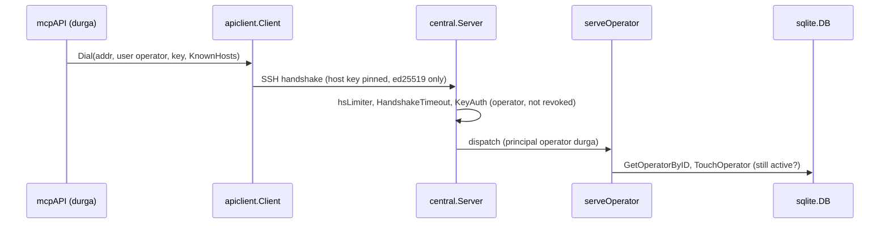

*Look at the last message: even after login, central re-checks that durga is still active.*

Part 2: from the channel to the "start" audit row.

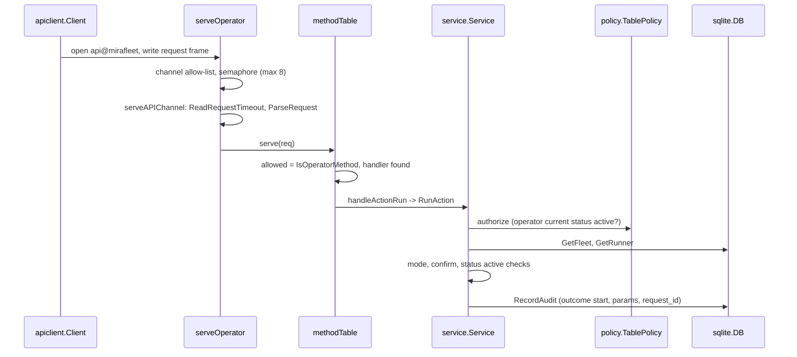

*Look at the last message: nothing has been sent to the runner yet, but the "start" row already exists.*

Part 3: service to the runner's guard and back.

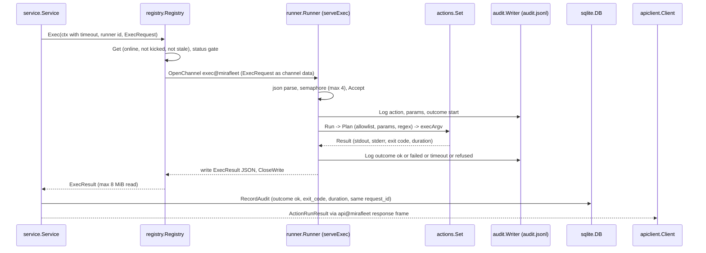

*Look at the runner's two lines in `audit.jsonl`: they are written before the result is sent
back to central.*

### The checks, in order

Every gate, with the code that implements it. There are 23, in four groups. The order is
deliberate: cheap checks that need no secrets and cause no side effects come first, and the first
write (the start audit row) comes only after every precondition holds.

#### A. Before and during the handshake (gates 1 to 6)

Nothing here has run any business logic yet. The goal is to refuse floods, impostors and revoked
keys as cheaply as possible.

| # | Gate | Where | If it fails |
|---|---|---|---|
| 1 | Request fits in 64 KiB | `apiclient.callOn` (client) and `api.ReadFrame` (server, before allocating) | `too_large` |
| 2 | Pre-handshake caps | `hsLimiter.acquire`: global `MaxHandshakes`, per-IP `MaxHandshakesPerIP` (unless this IP has an authenticated connection) | Connection closed before any cryptography |
| 3 | Handshake finishes in `HandshakeTimeout` | `Server.handle` sets a connection deadline | Dropped; slot released |
| 4 | Host key is the pinned one | client: `apiclient.KnownHosts` | Client refuses to continue |
| 5 | Ed25519 key, user `operator`, key in `operators`, not revoked | `KeyAuth.Authenticate`; `MaxAuthTries` 3 | Opaque `auth.ErrDenied` |
| 6 | Operator is *still* active | `serveOperator`: `GetOperatorByID` after `OperatorConns.add` (closes the add-after-kick window) | Connection closed |
#### B. Protocol shape (gates 7 to 11)

The connection is trusted as "durga", but the bytes durga sends are not: are they the right kind of
channel, the right size, valid JSON, and a method that kind of caller may use?

| # | Gate | Where | If it fails |
|---|---|---|---|
| 7 | Channel type allowed | `channelAllowed(KindOperator, "api@mirafleet")` | Channel rejected |
| 8 | At most 8 channels open | `sem` of size `api.MaxChannelsPerConn` | `ResourceShortage` |
| 9 | Request arrives in 10 s, strict JSON | `api.ReadRequestTimeout`, `ParseRequest` (`v` must be 1, no unknown fields, id 1-128 bytes) | `timeout`, `bad_request`, `unsupported_version` |
| 10 | Method is an operator method | `methodTable.allowed = api.IsOperatorMethod` | `forbidden` (admin/enroll methods are also logged) |
| 11 | Params decode strictly | `api.DecodeParams` in `handleActionRun` | `bad_request` |
#### C. Business rules (gates 12 to 18)

Now the service decides whether this particular action on this particular runner is allowed.

| # | Gate | Where | If it fails |
|---|---|---|---|
| 12 | Policy: operator is active *now* | `Service.authorize` loads the operator's current status; `TablePolicy` allows only `hello`, `fleets.list`, `runners.list`, `action.run` | `forbidden`, and the denial is audited |
| 13 | Kind is operator or admin | direct check in `RunAction` (independent of policy) | `forbidden`, audited |
| 14 | `prod/db-1` is a valid ref; action name 1-64 bytes; at most 32 params, key <= 64 B, value <= 4 KiB; `timeout_s` not negative | `store.ParseRef`, `api.ValidateActionParams`, `ValidateTimeoutS` | `bad_request` |
| 15 | Timeout clamp | `api.ActionTimeout`: default 2 min, max 10 min | (clamped, not refused) |
| 16 | Fleet exists and is in `actions` mode | `Store.GetFleet` | `not_found` / `conflict` |
| 17 | Guarded fleet: `confirm` equals the fleet name | `RunAction` (`f.Confirm && confirm != f.Name`) | `bad_request`, audited as `denied` |
| 18 | Runner exists (not revoked) and its stored status is `active` | `Store.GetRunner` | `not_found` / `conflict` ("runner is pending") |
#### D. Audit, then the runner (gates 19 to 23)

The audit row comes first. After that, the last gates are enforced on the runner itself, by code
central cannot change.

| # | Gate | Where | If it fails |
|---|---|---|---|
| 19 | **Start audit row written** | `Store.RecordAudit` | If it fails, **nothing is executed**: `unavailable` ("audit unavailable") |
| 20 | Runner is online (registered, not kicked, heartbeat within 45 s) and its live status is `active` | `Registry.Get`, `Registry.Exec` | Outcome `error`, "runner unavailable" |
| 21 | Runner has a free slot | `Runner.sem` of size `MaxExec` (default 4) | Channel rejected, runner logs a `refused` audit line |
| 22 | Action is defined in `actions.yaml`, no unknown params, no missing params, each value fully matches its regex, no leading `-` unless allowed | `actions.Set.Plan` | `ExecResult.Refused`; central answers `bad_request` "refused by runner: ..." |
| 23 | No shell, minimal environment, own process group, deadline, 1 MiB output cap | `actions.execArgv` | Process killed; `timed_out` |

**Why is a missing `confirm` `bad_request` but a policy failure `forbidden`?** `forbidden` means
"you, as a caller, may not do this at all", which is a statement about who is asking. A missing or
wrong `confirm` is different: durga is allowed to run actions, but this particular request is
incomplete for a guarded fleet, which is a statement about the request. The caller can fix it by
resending with `"confirm":"prod"`. (Both are audited, so a script that keeps forgetting is visible.)

### Walkthrough

1. **Dial.** `mcpAPI` reads `contexts.yaml` to find the current central, loads the operator key and
   calls `apiclient.Dial` with `apiclient.KnownHosts(known_hosts)`. If the host key is not pinned,
   the call fails. It never asks "do you trust this host?" (the `Prompt` helper refuses anything
   but an interactive terminal).
2. **Authenticate on central** (gates 2 to 5). `Server.handle` builds the `Principal` for user
   `operator`, `markAuthed`, and `dispatch` calls `serveOperator`.
3. **`serveOperator`** creates a context tied to the connection (`sconn.Wait` cancels it when the
   connection ends), registers the connection in `OperatorConns` (so a revoke can find it), then
   re-reads the operator (gate 6) and calls `TouchOperator` to record `last_seen_at`.
4. **Open a channel.** `Client.Call` opens an `api@mirafleet` channel, writes one frame (4-byte
   big-endian length, then JSON `{"v":1,"id":"...","method":"action.run","params":{...}}`; the
   smallest example, `hello`, is worked out byte by byte in [section 7.3](07-protocols.md#73-framing-the-4-byte-length-prefix))
   and waits for one frame back. Cancelling the call closes the channel; one request per channel.
5. **`serveAPIChannel`** reads and parses the request (gate 9), then arms `context.AfterFunc`
   so that closing the channel cancels the request context. A half-close (the client says "no more
   input") does **not** cancel; only a full close or a dead connection does.
6. **`methodTable.serve`** runs gates 10 and 11, then calls `handleActionRun`, which calls
   **`Service.RunAction`** with the principal, the source `api`, and the request context. `action.run`
   has no table-level timeout (`timeout` returns 0); the service applies its own.
7. **`RunAction` checks** (gates 12 to 18), in the order of the table. The order is not an accident:
   cheap, local, no-side-effect checks first; the first write (the start audit row) only after every
   precondition holds.
8. **Start audit row** (gate 19). `RunAction` generates a 128-bit random `request_id`
   (`newRequestID`) and writes an `AuditEvent` with source `api`, actor kind `operator`, actor
   `durga`, remote address, fleet `prod`, runner `db-1`, subject `tail-logs`, action `action.run`,
   params `{lines: 200}` and outcome `start`. If the database cannot take this row, the action does
   not run: *no row, no exec*. Without that rule a database outage would turn into unaudited
   commands.
9. **Exec.** `RunAction` derives `ectx` from the request context with the clamped timeout and calls
   `Registry.Exec`. `Exec` finds the live session (gate 20), checks its status, and calls `execOn`:
   `conn.OpenChannel("exec@mirafleet", payload)` where the payload is the JSON `ExecRequest{action,
   params}`. This is the channel opened *back* over the connection the runner itself made. Opening a
   channel cannot be cancelled by Go's SSH library, so `execOn` runs it in a goroutine and closes any
   channel that opens late.
10. **Runner: `serveExec`.** Parses the request (a bad payload is rejected), takes a slot from the
    semaphore (gate 21; if full, it writes a `refused` line to `audit.jsonl` and rejects the
    channel), accepts the channel, and ties the action's lifetime to the channel: a goroutine
    copies and discards any input, and when the channel closes (central gave up) it cancels the
    action. It then logs `{action, params, outcome: start}` to its JSONL file.
11. **The guard.** `execute` calls `actions.Set.Run` -> `Plan` (gate 22): unknown action, an extra
    parameter, a missing parameter without a default, a value that does not fully match its regex
    (`\A(?:pattern)\z`, so authors cannot accidentally leave it unanchored), or a value starting
    with `-` (option injection, unless `allow_leading_dash`) all produce a `RefusedError`. Otherwise
    `Plan` substitutes the values into the argv template in a **single pass**: a value that itself
    contains `{{x}}` is never re-expanded. So `tail-logs` with `lines=200` becomes
    `["/usr/bin/journalctl", "-u", "gitlab-runner", "-n", "200"]`.
12. **`execArgv`** (gate 23) starts the process with `exec.CommandContext` -- an argv list, never a
    shell -- with only `PATH` (a fixed path) and `LANG=C` in its environment, working directory `/`,
    its own process group (`Setpgid`), stdout and stderr limited to 1 MiB **combined**, and a
    deadline (`actions.yaml` `timeout`, default 60 s). When the deadline passes or the context is
    cancelled, `killTree` sends SIGKILL to the whole group, so a grandchild process cannot survive.
13. **Runner audit and reply.** The runner writes the outcome line to `audit.jsonl` **before** it
    writes the result to the channel: `refused`, `timeout`, `failed` (non-zero exit) or `ok`. Then
    `encodeResult` marshals an `ExecResult` (if it would exceed 8 MiB it is replaced by a small
    error result), writes it and calls `CloseWrite`.
14. **Central reads the result.** `execOn` reads at most `transport.MaxResultBytes` (8 MiB) plus one
    byte; more than that is an error ("result too large"). A result that does not parse is an
    error. A guard refusal comes back as a *result* with `Refused` set, not as an error.
15. **Outcome row.** `RunAction` maps what happened to an outcome:

    | Situation | Outcome | Wire answer |
    |---|---|---|
    | Runner kicked (revoke) | `cancelled`, message "runner revoked" | `unavailable` |
    | Our deadline passed, caller still waiting | `timeout`, "timed out" | `timeout` |
    | Caller's request was cancelled | `cancelled`, "request cancelled" | `unavailable` |
    | Runner offline or channel failed | `error`, "runner unavailable" | `unavailable` |
    | Guard refused | `error`, "refused by runner: ..." (clipped to 200 bytes, control characters removed) | `bad_request` |
    | Action ran (any exit code) | `ok`, exit code stored; `timeout` if the runner killed it for time | the result |

    Note that on central, `ok` means "the action ran and reported an exit code", even when that
    code is non-zero; the code is in `exit_code`. On the runner's own file a non-zero exit is
    `failed`. The outcome row copies the start row (same `request_id`), drops the params (already
    in the start row) and uses the runner's reported duration if there is one.
16. **The outcome write survives cancellation.** It uses `context.WithoutCancel(ctx)` with its own
    10 s limit (`outcomeWriteTimeout`), so a cancelled request still gets its row. If that write
    fails it is only logged: the command already ran, and refusing to say so would not undo it.
17. **Answer.** The handler returns `ActionRunResult{exit_code, stdout, stderr, truncated, duration_ms,
    request_id}`. `methodTable.serve` wraps it with `api.NewResult`; `writeResponseTimeout` writes
    the frame and closes the connection if the write stalls for `api.WriteTimeout` (10 s), so a
    client that stops reading cannot pin a handler forever. `Client.callOn` checks the version and
    that the response id matches the request id, and `mcpAPI` prints indented JSON.

**The two audit rows (central).**

| id | action | actor | fleet/runner | subject | params | outcome | exit_code | request_id |
|---|---|---|---|---|---|---|---|---|
| 1041 | `action.run` | `operator` `durga` (source `api`) | `prod` / `db-1` | `tail-logs` | `{"lines":"200"}` | `start` | none | `9f1c…e07a` |
| 1042 | `action.run` | `operator` `durga` (source `api`) | `prod` / `db-1` | `tail-logs` | none | `ok` | `0` | `9f1c…e07a` (same) |

Rows 1041 and 1042 are not adjacent in a busy system, but `request_id` ties them together. The table is
append-only: triggers abort any update or delete. The runner's `audit.jsonl` holds the matching pair
(`start`, then `ok`) with the same action and params but no `request_id`.

**Why two rows?** The start row proves *intent* even if central crashes mid-command. The outcome row
proves *result*. A start row with no outcome row tells an investigator "something began and we never
learned how it ended".

---

## 8. Revoking a runner while an action is in flight

**In one sentence:** aarvee revokes `dev/build-1` at the moment durga's `restart-service` is running
on it, and the revoke must be immediate and must not leave a running process behind.


*Look at the order: tombstone first, kick second, commit third. At no moment can the runner
slip back in.*

1. aarvee runs `central runner revoke dev/build-1`. The CLI sends `runner.lifecycle` (op `revoke`) over the admin socket.
2. Tombstone: build-1's id goes into the registry, so no new session can slip in during the commit.
3. Kick: the session context is cancelled and the runner's SSH connection is closed.
4. In-flight action cancelled: the runner kills the process group; the outcome row says `cancelled`.
5. Commit: `status = revoked` and the audit row are written in one transaction.
6. The runner redials. Auth finds a revoked key and refuses it: it never gets a session.

### In detail

Part 1: central marks the runner dead and wakes the in-flight call.

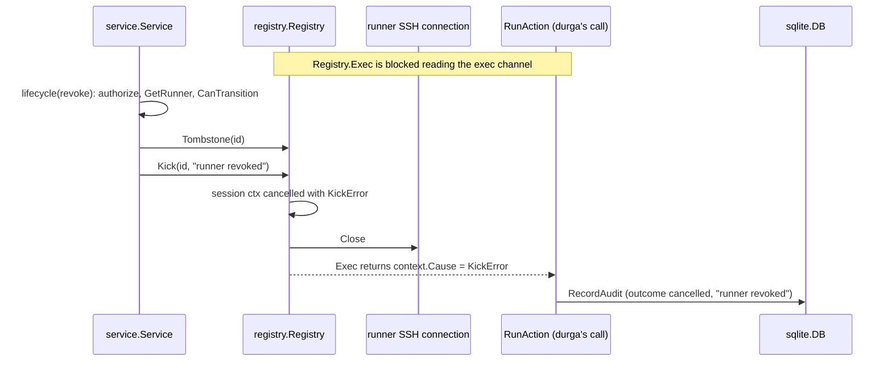

*Look at the order of the two registry calls: tombstone, then kick.*

Part 2: the runner kills the process, central commits, and the runner is refused when it returns.

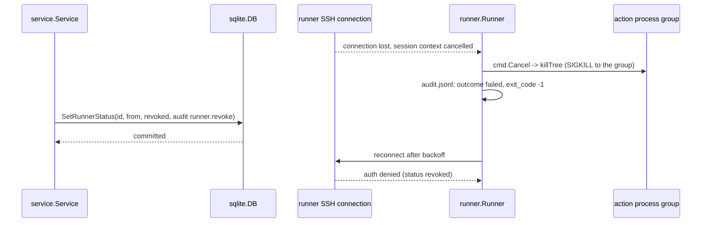

*Look at the three places the process dies from: the cancelled context on central, the closed
channel on the runner, and the closed connection. Any one is enough.*

1. **`Service.lifecycle`** with `op = revoke`: `authorize` (admin only), the "from" set is
   pending, active or disabled (a second revoke answers `not_found`, because `GetRunner` hides revoked runners), and the audit event gets the
   message `RevokeReason` = "runner revoked".
2. **`Registry.Tombstone(id)`** adds the runner's database id to an in-memory set. Ids come from
   `AUTOINCREMENT` and are never reused, so a tombstone can never accidentally block a different,
   later runner. After this line, `Registry.Register` refuses the id (`ErrTombstoned`), under the same
   lock that guards the sessions. This closes the window between "the runner authenticated" and "the
   database says revoked".
3. **`Registry.Kick(id, reason)`** finds the session and calls `s.cancel(&KickError{Reason})`, then
   `conn.Close()`. The registry lock is **not** held while closing a connection (the package
   comment forbids holding it across network I/O).
4. **The in-flight call wakes up.** `Registry.Exec` linked the session context to its exec
   context with `context.AfterFunc(sess.ctx, cancel)`, so the cancel closes the exec channel and
   `execOn` returns. `Exec` notices that the *caller's* context is fine but the *session's* is not, and
   returns `context.Cause(sess.ctx)`, the `*KickError`.
5. **`RunAction`** recognises the `KickError` (`errors.As`) and writes the outcome row
   `cancelled` with the message "runner revoked", then returns `unavailable: runner revoked` to Durga.
   Durga's tool sees why it stopped.
6. **On the runner**, the connection drop ends `session`; its deferred `cancel()` cancels the context
   that every `serveExec` derives from. Also, the closed channel ends the goroutine copying
   `io.Copy(io.Discard, ch)`, which cancels the action. `exec.Cmd.Cancel` calls `killTree`:
   SIGKILL to the process **group**, so the shell-free child and any grandchild die. The runner's
   `audit.jsonl` records `failed` with exit code -1 (the channel is gone, so the result never
   reaches central; central already has its own `cancelled` row).
7. **Commit.** `Store.SetRunnerStatus` moves the runner to `revoked` and writes `runner.revoke`
   in one transaction (`synchronous=FULL`, so it survives power loss). The tombstone **stays**
   after a successful commit: `registry.Status` has no "revoked" value, so the tombstone is what keeps
   the id out of the live registry. Tombstones live only in memory, which is safe because after a
   restart a revoked runner is refused at authentication by its database status.
8. **If the commit fails**, `lifecycle` removes the tombstone only if a fresh read proves the
   runner is *not* revoked (`ClearTombstone`). If the read also fails, it keeps the tombstone:
   fail closed.
9. **The runner reconnects** (flow 10). Two outcomes. If the commit has finished, `KeyAuth` sees
   `StatusRevoked` and denies the key at the handshake. If the commit is still in flight, the key
   still authenticates, but the first heartbeat reaches `Registry.Register`, which refuses the
   tombstoned id; `serveRunner` replies `false` and closes the connection. Either way the runner
   never regains a session. It will keep retrying with growing backoff, because it cannot tell
   "revoked" from "temporarily refused".
10. The revoked runner disappears from `runners.list` (`ListRunners` excludes revoked) and its name
    can be reused by a new runner with a *new key*. The old key can never re-enrol: `runners.pubkey`
    stays `UNIQUE` even for revoked rows.

---

## 9. Revoking an operator

**In one sentence:** aarvee revokes `kalyan` while kalyan has a long action running, and central commits the
change first and only then cuts kalyan's connections.

aarvee runs `mirafleet central operator revoke kalyan`.

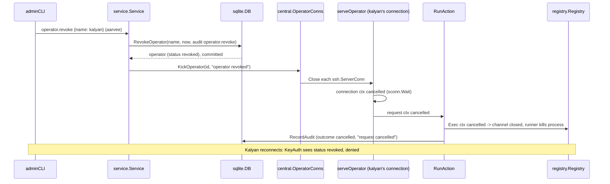

*Look at the order: commit first, kick second. A revoked key can never authenticate again.*

1. **`Service.RevokeOperator`** (admin only) validates the name and calls `Store.RevokeOperator`,
   which flips the operator to `revoked` and writes the audit row in one transaction.
2. Only after the commit it calls `OperatorConns.KickOperator(id, reason)`. `OperatorConns` keeps
   a set of live `ssh.ServerConn` per operator id; `KickOperator` copies the set under the lock and
   closes the connections **after releasing the lock**.
3. Closing the connection ends `sconn.Wait()` in `serveOperator`, which cancels the connection
   context. Every `serveAPIChannel` and every `RunAction` derived from it is cancelled. For Kalyan's
   running action, `Registry.Exec`'s context ends, the exec channel closes, and the runner kills the
   process group, exactly as in flow 8, step 6.
4. The outcome row says `cancelled`, message "request cancelled" (not "runner revoked": the runner
   is fine, the *caller* is gone).
5. **The race.** Kalyan could authenticate *just before* the commit, and `OperatorConns.add` could run
   *after* the kick. Then the kick would find nothing to close. That is why `serveOperator` re-reads
   the operator by id right after `add` and closes the connection if it is no longer active. Revoke
   commits before it kicks, so either the kick or this check catches every connection.
6. After revoke, `KeyAuth.Authenticate` (user `operator`) returns `ErrDenied` for Kalyan's key. If kalyan
   registers again with the same key, the store answers `conflict` (the key belongs to a revoked
   operator). A new key under the name `kalyan` is allowed, because the unique index on names covers only
   non-revoked operators.

> **Why the orders differ**
>
> - **Runner revoke: tombstone, then kick, then commit** (`Service.lifecycle`). Runners reconnect
>   *on their own* with backoff, and a reconnecting runner can authenticate and register at any
>   moment, including while the commit is still in flight. So central first marks the id dead in
>   memory (the tombstone), then kicks the live session, and only then commits. If the commit
>   fails, the tombstone is cleared again, but only if a fresh read proves the runner is not revoked.
> - **Operator revoke: commit, then kick** (`Service.RevokeOperator`). An operator's status is
>   re-read from the database on **every request**, so the moment the commit lands, no new request
>   can succeed. The kick only has to cut the connections that were already open. There is no
>   in-memory mark to maintain because the database is the mark.
>
> The shared idea: close every gap through which the revoked party could act. For a runner the gap
> is its own auto-reconnect; for an operator, the gap is only connections that already exist.

---

## 10. Reconnect, backoff and stale heartbeats

**In one sentence:** when the network fails, the runner retries with growing, jittered delays and
central drops sessions that go quiet, so both ends recover without anyone's help.

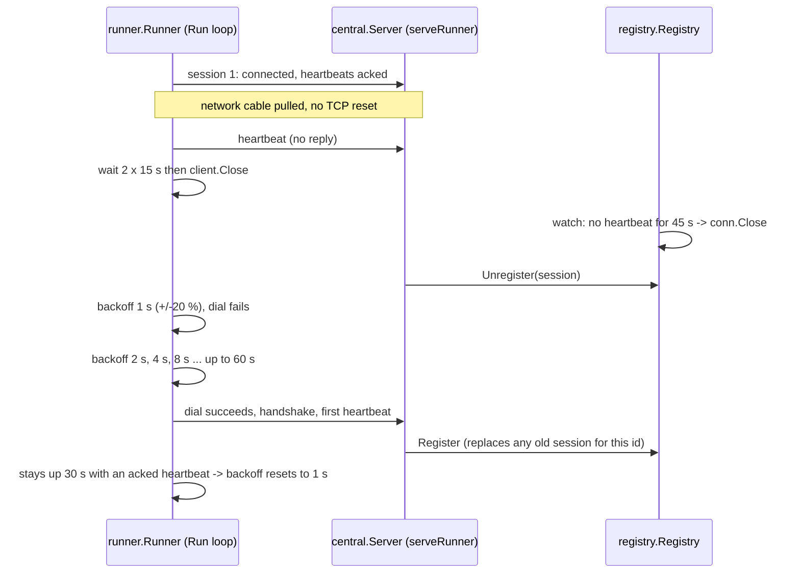

*Look at the last step: only a connection that proved itself healthy resets the backoff.*

**Runner side** (`Runner.Run` and `Runner.session`):

1. `Run` loops until its context ends. After each `session` it waits `jitter(backoff)`, a random
   value within +/-20 % of the current backoff, so a hundred runners that lost the same central do
   not all reconnect in the same second. Then `backoff = min(backoff*2, BackoffMax)`.
   Defaults: `BackoffMin` 1 s, `BackoffMax` 60 s.
2. The backoff resets to the minimum **only** if `session` reports `healthy`: a heartbeat was
   acknowledged **and** the connection lasted at least `HealthyAfter` (30 s). A central that accepts
   TCP and SSH but fails right after (say, it refuses to register the runner) would otherwise let
   the runner hammer it once per second.
3. `Runner.heartbeat` waits at most `2 x HeartbeatEvery` (30 s) for each reply. On a timeout it
   closes the client, so the loop reconnects instead of waiting on a half-dead TCP connection
   forever. `client.Wait()` returning also ends the session ("connection lost").

**Central side** (`registry.Registry` and `serveRunner`):

4. A session records the time of its last heartbeat (`lastSeen`). `Registry.stale` is true when that
   is older than `StaleAfter` = 3 x 15 s = **45 s**. The `watch` goroutine checks every
   `StaleAfter/6` (7.5 s) and **closes the connection** of a stale session. Closing it makes
   `serveRunner`'s loop end, which runs the deferred `Unregister`.
5. A stale session is *offline immediately*, even before the watcher notices: `Registry.Get` returns
   nil for it, and `Snapshot` reports `Online: false`. So `action.run` to a silent runner fails fast
   with "runner unavailable" and `runners.list` shows it offline.
6. **A new connection wins.** If the runner reconnects before the old session is noticed as dead,
   `Registry.Register` replaces the old session, cancels its context and closes its connection. An
   action that was in flight on the old connection ends as `error` ("runner unavailable").
7. A connection that never sends a valid heartbeat is closed by `serveRunner`'s guard timer after
   `StaleAfter`.

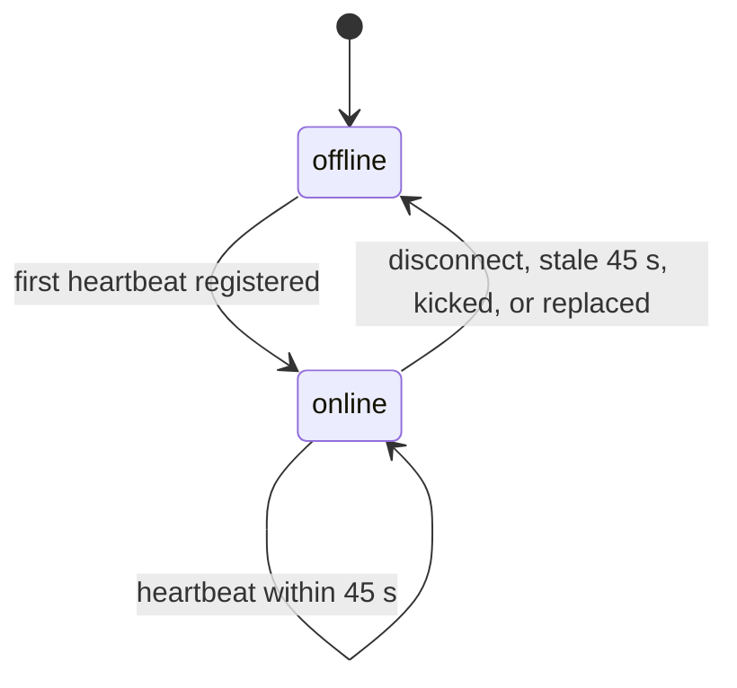

*Look at how online/offline is separate from `pending`/`active`: a runner has both a lifecycle status
(stored) and a presence (live, in the registry).*

---

## 11. Central shuts down

**In one sentence:** on SIGINT (Ctrl-C) or SIGTERM, central stops accepting, waits for in-flight
requests to finish their audit rows, then closes the database and releases the lock.

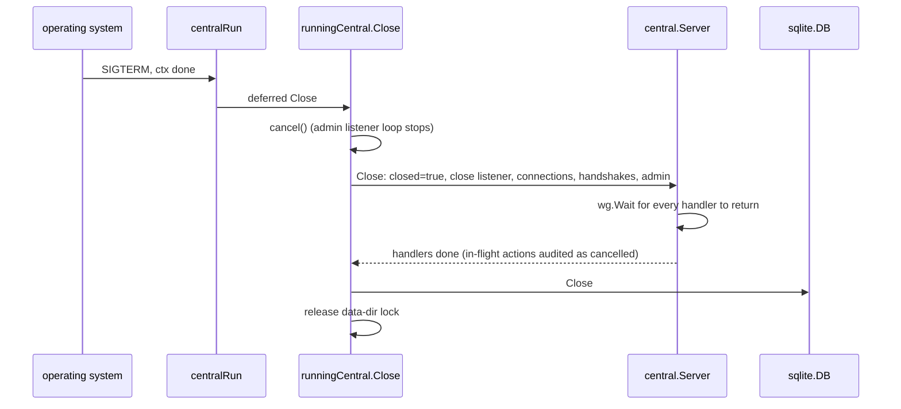

*Look at the order: connections drain before the database closes, and the lock is released last.*

1. `signal.NotifyContext` turns SIGINT or SIGTERM into `ctx.Done()`, so `centralRun` returns from
   `<-ctx.Done()` and its `defer rc.Close()` runs.
2. **`runningCentral.Close`** runs four steps in this order: `cancel()` (stops the admin accept loop),
   `srv.Close()`, `d.db.Close()` and the lock `release()`.
3. **`Server.Close`** sets `closed` under its mutex (so no new connection can be tracked: `track`
   and `Close` use the same lock, which removes a WaitGroup race), closes the SSH listener, every
   established `ssh.ServerConn`, every connection still in handshake and the admin listener and its
   connections, and then **waits** (`wg.Wait`) for all handler goroutines.
4. **In-flight work.** Closing an operator's connection cancels its requests, so an `action.run` in
   progress ends with an outcome row `cancelled` ("request cancelled"). That row is written with
   `context.WithoutCancel` *inside the handler*, and the handler is part of the wait group, so it is
   written before the database closes. Closing a runner's connection also kills the runner's process
   group for that action.
5. `ServeAdmin`'s accept loop removes `admin.sock` on its way out, but only if the file is still the
   one it created (it compares device and inode), so a new central that started quickly does not
   lose its socket.
6. Then the database closes and the lock is released. A new `central run` can start immediately.
7. **What the runners do:** their connection drops, and they follow flow 10: retry with backoff while
   central is down, then reconnect and re-register. Operators see errors from `mcp api` until central
   is back. Tombstones are lost on restart, but that is safe: revoked runners are refused by their
   stored status at the handshake.
8. One caveat: the background `toucher` goroutines that write `last_seen_at` are not in the wait
   group (they exist so a slow database never delays a heartbeat). A write still queued at shutdown can
   fail against a closed database; it only produces a log line.

---

## Workspace flows (M3)

Flows 12 to 18 are the workspace-mode story (new in M3). Here the cast is `dev` (a workspace fleet, not
guarded), its runner `build-1` (started with `-workspace /etc/mirafleet/workspace.yaml`,
`concurrent: 2`, containerd executor), and durga and kalyan. aarvee created the fleet earlier:

```
mirafleet central fleet create dev -mode workspace \
  -image docker.io/library/golang@sha256:... -images 'docker.io/library/golang@sha256:*' \
  -network none -cpus 2 -memory 4GiB -idle-ttl 24h -max-ttl 168h
```

Four terms recur. A **slot** is one place for a workspace on a runner (`concurrent: 2` means two
slots). A **session** is a name the client chooses (for example Claude Code's session id); there
is at most one live workspace per (operator, fleet, session), which is what makes it **sticky**.
A **workspace id** (`ws_id`) is 32 hex characters that central makes (128 random bits); the
runner uses it as the container name `mf-<ws_id>`. A **request id** ties the `start` audit row
of a call to its outcome row.

---

## 12. Open a workspace

**In one sentence:** durga's agent asks for a workspace on `dev`; central checks the rules,
picks the runner with the most free slots, writes a `start` audit row and a reserved
(`opening`) database row, asks the runner to create the container, and then marks the row
`open`.


*Look at the order: the slot is reserved in the database before the runner is asked to build
anything, so two simultaneous opens can never over-fill a runner.*

1. durga's agent calls `workspace.open` (fleet `dev`, session `s1`) through `mirafleet mcp`.
2. The `api@` frame reaches `service.OpenWorkspace`: active operator, workspace-mode fleet, image on
   the allowlist, `confirm` on a guarded fleet, valid session id.
3. Sticky reuse: a live workspace for (durga, `dev`, `s1`) is returned with `reused:true`. If its
   runner is offline the answer is `unavailable`; a fresh workspace is never created elsewhere.
4. Placement: active, online runners whose executor, trusted labels and image patterns fit, with
   free slots (heartbeat slots minus live rows). The most free slots wins, random tie-break.
5. `ReserveWorkspace` recounts the slots in one transaction and inserts the `opening` row with the
   start audit row.
6. A full runner (`ErrFull`) or a busy one moves to the next candidate (3 tries at most). Otherwise
   central sends op `create` on `workspace@mirafleet`.
7. The runner re-validates the spec against its own `workspace.yaml`, builds the container spec
   from its fixed template, pulls the image if needed and creates the container.
8. The row becomes `open`, the outcome audit row is written and the reply says `reused:false`.

The same flow as a sequence diagram, with the function names:

```mermaid
sequenceDiagram
  participant Op as durga (mcp api)
  participant Svc as service.OpenWorkspace
  participant DB as sqlite.DB
  participant Reg as registry.Registry
  participant Run as build-1 (serveWorkspace)
  participant Ex as ctrd.Executor

  Op->>Svc: workspace.open {fleet dev, session s1}
  Svc->>DB: GetFleet, GetFleetWorkspace, live rows of durga
  Svc->>Svc: sticky? per-operator cap? image allowed? candidates()
  Svc->>DB: ReserveWorkspace (row opening + start audit row), one transaction
  Svc->>Reg: Workspace(create, spec)
  Reg->>Run: workspace@mirafleet channel, op create
  Run->>Run: re-validate against workspace.yaml, take a slot
  Run->>Ex: Create(spec)
  Ex-->>Run: container running
  Run-->>Reg: WorkspaceResult ok
  Svc->>DB: SetWorkspaceState opening to open (+ outcome audit row)
  Svc-->>Op: workspace {id, state open}, reused false
```

1. **Gates.** `handleWorkspaceOpen` (`internal/central/workspace_handlers.go`) decodes the
   parameters strictly. `Service.OpenWorkspace` (`internal/service/workspace.go`) checks that the
   caller is an active operator, the fleet name and the session (`^[A-Za-z0-9._:-]{1,128}$`) are
   valid, the labels are well-formed, and the fleet is in workspace mode (otherwise `conflict`).
   On a guarded fleet `confirm` must equal the fleet name, or a `denied` row is written and the
   call fails.
2. **Image.** An empty `image` means the fleet's `default_image`. The image must match the
   fleet's allowlist (`WorkspaceConfig.ImageAllowed`: exact references, `repo:*` or
   `repo@sha256:*`), or the call fails with `bad_request`. Without this check an agent could ask for
   any image from the internet, including one built to attack the host.
3. **Sticky session.** Central lists durga's live workspaces. If one with the same fleet and
   session is `open`, `reuse` returns it with `reused: true` and writes a `reused` audit row.
   If its runner is offline the answer is `unavailable`: central **never** silently makes a fresh
   workspace, because durga's files are on that runner. If the existing row is still `opening`,
   the answer is `conflict` ("workspace is still opening").
4. **Per-operator cap.** An operator may hold at most 8 live workspaces (the service setting
   `DefaultMaxWorkspacesPerOperator`), or the call fails with `conflict`. Without it, one runaway
   agent could take every slot of a fleet.
5. **Placement.** `Service.candidates` (`workspace_sched.go`) keeps runners that are:
   `active` and online; running the executor the fleet asks for; advertising a secure runtime if
   the fleet is guarded; carrying every requested label among their *trusted* labels (the ones
   that came from the join token, not the self-reported heartbeat); and advertising an image
   pattern that matches. Free slots are the heartbeat's `slots` minus live rows in the database
   (`opening`, `open` and `closing` all count). The runner with the most free slots wins, with a
   random tie-break from `crypto/rand`.
6. **Reserve.** `Store.ReserveWorkspace` counts and inserts in **one** transaction, together with
   the `start` audit row (fail closed: no row, no workspace). If the runner filled up in the
   meantime it returns `ErrFull` and central tries the next candidate (at most 3).
7. **Create.** `registry.Workspace` opens a `workspace@mirafleet` channel on the runner's own
   connection and sends a `create` request (image, pull policy, limits, network mode, egress
   rules, labels). The 5-minute open timeout covers a slow image pull.
8. **The runner re-checks everything.** `wsState.prepare` validates the request against
   `workspace.yaml`: the image against the runner's own allowlist, limits against its caps, the
   network mode and egress rules against what it permits. If the runner is out of slots it rejects
   the channel *before* accepting it (`ResourceShortage`), which central reports as busy and
   answers by trying the next candidate. Only then does `ctrd.Executor.Create` build the OCI spec
   and start the container (flow 13 shows what that spec contains; chapter 5 explains why).
9. **Outcome.** On success the row moves `opening` to `open` together with the outcome audit
   row. On any failure it moves to `failed` with a reason, and a busy runner makes central try the
   next one. Image or pull failures are not retried elsewhere.

---

## 13. `workspace.exec`, end to end

**In one sentence:** durga's agent runs `go test ./...` inside their workspace; the command runs in the
container, the result comes back as one buffered answer, and two audit rows record exactly what
ran.


*Look at the two rows again: `start` is written before the runner is asked, the outcome after,
and both carry the same `request_id` and the workspace id.*

1. durga's agent calls `workspace.exec` (argv `go test ./...`) through `mirafleet mcp`.
2. One `api@` frame arrives; the method table routes it to `service.ExecWorkspace`.
3. Operator, ownership (`not_found` for others), state `open`, argv, cwd, env (denylist), confirm and
   timeout are checked; then the `start` audit row is written FIRST. No row, no exec.
4. `registry.Workspace` opens a `workspace@mirafleet` channel on the runner's own SSH connection; the
   op is JSON in the channel-open data, any stdin follows as raw bytes.
5. The runner re-validates argv, cwd, env (its `env_allow` plus the denylist) and the timeout. Central
   is not trusted.
6. The command runs inside the container as an unprivileged user, with no shell. Output is captured
   head and tail, trimmed to the budget; timeout or cancel sends SIGKILL.
7. The runner writes one result frame: exit code, stdout, stderr, `truncated`, `timed_out`.
8. Central writes the `outcome` audit row (same `request_id`) and replies to durga.

The same flow as a sequence diagram:

```mermaid
sequenceDiagram
  participant Op as durga (mcp api)
  participant Svc as service.ExecWorkspace
  participant DB as sqlite.DB
  participant Run as build-1 (runWS)
  participant Ex as ctrd.Executor
  participant C as container

  Op->>Svc: workspace.exec {workspace, argv [go test ./...]}
  Svc->>DB: owner check (not_found otherwise), state open
  Svc->>DB: audit row start (argv, cwd, env NAMES), fail closed
  Svc->>Run: workspace@mirafleet, op exec
  Run->>Run: re-validate, take an exec slot (max 4 per workspace)
  Run->>Ex: Exec(argv, cwd, env, timeout)
  Ex->>C: task.Exec (no caps, uid 1000)
  C-->>Ex: exit code, stdout, stderr
  Ex-->>Run: result (head+tail capture)
  Run-->>Svc: WorkspaceResult exec
  Svc->>DB: audit row outcome (same request_id)
  Svc-->>Op: exit_code, stdout, stderr, truncated, timed_out
```

1. **Find the workspace and its owner.** `Service.wsTarget` loads the row by `ws_id`. It must
   exist, be owned by the caller, and be `open`. For anyone else (kalyan, for instance) the answer
   is the same `not_found` as for an id that does not exist, so kalyan cannot even learn that the
   workspace is there.
2. **Validate the input.** `argv` is an array, at most 256 elements and 32 KiB, no NUL bytes.
   There is **no shell string** on the wire, so the audit log shows exactly what ran. `cwd` is
   cleaned with `workspace.CleanPath` (a lexical check: `..` and absolute paths outside
   `/workspace` are refused). `env` names must pass `workspace.FilterEnv`, which applies a hard
   denylist (`*_API_KEY`, `*_TOKEN`, `*_SECRET*`, `ANTHROPIC_*`, `AWS_*`, `*PROXY*`, ...) that
   beats any allowlist. A refused name is reported by name, never by value.
3. **Guarded fleets** need `confirm` equal to the fleet name here too.
4. **Timeout.** The effective timeout comes from the fleet (`exec_default_s`, default 120 s;
   `exec_max_s`, default 30 minutes, hard ceiling 24 h) and is further capped by the runner's own
   `limits.exec_max`. A client value above the maximum is refused.
5. **Audit `start`, fail closed.** `startRow` writes the row *before* dispatch. If it cannot be
   written, the call fails with `unavailable` and nothing runs. The row holds the argv as JSON
   (clipped to 4 KiB), the cwd and the env **names only, never values**, plus the timeout.
6. **Touch.** `last_used_at` is updated at dispatch and again at completion, and a workspace with
   an op in flight is never reaped as idle (flow 16).
7. **Dispatch.** `registry.Workspace` sends the `exec` request on a new `workspace@mirafleet` channel.
   If the runner is `disabled` or `pending`, the registry refuses it (a `disabled` runner still allows
   `read`, `close` and `destroy`, so people can rescue files).
8. **The runner runs it.** `runner.runExec` re-validates, takes one of at most 4 exec slots of that
   workspace, writes its own local `start` line, and calls `Executor.Exec`. In containerd that is
   `task.Exec` with an OCI process: the given argv, cwd under `/workspace`, filtered environment, uid
   1000, `NoNewPrivileges`, **no capabilities**. If the fleet uses `egress`, the executor adds
   `HTTP_PROXY` and `HTTPS_PROXY` pointing at the in-container proxy. A deadline or a cancel
   sends SIGKILL to the exec.
9. **Buffered output.** The runner captures the head and the tail of stdout and stderr and trims
   them so the JSON-encoded result fits 1 MiB (`truncated: true` tells the caller). Output is made
   valid UTF-8. There is no streaming in M3: one request, one response.
10. **Audit `outcome`.** Central writes the second row with the same `request_id`, the exit code,
    duration and an outcome of `ok`, `error`, `cancelled` or `timeout`, and returns
    `{exit_code, stdout, stderr, truncated, timed_out, duration_ms, request_id}`.
11. **Cancel.** If durga's channel closes (or central shuts down, or their operator key is
    revoked), the context is cancelled, the channel to the runner closes, and the executor kills the
    exec. One caveat: a daemonised child that double-forks can outlive an exec timeout, until the
    workspace is destroyed. The pids and memory limits bound the damage.

---

## 14. Reading and writing files (body frames)

**In one sentence:** a file travels in its own length-prefixed *body frame* after the JSON
request, and central reads that frame only after the caller has been authorised.

Why not put the bytes in the JSON as base64? Because every method's request would then need a
bigger size limit (or files would travel in tiny 48 KiB chunks). Instead a request frame stays at
64 KiB at most, and the file payload follows in **one more frame of at most 1 MiB**
(`api.MaxFileChunk`). Bigger files go in several calls with an `offset`.

```mermaid
sequenceDiagram
  participant Op as durga (mcp api -in FILE)
  participant Srv as central api@ channel
  participant Svc as service.WriteWorkspaceFile
  participant Run as build-1
  participant FS as workspace dir (os.Root, container executor)

  Op->>Srv: request frame {workspace, path, length, sha256}
  Op->>Srv: body frame (length bytes)
  Note over Srv: body is NOT read yet
  Srv->>Svc: WriteWorkspaceFile(lazy body)
  Svc->>Svc: policy, owner, state, confirm, path, mode, length, sha256 syntax
  Svc->>Srv: now read the body (30 s timer)
  Svc->>Svc: SHA-256 of body must equal sha256 (constant time)
  Svc->>Svc: audit start row (path, bytes, sha256)
  Svc->>Run: workspace@ channel: request, then length raw bytes, CloseWrite
  Run->>FS: write (temp file and rename when truncating), confined by os.Root (container executor)
  Run-->>Svc: result {size}
  Svc-->>Op: {size}
```

**Write (`workspace.write_file`):**

1. The client sends the request frame (`workspace`, `path`, `offset?`, `truncate?`, `mode?`,
   `length`, `sha256`) and right away the body frame. SSH's 2 MiB channel window means that
   second write never blocks.
2. `handleWorkspaceWriteFile` hands the service a *lazy* reader. `Service.WriteWorkspaceFile`
   runs every cheap check first: policy, ownership (`not_found` for others), workspace `open`,
   `confirm`, path cleaning, `mode` at most `0777`, `length` between 0 and 1 MiB, `sha256` is 64
   lowercase hex characters.
3. **Only now** does the first `Read` pull the body from the wire, armed with a 30 s timer
   (`api.BodyTimeout`) that closes the channel. This is the point of the design: an unauthorised
   caller (or a revoked key, or someone else's workspace id) can never make central buffer up to
   1 MiB. The cost of an attack is a refused small frame.
4. Central computes the SHA-256 of the body and compares it with the announced one in constant
   time. A mismatch or a short body is audited as one `error` row and nothing is sent to the runner.
5. A `start` row (path, byte count, sha256, **never the content**) is written, then central sends
   the runner the request followed by exactly `length` raw bytes and `CloseWrite`. The runner
   refuses a mismatch.
6. The container executor writes through `os.Root` opened on the workspace directory, so a symlink
   planted by the agent cannot lead outside it. (The `host` executor has no container: it writes
   with plain OS calls below the session directory and the OS user's permissions are the
   boundary.) With `truncate` it writes a temp file and renames it. New
   files are chowned to the container's mapped uid. A **soft** disk quota is checked before the write
   (over quota refuses; [section 5.9](05-security.md#59-the-workspace-container-boundary) explains
   why it is only "soft").

**Read (`workspace.read_file`):**

1. The request has `workspace`, `path`, `offset?` and `limit?`. There is no request body, so
   nothing special is deferred.
2. After the same gates, central writes a `start` row (path, offset, limit) and asks the runner.
3. The container executor opens the file through `os.Root` (the host executor: plain OS calls from the
   session directory) with `O_NOFOLLOW` and `O_NONBLOCK`, then checks with
   `fstat` that it is a regular file (a FIFO or a device would hang the runner), and replies with
   a result frame followed by the raw bytes.
4. Central **buffers** the bytes (at most 1 MiB), checks that their count matches the runner's
   `length`, and only then sends durga the JSON result (`size`, `offset`, `length`, `mode`, `eof`)
   followed by one body frame. A runner that lies about the length therefore sends nothing at all.
5. The outcome row records the path and the byte count.

`mirafleet mcp api workspace.write_file '{...}' -in main.go` fills `length` and `sha256` for you and
sets the body; `-out report.txt` on `workspace.read_file` saves the body (atomically, mode `0600`).

---

## 15. Close a workspace

**In one sentence:** the owner closes the workspace; the row goes `open`, `closing`, `closed`
and the container and directory are deleted.

```mermaid
sequenceDiagram
  participant Op as durga
  participant Svc as service.CloseWorkspace
  participant DB as sqlite.DB
  participant Run as build-1
  participant Ex as ctrd.Executor

  Op->>Svc: workspace.close {workspace}
  Svc->>DB: SetWorkspaceState open to closing (+ start audit row)
  Svc->>Run: workspace@ channel, op destroy
  Run->>Ex: Destroy(id)
  Ex-->>Run: task killed, container and snapshot deleted, directory removed
  Run-->>Svc: ok (or not_found: already gone)
  Svc->>DB: SetWorkspaceState closing to closed (+ outcome audit row)
  Svc-->>Op: workspace {state closed}
```

1. Only the owner may close; anyone else gets `not_found`. Closing something already terminal does
   nothing and returns it. Closing one that is still `opening` is a `conflict`.
2. The row moves to `closing` first. A `closing` row **still holds its slot**, so the runner
   cannot be over-filled while the container is half deleted.
3. `Executor.Destroy` kills every process in the container (`KillAll`), waits, deletes the
   task and the container with its snapshot, closes the egress listener, then removes the directory
   with `os.RemoveAll` (which does not follow symlinks). It is idempotent: a second destroy of an
   absent container is not an error.
4. If the runner is offline or the destroy fails, the row **stays `closing`** and the response says
   so. The reaper (flow 16) or reconcile (flow 17) finishes the job later. The user never has
   to retry.

---

## 16. The TTL reaper

**In one sentence:** every 60 seconds a goroutine in central closes workspaces that nobody uses
any more, so forgotten workspaces cannot pile up and use disk forever.

1. `Service.RunReaper` is started with central (`internal/central/central.go`), runs in the server's
   wait group, and is stopped in `Close` **before** the store closes. It uses the injected clock,
   which is how the tests move time forward.
2. Each sweep (`ReapOnce`) lists `open` rows and moves one to `closing` when any of these holds:
   its operator is revoked; its runner is revoked; `expires_at` has passed (the fleet's `max_ttl`,
   default 7 days); or it has been idle for more than the fleet's `idle_ttl` (default 24 h).
3. **Idle is counted from the later of `last_used_at` and central's start.** If central was down for
   two days, no workspace looks idle at the first sweep after restart, although nobody could reach
   it. A workspace with an operation in flight is never reaped as idle.
4. For each online runner, in a bounded number of goroutines (so one hung runner cannot stall the
   rest), it destroys that runner's `closing` rows and moves them to `closed`.
5. Rows on an **offline** runner stay `closing` and keep their slot until reconcile (flow 17). Rows on
   a runner that is revoked or has vanished move to `lost`: that runner will never return to be told
   to delete them, and its host keeps the containers until `mirafleet runner workspace prune`.
6. Every state change writes a `system` audit row (`workspace.reap`, `workspace.destroy`,
   `workspace.lost`) with the reason. Nobody has to be logged in.
7. A runner-local backstop exists too: `max_age` in `workspace.yaml` lets the runner destroy anything
   older, in case central is gone for good. Otherwise a runner never deletes on its own.

---

## 17. Reconcile after a runner or central restart

**In one sentence:** the database and the runner can disagree after a crash, so each time a
runner connects central compares the two lists and fixes the difference.

```mermaid
flowchart TD
  A["runner (re)connects,<br/>first heartbeat"] --> B["central: read live rows<br/>for this runner"]
  B --> C["central: ask runner<br/>for List()"]
  C --> D{"container vs row"}
  D -->|"container, no row or row closed"| E["destroy it (orphan)"]
  D -->|"container, row closing"| F["destroy, row closed"]
  D -->|"container, row opening older than<br/>open timeout + 30 s"| G["destroy, row failed"]
  D -->|"no container, row open"| H["row lost, slot freed"]
  D -->|"no container, row closing"| I["row closed"]
```

1. **Trigger.** On a runner's first heartbeat `serveRunner` starts `Service.ReconcileRunner` in a
   background goroutine (never under the registry lock). A second trigger for the same runner while
   one runs is ignored.
2. **Rows first, list second.** Central reads the rows, then asks the runner for its list. A
   workspace that opens between the two is not in the rows, so it cannot be mistaken for a missing
   container.
3. **Decisions** are in the flowchart. Each one writes a `system` audit row (`workspace.orphan`,
   `workspace.destroy`, `workspace.recover`, `workspace.lost`).
4. **When the runner restarts:** its containers keep running (they belong to containerd), so
   `open` rows survive and `exec` works again. The runner re-attaches the egress proxy listener to
   each container's network namespace, but only if `egress` is still allowed in `workspace.yaml`.
   Its slot table is re-seeded from the executor's list.
5. **When central restarts:** `RecoverWorkspaces` runs at startup. A row still `opening` means central
   crashed in the middle of a create, so it becomes `failed`. Every other row simply persists in
   SQLite, and the container is still there. The first reconcile with each returning runner
   destroys any container that the failed row left behind.

---

## 18. Revoke cascades

**In one sentence:** revoking a runner or an operator also closes the workspaces they hold, in
their own transaction with their own audit row, with the reaper as a backstop.

1. **Runner revoke** (flow 8): after the commit that sets `revoked`, `Service.closeWorkspacesOf`
   moves that runner's `opening` and `open` workspaces to `closing` with the reason "runner
   revoked", in one transaction with a `system` audit row (`workspace.close_all`). Nothing can be
   destroyed on that host: the runner never reconnects. The next reaper sweep moves the rows to
   `lost`. The containers stay on the host until an admin there runs
   `mirafleet runner workspace prune`.
2. **Operator revoke** (flow 9): the connection kick cancels in-flight execs. Then the same cascade moves
   the operator's workspaces to `closing`, and the next sweep destroys them on their runners.
3. **If the cascade write fails**, it is only logged: the reaper checks for revoked owners and
   runners on every sweep, so nothing is missed, only delayed by up to 60 seconds.
4. **Disabled runner.** `disable` is gentler: no new `open`, `exec` or `write_file`, but `read_file`,
   `close` and destroy still work, so people can fetch their files first.
5. **Admin kill.** `mirafleet central workspace kill ID` (`workspace.kill`) moves any workspace to
   `closing` and destroys it. `workspace list` shows every workspace with its operator.

---

## MCP flows (M5)

Flows 19 to 23 are the orchestrator story (new in M5): what happens on durga's laptop between
their harness and central. Chapter 3 draws the [packages](03-architecture.md#operator-side);
chapter 2 explains [MCP](02-background.md#210-mcp-and-harnesses). The cast: durga runs Claude
Code with the mirafleet plugin in a project that has a `.mirafleet.yaml` saying `fleet: dev`,
and durga's `contexts.yaml` has one context, `mirastack`, pointing at `central.example.com:2222`. A
**session** is still the client-chosen name from flow 12; here the client is Claude Code, so the
session is `cc:` plus Claude Code's own session id.

---

## 19. One `exec` tool call, end to end

**In one sentence:** Claude Code asks the MCP server to run `go test ./...`; the server resolves
where it should run, sends one `workspace.exec` to central, and returns capped, cleaned output
that the model must treat as data.


*Look at the orange box: the output is trimmed on the laptop, after central and the runner have
done their work, so the model never sees more than the cap.*

1. Claude Code (the harness) sends `tools/call` `exec` with `command: "go test ./..."` as one JSON line on the stdin of `mirafleet mcp`.
2. `mcpserver` decodes the arguments strictly: unknown, duplicate or mis-cased names are refused before any handler runs.
3. `orch` resolves context, fleet and session, and finds or opens durga's workspace. Its guard lets only operator methods through.
4. One `api@` frame, method `workspace.exec`, goes to central over the pinned SSH connection.
5. Central runs its checks, writes the `start` audit row and sends `workspace@` to the runner (flow 13).
6. The runner runs the command in the container; exit code, stdout and stderr come back (1 MiB at most).
7. On the way back `orch` strips ANSI and invisible characters and caps stdout plus stderr at 30 KiB (1/3 head, 2/3 tail, a marker between).
8. `mcpserver` returns `structuredContent` plus one text copy. The model gets capped, sanitised data that is not instructions.

The same flow as a sequence diagram:

```mermaid
sequenceDiagram
  participant H as Claude Code
  participant S as mcpserver (exec handler)
  participant O as orch
  participant C as central (flow 13)

  H->>S: tools/call exec {command: "go test ./..."}
  S->>S: DecodeArgs (exact-case, no unknown fields), one of command or argv
  S->>O: Resolve (context, fleet), SessionFor
  O->>C: fleets.list (guarded?), workspace.open if not bound
  C-->>O: workspace id
  S->>O: WorkspaceExec(argv /bin/sh -c ..., env, timeout)
  O->>C: api@ frame workspace.exec
  C-->>O: exit_code, stdout, stderr
  O-->>S: result
  S->>S: CapOutput (sanitise, 30 KiB)
  S-->>H: structuredContent + text, isError false
```

1. **Decode.** `wrap` (in `internal/mcpserver/server.go`) refuses arguments that are not a JSON
   object. `DecodeArgs` then checks every key of the tool's argument struct for an exact-case
   match, refuses duplicates and unknown fields, and refuses trailing data. The go-sdk does no
   argument checking for raw tools, so this is the only checker. Chapter 5 explains why exact case
   matters.
2. **Shape the command.** `exec` needs exactly one of `command` and `argv`. A `command` becomes
   `["/bin/sh","-c",command]`; the shell runs *inside* the container, which is the boundary.
   `api.ValidateArgv`, `ValidatePath` (for `cwd`) and `ValidateEnv` run locally first so an
   obviously bad request never costs a network round trip. `stdin` is text, at most 1 MiB.
3. **Resolve the target.** `Orch.Resolve` picks the context and fleet in this order: the tool
   argument, then the `-context`/`-fleet` flags, then `.mirafleet.yaml`, then the context's
   `default_fleet`. For durga that is `mirastack` and `dev` (source "project file"). A guarded fleet
   that came from a default (the project file or `default_fleet`) is refused: it must be named
   explicitly (flow 23). Every result carries a `where` object naming the context and fleet and
   where each came from, because a cloned repository's `.mirafleet.yaml` can steer unqualified
   calls, and the user should be able to see that.
4. **Find the workspace.** `SessionFor` gives the session (flow 20). The handler looks up the
   binding for (context, fleet, session). With no binding it opens one **only on an unguarded
   fleet** (`fleets.list` first; an unknown fleet fails closed), through the same `workspace.open`
   as flow 12; for a guarded fleet it says to call `workspace_open` after asking the user.
5. **One guarded path.** `Orch.WorkspaceExec` goes through the private `call`, the only code that
   reaches `apiclient`. `call` refuses any method for which `api.IsOperatorMethod` is false, takes
   one of 8 per-connection slots (`api.MaxChannelsPerConn`), applies the client-side time limit
   (`CallLimit`: `timeout_s` plus a 30 s margin) and gets the context's one SSH connection from
   the pool (dialled lazily, with the host key pinned from `known_hosts`; never trust on first use).
6. **Central and the runner** do flow 13, unchanged. Nothing in central knows an MCP server was
   involved: it sees an operator key and a `workspace.exec` request.
7. **Cap and clean.** `orch.CapOutput` sanitises stdout and stderr (ANSI sequences, control
   characters, invisible Unicode) and fits both into the output cap (default 30 KiB, set by
   `output_cap_bytes` in `contexts.yaml`, 4 KiB to 256 KiB). A stream that does not fit keeps a
   third head and two thirds tail around `[mirafleet: N bytes omitted]`, and the result says
   `truncated: true`. Why 30 KiB: it stays under Claude Code's warning size for tool output.
8. **Answer.** The result object (`exit_code`, `stdout`, `stderr`, `truncated`, `omitted_bytes`,
   `duration`, `workspace`, `where`) is JSON-encoded once and sent as `structuredContent` plus the
   same text. If the harness sent a `progressToken`, a progress notification went out every 15 s
   while this waited. If central dropped the connection mid-call, `exec` is **never retried**
   (it may have run): the error says "the connection to central was lost; the call may or may not
   have completed". Lists, `read_file` and `workspace_open` are retried once on a fresh connection.
9. **Cancel.** If the user presses Esc, `notifications/cancelled` cancels the handler's context.
   `call` returns, the channel closes, and central cancels the exec exactly as in flow 13 step 11;
   the audit outcome is `cancelled`.

---

## 20. Session resolution and `--resume` reattach

**In one sentence:** the workspace is tied to a *session* name, and a tiny file lets the server
learn Claude Code's session id, so resuming the conversation brings back the same container.


*Look at the middle box: it is the only thing the hook and the server share, and it holds a
session id, not a secret.*

1. Claude Code starts session `abc` and runs the SessionStart hook. The hook reads `session_id` from its stdin and makes no network call.
2. The hook writes `cc:abc` to a handoff file in the state directory, keyed by the parent PID (Claude Code) and the project directory. The file is mode 0600 in a 0700 directory.
3. `mirafleet mcp`, another child of the same Claude Code process, re-reads the file at every workspace open.
4. `workspace.open` carries session `cc:abc`; central opens durga's workspace or returns the one durga already has.
5. Claude Code exits. Nothing is closed: the workspace stays `open` and the 24 h idle TTL reaps it later.
6. `claude --resume`: same session id, new PIDs. The hook runs again and rewrites the file for the new PID.
7. The server reads `cc:abc` again and central answers `reused: true`: same container, same files.
8. After `/clear` the id is new, so the next open binds a new workspace. With no hook there is no file, and the server uses a random per-process session `p:...`.

In detail:

1. **Why a file.** The MCP server never sees Claude Code's session id: MCP does not carry it.
   The hook does (it is in the hook's input), but the hook and the server are separate processes.
   So the hook leaves the id where the server can find it.
2. **The order.** `Orch.SessionFor` tries, every time: (a) the `-session` flag (works with any
   harness, no hooks); (b) the handoff file for (parent PID, project directory), written by a
   hook; (c) a random `p:<32 hex>` made once per server process (`crypto/rand`). The result is
   reported back as `session_source` (`flag`, `handoff` or `process`) in `workspace_open`.
3. **The handoff file.** `internal/handoff` stores `{v, session, project, pid, written}` as
   `sessions/<sha256(pid|project) first 32 hex>.json` in the state directory
   ([per-OS paths](03-architecture.md#where-does-each-secret-and-key-live)). The directory is `0700`
   and the file `0600`, written atomically (temp file, then rename). A symlinked `sessions`
   directory is refused, files older than 7 days are pruned on write, and `Read` returns
   "not found" for a file whose pid or project differs from the key.
4. **Why the parent PID.** One laptop can run several Claude Code windows in the same project. Each
   has its own PID, so each gets its own file and its own workspace. This relies on the hook
   process and the MCP server both being direct children of Claude Code (`os.Getppid()` is the
   same in both). That topology is an assumption checked in the real-Claude-Code smoke test; if it
   is false the server falls back to (c), which is safe and only loses `--resume` reattach.
5. **Re-read at every open.** After `/clear`, Claude Code starts a new session with a new id; the
   SessionStart hook rewrites the file; the next open sees the new session and binds a different
   workspace. The server's in-memory binding is keyed by (context, fleet, *session*), so the old
   binding is simply not used.
6. **Validated.** Every value passes `api.ValidateSession` (letters, digits, `.`, `_`, `:`, `-`,
   at most 128 characters).
7. **A planted file is harmless.** If someone plants a handoff file, the worst it can do is point
   the server at another session of the *same operator*: central enforces ownership of workspaces
   per operator key (`not_found` for anyone else's).

---

## 21. Idle on exit, and the reaper

**In one sentence:** when the harness goes away the MCP server shuts down in seconds but leaves
the workspace alone; central's reaper deletes it later if nobody comes back.

1. The harness closes the server's stdin (or sends SIGTERM or SIGHUP; on Windows `os.Interrupt`).
2. `mcpserver.Serve` returns. `runServe` (`cmd/mirafleet/mcp_serve.go`) calls `Orch.Close`, which
   cancels every in-flight call (closing a channel makes central cancel the work, flow 13 step 11)
   and closes the SSH connections. It waits at most 5 seconds, then exits 0.
3. **No workspace is closed.** The row stays `open` and holds its slot. Closing on every exit
   would destroy the files of a user who merely restarted Claude Code.
4. If a session id is stable (the handoff file, or `-session`), the next server finds the same
   workspace (flow 20). With a random per-process session (no hooks), it cannot: the new server
   opens a *new* workspace, which takes another slot. The old one waits for the reaper.
5. Flow 16's reaper moves a workspace to `closing` when it has been idle for the fleet's
   `idle_ttl` (default 24 h) and destroys it. The integration test `TestM5Done` shows the whole
   chain: close durga's stdin, `Serve` returns within 5 seconds, the row is still `open`; a new
   server with a new random session gets the other runner (`concurrent: 1`); a third gets
   `unavailable` (no slot free); advance the injected clock past the idle TTL and the reaper closes
   the first row.
6. To free the slot sooner: call `workspace_close`, or (in Claude Code) end the session with
   `/clear` or logout, which runs flow 22.

---

## 22. SessionEnd closes the workspace (clear and logout only)

**In one sentence:** the Claude Code plugin cleans up after a session that is truly over, and
keeps the workspace when the session may come back.

1. Claude Code runs the SessionEnd hook (`mirafleet mcp hook claude-code session-end`) and passes
   a JSON object with `session_id` and `reason`.
2. The hook removes its handoff file, but only if the file still names this session
   (`handoff.RemoveIf`). After a `/clear`, a newer session may already have rewritten it.
3. If `reason` is not `clear` or `logout`, it stops. `resume`, `prompt_input_exit` (the user
   quits Claude Code) and `other` keep the workspace, because the user may `--resume` it; the idle
   TTL is the safety net.
4. For `clear` and `logout` it builds its own `orch` (a SessionEnd hook is a new process: it has
   no connection), lists the workspaces of every context (`workspace.list`, own only), picks the
   ones whose `session` is `cc:<this session id>` and sends `workspace.close` for each.
5. It is bounded and never blocks the session: 10 seconds of its own (the hook's registered
   timeout is 15), every error goes to stderr, and the exit code is **always 0**.

Why not close on every exit? A closed workspace loses its files. Quitting Claude Code is far more
often "see you after lunch" than "I am done forever", and a forgotten workspace costs only a
slot for at most `idle_ttl`.

---

## 23. A guarded call and the `confirm` prompt

**In one sentence:** on a guarded fleet (`prod`), the first call is refused, the model must ask
the human, and only the repeated call with `confirm: "prod"` goes through, after one more
question from the harness.

1. The model calls `run_action` with `fleet: "prod"`, `runner: "db-1"`, `action: "tail-logs"`
   and **no** `confirm`. (Before that, the PreToolUse hook runs, sees no `confirm`, prints nothing,
   and the call proceeds.)
2. `Orch` sends `action.run`. Central refuses: `bad_request`, "fleet requires confirm to equal the
   fleet name", and writes a `denied` audit row (flow 7).
3. `mcpserver` (`guardedRewrite`) replaces central's text with: "fleet `prod` in context `mirastack`
   (...) is guarded. Ask the user. Only after the user explicitly agrees, repeat the call with
   `confirm` set to the fleet name." The model is told to stop and ask.
4. durga reads the model's question and agrees. The model repeats the call with
   `confirm: "prod"`.
5. **PreToolUse hook.** Before the harness runs the tool, Claude Code runs the plugin's hook with
   the tool call as JSON on stdin. The hook sees `confirm` is set and prints a decision of `ask`
   with a reason built from sanitised, clipped fields: `Guarded fleet "prod": run_action tail-logs
   on db-1`. Claude Code shows that to durga as a permission prompt, whatever its permission mode
   is (this is checked in the smoke test; see the note below). The hook can only ever say `ask`,
   never `allow`.
6. durga approves. `mcpserver` passes `confirm` **verbatim**: it is never filled from config,
   never cached, never defaulted.
7. Central checks `confirm == "prod"`, writes the `start` audit row, and flow 7 continues.

Three rules keep the model out of trouble:

- **Central is the enforcer.** If the plugin is not installed, the hook crashes, or the harness
  is not Claude Code, central still refuses every guarded call without the exact `confirm`. The
  hook only adds a clear question for the human. In other harnesses the human gate is the harness's
  normal tool-approval prompt.
- **No guarded fleet by default.** A fleet named only by `.mirafleet.yaml` or `default_fleet` is
  refused when it is guarded, and the implicit open in `exec`, `read_file` and `write_file` never
  targets a guarded fleet. The model has to name `prod` explicitly, which is the moment to ask.
- **Be exact.** The hook and the server read the argument names exactly. A call with `Confirm`
  (capital C) is refused by the server, and the hook, which cannot tell what such a call means,
  asks with a fixed "ambiguous arguments" reason. So a disguised `confirm` cannot slip past either
  one ([section 5.11](05-security.md#511-prompt-injection-through-tool-output) tells the story).

Note on verification: whether a PreToolUse `ask` still prompts in a permissive permission mode is
one of the conventions to check by hand with real Claude Code (M5 step S17). Nothing depends on it,
because central refuses without `confirm`; it only changes who sees the question.

---

## GUI flows (M4)

Flows 24 to 29 are the admin GUI story. The cast: aarvee, the admin, runs central on
`central.example.com`. The GUI listens on `https://central.example.com:8443`. Chapter 3 explains
[where the GUI fits](03-architecture.md#the-admin-gui-m4), chapter 2
[the web basics](02-background.md#212-web-basics-for-the-admin-gui) and chapter 5
[how it is attacked](05-security.md#512-attacking-the-gui). Two promises hold in every flow: the
GUI calls the same `service` methods as the CLI, and a secret (setup token, password, session
token) is never written to a log or to an audit row.

---

## 24. First-start setup of the GUI

**In one sentence:** the first time central starts without a GUI admin it makes a one-time setup
token and leaves it in a file only aarvee can read; aarvee pastes it into `/setup` to create the
admin account and aarvee's first session.


*Follow the setup token from central's start to the file, then to aarvee's browser and the first
session.*

1. Central starts (`startGUI` in `cmd/mirafleet/central_gui_linux.go` calls `Server.PrepareSetup`).
   There is no active admin, so `service.EnsureGUISetup` makes 32 random bytes, formats them as
   `mfs1.<base64url>`, and stores only the SHA-256 plus a 24-hour expiry in table `gui_setup`
   (audit action `gui.setup_token`, source `system`; the token is not in the row).
2. The GUI writes the token to `<data>/gui/setup-token` (mode `0600`, created with `O_EXCL`
   through `os.Root`). The log names the file and the URL, **never the token**: journald is often
   readable by other users.
3. aarvee, who has a shell on the central host, runs `cat /var/lib/mirafleet/central/gui/setup-token`.
   aarvee opens `https://central.example.com:8443`. Every page except `/setup`, the static files and
   the error pages answers with a redirect to `/setup`, so there is nothing else to see. The browser
   warns about the self-signed certificate; aarvee compares the fingerprint with the one central
   logged (the setup page repeats it next to the token field) before continuing.
4. aarvee sends the token, a username (`aarvee`) and a password twice. The form carries a CSRF token
   that matches the short-lived `__Host-mf_pre` cookie (there is no session yet). `/setup` has its
   own per-IP rate limit, and Argon2id hashing is limited to two at a time.
5. `service.CompleteGUISetup` runs in **one transaction** (`store.CompleteGUISetup`): the setup row
   exists, the hash matches in constant time, it has not expired, and no active admin exists. Then
   it inserts the admin (Argon2id hash, generation 1), deletes the setup row and writes the
   `gui.setup` audit row, all together. Two people racing: one wins, the other gets a plain
   refusal.
6. The service then opens the first session in a second transaction (row with `SHA-256(token)`
   plus a `gui.login` audit row whose message is "after setup"). The GUI deletes the token file,
   sets the `__Host-mf_session` cookie and redirects to the Overview. From now on `/setup` is
   `404`.

**Why this is safe from the LAN.** Central listens on all interfaces by default, so anyone on the
network can open `/setup` before aarvee does. They still cannot do anything: the token has 256 bits,
so guessing is hopeless; no endpoint creates or reveals a token, so they cannot take it or block
aarvee; and before setup the pages show no data. The one real risk is a man in the middle on the
very first visit (self-signed certificate), which is why the fingerprint check matters and why
the guide recommends doing the first visit through `ssh -L 8443:127.0.0.1:8443`
([section 5.12](05-security.md#512-attacking-the-gui)). If the token expires, central makes a new
one at its next start.

---

## 25. Login and the first request after it

**In one sentence:** aarvee types a username and password; if they are right, central starts a
session and sets a cookie that proves it on every later request.

```mermaid
sequenceDiagram
  participant B as aarvee's browser
  participant G as gui.Server
  participant S as service.Service
  participant DB as sqlite.DB
  B->>G: GET /login (Host checked, pre-session cookie set)
  G-->>B: form with _csrf token
  B->>G: POST /login username, password, _csrf
  G->>G: CSRF check, rate limit check, hash slot (max 2)
  G->>S: GUILogin(remote, user agent, username, password)
  S->>DB: read the admin, verify Argon2id hash
  S->>DB: create session row (SHA-256 of token) + gui.login audit row, one tx
  S-->>G: raw session token
  G-->>B: 303 to Overview, Set-Cookie __Host-mf_session
  B->>G: GET / with cookie
  G->>S: GUIAuthenticate(token)
  S->>DB: look up hash, check expiry and generation
  S-->>G: Principal admin aarvee, source gui
```

1. `GET /login` passes the **Host allowlist** (any other `Host` gets `421`), gets the security
   headers, and sets a pre-session cookie `__Host-mf_pre` whose value keys the form's CSRF token.
2. `POST /login` (`handleLogin`) first checks the CSRF token, then the **login limiter**: 5
   attempts per minute per client address (IPv6 by /64). After 10 failures in a row the address
   is locked out for 15 minutes (`429` with `Retry-After`, and one `gui.lockout` audit row). More
   than 100 failures in 10 minutes slows login for everyone to one attempt per 5 seconds, but
   never locks the account: with only one admin, a lockout would let any attacker shut aarvee out.
3. The handler takes one of two hash slots (a third waiter waits up to 5 s, then gets `503`) and
   calls `service.GUILogin`. For an unknown username the service still burns a dummy Argon2id
   hash, and a wrong password and an unknown user return the same error, so timing and message
   reveal nothing about which usernames exist.
4. On success the store creates the session row and the `gui.login` audit row **in one
   transaction**. The row holds `SHA-256(token)`, never the token. At most 16 sessions per admin
   exist; a 17th login deletes the oldest.
5. The browser gets `__Host-mf_session` (`Secure`, `HttpOnly`, `SameSite=Strict`, `Path=/`, no
   `Domain`) and a redirect. Failed logins are only logged (address and username length), not
   audited, so an attacker cannot fill the audit table.
6. Every later request runs `requireAdmin`, which calls `service.GUIAuthenticate`: one indexed
   read joining the session to the active admin. The result is a principal
   `auth.GUIAdmin("aarvee", <peer ip:port>)` with kind `admin`.

---

## 26. A revoke from the Runners screen

**In one sentence:** aarvee clicks Revoke on `dev/build-1`; the GUI checks the request, then runs
exactly the code path that `mirafleet central runner revoke dev/build-1` runs.


*Count the gates before the service call; the last half is the same as the CLI revoke in
[flow 8](#8-revoking-a-runner-while-an-action-is-in-flight).*

1. On `/runners`, aarvee clicks Revoke. `GET /runners/dev/build-1/revoke` shows a page explaining
   the effect (connection closed, in-flight work cancelled, workspaces closed, the key never
   enrols again) and asking aarvee to type `dev/build-1`. aarvee does, and submits
   `POST /runners/dev/build-1/revoke`.
2. Middleware (`Server.buildHandler`): the `Host` must be allowed (`421`), no more than 32
   requests are in flight (`503`), and the body must be an urlencoded form under 64 KiB (`415`,
   `413`).
3. Session: `requireAdmin` hashes the cookie and finds a live row of the active admin, else `303`
   to `/login?next=...` (an htmx request gets `HX-Redirect` instead).
4. CSRF (`CSRF.Check`): first the stdlib `http.CrossOriginProtection` (refuses cross-site
   `Sec-Fetch-Site` / `Origin`), then the `_csrf` field must equal the HMAC derived from the
   cookie's token, compared in constant time. Failure: `403`.
5. `runnerOp` checks that the typed text equals `dev/build-1` (otherwise `422` and the form is
   shown again with the error), then calls `Backend.Lifecycle(ctx, principal, SourceGUI,
   "dev/build-1", "revoke")`.
6. From here it is the same as the CLI: `service.lifecycle` authorises (policy plus the direct
   admin check), the tombstone goes up, `Registry.Kick` closes `build-1`'s connection, in-flight
   work is cancelled, workspaces cascade to `closing`, and the status change and the audit row
   (`runner.revoke`, `source=gui`, actor `aarvee`) commit in one transaction. The GUI answers `303`
   back to the page and shows a one-time "revoked" flash message ([flow 8](#8-revoking-a-runner-while-an-action-is-in-flight) has the details).

If the runner was changed by someone else a moment earlier (`conflict`), the page says so and
changes nothing. Because the revoke is a `POST` followed by a `303` (post, redirect, get),
pressing refresh does not send it twice.

---

## 27. Session lifetime: expiry, restart and the generation check

**In one sentence:** a session ends when it is idle for 30 minutes, 12 hours old, replaced by a
password change or a `reset-admin`, or deleted by hand; a central restart does not end it.

1. **Idle and absolute limits.** `GUIAuthenticate` compares the row with the clock the service
   owns: idle timeout 30 minutes from `last_active_at`, absolute 12 hours from `created_at`. A
   dead row is deleted and the request is treated as logged out (`303` to `/login`).
2. **Touches are throttled.** Each normal request updates `last_active_at`, but at most once per
   60 seconds per session. Polled fragments (the Overview, Runners and Workspaces tables refresh
   every 10 s through htmx) are registered as **passive** and never touch the row, so a tab left
   open cannot keep a session alive.
3. **Restart.** Sessions are rows in SQLite (`gui_sessions`), not memory. When central restarts,
   aarvee's cookie still works, because the expiry arithmetic uses stored timestamps.
4. **Generation.** Each admin has a `generation` number, copied into every session at login. A
   password change bumps it, deletes every other session in the same transaction and re-issues
   the current session under a new token. Any row whose generation differs from the admin's is
   dead on its next request. A stolen cookie therefore dies the moment aarvee changes the password.
   The Account screen also lists sessions (created, last active, address, browser) so aarvee can sign
   out one or all others (`gui.session_revoke`).
5. **Housekeeping.** `PurgeGUISessions` deletes expired and dead rows at GUI start and every
   10 minutes. It is not audited: it is housekeeping.

---

## 28. Recovery with `central gui reset-admin`

**In one sentence:** aarvee forgot the GUI password; because aarvee can still log in to the central
host as the user that runs central, aarvee asks central for a fresh setup token.

1. On the central host aarvee runs `mirafleet central gui reset-admin`. The CLI sends the admin
   method `gui.reset_admin` over the admin socket (never the network; the GUI itself cannot do
   this).
2. `service.ResetGUIAdmin` (admin only, with the double gate) runs one transaction: the active
   admin's status becomes `reset`, **every** GUI session row is deleted, a new setup token's hash
   is stored, and the audit row `gui.reset_admin` (source `cli`) is written.
3. The CLI prints the token once on standard output and a reminder on standard error. It is in no
   log.
4. aarvee opens the GUI, which now answers like flow 24: every page goes to `/setup`. aarvee pastes
   the token and picks a username and password. A new admin row is created; the old one stays as
   `reset`, and old cookies are already dead.

Why this is safe: anyone who can talk to the admin socket already has central's user id, which
is as powerful as the database file itself. The step only makes the GUI no weaker than that.

---

## 29. A join token that is shown once

**In one sentence:** aarvee creates a join token in the GUI; the page shows the secret exactly once,
and refreshing or going back cannot mint a second one.

1. On `/tokens/new` aarvee chooses fleet `dev`, labels, uses and a lifetime (at most 30 days). The
   form contains a **nonce**: a value signed (HMAC) with aarvee's session's CSRF key.
2. `POST` `tokenCreate` checks the session and CSRF as in flow 26, validates the fields (`422`
   with field errors if wrong) and then marks the nonce **used** in an in-memory table (kept 1 h,
   at most 1024 entries). Only then does it call `service.CreateToken` with source `gui`.
3. The service stores `SHA-256(secret)` and the audit row `token.create` in one transaction, as in
   [flow 2](#2-creating-a-fleet-and-a-join-token). The page renders **directly** (no redirect)
   with `Cache-Control: no-store`, shows the token with a copy button and the command to run on
   the runner (`mirafleet runner join central.example.com:2222 -name build-1 -token -`), and says
   it cannot be shown again.
4. If aarvee presses back and resubmits, or refreshes, the nonce is already used: the page says
   "already created; the token is not shown again" and no second token exists. htmx history
   caching is off, so the page with the token is not kept in the browser's `localStorage`.

The registration code (Operators screen) follows the same rule for a different reason: each
"Show code" press is audited by `service.OperatorCode`, so the page never refreshes it by itself.
## Host-mode flows (M7)

<!-- verify: flows 30 to 36 are written from docs/M7.md plus the decided-behaviour notes; step lists name functions that exist in the m7-wave-a worktree (hostx.Executor, hostx.Manager, runner credHolder, service.DeliverRunner, service.RotateDue/rotate, service.IngestRunnerEvents) but the end-to-end wiring (central dispatch for workspace.fs / job_* / output_read / credential.*, S17) was still being added. Re-check each step against the merged code. -->

Flows 30 to 36 are the host-mode story (new in M7). The cast: raj owns a spare VM `vm1.example.com`
with an ordinary user `dev` and a runner `vm1-dev` in fleet `dev` (workspace mode, executor `host`).
MIRASTACK LABS' private GitLab, `gitlab.example.com`, is reachable only from the VM. aarvee stored two
credentials on central: `gitlab-deploy` (kind `ssh-key`, host `gitlab.example.com`) and
`gitlab-api` (kind `https-token`, host `gitlab.example.com`), and assigned both to `vm1-dev`. Durga's
project has `.mirafleet.yaml` with `fleet: dev` and `remote: true`. Chapter 3 draws the
[components](03-architecture.md#host-mode-the-m7-runner).

---

## 30. Open a host workspace

**Summary:** the same `workspace.open` as flow 12, with three extra checks (is this runner free,
does it hold the credentials, is the session already held) and a directory instead of a container.

```mermaid
sequenceDiagram
  participant H as Claude Code
  participant M as mirafleet mcp
  participant S as service.Service
  participant St as store (sqlite)
  participant R as runner vm1-dev
  participant X as hostx.Executor
  H->>M: workspace_open {session, credentials?}
  M->>S: workspace.open (api@)
  S->>S: host fleet? credentials narrowed, never widened
  S->>St: reserve (one-operator hold check)
  S->>R: workspace@ op=create (labels: session, workdir, credentials)
  R->>R: every named credential held?
  R->>X: Create
  X-->>R: session dir (0700)
  R->>R: start agent socket and broker session
  R-->>S: created
  S->>St: row opening to open, audit workspace.open
  S-->>M: workspace id, reused=false
```

1. **The tool call.** Claude Code calls `workspace_open`. Arguments: an optional `credentials` list
   (names; a subset of what the runner holds; the default is all of them), and the session name
   (`cc:<id>`, flow 20). `.mirafleet.yaml` with `remote: true` also makes the plugin's skill tell
   Claude to use only the mirafleet tools for this project.
2. **Central checks the fleet.** It is the same ownership and policy path as flow 12. A host fleet
   must be in workspace mode with executor `host`. Asking for credentials on any other fleet is a
   `bad request` ("credentials need a host fleet"), and so is a `workdir`.
3. **Placement filters by credentials.** `FilterRunnersByCredentials` keeps only runners whose
   effective set holds *every* requested credential. `ResolveCredentials` turns "all" into the
   concrete list. A request can **narrow** the set but never widen it: naming a credential the
   runner does not hold fails, and so does naming one nobody assigned.
4. **One operator at a time.** Inside the store's reserve transaction, central counts live
   workspaces (`opening`, `open`, `closing`) of *other* operators on that runner. If there is any,
   the open is refused with code `conflict` and `busy: runner NAME is in use by kalyan`, and placement had already skipped such
   runners if another was free. No table is added: it is a count over `workspaces`. The hold ends
   when the holder's last live workspace is closed, reaped, expired, killed, or `lost`.
5. **The create request.** Central sends `workspace@mirafleet` `create` with labels. The runner
   (never central) decides the directory.
6. **The runner creates a directory, not a container.** `hostx.Manager.OpenFor` makes
   `<root>/sessions/<slug>` (mode `0700`), or, when the label `mirafleet.workdir` carries a name that
   matches `^[a-z0-9][a-z0-9._-]{0,62}$`, `<root>/work/<name>`. Symlinks are refused. `<slug>` is the
   session id when it is a short safe name, else `h_` plus a hash of it (`hostx.Slug`), because ids
   such as `cc:<uuid>` are not safe directory names. The runner labels the workspace with
   `mirafleet.session` (the orchestrator's session id), so reopening the session reattaches. If the
   same session is already open on that runner the open is refused (`ErrRefused`).
7. **Tools get their secrets-without-secrets.** The runner starts the session's ssh-agent on
   `agent.sock`, a broker session with a per-session CA, writes `ssh_config` and `ca.pem`, and hands
   the executor the environment (`SSH_AUTH_SOCK`, `GIT_SSH_COMMAND`, `HTTPS_PROXY`,
   `SSL_CERT_FILE`, `GIT_SSL_CAINFO`, `NODE_EXTRA_CA_CERTS`, ...) through `SetSessionEnv`. Every child
   process gets these over anything the agent sets.
8. **Audit and answer.** The row goes `opening` to `open` and `audit.action = workspace.open` is
   written, as in flow 12. The result carries the workspace id.

**What can go wrong:** the runner is held by another operator (step 4, `busy`); no runner holds all
requested credentials (`unavailable`); `workdir` is invalid or the runner is a container runner.

---

## 31. Reattach by session

**Summary:** closing keeps the directory, and opening the same session (or `workdir`) later finds it
again, with its files, even after a runner restart.

1. Durga closes their laptop. Claude Code exits, `SessionEnd` or the idle reaper closes the
   workspace (flows 21 and 22). `workspace_close` stops every process group of the session, closes
   the agent socket and broker session, and **keeps the directory**. The `workspaces` row becomes
   `closed`; a record of the directory (`<slug>.json`: dir, created, last used) stays in the
   runner's state.
2. The next day Durga runs `claude --resume`. The handoff file gives the same session name
   `cc:<id>` (flow 20).
3. `workspace_open` runs flow 30 again. The sticky-session rule from flow 12 finds no live row (the
   old one is `closed`), so a new row and a new workspace id are made, but the runner receives the
   *same session id* as the label `mirafleet.session`, so `hostx.Manager.OpenFor` maps it to the
   *same slug* and finds the existing directory. Their checkout, build caches and
   uncommitted edits are there. Credentials are loaded fresh from the runner's current set, not from
   anything saved.
4. With `workdir: shared-app` in `.mirafleet.yaml`, two sessions (or two different Claude sessions
   of the same operator) share `<root>/work/shared-app`.
5. `workspace_list` shows the directories with their size and last use, including ones with no
   live workspace.
6. **Cleanup** is the only thing that deletes a directory. A daily runner sweep
   (`hostx.Manager.Sweep`) deletes directories not used for `cleanup.delete_after` (default 30
   days; `0` or a negative value means never). Tool results warn three days before. Explicit
   deletion: `workspace_close {delete: true}` (owner only), `mirafleet runner host prune
   [-older-than D] [-yes]` on the VM (a dry run without `-yes`), or the admin `workspace.kill`
   with delete on central. A directory with a running background job is never swept.

**What can go wrong:** two live handles for the same session are refused. The next *operator* on a
runner can read directories the previous operator left, because they are the same OS user; this is
documented ([section 5.14](05-security.md#514-host-mode-and-credentials-m7)).

---

## 32. `bash` with full output and paging

**Summary:** a foreground command runs as the runner's user in the session's current directory;
its full output is saved on the VM; if the reply had to be cut, the reply says so and how to read
the rest.

```mermaid
sequenceDiagram
  participant H as Claude Code
  participant M as mirafleet mcp
  participant S as service.Service
  participant R as runner vm1-dev
  participant X as hostx (bash)
  H->>M: bash {command, timeout_s}
  M->>S: workspace.exec
  S->>S: owner, confirm, audit start row
  S->>R: workspace@ op=exec
  R->>X: Bash(command, timeout, request id)
  X->>X: bash -lc, tee to out/request id
  X-->>R: exit code, inline text, bytes, ref, cwd
  R-->>S: result
  S->>S: audit end row
  S-->>M: result
  M->>M: cap, neutralise control tags
  H->>M: read_output {ref, offset, tail_lines, grep}
  M->>S: workspace.output_read
  S->>R: op=output_read
  R-->>M: exactly the requested bytes
```

1. **Dispatch.** Same path as flow 13 (ownership, `confirm` on a guarded fleet, `start` audit row
   before dispatch). The tool is `bash{command, timeout_s, description, run_in_background}`. The
   default timeout is 120 s and the maximum is 600 s (10 minutes, like Claude Code's Bash tool).
2. **A fresh shell each time.** The runner runs `bash -lc COMMAND` (fallback `sh -c`) with a
   *clean* environment: only the names in the runner's `env_allow`, the runner-set tool
   variables of flow 30, `HOME`, `USER`, `PATH` and `LANG`. It starts a new session and process group
   (`Setsid`) and passes only file descriptors 0 to 2. Environment variables set in one call do
   **not** persist.
3. **The directory does persist.** A wrapper reports the final `pwd` on an extra descriptor; the
   runner saves it per session, and the result carries it as `Cwd`. The next call starts there. This
   mimics Claude Code's own Bash tool.
4. **Everything is saved.** While the command runs, the runner tees stdout and stderr into
   `out/<request_id>` in the session's state directory. The last 32 such files are kept, each at most
   64 MiB (`hostx.KeepOutputs`, `hostx.MaxOutputFile`).
5. **Never a silent cut.** The reply holds as much text as fits (a budget of about 32 KiB of JSON
   text per stream) and always carries `stdout_bytes`, `stderr_bytes`, `truncated` (with how many
   bytes were omitted from the head and the tail) and a `ref`. The text itself says how to page.
6. **Paging.** `read_output{ref, offset, limit, tail_lines, grep}` reads the saved file: a byte
   `offset` and `limit` (at most 1 MiB), the last N lines, or only lines matching an RE2 regular
   expression. It returns `next_offset` to continue. Paging a 5 MiB build log from offset 0 in
   chunks returns exactly the original bytes.
7. **The MCP layer.** The `mcp` process applies the output cap from chapter 5.11 and neutralises
   harness-control tags (such as `<system-reminder>`) in every tool result and error. The file
   tools' own notices are plain `[Warning: ...]` text. See [section 5.11](05-security.md#511-prompt-injection-through-tool-output).
8. **Timeout.** When `timeout_s` passes, the runner kills the whole process group, and the
   result says so and still carries the output saved so far.

---

## 33. A background job

**Summary:** `run_in_background` starts a supervised shell that outlives the tool call, writes its
output to files, and is polled, tailed or killed later.

1. **Start.** `bash {command, run_in_background: true}` becomes `workspace.job_start`. The runner
   starts the hidden `mirafleet host-shim job` (`cmd/mirafleet/host_shim_linux.go`), which runs the
   command in its own process group and supervises it. The reply returns at once with a
   `shell_id`.
2. **Where output goes.** The shim writes `stdout`, `stderr` and `status.json` under
   `jobs/<id>/` in the session's state directory. The files belong to the agent's own user, so they
   are informational: the agent could edit them. Each stream is capped at 256 MiB
   (`hostx.MaxJobStream`): the shim checks the file sizes about every poll and, when one passes the
   cap, kills the job and records it as canceled with the message "job killed: output exceeded the
   per-stream cap". Nothing is rotated or dropped before that.
3. **Limits.** At most 8 background shells per session; a maximum duration per fleet (default 12
   hours, at most 24). When it passes, the group is killed.
4. **Polling.** `bash_output{shell_id, filter?}` returns the output since the **previous**
   `bash_output` call (each call advances the position), plus the state and exit code. A `filter`
   regular expression returns only matching lines. `read_output{shell_id, stream, offset, ...}` re-reads
   from any earlier point. `job_list` lists the session's shells with state and exit code.
5. **Killing.** `kill_shell{shell_id}` signals the whole process group.
6. **A running job keeps the workspace alive.** The runner's heartbeat reports `busy`, central touches the
   workspace row at most every 5 minutes, and the idle reaper ([flow 16](#16-the-ttl-reaper)) skips
   a busy session. The sweep of flow 31 also never deletes a directory with a running job.
7. **Runner restart.** See flow 35: a job survives it.

**What can go wrong:** the shell id is unknown (`not_found`), the 8-shell limit is reached, or the
command exits at once (`state: exited` with an exit code and the output so far).

---

## 34. Credential assign, delivery, use and rotation

**Summary:** aarvee enters a secret once; central stores it encrypted; the runner receives it in
memory; the agent uses it without reading it; later aarvee replaces it and the new value is live
at once.

```mermaid
sequenceDiagram
  participant D as aarvee (GUI / CLI)
  participant C as service.Service
  participant DB as sqlite (ciphertext)
  participant R as runner vm1-dev (memory)
  participant A as agent socket / broker
  participant G as gitlab.example.com
  D->>C: credential.set (value in a body frame)
  C->>DB: seal (AES-GCM), audit credential.set, no value
  D->>C: credential.assign gitlab-deploy to vm1-dev
  C->>C: effective set = runner assignments union fleet assignments
  C->>R: creds_sync (generation, whole set)
  R->>R: swap the in-memory set atomically
  Note over R,A: agent runs git push
  A->>G: signed login or injected header
  R->>C: events: credential.use (aggregated)
  D->>C: credential.set (new value)
  C->>R: creds_sync (new generation)
  Note over R,A: next git push uses the new value
```

**A. Set.** On central the value arrives as a *body frame* (the same mechanism as file
transfer, [flow 14](#14-reading-and-writing-files-body-frames)), so it is never in a JSON request
that gets logged. The CLI reads it from stdin only: `mirafleet central credential set gitlab-deploy
-kind ssh-key -hosts gitlab.example.com -known-hosts ./pinned < ./deploy_key`. A flag or argument
carrying the value is refused. The GUI form is write-only too, and has no file upload. Other flags:
`-user`, `-auth basic|bearer|header`, `-header NAME`, `-host-binding required|off`, `-expires`,
`-rotate gitlab_self -rotate-project P`. `service.SetCredential` validates the kind and hosts,
computes a fingerprint (admin-only), seals the value with `internal/secrets` (AES-256-GCM, fresh
nonce, AAD = credential id and version), stores the row, and writes an audit row naming the
credential but **never the value**. Replacing the value bumps `version` and sets `rotated_at`.

**B. Assign.** `credential.assign NAME -runner fleet/runner` or `-fleet F` stores a row in
`credential_assignments` (exactly one of runner or fleet; the database enforces it). A runner's
**effective set** is its own assignments united with those of its fleet.

**C. Deliver.** `Service.DeliverRunner` builds the set for a connected host runner and sends it
as a `creds_sync` operation on the `workspace@mirafleet` channel, **on connect and on every change**
(`RunnerConnected`, `deliverHolders`, `deliverTo`). Each sync carries a generation number
and the whole set. The runner's `credHolder.apply` replaces its set atomically: a removed
credential stops working at once, and a stale (lower-generation) sync is ignored. Values live in runner
memory only. A **revoked** runner gets nothing again, because its connection is gone.
The heartbeat reports each credential's name, kind, hosts and status (`ok`, `expiring`, `expired`,
`invalid`); operators see names, kinds, hosts and status in `runners.list`, while fingerprints and
expiry dates are admin-only.

**D. Use.**
- *SSH:* the agent runs `git clone git@gitlab.example.com:mirastack/app.git`. `ssh` reads `SSH_AUTH_SOCK`
  and asks the session's restricted agent to sign. With host binding the agent first checks that the
  server's host key is in `gitlab-deploy`'s pinned `known_hosts`; it signs only the user-auth request
  for the user `git`.
- *HTTPS:* `git clone https://gitlab.example.com/mirastack/app.git` goes to the broker through
  `HTTPS_PROXY`. Because `gitlab.example.com` is a credential host, the broker terminates TLS with
  the per-session CA, strips whatever `Authorization` header the client sent, adds the stored one,
  and forwards over verified TLS (system certificates plus the corporate CA). Redirects are never
  followed. A host without a credential is a raw `CONNECT` tunnel.
- *Registry:* on a `401 Bearer` challenge the broker fetches the token itself and caches it per
  scope; the client never sees a 401 or a JWT.
- *Audit:* every use is logged in the runner's local JSONL file and counted. Counts are sent to central
  as `events` batches (per session, credential, host and status, in 60-second windows; at most 128
  events or 64 KiB per batch). Central writes audit rows `credential.use` with source `runner`; a
  flood becomes an `events.dropped` row.
**E. Rotate.** Three ways, from least to most automatic.
1. *Manual:* aarvee runs `credential set` (or uses the GUI replace form) with the new value, which
   goes through step C. Every running session uses it from its next connection.
2. *Expiry warnings:* 14 days before `expires`, the credential's status becomes `expiring` (GUI,
   heartbeat, and tool results that name the credential).
3. *GitLab self-rotation (opt-in):* with `rotate: gitlab_self`, central's `RunRotation` loop calls
   `RotateDue` and, when less than 7 days remain, `rotate`: it calls GitLab's
   `POST /projects/:id/access_tokens/self/rotate` with the token itself (the token needs the
   `self_rotate` scope), stores the new sealed value **in the same transaction as its audit row**,
   then pushes it to every assigned runner. It needs central to reach GitLab over HTTPS (system
   certificates plus the file named by `MIRAFLEET_CORPORATE_CA_FILE`). If GitLab is unreachable,
   the failure is audited (a `credential.rotate` row with outcome `error`), shown in the GUI, and the
   old token keeps working until it expires; rotation then is manual.

**What can go wrong:** the runner is offline when the value changes (it receives the whole set on
reconnect); the wrong or missing `MIRAFLEET_SECRETS_KEY` (central refuses to start when credentials exist but the key is missing or wrong;
[section 6.19](06-data-model.md#619-host-mode-and-credentials-migration-0004-m7)); a credential is deleted while sessions use it (the next `creds_sync` removes
it, and the next use fails).

---

## 35. Runner restart: re-adoption

**Summary:** a restarted runner picks its sessions and running jobs back up instead of treating them
as lost.

1. **What survives.** The systemd unit uses `KillMode=process`, so stopping the runner kills only
   the runner process and not its children. Background shells run under `host-shim` in their own
   process group, so they keep going. Directories are just files.
2. **Start-up.** The new runner process hardens itself first (non-dumpable, no core dumps, refuses
   uid 0 and capabilities; [section 5.14](05-security.md#514-host-mode-and-credentials-m7)),
   *then* connects to central. It holds **no secrets** yet.
3. **Reconnect and sync.** Central sees the runner connect (a newer connection replaces an older half-open one and
   writes a `runner.replaced` audit row, and the GUI flags the runner) and sends `creds_sync`
   (flow 34 C). Only now do the secrets exist in the new process's memory.
4. **Re-adopt sessions.** The executor reads its session records (`hostx.Manager.OpenSessions`):
   sessions whose `open` flag was left set are re-attached. The runner then re-wires their
   credentials (`devMgr.adopt`, called once with the adopted workspaces at start): for each session it
   reads the `creds_scope` file that the original open saved in the session state directory
   (`<state>/sessions/<slug>/`) and rebuilds the agent socket, broker session and environment with
   **that same, never wider** set. Until `creds_sync` has delivered the values the session has no
   secrets, and a session whose `creds_scope` file is missing or unreadable gets **no** credentials
   rather than all of them (the next open fixes it).
5. **Re-adopt jobs.** For each job directory, the executor reads `status.json`, which records the
   supervisor's pid and its process **start time**, so a reused pid is not mistaken for the job. A
   job whose supervisor is still the same process stays `running`; one recorded as `running` whose
   supervisor is gone is reported `lost`, and one that finished while the runner was down keeps the
   state and exit code the supervisor wrote.
6. **Reconcile.** Central's reconcile (flow 17) compares its `open` rows with the runner's
   list; sessions the runner re-adopted stay `open`, so Durga's `bash_output` simply continues.
   A session the runner cannot find becomes `lost`.

**What can go wrong:** the runner was down so long that central marked the workspaces `lost`
(flow 17); the runner process was killed together with its children (the unit file did not have
`KillMode=process`).

---

## 36. The cleanup sweep and prune

**Summary:** a once-a-day sweep and one command delete directories nobody is using.

1. The runner runs `hostx.Manager.Sweep` daily. For each session directory it compares `last_used`
   with `cleanup.delete_after`. Over the limit and not busy: delete (only inside `root`; the
   deletion refuses paths that resolve outside it). Within 3 days of the limit: add a warning
   to results.
2. `mirafleet runner host prune [-older-than D] [-yes]` does the same by hand. Without `-yes` it is a
   dry run that lists what would go.
3. The timestamp comes from an injectable clock in tests, so "30 days later" is a test without waiting.

---

## Lifecycle at a glance

| Thing | States | Changed by | Effect on live connections |
|---|---|---|---|
| Runner (stored) | `pending`, `active`, `disabled`, `revoked` | join; `approve`, `disable`, `enable`, `revoke` on central | approve/enable/disable: status updated in place, connection stays. Revoke: kicked. |
| Runner (live) | offline, online (registered, heartbeat < 45 s) | connect, heartbeat, disconnect, stale | n/a |
| Operator | `active`, `revoked` | `mcp login` with a valid code; `operator revoke` | revoke: connections closed, in-flight actions cancelled |
| Join token | usable until used up, expired or revoked | `token create`, `token revoke`, enroll | n/a |
| Registration code | valid for its 60 s step | time; `rotate-secret` invalidates all | n/a |
| Session handoff file | written (SessionStart), rewritten (resume, `/clear`), removed (SessionEnd), pruned after 7 days | the Claude Code hooks (flows 20 and 22) | none: a file only; the MCP server re-reads it at every open |
| GUI setup token | made at first start or by `reset-admin`; valid 24 h; single use | `EnsureGUISetup`, `gui reset-admin`, `CompleteGUISetup` (flows 24, 28) | none: a file and a table row |
| GUI session | live until idle 30 min, 12 h old, replaced by a password change, or deleted | `GUILogin`, `GUILogout`, `ChangeGUIPassword`, `ResetGUIAdmin`, the purge (flows 25, 27, 28) | none to runners; the browser is sent to `/login` on its next request |
| Workspace | `opening`, `open`, `closing`, `closed`, `failed`, `lost` (see [chapter 6](06-data-model.md#the-workspace-state-machine)) | `workspace.open` / `close`, the reaper, reconcile, revoke cascades, `workspace.kill` | runner revoke: its workspaces go `closing` then `lost`; operator revoke: `closing` then `closed`; runner disable: no new open, exec or write |
| Host session directory (M7) | present (live or closed), deleted | `workspace_close {delete: true}`, the daily sweep, `runner host prune`, admin kill with delete | none: closing never deletes (flow 31) |
| Background job (M7) | running, then exited, killed or timed out | `bash {run_in_background}`, `kill_shell`, job limit, runner restart re-adoption | a running job keeps its workspace busy and is not reaped (flow 33) |
| Credential (M7) | stored, assigned, delivered (per runner: `ok`, `expiring`, `expired`, `invalid`), deleted | `credential set/assign/unassign/rotate/delete` | delivery on connect and on every change (flow 34) |

## Failure: what you see and what the system does

| Failure | What you see | What the system does |
|---|---|---|
| Runner's network drops (no TCP reset) | `runners.list` shows it offline within 45 s; `action.run` answers `unavailable` ("runner unavailable") | Central closes the stale session; the runner times out its own heartbeat and redials with backoff (flow 10). |
| Central restarts | Operators get errors from `mcp api` until it is back; runners show offline then online | In-flight actions end as `cancelled`; runners reconnect and re-register (flow 11). |
| Wrong or unknown join token | `join refused` (identical for every cause) | Nothing is consumed or stored; the real reason is logged on central only (flow 3). |
| Central presents an unexpected host key at join | Client aborts with a host-key mismatch before sending the token | The token never leaves the runner (flow 3). |
| Registration code from the previous 60 s window | `registration refused` | Nothing stored; ask aarvee for a fresh code (flow 6). |
| Guarded fleet and no `confirm` | `bad_request`: fleet requires `confirm` to equal the fleet name | A `denied` audit row; nothing runs (flow 7). |
| Runner is `pending` or `disabled` | `conflict`: "runner is pending" or "runner is disabled" | No start row, nothing runs (flows 5 and 7). |
| Audit database cannot take the start row | `unavailable`: "audit unavailable" | Nothing runs: no row, no exec (flow 7). |
| Action not in `actions.yaml`, or a parameter does not match its regex | `bad_request`: "refused by runner: ..." | The runner writes a `refused` line; the process is never started (flow 7). |
| Action runs too long | `timeout` | The runner kills the whole process group (flow 7). |
| Runner revoked mid-action | `unavailable`: "runner revoked" | Process killed, `cancelled` row, runner refused when it returns (flow 8). |
| Operator revoked mid-action | The connection closes | Request cancelled, runner kills the process, `cancelled` row (flow 9). |
| Central crashes after the start row | A start row with no outcome row | Investigators read it as "something began and we never learned how it ended" (flow 7). |
| `workspace.open` and every slot is taken | `unavailable`: "no runner can take this workspace right now" | A `failed` row at most; no container is made (flow 12). |
| `workspace.open` for a session whose runner is offline | `unavailable`: "the runner holding this session's workspace is offline" | No new workspace is created, because the files are on that runner (flow 12). |
| `workspace.open` twice quickly for one session | The second gets `conflict`: "workspace is still opening" | The first create continues (flow 12). |
| Image not in the fleet allowlist | `bad_request`: "image is not allowed by the fleet" | Nothing reserved or created (flow 12). |
| Operator already holds 8 workspaces | `conflict`: "workspace limit reached (8)" | A `denied` audit row (flow 12). |
| kalyan uses durga's workspace id | `not_found`, identical to an unknown id | Nothing leaks; no runner is contacted (flow 13). |
| Forbidden env name (for example `ANTHROPIC_API_KEY`) | `bad_request` naming the variable, never its value | A refused audit row; nothing runs (flow 13). |
| `exec` runs past its timeout | The result has `timed_out: true` and outcome `timeout` | The runner kills the exec; daemonised children survive until close (flow 13). |
| Output bigger than 1 MiB | `truncated: true`, head and tail kept | Nothing fails; the middle is dropped (flow 13). |
| `write_file` with a wrong `sha256`, or fewer bytes than `length` | `bad_request` | One `error` audit row; nothing reaches the runner (flow 14). |
| Body frame never arrives | `timeout` after 30 s | The channel is closed; central buffered nothing before authorisation (flow 14). |
| Workspace over its disk quota | `bad_request`: "refused by runner: ..." (the runner's quota error) | Reads, exec and close still work (flow 14). |
| Runner offline during `workspace.close` | The call returns the workspace in state `closing` | The reaper or reconcile finishes it (flows 15 to 17). |
| Workspace idle for `idle_ttl` | Later calls get `conflict`: "workspace is closed" | The reaper destroyed it and wrote a `system` row (flow 16). |
| Runner restarts | Existing workspaces keep working after it reconnects | Reconcile compares lists; the egress proxy is re-attached (flow 17). |
| Central restarts during a create | The row is `failed` after restart | `RecoverWorkspaces`; reconcile destroys the leftover container (flow 17). |
| Container vanished (host reboot, manual delete) | The row becomes `lost` | Reconcile frees the slot and writes `workspace.lost` (flow 17). |
| Runner or operator revoked | Their workspaces are closed | Cascade, then reaper as backstop (flow 18). |
| Central is down or unreachable | Every tool call answers `unavailable`: "cannot reach central". `tools/list` still works | `orch` dials lazily; the next call dials again. Lists, `read_file` and `workspace_open` are retried once on a fresh connection; `exec`, `write_file` and `run_action` are never retried (flow 19). |
| Connection to central lost mid-`exec` | `unavailable`: "the connection to central was lost; the call may or may not have completed" | The connection is dropped and redialled on the next call. The model must check the effect before repeating (flow 19). |
| One of several contexts is dead | `list_fleets` returns the live contexts plus one `errors[]` entry for the dead one; a call that names the dead context gets `unavailable` | The other contexts are unaffected: each has its own connection (flow 19). |
| Context name unknown | `not_found`: "unknown context ..." with the list of known names | Nothing is sent (flow 19). |
| No login yet (no contexts, key or pinned host key) | `unavailable`: "not set up: run `mirafleet mcp login …`" (no paths in the text) | The server still starts and lists its tools; it never dials without a pinned host key, so there is no trust on first use (flow 19). |
| Central rejects the operator key (revoked, or login redone elsewhere) | `unauthenticated`: "central rejected the operator key: run `mirafleet mcp login …`" | Nothing runs; the model is told the human fix (flow 9). |
| Central's host key changed | `unavailable`: "central's host key does not match the pinned key; the server may have been rebuilt or intercepted" | The connection is refused; no data is sent (chapter 5). |
| Central is at its channel limit | `unavailable`: "central is busy: too many concurrent calls; try again" | `orch` retries the open three times with a short back-off first, because nothing had been sent (flow 19). |
| Guarded fleet, no `confirm` | `bad_request` with "... is guarded. Ask the user. Only after the user explicitly agrees, repeat the call with `confirm` ..." | A `denied` audit row (flow 23). |
| Guarded fleet came from `.mirafleet.yaml` or `default_fleet` | `bad_request`: "fleet ... is guarded and was taken from the project file: name it explicitly" | Nothing is sent to the fleet (flow 23). |
| Invalid `.mirafleet.yaml` | `bad_request`: "the project file .mirafleet.yaml is invalid" (details on stderr only) | Nothing is sent (flow 19). |
| Argument with a wrong case (`Confirm`) or an unknown name | `bad_request`: "unknown or mis-cased argument ..." | The handler never runs (flow 19, chapter 5). |
| Harness closes stdin | The server exits 0 within 5 s | In-flight calls are cancelled; the workspace stays `open` until `idle_ttl` (flow 21). |
| SessionEnd for `prompt_input_exit`, `resume` or `other` | Nothing visible | The workspace is kept for a possible `--resume` (flow 22). |
| GUI: `Host` header not on the allowlist | `421` branded error page | Nothing is routed; the request never reaches a handler (flow 25, [section 5.12](05-security.md#512-attacking-the-gui)). |
| GUI: 5 login attempts in a minute, or 10 failures in a row | `429` with `Retry-After` and a "try again in N minutes" message | The address is locked out for 15 minutes; one `gui.lockout` audit row (flow 25). |
| GUI: session idle 30 min, 12 h old, or password changed elsewhere | `303` to `/login?next=...` (htmx: `HX-Redirect`) | The session row is deleted (flow 27). |
| GUI: missing or wrong CSRF token, or a cross-site `POST` | `403` page | Nothing changes (flow 26). |
| GUI: revoke form with the wrong typed name | `422`, the form again with an error | Nothing changes (flow 26). |
| GUI: resubmitted token form | "already created; the token is not shown again" | No second token is minted (flow 29). |
| GUI: all hash slots busy | `503` with `Retry-After: 1` | Argon2id runs at most two at a time (flow 25). |
| `workspace_open` on a host runner another operator holds (M7) | `conflict`: "busy: runner NAME is in use by kalyan" | A `denied` audit row; placement had skipped held runners if another was free (flow 30). |
| Requested credential not held by any runner of the fleet (M7) | `unavailable`, naming no value | Nothing is created (flow 30). |
| `bash` output too long for the reply (M7) | The text plus `stdout_bytes`, `stderr_bytes`, `truncated` and a `ref` | The full output is on the VM; `read_output` pages it (flow 32). |
| Runner restarted while a job runs (M7) | `bash_output` continues | The job survives and is re-adopted (flow 35). |
| GitLab unreachable at self-rotation (M7) | A "rotation failed" notice in the GUI | An audit row; the old token keeps working until it expires (flow 34). |

## Check your understanding

1. In flow 3, why does it matter that the host-key pin is checked during the SSH handshake and not
   after the token is sent?
2. `kalyan` registers at 10:03:59 with a code that was shown at 10:03:12. Does it work? What if kalyan
   tries at 10:04:01?
3. In `RunAction`, why is the start audit row written before the call to `Registry.Exec`, and what
   happens if writing it fails?
4. An admin disables `db-1` while a 5-minute action is running on it. Does the action stop? What
   about when the admin revokes `db-1` instead?
5. After `central operator revoke kalyan`, Kalyan's laptop is still connected for a fraction of a second.
   Which two mechanisms make sure it does not stay connected?
6. durga sends `workspace.open` for session `s1` twice. What does durga get the second time, and
   what if `build-1` went offline in between?
7. Why does central read the body frame of `write_file` only after the policy, ownership and
   confirm checks? What would an attacker gain if it read the body first?
8. A workspace has been closed by the reaper while `build-1` was offline for a day. What state is
   its row in, and what finally deletes the container?
9. Why does `workspace.exec` write a `start` audit row before dispatch, and what does it record
   about the environment?
10. The MCP `exec` tool is called while the connection to central drops. Is the call retried? Is
    a `list_fleets` call retried? Why the difference?
11. durga quits Claude Code for lunch and comes back with `claude --resume`. What happens to durga's
    workspace in between, and which file makes the reattach work? What changes with no hooks?
12. The model calls `run_action` on `prod` and the hook shows durga a prompt. Which two components
    would still stop a call that has no `confirm`, even with no plugin installed?
13. Someone on the LAN opens `https://central.example.com:8443/setup` before aarvee does. What can
    they do, and what can they not do?
14. aarvee changes the GUI password on a laptop. What happens to the session still open in a
    phone's browser, and why on the very next request?
15. aarvee revokes `dev/build-1` from the GUI. List the checks before `Service.Lifecycle` runs, and
    say what the audit row records that tells it apart from a CLI revoke.
16. Durga closes a host workspace on Monday and reopens the same session on Wednesday. Which
    files are still there, and what is the only thing that deletes them?
17. A 200 MiB build log scrolls past in a foreground `bash` call. What does Claude receive, and
    how can it read the error at line 41,203?
18. aarvee replaces the value of `gitlab-api`. Does `vm1-dev` need a restart? What happens to a
    `git push` already in flight?
19. The runner is restarted during a 3-minute build. Why does the build survive, and why can
    the new runner process not read the token it needs?

<details>
<summary>Answers</summary>

1. The token is a bearer secret. If the pin were checked afterwards, a fake central (a
   man-in-the-middle) would already have received the token and could use it. `PinnedHash` runs as
   the SSH host-key callback, so on a mismatch the handshake aborts and the token is never sent.
2. At 10:03:59 it works: the code is valid for the whole step 10:03:00 to 10:03:59, and the
   same code verifies repeatedly. At 10:04:01 it is refused: `VerifyCode` only accepts the code of
   the current step, and the step changed. Kalyan gets the identical "registration refused" error and
   must ask the admin for the new code.
3. The start row records intent before any side effect. If it cannot be written (database
   unavailable), `RunAction` returns `unavailable` ("audit unavailable") and nothing is executed:
   no row, no exec. Otherwise an outage of the database would silently create unaudited commands.
4. Disable does not stop it. `RunAction` checked the status once at the start, and the registry's
   status gate only runs when an exec begins; the connection stays up and the action finishes.
   New `action.run` calls are refused with `conflict`. Revoke does stop it: `Tombstone` and `Kick`
   cancel the session context, the exec channel closes, the runner kills the process group, and the
   outcome row says `cancelled` with message "runner revoked".
5. Central closes kalyan's open connections right after committing the revoke, and a re-check catches
   any connection that slipped in around the commit. In detail: `Service.RevokeOperator` commits the revoked status and then `OperatorConns.KickOperator` closes
   every tracked connection, which cancels the in-flight requests. For a connection that
   authenticated just before the commit and was added to `OperatorConns` after the kick,
   `serveOperator` re-reads the operator right after `add` and closes the connection if it is not
   active. New connections are refused by `KeyAuth` because the stored status is `revoked`.
6. The second time durga gets the same workspace with `reused: true`. If `build-1` is offline, durga
   gets `unavailable`: central never creates a fresh workspace elsewhere, because their files are on
   `build-1`.
7. Reading the body costs memory (up to 1 MiB per call) and time. If central read it first, anyone
   with a valid connection could make it buffer megabytes for requests that will be refused (wrong
   owner, revoked key, missing confirm). Reading it last bounds the attacker's cost to a small
   refused frame.
8. The row stays `closing` (it still holds its slot), because central cannot reach the runner.
   When `build-1` returns, reconcile finds the container, destroys it and sets the row `closed`
   (or the next reaper sweep does, once the runner is online).
9. Fail closed: if the audit database is down, no command should run unrecorded. The row stores
   the argv, the cwd and the env variable **names**, never the values, so a secret passed in
   an environment variable does not land in the audit log.
10. `exec` is never retried: it may already have run, so the error says "the call may or may not
    have completed". `list_fleets` is retried once on a fresh connection, because repeating a
    read changes nothing (`orch` retries only lists, `read_file` and `workspace_open`).
11. Nothing happens to it: the server shuts down without closing workspaces (flow 21), and
    SessionEnd with reason `prompt_input_exit` keeps it. On resume the SessionStart hook rewrites
    the handoff file with the same `cc:<id>`; `SessionFor` reads it and `workspace.open` answers
    `reused: true`. With no hooks there is no file and the server's session is random, so a new
    server opens a new workspace and the old one waits for the idle TTL (unless `-session` is set).
12. The MCP server (it relays central's refusal and rewrites it into "ask the user") and, above
    all, central: `service` refuses a guarded fleet's call unless `confirm` equals the fleet name,
    and writes a `denied` audit row. The hook is only convenience.
13. They can load the page and try tokens, within the per-IP rate limit. They cannot succeed: the
    token has 256 bits, no endpoint reveals or regenerates it, and every other page just redirects
    to `/setup` without showing data. Their one real chance is a man in the middle on aarvee's first
    visit, which the fingerprint check (or an `ssh -L` tunnel) prevents.
14. The phone session is dead. `ChangeGUIPassword` bumps the admin's generation and deletes every
    other session row in the same transaction. Even without the delete, `GUIAuthenticate` compares
    the session's generation with the admin's on every request and would refuse it.
15. `Host` allowlist, in-flight cap and body limits; a live session; the CSRF checks (cross-origin
    headers, then the token); the typed name `dev/build-1`. Then the same service code as the CLI.
    The row has `source` = `gui` and actor `aarvee`; the CLI's row says `cli`.
16. All of them: closing keeps the directory and reopening the same session finds it again. Only the
    cleanup sweep (after `delete_after`, default 30 days), `workspace_close {delete: true}`, `runner host
    prune` or an admin kill with delete removes it.
17. The first part of the output (about 32 KiB per stream), exact byte counts, how much was
    omitted, and a `ref`. It calls `read_output {ref, grep: "error"}` or `tail_lines` or an
    `offset`, and gets exactly those bytes from the file on the VM.
18. No. Central pushes a new `creds_sync`; the runner swaps its in-memory set atomically and
    the next request uses the new value. A push in flight keeps whatever it was already given.
19. The unit uses `KillMode=process` and the job runs under `host-shim` in its own process group, so
    it is not killed. The new runner starts with no secrets in memory and receives them again by
    `creds_sync` after it reconnects; nothing was ever on disk.

</details>

Next: [5. Security](05-security.md).
