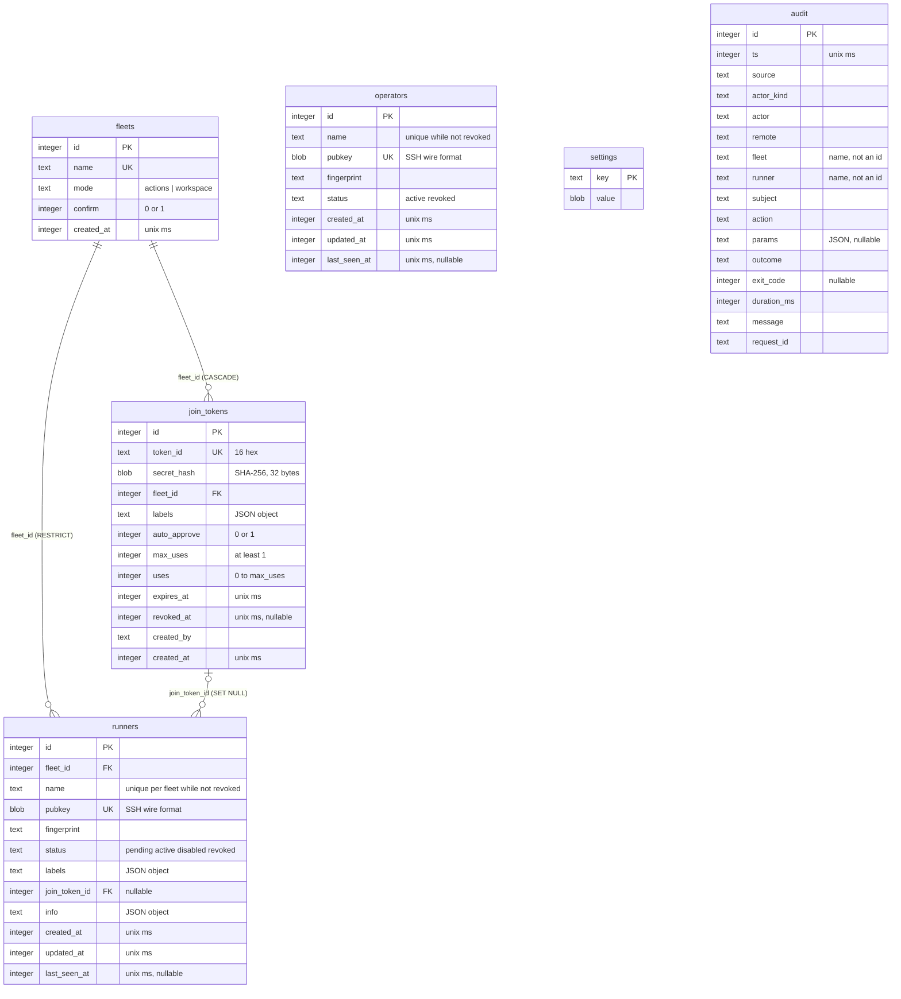
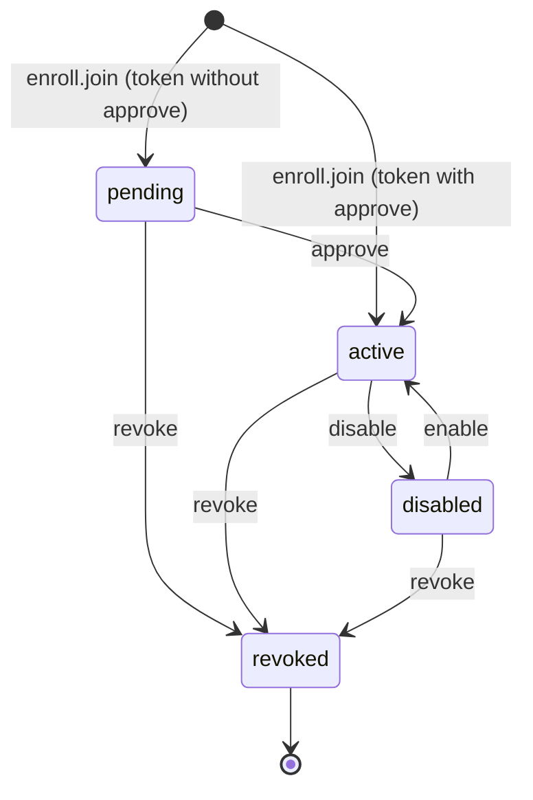
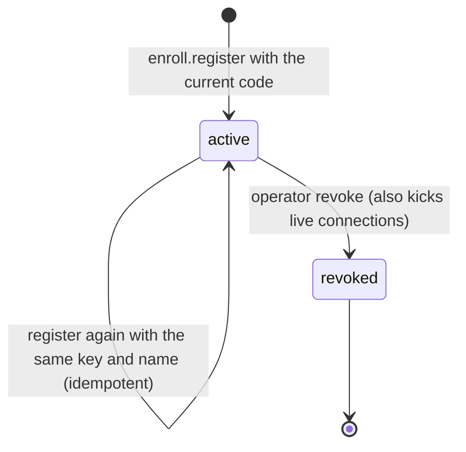
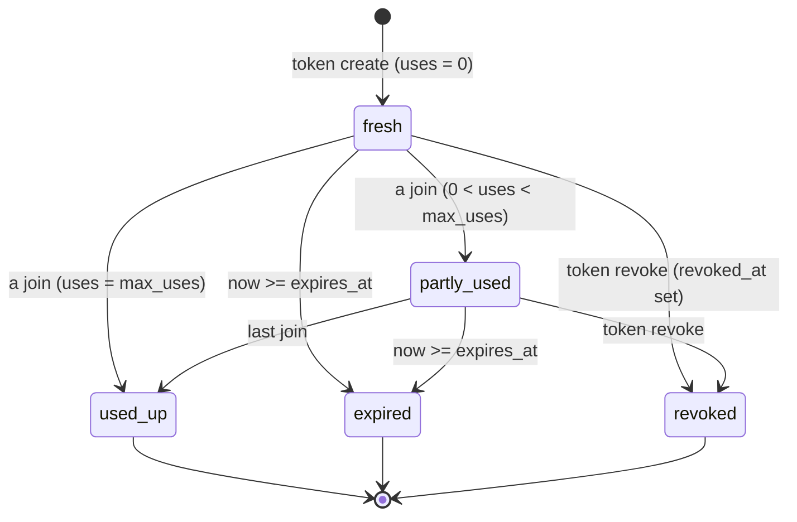
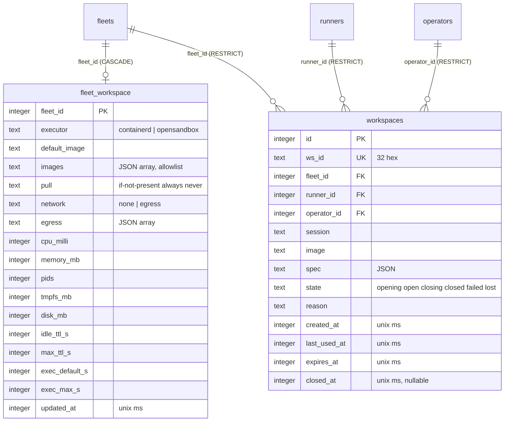
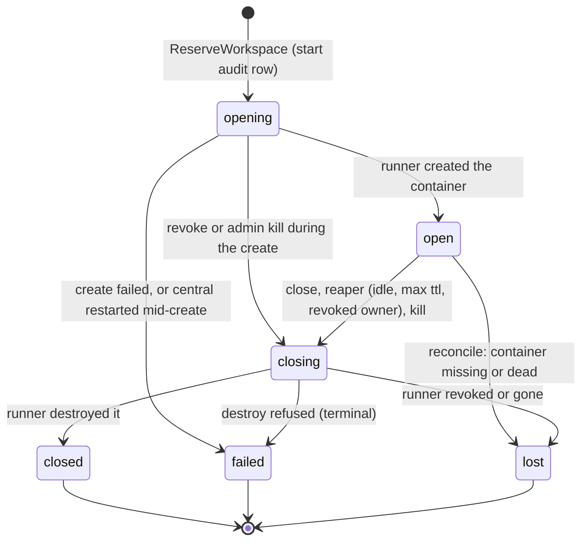
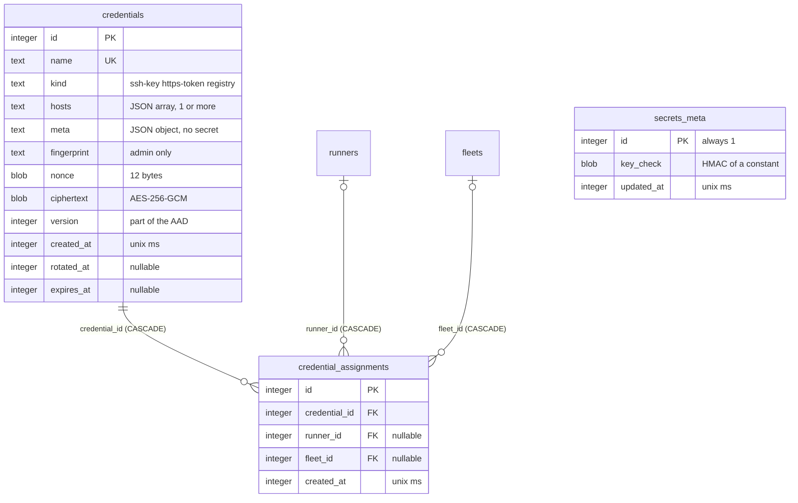

# 6. Data model

## What you will learn

- Every table and column of central's SQLite database: its type, unit, constraints and why it is
  there.
- How runners, operators and join tokens move through their states, and which transitions the
  code allows.
- How the append-only audit table works, with real example rows.
- How the database is opened safely, migrated, and kept consistent (one writer, many readers,
  `synchronous=FULL`).
- What the `Store` interface promises about atomicity and errors (summary here, every method in
  the appendix at the end).
- The workspace tables `fleet_workspace` and `workspaces`, the workspace state machine, migration
  0002, and the new `audit.workspace` column (section 6.15).
- That M5 changed **no schema**, and which local files it added on the operator's machine
  (`contexts.yaml`, `.mirafleet.yaml`, the session handoff file) plus the heartbeat `actions`
  field (section 6.16).
- Migration 0004 (M7): the `credentials`, `credential_assignments` and `secrets_meta` tables, the
  rebuilt `fleet_workspace` that allows the `host` executor, and the audit actions M7 added
  (section 6.17).

Each new database word is explained where it first appears, and the main ones are also in the
[glossary](glossary.md). Quick versions: a **transaction** is a group of changes that all
happen or none do; a **foreign key** is a column that must point at a row in another table; a
**tombstone** (here) is an in-memory "this id is dead" marker. M1, M2 and M3 are done (13 Nov
2026) and M5 is built; sections 6.1 to 6.14 describe the M2 schema and [section 6.15](#615-the-workspace-tables-migration-0002)
adds what M3 brought (two tables, one audit column, one state machine). M5 changed no schema:
[section 6.16](#616-local-files-on-the-operators-machine-and-heartbeat-actions-m5-no-schema-change)
lists the local files and the heartbeat field it added. The code lives in `internal/store` (the interface, pure Go with no SQL)
and `internal/store/sqlite` (the implementation). Central is the only component with a
database; runners keep a small local JSON-lines audit file and a `runner.yaml`, nothing more.

## 6.1 Why SQLite, and why behind an interface

Central is **one process on one host** in the open-source core, so it does not need a database
server. **SQLite** is a database in a single file, used through a library. We use the pure-Go
driver `modernc.org/sqlite`, which keeps the binary static (`CGO_ENABLED=0`).

Nobody outside `internal/store/sqlite` writes SQL. The rest of central talks to the
**`Store` interface**, whose methods are *domain-level* ("enrol this runner using this token"),
not generic ("run this SQL"). Two reasons:

1. **Atomicity lives inside the method.** "Consume one use of the token *and* insert the runner"
   must be one all-or-nothing step. A generic `WithTx(func(tx))` would let callers forget that.
2. **A different database can be swapped in later** (the enterprise plan mentions Postgres for
   high availability) by implementing the same interface; `internal/store/storetest` is the
   shared test-suite any implementation must pass.

Rejected alternatives (from `docs/M2.md` section 1.1): a generic `WithTx` (leaks SQL, harder
fakes); `goose`/`golang-migrate` (new dependencies); ad-hoc DDL at start-up (no versioning).

## 6.2 The tables at a glance



*Look at: `operators`, `settings` and `audit` have no lines. They are not linked by foreign keys.
`audit` is deliberately disconnected so history outlives what it describes.* (This picture is the
M2 schema. The two workspace tables, `fleet_workspace` and `workspaces`, and the extra `audit`
column `workspace` come from migration 0002 and have their own diagram in
[6.15](#615-the-workspace-tables-migration-0002).)

What the three words in brackets mean. They say what the database does when someone deletes the
row a foreign key points at (the "parent"):

- **RESTRICT:** refuse the delete. A fleet that still has runners (even revoked ones) cannot be
  deleted.
- **CASCADE:** delete the dependent rows too. Deleting a fleet would delete its join tokens.
- **SET NULL:** keep the dependent row, but blank the pointer. Deleting a token leaves its
  runners, with `join_token_id` empty.

(The current code never deletes fleets or tokens; these rules are a safety net.)

### Conventions used by every table

- **Times are `INTEGER` unix milliseconds, UTC.** `1794562867512` means 2026-11-13T09:41:07.512Z.
  Go converts with `time.UnixMilli` (see `fromMS` in `runners.go`); nothing in the database
  depends on a time zone. The audit table uses the same unit.
- **`NULL` means "not set"**, used for `last_seen_at`, `revoked_at`, `join_token_id`,
  `audit.params` and `audit.exit_code`. In Go a zero `time.Time` stands for `NULL`.
- **Every primary key is `INTEGER PRIMARY KEY AUTOINCREMENT`.** Plain SQLite may reuse the id
  of a deleted row. `AUTOINCREMENT` never does. The revoke design depends on this: central keeps
  an in-memory "tombstone" of revoked runner ids, and an id that could be recycled by a new runner
  would put the tombstone on the wrong host.
- **JSON columns** (`labels`, `info`, `params`) are `TEXT` with a `CHECK (json_valid(...))`. They
  hold flat `{"key":"value"}` string maps. The database refuses malformed JSON; Go marshals and
  unmarshals with `marshalMap`/`unmarshalMap`.
- **Keys are stored as SSH wire-format `BLOB`s** (what `ssh.PublicKey.Marshal()` returns) next
  to a text `fingerprint` (`SHA256:...` as printed by `ssh-keygen -l`). The blob is what auth
  compares; the fingerprint is for humans and audit rows. Only `ssh-ed25519` ever gets here.

## 6.3 `fleets`

A fleet is a named group of runners and the unit of isolation.

| Column | Type | Meaning |
|---|---|---|
| `id` | `INTEGER` PK AUTOINCREMENT | Internal id; never shown to users. |
| `name` | `TEXT NOT NULL UNIQUE` | `dev`, `prod`. Regex `^[a-z0-9][a-z0-9._-]{0,62}$` (`store.FleetNameRE`), checked in Go before the insert. |
| `mode` | `TEXT NOT NULL`, `CHECK IN ('actions','workspace')` | `actions` runs only named actions (the only mode `action.run` accepts). `workspace` (built in [M3](../M3.md)) serves the `workspace.*` methods and has a `fleet_workspace` row ([6.15](#615-the-workspace-tables-migration-0002)); central refuses `action.run` on it with `conflict: fleet is not in actions mode`, and `workspace.*` on an actions fleet with `conflict: fleet is not in workspace mode`. |
| `confirm` | `INTEGER NOT NULL DEFAULT 0`, `CHECK IN (0,1)` | SQLite has no boolean type; 0/1. `1` = **guarded fleet**: `action.run` must carry `confirm == fleet name` ([chapter 5](05-security.md#537-guarded-fleets-confirm-must-equal-the-fleet-name)). |
| `created_at` | `INTEGER NOT NULL` | Unix ms. |

A `fleets` row is never updated or deleted by the current code (only a workspace fleet's separate
`fleet_workspace` row is replaced, by `fleet.workspace_set`); there is no `fleet.delete` method.
(`join_tokens.fleet_id` is `ON DELETE CASCADE`, so deleting a fleet by hand would also delete its
tokens; `runners.fleet_id` is `ON DELETE RESTRICT`, so a fleet that still has runners, even revoked
ones, cannot be deleted.)

## 6.4 `runners`

One row per enrolled host, **including revoked ones** (history).

| Column | Type | Meaning |
|---|---|---|
| `id` | PK | Used as the session key in the live registry and in `Principal.ID`. |
| `fleet_id` | `INTEGER NOT NULL` FK to `fleets(id)` `ON DELETE RESTRICT` | The one fleet this runner belongs to. |
| `name` | `TEXT NOT NULL` | `build-1`, `db-1`. Same regex as fleets. Unique **within the fleet while not revoked** (see index below). |
| `pubkey` | `BLOB NOT NULL UNIQUE` | The runner's Ed25519 key in SSH wire format. Globally unique, **including revoked rows**, so a revoked key can never be enrolled again. |
| `fingerprint` | `TEXT NOT NULL` | `SHA256:...` of the key. |
| `status` | `TEXT NOT NULL`, `CHECK IN ('pending','active','disabled','revoked')` | Lifecycle state, section 6.8. |
| `labels` | `TEXT NOT NULL DEFAULT '{}'`, `json_valid` | Copied from the join token at enrol time. **Trusted**: set by the admin who made the token. |
| `join_token_id` | `INTEGER` FK to `join_tokens(id)` `ON DELETE SET NULL` | Which token enrolled this runner, kept for forensics. `NULL` if the token row is later deleted. |
| `info` | `TEXT NOT NULL DEFAULT '{}'`, `json_valid` | `hostname`, `os`, `arch`, `version` from the last heartbeat, each clipped to 256 bytes; the JSON is capped at 16 KiB by `TouchRunner`. **Informational, untrusted.** |
| `created_at` / `updated_at` | `INTEGER NOT NULL` | `updated_at` changes on status changes only. |
| `last_seen_at` | `INTEGER`, nullable | Last time central saw the runner, written on connect, disconnect and at most every 5 minutes (`Config.TouchInterval`). Heartbeats themselves stay **in memory**; writing a row every 15 s per runner would be wasteful. |

### Indexes on `runners`

```sql
CREATE UNIQUE INDEX runners_fleet_name_live ON runners (fleet_id, name) WHERE status <> 'revoked';
CREATE INDEX runners_fleet ON runners (fleet_id);
```

- **`runners_fleet_name_live` is a *partial unique index*:** it covers only rows whose status is
  not `revoked`. Result: two *live* runners cannot share a name in a fleet, but once `db-1` is
  revoked a replacement can be enrolled as `db-1` again. A plain `UNIQUE(fleet_id, name)` would
  block that forever and force admins to invent `db-1b`. Because only the key is unique over
  *all* rows, the old key stays dead.
- `runners_fleet` speeds up "list the runners of a fleet" and the runner count per fleet.
- `pubkey UNIQUE` creates an implicit index, used by `GetRunnerByKey` on every SSH login.

## 6.5 `join_tokens`

| Column | Type | Meaning |
|---|---|---|
| `id` | PK | Internal; referenced by `runners.join_token_id`. |
| `token_id` | `TEXT NOT NULL UNIQUE` | The public 16-hex-character id (8 random bytes). Appears in the token string, in audit rows (`subject`) and in `token list`. Not secret. |
| `secret_hash` | `BLOB NOT NULL`, `CHECK (length(secret_hash) = 32)` | SHA-256 of the 32-byte secret. The secret itself is never stored. |
| `fleet_id` | `INTEGER NOT NULL` FK to `fleets(id)` `ON DELETE CASCADE` | Fleet the joining runner enters. |
| `labels` | JSON text | Labels given to runners that join with this token. |
| `auto_approve` | `INTEGER` 0/1 | `1` = the runner starts `active` instead of `pending` (`token create -approve`). |
| `max_uses` | `INTEGER NOT NULL`, `CHECK (max_uses >= 1)` | Default 1, at most 1000 (service limit). Never "unlimited". |
| `uses` | `INTEGER NOT NULL DEFAULT 0`, `CHECK (uses >= 0 AND uses <= max_uses)` | Joins so far. The `CHECK` is a backstop: even a bug cannot push `uses` past `max_uses`. |
| `expires_at` | `INTEGER NOT NULL` | Unix ms. Default now + 24 h, at most now + 30 days. |
| `revoked_at` | `INTEGER`, nullable | Set by `token revoke`. |
| `created_by` | `TEXT NOT NULL DEFAULT ''` | Admin principal name, for example `uid:1000`. |
| `created_at` | `INTEGER NOT NULL` | Unix ms. |

A token has no `status` column. Its state is **derived** from columns at the moment of use, in one
conditional UPDATE (`store.Enroll`):

```sql
UPDATE join_tokens SET uses = uses + 1
 WHERE id = ? AND revoked_at IS NULL AND expires_at > ? AND uses < max_uses
```

If that affects one row, the use is consumed in the same transaction that inserts the runner.
If it affects zero rows the token is stale (`store.ErrStale`). Because SQLite runs one writer at a
time and the UPDATE checks and increments in a single statement, 20 goroutines racing for a
single-use token produce exactly one runner (the `EnrollRaceSingleUse` test in `storetest` does exactly this).

## 6.6 `operators`

| Column | Type | Meaning |
|---|---|---|
| `id` | PK | `Principal.ID` for operators. |
| `name` | `TEXT NOT NULL` | `durga`, `kalyan`. Unique while not revoked (index below). |
| `pubkey` | `BLOB NOT NULL UNIQUE` | Ed25519 key, SSH wire format. Unique over all rows: a revoked operator's key is dead. |
| `fingerprint` | `TEXT NOT NULL` | `SHA256:...`. |
| `status` | `TEXT`, `CHECK IN ('active','revoked')` | There is **no `pending` state**: registering with a valid code makes the operator `active` immediately. |
| `created_at`, `updated_at`, `last_seen_at` | `INTEGER` | `last_seen_at` is written when an operator connects. |

```sql
CREATE UNIQUE INDEX operators_name_live ON operators (name) WHERE status <> 'revoked';
```

Same trick as runners: a revoked `durga` frees the name, so Durga can register again from a new
laptop with a new key.

## 6.7 `settings`

A tiny key/value table.

| Column | Type | Meaning |
|---|---|---|
| `key` | `TEXT PRIMARY KEY` | Today only `registration_secret` (`store.SettingRegistrationSecret`). |
| `value` | `BLOB NOT NULL` | For the registration secret: 32 random bytes. |

- `CreateSetting` inserts and returns `ErrConflict` if the key exists. `central init` uses it, so
  running init twice **cannot** replace the secret.
- `PutSetting` is an upsert and is used only by `operator rotate-secret`.
- Both write their audit row in the same transaction (`operator.init_secret`,
  `operator.rotate_secret`). The value is never in the audit row or any log.
- `checkSetting` rejects an empty key or empty value (`ErrInvalid`).

The secret is stored in plaintext because central must compute codes from it. The protection is
the `0600` file in a `0700` directory ([chapter 5](05-security.md#5316-file-modes-umask-flock-and-the-admin-socket)).

## 6.8 State machines

### Runner



*Look at: `revoked` is terminal. `pending` cannot go to `disabled`; `disabled` cannot go back to
`pending`.*

The rules are one function, `store.CanTransition(from, to)`:

| From \ To | pending | active | disabled | revoked |
|---|---|---|---|---|
| pending | no | yes (approve) | no | yes |
| active | no | no | yes (disable) | yes |
| disabled | no | yes (enable) | no | yes |
| revoked | no | no | no | no |

What each state means to a *live* connection (`internal/central/registry`):

| Status | May it connect? | May it heartbeat? | May it run actions? |
|---|---|---|---|
| `pending` | yes | yes | **no**: `ErrPending` |
| `active` | yes | yes | yes |
| `disabled` | yes (visible) | yes | **no** for new work; in-flight work finishes |
| `revoked` | **no**: key rejected at auth | n/a | no |

Two layers enforce a transition, and both must agree: the service checks the `from` set and
`CanTransition` first (to give a good `conflict` message), and `SetRunnerStatus` checks again
**inside the transaction** against the row it just read, so a concurrent change cannot slip
through. `disable` and `enable` also update the registry (`SetStatus`); the registry remembers the
status per runner id even while the runner is offline and applies it at its next registration.

### Operator



*Look at: there is no way back from `revoked`. A person returns by registering a new key (the name
is free again), never by "un-revoking".*

Re-registering with the same key and name returns success (and is still audited with message
`already registered`). Re-registering a revoked key is `ErrConflict`, and so is using the name of
a different active operator, or a key that belongs to a runner.

### Workspace

Workspaces have a third state machine, with six states and three terminal ones. It is drawn and
explained in [6.15](#the-workspace-state-machine), next to the tables it belongs to.

### Join token (derived state)



*Look at: no column named `status` exists. Only `uses`, `max_uses`, `expires_at`, `revoked_at`
decide, and they are checked together in the one UPDATE.* `JoinToken.Usable(now)` is a read-only
pre-check helper; `Enroll` re-checks atomically.

## 6.9 Connection pools and pragmas

`sqlite.Open` creates **two** `database/sql` pools on the same file.

| Pool | Size | Extra settings | Used for |
|---|---|---|---|
| **writer** | exactly 1 connection (`SetMaxOpenConns(1)`) | `_txlock=immediate` | every INSERT/UPDATE (all mutating `Store` methods), and `RecordAudit` |
| **reader** | 4 connections (`readerConns`) | `query_only(1)` | every `Get*`/`List*` |

Why not one shared pool? In **WAL mode** (write-ahead log: changes are appended to a separate
log file first, so readers keep reading the old data while a write happens) readers never block
the writer, and the writer never blocks readers: that is the whole point. But a transaction that starts as a *read* and then tries
to *write* can fail instantly with `SQLITE_BUSY` if another writer got in between ("read to write
upgrade"). Two separate pools plus `BEGIN IMMEDIATE` (take the write lock *at the start*) avoid
that: the single writer connection serialises writers inside the process, and every write
transaction begins by acquiring the write lock, so callers never see `SQLITE_BUSY`. One
connection for everything would instead make a slow list query stall every write.
`query_only(1)` makes it impossible for a reader connection to write by mistake.

The writer pool's DSN option `_txlock=immediate` is what makes Go's `database/sql` issue `BEGIN
IMMEDIATE` instead of the default `BEGIN` (which takes the lock lazily, at the first write).

### Pragmas (set per connection through the DSN)

| Pragma | Value | Why |
|---|---|---|
| `busy_timeout` | `5000` ms | Wait for a lock instead of failing at once. Listed first so even the WAL switch waits. |
| `foreign_keys` | `1` | SQLite ignores foreign keys unless asked, per connection. |
| `journal_mode` | `WAL` | Write-ahead log: readers and the writer do not block each other. |
| `trusted_schema` | `0` | Do not let functions or views embedded in the database file run unvetted code. |
| `synchronous` | **`FULL`** | See below. |
| `query_only` | `1` (readers only) | Readers cannot write. |

**Why `synchronous=FULL`.** In WAL mode the cheaper setting `NORMAL` does not force the log to
disk at every commit; after a power cut the last few commits can vanish (the database stays
consistent, but recent transactions are lost). Imagine: aarvee revokes `db-1`, the CLI prints
"revoked", then the machine loses power. With `NORMAL`, after reboot `db-1` could be `active`
again, and the attacker we just kicked is back. `FULL` flushes on every commit, so **a revoke
that was acknowledged survives power loss**. The price is slower writes, which is fine because
central's write rate is low (heartbeats are not written).

### Another safety measure: the `ping` retry

When two processes create a *fresh* database at the same instant, switching to WAL needs an
exclusive lock that the busy handler does not always wait for. `pingRetry` retries briefly on
`SQLITE_BUSY`/`LOCKED`. (Normally the `flock` on
`central.lock` already keeps two centrals apart; the retry is a second line of defence.)

## 6.10 Migrations

Schema changes are **embedded SQL files** `internal/store/sqlite/migrations/NNNN_name.sql`
(`0001_init.sql` to `0004_devws.sql` today; see [6.17](#617-host-mode-and-credentials-migration-0004-m7) for 0004), applied by `migrate` in `migrate.go`.

- **Forward-only.** There are no "down" migrations. Rolling back means restoring a backup.
- **Versioned with `PRAGMA user_version`**, an integer stored in the database header. After
  applying migration N the code sets `user_version = N`.
- **All in one transaction.** `migrate` runs `BEGIN IMMEDIATE`, then reads `user_version`
  *inside* the transaction, applies every migration with a higher number, then `COMMIT`. Reading
  inside the lock means two processes starting together serialise: the second one sees the
  first one's result. Any error rolls everything back.
- **Fails closed on a newer database.** If `user_version` is greater than the number of migrations
  this binary has, `Open` returns `database schema version N is newer than this binary supports
  (M): refusing to open; upgrade mirafleet`. Running an old binary on a new schema could corrupt
  data it does not understand.
- **Numbering must be contiguous.** `loadMigrations` insists on `0001`, `0002`, ... with no gaps
  and exactly four digits; a test enforces it, so two developers adding `0002_*.sql` on separate
  branches get a loud failure at merge.
- **`PRAGMA` does not accept bound parameters**, so the version number is concatenated into the
  statement. That is safe because it is an `int` parsed from a file name that was just validated,
  never user input.

To add a column later: create `0003_add_something.sql`, write plain `ALTER TABLE ...`, and add a
test in `storetest`. Never edit `0001_init.sql` or `0002_workspaces.sql` after they have shipped.

**Migration 0002 in short** (M3, schema version 2): it creates `fleet_workspace` and `workspaces`
with their indexes and adds the column `audit.workspace` with its index. Upgrading is automatic: the
first `central run` of the new binary applies it in the same single transaction as any other
migration, and an *older* binary then refuses to open the database (version 2 is newer than it
knows). Take a backup of `mirafleet.db` before upgrading, because there is no "down".

## 6.11 The audit table

Every change and every action leaves a row. The table is **append-only**.

```sql
CREATE TRIGGER audit_no_update BEFORE UPDATE ON audit
BEGIN SELECT RAISE(ABORT, 'audit is append-only'); END;
CREATE TRIGGER audit_no_delete BEFORE DELETE ON audit
BEGIN SELECT RAISE(ABORT, 'audit is append-only'); END;
```

A **trigger** is code stored in the database that runs on an event. `RAISE(ABORT, ...)` cancels the
statement and returns an error, so an `UPDATE audit ...` or `DELETE FROM audit ...` fails, even
from the `sqlite3` shell. (Whoever has file access can still `DROP TRIGGER`; this guards against
bugs and ordinary mistakes, see [chapter 5](05-security.md#510-what-mirafleet-does-not-protect-against).)

**Denormalised on purpose:** `fleet` and `runner` are *names as text*, not ids, and there are no
foreign keys, so rows survive when what they describe is renamed, revoked or deleted. A reader of the
log should not have to join five tables to learn that `durga` ran `restart-runner` on `prod/db-1`.

### Columns

| Column | Type | Meaning |
|---|---|---|
| `id` | AUTOINCREMENT PK | Monotonic. `audit.list` pages by `since_id`; a SIEM exporter can tail it. |
| `ts` | `INTEGER NOT NULL` | Unix ms when the event happened (injected clock `Service.now`). |
| `source` | `TEXT` | Which **front end** (the door the request came through): `cli` (admin socket), `api` (operator API), `enroll`, and `gui` (planned, M4). `system` is used by the workspace reaper, reconcile and revoke cascades (M3): events nobody asked for. |
| `actor_kind` | `TEXT` | The principal's kind. Values actually written today: `admin` (the local CLI), `operator` (the API), `enroll` (a peer joining or registering) and `system` (workspace housekeeping, with actor `reaper` or `revoke`). `runner` is a principal kind too but a runner has no API, so it never appears. |
| `actor` | `TEXT` | Name of the actor. For the local admin it is `uid:<n>`; for an enrolling peer it is empty (the enrollee has no name yet). |
| `remote` | `TEXT` | Source address (`host:port`) of an SSH peer, or `local` for the admin socket. |
| `fleet` | `TEXT` | Fleet name, or empty. |
| `runner` | `TEXT` | Runner name, or empty. |
| `subject` | `TEXT` | What was acted on: the action name for `action.run`, `fleet/runner` for lifecycle, a token id, an operator name. |
| `action` | `TEXT` | What happened: `action.run`, `runner.revoke`, `enroll.join`, `fleet.create`, ... (method names). |
| `params` | `TEXT`, nullable, `json_valid` | Small string map. For `action.run` start rows: the action's parameters, **verbatim**. For lifecycle: `{"from":...,"to":...}`. |
| `outcome` | `TEXT` | `ok`, `denied`, `start`, `error`, `cancelled`, `timeout`. |
| `exit_code` | `INTEGER`, nullable | The action's exit status; `NULL` when there is none (start rows, errors). |
| `duration_ms` | `INTEGER NOT NULL DEFAULT 0` | How long the action took. |
| `message` | `TEXT` | Human text: `runner revoked`, `timed out`, `confirm missing or wrong`, `already registered`, ... |
| `request_id` | `TEXT` | 32 hex characters (16 random bytes) tying an exec's `start` row to its outcome row. |
| `workspace` | `TEXT NOT NULL DEFAULT ''` | Added by migration 0002: the 32-hex `ws_id` the event concerns, or empty. Indexed (`audit_workspace`, only for non-empty values). |

Indexes: `audit_ts (ts)` for time range queries; `audit_fleet_runner (fleet, runner)` for "show me everything
on prod/db-1".

### Example rows

A guarded `action.run`, as two rows. durga runs `tail-logs` on `prod/db-1` with `confirm = "prod"`:

| id | ts | source | actor_kind | actor | remote | fleet | runner | subject | action | params | outcome | exit_code | duration_ms | message | request_id |
|---|---|---|---|---|---|---|---|---|---|---|---|---|---|---|---|
| 1041 | 1794562867512 | api | operator | durga | 203.0.113.7:51514 | prod | db-1 | tail-logs | action.run | `{"lines":"200"}` | **start** | NULL | 0 | | `9f1c…e07a` |
| 1042 | 1794562867561 | api | operator | durga | 203.0.113.7:51514 | prod | db-1 | tail-logs | action.run | NULL | **ok** | 0 | 41 | | `9f1c…e07a` |

(`request_id` is shortened with “…” here; both rows hold the same 32-character value.) What to notice:

- Row 1041 exists **before** the runner is asked; if it could not be written, row 1042 would never exist
  because nothing ran. This is the fail-closed rule.
- The outcome row copies the identity fields but sets `params` to NULL, so parameters are stored
  once. `duration_ms` comes from the runner's measurement when it reports one.
- The `confirm` string is not stored. A *missing* confirm instead produces one row, `outcome =
  denied`, `message = confirm missing or wrong`, `params = NULL`.

If aarvee revokes `db-1` while that action is still running, the outcome row would read instead
`outcome = cancelled`, `message = runner revoked`, `exit_code = NULL`.

The revoke itself, run from the central CLI on the host as uid 1000:

| id | ts | source | actor_kind | actor | remote | fleet | runner | subject | action | params | outcome | exit_code | duration_ms | message | request_id |
|---|---|---|---|---|---|---|---|---|---|---|---|---|---|---|---|
| 1043 | 1794562901204 | cli | admin | uid:1000 | local | prod | db-1 | prod/db-1 | runner.revoke | `{"from":"active","to":"revoked"}` | ok | NULL | 0 | runner revoked | |

This row was written in the **same transaction** as `UPDATE runners SET status = 'revoked'`
(`SetRunnerStatus`), so you can never find a revoked runner without its audit row or the reverse.
`request_id` is empty because lifecycle changes are not requests that pair a start and an outcome.

### What is audited, and what is not

| Audited (a row exists) | Not audited (only logged on central) |
|---|---|
| fleet created; token created and revoked; runner approved, disabled, enabled, revoked | Failed joins, bad registration codes (a flood must not also flood the audit table) |
| operator registered, re-registered, revoked | SSH authentication failures |
| registration secret created and rotated; **a code being shown** (never its value) | Heartbeats and `last_seen_at` writes |
| every `action.run` (start plus outcome); denied calls and refused confirms | Forbidden methods attempted on `api@` (these go to the log) |
| successful joins and registrations | |
| every `workspace.*` call, `list` included (start plus outcome for open, exec, read, write, close); refusals; reaper, reconcile and cascade changes (source `system`) | File contents, env values, and an exec's output (only names, paths, byte counts and SHA-256) |

## 6.12 File safety

The database file lives in the central data directory (default `/var/lib/mirafleet/central`),
which is `0700`. `sqlite.Open` is stricter than "open a file":

1. Refuse `""`, `":memory:"` and `file:` paths. (`:memory:` gives *each pooled connection its own*
   empty database, which would silently break the two-pool design. Tests use files under
   `t.TempDir()`.)
2. `checkDBFile`: if the path exists it must be a regular file, not a symlink; open it with
   **`O_NOFOLLOW`** (unix) so a symlink in the last path component is refused atomically; `fstat`
   the open handle and compare with a fresh `Lstat` of the path using `os.SameFile` ("is the file I
   opened still the file at that path?"); `chmod 0600`.
3. `checkSidecars`: if `mirafleet.db-wal` or `-shm` already exist they must be regular files, not
   symlinks (a planted symlink would redirect SQLite's journal writes to another file).
4. After opening, `tightenModes` best-effort `chmod 0600`s the database and sidecars. The caller
   sets `umask 077` before `Open` so SQLite creates the sidecars `0600` from the start.
5. The data dir is `flock`ed (`central.lock`), so only one central process uses it.

There is a theoretical race left: SQLite re-opens the file by name after these checks. Closing
it needs the directory itself to be private (`0700`), which central enforces; only someone who
can write the directory could swap the file.

## 6.13 The `Store` interface

`internal/store/store.go`. All methods are safe for concurrent use and take a `context.Context`.

### Rules that hold for every method

- **Every mutator takes `now time.Time`.** Nothing below the service calls `time.Now()`; tests
  inject a fake clock.
- **Every state-changing method also takes an `AuditEvent` and writes it in the same transaction.**
  Either both commit or neither. A zero `ev.Time` is set to `now`. `RecordAudit` is the exception:
  it has no state to change and no `now`, so it requires `ev.Time` (zero gives `ErrInvalid`).
- **Secrets never appear in events.**
- **Errors** are four sentinels, matched with `errors.Is` (plus `ErrFull` for workspaces, see
  6.15):

| Error | Meaning | Wire code the service maps it to |
|---|---|---|
| `ErrNotFound` | Fleet, runner, token, operator or setting does not exist. From `Enroll` it *also* means "wrong secret" (indistinguishable on purpose). | `not_found` (enroll paths: `unauthenticated`) |
| `ErrInvalid` | Input failed validation (name shape, mode, malformed id or hash, `MaxUses < 1`, expiry not after now, empty key, oversize info, zero audit time). Describes the shape of input, never a token's existence. | `bad_request` |
| `ErrConflict` | A `UNIQUE` or state precondition failed (duplicate name or key, revoked key re-enrolling, status `from` set no longer matches). | `conflict` |
| `ErrStale` | Join token expired, revoked or used up. | `conflict` (enroll paths: `unauthenticated`) |

  Only `UNIQUE` and `PRIMARY KEY` violations become `ErrConflict` (`isUnique`, extended result codes 2067
  and 1555). `CHECK`, `NOT NULL`, foreign-key and trigger errors are returned as they are and end
  up as `internal` on the wire.

### Summary of the method contracts

The full per-method table is the [appendix](#appendix-the-store-method-contracts) at the end of
this chapter. In five lines:

1. **Fleets, tokens, operators, settings:** create, get, list; state-changing methods take `now`
   and an `AuditEvent` and commit both atomically.
2. **Runners:** `Enroll` is the one big atomic operation (token lookup, constant-time compare,
   consume a use, key checks, insert runner, audit row); `SetRunnerStatus` enforces the state
   machine inside the transaction.
3. **Lookups by key or id return any status**, including revoked (auth needs to see `revoked` to
   refuse it); lookups by name return only non-revoked rows.
4. **Heartbeat-type writes** (`TouchRunner`, `TouchOperator`) are not audited.
5. **Audit:** `RecordAudit` appends without a state change; `ListAudit` pages by id.

## 6.14 How a join touches the database

Putting the pieces together, the 6 steps of a successful `enroll.join` for `build-1` into `dev`:

1. `service.Join` parses the token, checks the host-key pin, and hashes the secret with SHA-256.
2. `store.Enroll` begins `BEGIN IMMEDIATE` on the writer connection.
3. `SELECT ... FROM join_tokens WHERE token_id = ?` then a constant-time compare.
4. `UPDATE join_tokens SET uses = uses + 1 WHERE ... uses < max_uses ...` affects 1 row.
5. `INSERT INTO runners (...)` with status `pending`, then `INSERT INTO audit (...)`
   (`action = enroll.join`, `source = enroll`).
6. `COMMIT` (flushed to disk because of `synchronous=FULL`). The new runner row is read back inside the
   transaction and returned.

If any step fails, `withTx` rolls back and the token still has its use. The deferred rollback also
runs on a panic, so the single writer connection is never left stuck inside an open transaction.

## 6.15 The workspace tables (migration 0002)

Workspace mode (M3) added two tables and one column in `0002_workspaces.sql`. Nothing in
`0001` was edited: that is the rule for a shipped migration (6.10).



*Look at: `fleet_workspace` is one row per workspace-mode fleet (`fleet_id` is its primary key, so
at most one). `workspaces` points at fleets, runners and operators with `RESTRICT`, so none of
them can be deleted while a workspace row refers to it.*

### `fleet_workspace`

The admin-set configuration of a workspace-mode fleet. It is created in the same transaction as the
fleet (`CreateFleet` with `Fleet.Workspace`) and replaced as a whole by `PutFleetWorkspace`
(`fleet.workspace_set`). Existing workspaces keep the `spec` they were opened with; a change
affects only new ones.

| Column | Type | Meaning |
|---|---|---|
| `fleet_id` | `INTEGER` PK, FK `fleets(id)` `ON DELETE CASCADE` | The fleet. One row per workspace fleet. |
| `executor` | `TEXT`, `CHECK IN ('containerd','opensandbox')` | Which runner-side backend this fleet needs. Placement matches it against the runner's heartbeat. |
| `default_image` | `TEXT` | Used when `workspace.open` names no image. Must match `images`. |
| `images` | `TEXT`, `json_valid` | The **image allowlist**: JSON array of exact references or patterns `repo:*` and `repo@sha256:*`. Prefer digests. |
| `pull` | `TEXT`, `CHECK IN ('if-not-present','always','never')` | When the runner pulls. `never` means pre-pulled images only (there are no registry credentials in M3). |
| `network` | `TEXT`, `CHECK IN ('none','egress')` | `none` is the default: loopback only. |
| `egress` | `TEXT DEFAULT '[]'`, `json_valid` | Proxy allowlist entries such as `proxy.golang.org:443`, `*.golang.org:443`, `cidr:port`. Used only with `network = egress`. |
| `cpu_milli` | `INTEGER > 0` | CPU in thousandths of a core (2000 = 2 cores). |
| `memory_mb`, `tmpfs_mb`, `disk_mb` | `INTEGER > 0` | Memory limit, size of `/tmp`, soft disk quota of `/workspace`, all in MiB. |
| `pids` | `INTEGER > 0` | Maximum processes (the fork-bomb limit). |
| `idle_ttl_s` | `INTEGER > 0` | Seconds of inactivity before the reaper closes the workspace (default 24 h). |
| `max_ttl_s` | `INTEGER >= idle_ttl_s` | Hard lifetime in seconds (default 7 days). |
| `exec_default_s` | `INTEGER > 0` | Exec timeout when the caller gives none (default 120). |
| `exec_max_s` | `INTEGER >= exec_default_s AND <= 86400` | The longest exec the fleet allows (default 1800; hard ceiling 24 h). The runner's own `limits.exec_max` can lower it further. |
| `updated_at` | `INTEGER` | Unix ms of the last change. |

Units differ from the Go struct on purpose: the struct (`store.WorkspaceConfig`) uses
`time.Duration` and the table uses whole seconds; `internal/store/sqlite/fleetws.go` converts.
The service fills omitted fields with defaults on `fleet create` (`service.WorkspaceDefaults`);
`fleet workspace set` is a **full replace**, so the CLI reads the current config, applies your
flags and sends the complete value (this is also how a list like `egress` can be cleared).

### `workspaces`

One row per workspace, in every state. Rows are never deleted; terminal rows are history.

| Column | Type | Meaning |
|---|---|---|
| `id` | `INTEGER` PK AUTOINCREMENT | Internal. |
| `ws_id` | `TEXT NOT NULL UNIQUE`, `length = 32` | The public id: 32 lowercase hex characters from `crypto/rand`, made by central. The runner names the container `mf-<ws_id>`, so reconcile can map containers back to rows. |
| `fleet_id`, `runner_id`, `operator_id` | `INTEGER NOT NULL`, FKs with `ON DELETE RESTRICT` | Where it lives and who owns it. Every owner check compares `operator_id`. |
| `session` | `TEXT` | The client-chosen session name (`^[A-Za-z0-9._:-]{1,128}$`). |
| `image` | `TEXT` | The image reference actually used. |
| `spec` | `TEXT`, `json_valid` | The spec central sent to the runner (limits, network, labels). No secrets. |
| `state` | `TEXT`, `CHECK IN (...)` | See the state machine below. |
| `reason` | `TEXT DEFAULT ''` | Why the last transition happened: `idle ttl expired`, `runner revoked`, `closed by operator`, ... |
| `created_at`, `last_used_at`, `expires_at` | `INTEGER` | Unix ms. `last_used_at` is touched (not audited) by every operation; `expires_at` = creation + the fleet's `max_ttl`. |
| `closed_at` | `INTEGER`, nullable | Set when the state becomes `closed`, `failed` or `lost`. |

Three **indexes** do real work:

- `workspaces_session_live`: a **unique partial index** on `(operator_id, fleet_id, session)`
  `WHERE state IN ('opening','open')`. This is what makes a session *sticky*: the database itself
  refuses a second live workspace for the same operator, fleet and session. After a workspace is
  closed, the same session name can be used again.
- `workspaces_runner_live` on `(runner_id)` `WHERE state IN ('opening','open','closing')`: the
  slot count. `free = slots - rows in this index for the runner`.
- `workspaces_idle` on `(last_used_at)` `WHERE state = 'open'`: for the reaper's idle sweep.

### The workspace state machine



*Look at: three terminal states, and that `closing` is where a workspace waits when its runner is
offline.*

The rule is one function, `store.CanTransitionWorkspace(from, to)`, and `SetWorkspaceState`
checks it again inside the transaction, like the runner state machine (6.8). Which states hold a
slot? `opening`, `open` and `closing` (`WorkspaceState.Live`); that is why `closing` is a real
state and not just "being deleted".

| State | Meaning | Holds a slot? |
|---|---|---|
| `opening` | Reserved; the runner is creating the container. | yes |
| `open` | Ready; the owner may exec, read and write. | yes |
| `closing` | Asked to close; the container may still exist. | yes |
| `closed` | Destroyed on purpose. | no |
| `failed` | The create failed, or central crashed while creating. | no |
| `lost` | The container vanished (host reboot, manual delete) or its runner was revoked. | no |

### `audit.workspace`

Migration 0002 also runs `ALTER TABLE audit ADD COLUMN workspace TEXT NOT NULL DEFAULT ''` and
`CREATE INDEX audit_workspace ON audit (workspace) WHERE workspace <> ''`. Every workspace
audit row carries the `ws_id`, so "show me everything that happened to this workspace" is one
indexed query (`audit.list` and `store.AuditEvent.Workspace`). The append-only triggers from
`0001` still hold: the `ALTER` does not touch them.

Audit rows for workspaces follow the same start/outcome pairing as `action.run` (6.11), with these
actions: `workspace.open`, `workspace.exec`, `workspace.read_file`, `workspace.write_file`,
`workspace.close`, `workspace.list`, `workspace.kill`, and the **system** actions the background
code writes with `source = system` and `actor_kind = system`: `workspace.reap` (open to closing),
`workspace.destroy` (closing to closed), `workspace.orphan` (a container with no row was destroyed),
`workspace.lost`, `workspace.recover` (opening to failed) and `workspace.close_all` (the revoke
cascade). Example, an `exec` pair (durga runs `go test ./...` on `dev/build-1`):

| id | source | actor | action | fleet / runner | outcome | params / message | request_id |
|---|---|---|---|---|---|---|---|
| 2101 | api | durga | `workspace.exec` | dev / build-1 | `start` | `{"argv":"[\"go\",\"test\",\"./...\"]","cwd":"/workspace","env_names":"CI","timeout_s":"120"}` | `9f2c...` |
| 2102 | api | durga | `workspace.exec` | dev / build-1 | `ok` | exit_code 0, duration 8140 ms | `9f2c...` |

(both rows also have the `workspace` column set to the 32-hex id). Env **values** and file
**contents** never appear.

### New `Store` methods

All follow the rules of 6.13: they take `now`, and every state change writes its `AuditEvent` in
the same transaction. A fifth error sentinel, **`ErrFull`**, means "no free slot or per-operator
cap reached" (the service maps it to "try the next runner", and finally `unavailable` or
`conflict`).

| Method | Contract |
|---|---|
| `CreateFleet` (changed) | `Fleet.Workspace` is inserted in the same transaction: required in workspace mode, forbidden in actions mode. |
| `GetFleetWorkspace(fleet)` | The fleet's config. `ErrNotFound` for an unknown fleet or an actions fleet. |
| `PutFleetWorkspace(fleet, cfg, now, ev)` | Replaces the whole config atomically with `ev`. Existing workspaces keep their spec. `ErrInvalid` for a bad config or an actions fleet. |
| `ReserveWorkspace(w, slots, maxPerOp, now, ev)` | In **one immediate transaction**: (1) a live workspace for the same (operator, fleet, session) is returned with `existing = true` and nothing is written; (2) else, if the operator holds `maxPerOp` live workspaces, `ErrFull`; (3) else, if the runner holds `slots` live workspaces, `ErrFull`; (4) else insert with state `opening` and write `ev`. Twenty goroutines racing for two slots get exactly two. |
| `SetWorkspaceState(wsID, from, to, reason, now, ev)` | Moves only if the current state is in `from` and `CanTransitionWorkspace` allows it; sets `closed_at` for terminal states. `ErrConflict` otherwise. |
| `TouchWorkspace(wsID, now)` | Sets `last_used_at` on an **open** workspace. Not audited. Any other state is left unchanged. |
| `GetWorkspace(wsID)`, `ListWorkspaces(filter)` | Any state; filter by fleet, operator, runner, states. Names are filled in on read. |
| `CountLiveWorkspaces(runnerIDs)` | Slots held per runner (`opening`, `open`, `closing`). |
| `CloseWorkspacesOf(owner, reason, now, ev)` | The revoke cascade: moves every `opening` and `open` workspace of one runner or one operator to `closing` in one transaction, writing `ev` once with the count and ids. Returns the ids. |

The shared test suite in `internal/store/storetest` runs all of this against any `Store`.

## 6.16 Local files on the operator's machine, and heartbeat `actions` (M5, no schema change)

**M5 adds no table, column or migration.** Central's database is exactly as in section 6.15. What
M5 adds is a handful of small files on the operator's machine, and one extra field in the runner's
heartbeat. Both are described here so you can tell "data" from "database".

### The files (all under `internal/opconf` and `internal/handoff`)

| File | Where | Written by | Holds |
|---|---|---|---|
| `operator_ed25519` | the config directory | `mcp login` | the operator's private key (owner-only; Windows DACL, see [chapter 5](05-security.md#511-prompt-injection-through-tool-output)) |
| `known_hosts` | the config directory | `mcp login` | the pinned host key of each central |
| `contexts.yaml` | the config directory | `mcp login`, `mcp context use\|remove` | the list of contexts |
| `.mirafleet.yaml` | a project directory (often committed) | the project's authors | a default `fleet` and `context` for that project |
| `sessions/<hash>.json` | the state directory | the Claude Code SessionStart hook | one session id (the *session handoff* of [flow 20](04-flows.md#20-session-resolution-and---resume-reattach)) |

Where the config and state directories are on each OS is in the table in
[chapter 3](03-architecture.md#where-does-each-secret-and-key-live).

**`contexts.yaml`.** A **context** is a named central the operator can talk to (not the Go
`context` of chapter 2). MIRASTACK LABS's version:

```yaml
current: mirastack
contexts:
  - name: mirastack
    addr: central.example.com:2222
    default_fleet: dev        # optional
  - name: lab
    addr: lab.example.com:2222
output_cap_bytes: 30720       # optional: 4096 to 262144, default 30720
```

`opconf.LoadContexts` is strict: an unknown field is an error, every context needs a `name` and
an `addr`, `default_fleet` must be a valid name, `current` must name a defined context, and
`output_cap_bytes` must stay in bounds. A `jump` key (SSH jump hosts) is rejected on purpose:
jump hosts are deferred, and failing loudly beats silently ignoring a security-relevant setting.
`mcp login` writes the file; `mcp context list`, `use NAME` and `remove NAME` edit it. It holds no
secret: only names, addresses and one number.

**`.mirafleet.yaml`.** A **project default** is what a team commits so that Claude Code in that
repository targets the right fleet without being told:

```yaml
fleet: dev
context: mirastack
```

Only those two keys exist, and `opconf.LoadProject` is strict about them (unknown keys, a symlink,
a non-regular file or a file over 4 KiB is an error). It deliberately has **no addresses, keys or
caps**: a hostile repository must not be able to point durga's key at a central of its choosing.
The file is looked up from the project directory upward, stopping at the first directory that
contains `.git` (or at the home directory), and never above home. Precedence for a call is: the
tool argument, then the `-context` and `-fleet` flags, then `.mirafleet.yaml`, then the context's
`default_fleet`, then nothing. A guarded fleet taken from the project file or `default_fleet` is
refused: it must be named explicitly ([flow 23](04-flows.md#23-a-guarded-call-and-the-confirm-prompt)).

**The handoff file.** `handoff.Write` stores `{"v":1,"session":"cc:<id>","project":...,"pid":...,
"written":...}` under a name made from `sha256(pid|project)`. It is owner-only, written atomically,
at most 4 KiB, pruned after 7 days, and read back only if its `pid` and `project` match the
reader's key. It holds an identifier, not a secret.

### Heartbeat `actions` (action discovery)

The MCP tool `list_runners` can tell the model which actions a runner offers and what parameters
they take, so it need not guess names. For that, an actions-mode runner now adds an optional
`actions` list to its [heartbeat](07-protocols.md):

```json
{"name":"tail-logs","params":[{"name":"lines","pattern":"^[0-9]{1,4}$","default":"200"}]}
```

- It is built from `actions.yaml` by `actions.Set.Describe`, and sent only by actions-mode runners
  (older runners omit it, and everything still works).
- It is **bounded** before central stores it, in `Heartbeat.Validate`: at most 128 actions, a name
  up to 64 bytes, at most 32 parameters per action, patterns and defaults up to 256 bytes, and
  16 KiB of JSON for the whole list. (A runner sending more would otherwise overflow the SSH packet
  limit or bloat `runners.list`.)
- It is **not in SQLite.** Like the rest of the heartbeat it lives in the registry's memory, next
  to the live session, and appears in `runners.list` as `RunnerInfo.Actions` (central also caps the
  total encoded action bytes in one response and marks later runners `actions_omitted`).
- It is **informational only.** It is never used to authorise anything: the runner's
  `actions.yaml` is still the security boundary (chapter 5, 5.2), and a runner that lied about its
  list would only mislead the model, whose call the guard would still refuse.

## 6.17 Host mode and credentials: migration 0004 (M7)

<!-- verify: column lists below were read from internal/store/sqlite/migrations/0004_devws.sql in the m7-wave-a worktree. docs/M7.md section 4.1 lists slightly different columns (meta JSON / updated_at; the migration has fingerprint, rotated_at, expires_at). The migration is right; re-check at reconciliation if the file changes. -->

Migration 0004 (schema version 4; `0003_gui.sql` was M4's admin accounts, sessions and two audit
indexes) is M7's only schema change. It adds three tables and **rebuilds** one. As always it is
applied automatically in the single start-up transaction of [section 6.10](#610-migrations), and an
older binary then refuses to open the database. **Take a backup of `mirafleet.db` first**: the
credential rows in it are encrypted, but if you also lose `MIRAFLEET_SECRETS_KEY` they are
unreadable for good.



### `credentials`

One row per named secret.

| Column | Meaning |
|---|---|
| `name` | Unique, chosen by aarvee (`gitlab-deploy`). The only thing operators and the agent ever see, with kind, hosts and status. |
| `kind` | `ssh-key`, `https-token` or `registry` (CHECK). |
| `hosts` | JSON array of `host` or `host:port` (CHECK: valid JSON, an array, at least one). The hosts the credential applies to; also what the agent's pinned host list and the broker's intercept list are built from. |
| `meta` | JSON object with the non-secret settings: SSH user, `known_hosts` lines, auth style (`basic`, `bearer`, `header` plus its name), host binding, rotation settings. Never a secret. |
| `fingerprint` | A public fingerprint of the value, so aarvee can tell which key is stored. Shown to admins only. |
| `nonce`, `ciphertext` | The AES-256-GCM output: a 12-byte random nonce (CHECK on length) and the sealed value. The only place the secret exists in the database. |
| `version` | Starts at 1, grows with each replaced value. Together with `id` it is the AEAD associated data, so a ciphertext cannot be moved to another row or back to an older version. |
| `created_at`, `rotated_at`, `expires_at` | Unix milliseconds. `rotated_at` is NULL until the first replacement; `expires_at` drives the 14-day warning and the self-rotation. |

### `credential_assignments`

A credential goes to **one runner or one whole fleet** per row. A CHECK enforces
`(runner_id IS NULL) <> (fleet_id IS NULL)`, so a row is never both and never neither. Unique partial
indexes `credential_assign_runner` and `credential_assign_fleet` stop duplicate assignments, and
two more indexes make "what does this runner hold" fast. Foreign keys cascade: delete the
credential, runner or fleet and the assignment goes. A runner's **effective set** is the union
of its own rows and the rows of its fleet (`Store.EffectiveCredentials`).

### `secrets_meta`

At most one row (`id = 1` by CHECK): the **key-check value**, an HMAC of a constant under the secrets
key. At start-up central recomputes it with `MIRAFLEET_SECRETS_KEY` and compares. If credentials
exist but the key is missing or does not match, central refuses to start. `central secrets rekey`
rewrites every ciphertext **and** this row in one transaction (`Store.RekeyCredentials`).

### `fleet_workspace` rebuilt

SQLite cannot change a CHECK in place, so the migration creates `fleet_workspace_new`, copies the
rows, drops the old table and renames. The `executor` check now allows `'host'`, and the resource
columns (`cpu_milli`, `memory_mb`, `pids`, `tmpfs_mb`, `disk_mb`) must be positive only when the
executor is not `host`: a host fleet has no image allowlist and no limits, because the VM is the
boundary. Existing container rows are unchanged.

### New `Store` methods

`SetCredential` (create or replace, with its audit row in the same transaction), `GetCredential`
and `ListCredentials` (metadata, never ciphertext), `DeleteCredential`, `AssignCredential`,
`UnassignCredential`, `EffectiveCredentials`, `CredentialRunners`, and the only two readers of
ciphertext: `SealedCredentialsFor` (delivery) and `GetSealedCredential` (central-side rotation).
`RekeyCredentials` re-encrypts. Each write takes its audit event and commits it atomically, like
every other write in the store. Workspace reservation also counts live rows of other operators on
the runner to enforce the one-operator hold ([flow 24](04-flows.md#24-open-a-host-workspace)); there is
no table for it.

### Audit actions added by M7

The `audit` table gets no new column. New values appear in `action` and `source`:

| Action | Source | When |
|---|---|---|
| `credential.set`, `credential.delete`, `credential.assign`, `credential.unassign`, `credential.rotate` | admin (`cli` or `gui`) | Admin changes. The row names the credential and the runner or fleet; the value is never recorded. <!-- verify: exact action strings written by service.SetCredential/DeleteCredential/AssignCredential/UnassignCredential/RotateCredential --> |
| `credential.rotate_failed` | `system` | Self-rotation could not reach GitLab or was refused; the old value keeps working. <!-- verify: this action string and its source --> |
| `credential.use` | `runner` | An aggregated usage event from a runner: session, credential name, host, outcome, with a count (60-second windows). |
| `events.dropped` | `runner` | A runner's event batch exceeded the caps; the row carries the count of lost events. |
| `runner.replaced` | `system` | A runner's new connection replaced a live one. The GUI flags the runner. <!-- verify: source value of runner.replaced rows --> |
| `secrets.keycheck` | `system` | The secrets key was checked or first recorded at start-up. |
| `workspace.fs`, `workspace.job_start`, `workspace.job_status`, `workspace.job_tail`, `workspace.job_cancel`, `workspace.output_read` | `api` | The host-mode operations of flows 26 and 27. `workspace.fs` records op, paths, sizes and the SHA-256 of what was written, never content. |
| `workspace.kill` (with delete) | admin | An admin kill that also deletes the session directory. |

For `credential.use` and `events.dropped`, `fleet` and `runner` are filled from the store (the
batch cannot lie about which runner sent it) and the `actor` is the runner's name.

### Not in the database

What is *not* here matters as much: the **plaintext** of any credential; the per-session CA key; job
logs and outputs (files on the VM); session directories and their records (files on the VM, owned
by the runner's user); the runner's local credential-use JSONL. Central's database holds only
ciphertext, names, hosts, assignments and audit.

## Check your understanding

1. Why does `runners` have a *partial* unique index on `(fleet_id, name)` but a plain `UNIQUE`
   on `pubkey`?
2. A power cut happens one second after "revoked" was printed. What guarantees the runner is still
   revoked after reboot?
3. What does `RegisterOperator` return, and what audit row is written, if Durga registers twice
   with the same key and name?
4. Why are `fleet` and `runner` in the `audit` table text names and not foreign keys?
5. You open the database with an older mirafleet binary after upgrading. What happens, and why is
   that better than letting it try?
6. How does the database itself stop durga from holding two live workspaces for session `s1` on
   `dev`? And can durga use `s1` again after closing?
7. A workspace row is `closing` and its runner is offline. Does it still count against the
   runner's slots? Why is that the right choice?
8. Why does the audit table need a `workspace` column when `subject` already holds the session?
9. M5 added an MCP server, a handoff file and an `actions` list in the heartbeat. Which of them
   needed a database migration, and where does each live?
10. A cloned repository contains a `.mirafleet.yaml` with `fleet: prod`. Why can it neither add a
    new central nor silently run commands on `prod`?
11. A credential row has `id` 7 and `version` 3. An attacker with write access to the database
    copies its `ciphertext` into the row of credential 9. What happens when central opens it, and
    which columns made that fail?
12. Why can `credential_assignments` not hold a row that assigns a credential to both a runner and
    a fleet, and how does a runner end up holding both kinds?
13. Which table lets central refuse to start with the wrong secrets key, and what does it hold
    instead of the key?

<details>
<summary>Answers</summary>

1. Names are meant to be reusable once their runner is revoked (so a replacement `db-1` can be
   enrolled), hence the index only covers `status <> 'revoked'`. Keys must never be reusable, so
   `pubkey` is unique over every row including revoked ones.
2. `synchronous=FULL`. The WAL is flushed to disk at each commit, so a committed revoke (status
   change plus audit row, one transaction) survives power loss. With `NORMAL` it could be lost.
3. The existing operator with `created = false`; the store writes no audit row in that case. The
   service then records one itself with message `already registered`
   (`service.Register`).
4. So history outlives what it describes: a deleted or renamed fleet or a revoked runner must not
   change or break old rows. Append-only triggers make them immutable.
5. `migrate` reads `PRAGMA user_version`, sees a number higher than the migrations it embeds, and
   returns an error ("newer than this binary supports"). Failing closed prevents an old binary
   from writing data in a layout it does not understand.
6. The unique partial index `workspaces_session_live` on `(operator_id, fleet_id, session)` for
   states `opening` and `open`; `ReserveWorkspace` returns the existing row instead of inserting.
   After the first workspace reaches `closing` or a terminal state, it no longer matches the
   index, so a new workspace for `s1` is allowed.
7. Yes. The container may still exist and use CPU, memory and disk until it is really destroyed.
   If `closing` released the slot at once, a flaky runner could be over-filled with containers
   the database no longer counts.
8. A session name can be reused over time, so it does not identify one workspace. The `ws_id` does,
   and the index on it makes "everything that happened to this workspace" a quick lookup.
9. None needed a migration: central's schema is unchanged. The handoff file lives in the
   operator's state directory (`sessions/<hash>.json`); `contexts.yaml` and `.mirafleet.yaml` are
   plain YAML files; the heartbeat `actions` list is held in the registry's memory and returned
   by `runners.list`, never written to SQLite.
10. `.mirafleet.yaml` can only hold a `fleet` and a `context` name, so there is nowhere to put an
    address or key, and an unknown context is `not_found`. A guarded fleet taken from a project
    default is refused: it must be named explicitly and confirmed, and central refuses without the
    exact `confirm`.
11. The decryption fails its authentication tag. The AES-GCM associated data is the credential id
    and version, so ciphertext sealed for (7, 3) does not open as (9, anything). `id` and
    `version` together are the cause.
12. A CHECK says exactly one of `runner_id` and `fleet_id` is NULL. A runner holds both kinds
    through two separate rows (one for the runner, one for its fleet); its effective set is their
    union.
13. `secrets_meta`. It holds `key_check`, an HMAC of a constant under the key, never the key.

</details>

## Appendix: the Store method contracts

Reference table for `internal/store/store.go`. Read the rules and the error table in section 6.13 first.

**Fleets**

| Method | Contract |
|---|---|
| `CreateFleet(f, now, ev)` | Inserts and returns the fleet with `ID` and `CreatedAt = now`. `ErrInvalid` for a bad mode or name; `ErrConflict` if the name exists. Atomic with `ev`. |
| `GetFleet(name)` | `ErrNotFound` if absent. `RunnerCount` is **not** filled. |
| `ListFleets()` | Ordered by name; `RunnerCount` = non-revoked runners, computed in the same query. `Workspace` is filled for workspace fleets. |
| `GetFleetWorkspace(fleet)`, `PutFleetWorkspace(fleet, cfg, now, ev)` | Read, and atomically replace, a workspace fleet's config (see 6.15). `CreateFleet` inserts `Fleet.Workspace` in the same transaction. |

**Workspaces** (migration 0002; full contracts in [6.15](#new-store-methods))

| Method | Contract |
|---|---|
| `ReserveWorkspace`, `SetWorkspaceState`, `TouchWorkspace` | Reserve a slot (sticky, capped, in one transaction), move between states with the transition table, and update `last_used_at`. |
| `GetWorkspace`, `ListWorkspaces`, `CountLiveWorkspaces` | Read any state; count the slots a runner holds. |
| `CloseWorkspacesOf` | The revoke cascade for one runner or one operator. |

**Runners**

| Method | Contract |
|---|---|
| `ListRunners(fleet, includeRevoked)` | Ordered by name then id. `ErrNotFound` if the fleet does not exist. |
| `GetRunner(ref)` | The **non-revoked** runner `fleet/name`. |
| `GetRunnerByKey(pubKey)`, `GetRunnerByID(id)` | **Any status**, including revoked: auth needs to see `revoked` to refuse it, and audit needs old rows. |
| `TouchRunner(id, seen, info)` | Sets `last_seen_at` and `info`. **Not audited** (high frequency). Never changes status. `ErrInvalid` if the info JSON is over 16 KiB; `ErrNotFound` if the id is unknown. |
| `Enroll(tokenID, secretHash, now, newRunner, ev)` | **The most important atomic operation.** One transaction: (1) look up the token by id; (2) constant-time compare the hash, against a dummy hash if the id is unknown; (3) conditionally consume a use (revoked, expired or used up gives `ErrStale`); (4) refuse a key that is an operator's (`ErrConflict`; this runs after the token checks so a caller with a bad token learns nothing about operator keys); (5) insert the runner with the token's fleet, labels and status (`active` if `auto_approve`, else `pending`); (6) write `ev` with `ev.Fleet` set to the token's fleet. **Nothing is consumed on any error.** `ErrInvalid` (checked first) for a bad name, empty key/fingerprint, or a hash that is not 32 bytes. `ErrConflict` if the name is taken by a non-revoked runner in that fleet or the key is already known (revoked runner keys included). |
| `SetRunnerStatus(id, from, to, now, ev)` | Moves a runner to `to` only if its current status is in `from` **and** `CanTransition` allows it, atomically with `ev`; sets `updated_at = now`. `ErrInvalid` for an empty `from` set or an invalid status; `ErrNotFound` for an unknown id; `ErrConflict` if the status is not in `from` or the transition is illegal. This is how a concurrent change is detected. |

**Join tokens**

| Method | Contract |
|---|---|
| `CreateToken(t, now, ev)` | Inserts; returns the token with `SecretHash = nil`. `ErrInvalid` unless the hash is 32 bytes, the id is 16 lowercase hex, `MaxUses >= 1` and `ExpiresAt` is after now. `ErrNotFound` for an unknown fleet; `ErrConflict` for a duplicate `TokenID`. |
| `RevokeToken(tokenID, now, ev)` | Sets `revoked_at`. `ErrNotFound` if unknown. **Revoking twice is a no-op returning nil with no event.** |
| `ListTokens(fleet)` | Ordered by id; `fleet == ""` means all. `SecretHash` is never selected. |

**Operators**

| Method | Contract |
|---|---|
| `RegisterOperator(name, pubKey, fingerprint, now, ev)` | Inserts an `active` operator. **Idempotent per key:** if the key is already an *active* operator, that operator is returned with `created = false` and **no audit row is written**, so the service must record the re-registration itself (it does). `ErrConflict` if the key belongs to a revoked operator or to *any* runner (checked inside the transaction), or if the name is held by a different active operator. `ErrInvalid` for a bad name. |
| `GetOperatorByKey`, `GetOperatorByID` | Any status. |
| `GetOperatorByName(name)` | The non-revoked operator only. |
| `TouchOperator(id, seen)` | Sets `last_seen_at`; not audited. |
| `RevokeOperator(name, now, ev)` | Marks the non-revoked operator revoked, atomically with `ev`. `ErrNotFound` if there is none. The *caller* then kicks connections (the store does not know about SSH). |
| `ListOperators(includeRevoked)` | Ordered by id. |

**Settings**

| Method | Contract |
|---|---|
| `GetSetting(key)` | `ErrNotFound` if absent. The value may be secret: never log it. |
| `CreateSetting(key, value, now, ev)` | Insert only; `ErrConflict` if present. Atomic with `ev`. |
| `PutSetting(key, value, now, ev)` | Upsert, an explicit overwrite. Atomic with `ev`. |

**Audit**

| Method | Contract |
|---|---|
| `RecordAudit(ev)` | Appends one row (its own transaction), returns the new id. Used for events with no state change: exec start and outcome rows, denials, re-registrations, "code shown". |
| `ListAudit(sinceID, limit)` | Rows with `id > sinceID`, ascending; `limit <= 0` means 100 and the cap is 1000. Reads from the reader pool. |

**Housekeeping:** `Close()` closes both pools; later calls fail.
