# 7. Protocols

## What you will learn

- Which SSH users and channels exist, and who may open what.
- The exact bytes of a message: the 4-byte length prefix, the JSON envelope, and a hex example.
- Every method with a real request and response: operator methods, admin methods on the local
  socket, and the two enrol methods.
- The error codes, the limits (with constant names and values), and the formats of join tokens
  and registration codes, field by field.
- What flows between central and a runner (`heartbeat@mirafleet`, `exec@mirafleet`) and the
  rules for changing the protocol.

Unfamiliar terms (SSH channel, global request, framing, envelope) are in the
[glossary](glossary.md). The code is `internal/api` (framing, envelope, DTOs, limits),
`internal/transport` (names shared by central and runner), `internal/tokens` (token formats),
`internal/central` (server side) and `internal/apiclient` (client side).

All examples use the running example: central at `central.example.com:2222`, fleets `dev` and
`prod`, runners `build-1` (in `dev`) and `db-1` (in `prod`), operators `alice` and `bob`, and
Dana, the admin who uses the local admin socket. Tokens and codes are obviously fake (the secret
and host-key-hash placeholders are exactly 43 characters long, like the real ones). Timestamps
are made up. M1 and M2 are done (13 Nov 2026); everything here is implemented, except where a
paragraph says "planned".

## 7.1 The big picture: SSH carries everything

mirafleet invents no network protocol of its own. Everything rides on **SSH** (implemented
in-process with `golang.org/x/crypto/ssh`). SSH gives us encryption, server authentication
(the host key) and client authentication (public keys). On top of one SSH connection, you can open many
independent **channels** (think: lightweight sub-connections, each with a *type name*). Peers can
also send **global requests** (one-off messages on the connection itself, not tied to any
channel, optionally answered). Opening a channel can also carry **extra data**: a small blob of
bytes sent inside the channel-open message itself, before any channel traffic.

mirafleet uses three kinds of things on top of SSH:

| Mechanism | Used for | Message format |
|---|---|---|
| Channel `api@mirafleet`, `join@mirafleet`, `register@mirafleet` (peer to central) | Operator API, enrolment | 4-byte length prefix + JSON, one request, one response (section 7.3) |
| Global request `heartbeat@mirafleet` (runner to central) | "I am alive, here is what I am" | SSH request payload: JSON, answered with ok/not ok |
| Channel `exec@mirafleet` (central to runner, **over the runner's own connection**) | Run one action | Open data: JSON; reply: one JSON document then EOF (section 7.10) |

Names are defined once, in `internal/transport/transport.go`, so central and runner cannot
disagree.

## 7.2 SSH users and channels

The SSH **user name** selects the role. The key is looked up only in that role's table
([chapter 5](05-security.md#533-ssh-user-to-role-binding)). Authentication is public key only,
`ssh-ed25519` only, with at most 3 tries (`MaxAuthTries`). Any other user name is refused.

| SSH user | Key must be | May open (peer to central) | May send | Central may open toward it |
|---|---|---|---|---|
| `runner` | an enrolled, non-revoked runner key | **nothing**: every channel is rejected | `heartbeat@mirafleet` global requests | `exec@mirafleet` |
| `operator` | an active operator key | `api@mirafleet`, at most **8 at once** | nothing honoured (global requests are discarded) | nothing |
| `enroll` | **any** Ed25519 key | exactly **one** of `join@mirafleet` or `register@mirafleet`, then the connection closes | nothing honoured | nothing |
| (anything else) | n/a | n/a | n/a | n/a (authentication fails) |

Notes you will need when debugging:

- A channel type that is not in the role's allow-list is rejected with SSH reason
  `UnknownChannelType` ("channel type not allowed"). An allowed channel over the cap is rejected
  with `ResourceShortage` ("too many concurrent channels"). A runner's channels all get
  `UnknownChannelType`.
- On an `enroll` connection only the **first** channel counts. A second one gets `Prohibited`. If
  the first has a disallowed type, the connection is closed.
- An `enroll` connection lives at most `Config.EnrollDeadline` (30 s) from accept, and is
  rate limited (10/min per source, 60/min overall) *after* the handshake. This is why anyone who
  can reach the port can complete a handshake as `enroll`: they can then do nothing except present
  a token or code.
- The runner never listens. Its only channel handler is for `exec@mirafleet`; the SSH library
  rejects other channel types toward the runner.
- `file@mirafleet` and `workspace@mirafleet` (central to runner) are planned for [M3](../M3.md).
  They do not exist in the code yet.
- The **admin socket** is a unix socket, not SSH. It speaks the same framing and envelope as
  `api@mirafleet` (section 7.5).

## 7.3 Framing: the 4-byte length prefix

A **frame** is one message on a channel. A reader of raw JSON would have to parse it to find
where it ends, so it could not check the size before parsing (and a hostile sender could keep
sending). So every message is wrapped in a **length prefix**: the size comes first.



*Look at: every message is 4 length bytes followed by exactly that many JSON bytes.*

1. The operator builds the JSON request: 33 bytes. Hex above, letters below each byte.
2. It puts the payload length first, as 4 bytes, big-endian: 33 = 0x00000021.
3. Header and payload go out in one Write on the channel.
4. Central reads 4 bytes, checks the length against its limit BEFORE allocating, reads that many.
5. Central runs the method and builds the JSON response (a small example: 28 bytes).
6. The response is framed the same way: 28 = 0x0000001C. The operator reads it back.

### In detail

- The client opens a channel of type `api@mirafleet` (or the enrol types).
- The client writes **4 bytes**: the payload length `N` as an unsigned big-endian integer.
- The client writes the **N bytes** of JSON. (Header and payload leave in one write.)
- Central reads the 4 bytes, **checks `N` against the limit first**, and only then allocates and
   reads N bytes. A hostile prefix of 4 GiB costs nothing.
- Central writes one response frame of the same shape and closes the channel.

### Byte by byte

```
 byte 0      byte 1      byte 2      byte 3      bytes 4 .. 4+N-1
+-----------+-----------+-----------+-----------+---------------------------+
| N >> 24   | N >> 16   | N >> 8    | N & 0xff  | N bytes of UTF-8 JSON     |
+-----------+-----------+-----------+-----------+---------------------------+
   most significant byte first ("big-endian", also called network byte order)
```

Rules (`internal/api/frame.go`, `ReadFrame` / `WriteFrame`):

| Situation | Result |
|---|---|
| `N == 0` | `ErrEmptyFrame`: the peer gets `bad_request` "empty request". Empty frames are also refused when writing. |
| `N` over the limit (request: 64 KiB) | `ErrFrameTooLarge`, **nothing more is read**; the peer gets `too_large`. |
| Stream ends before the 4 header bytes are complete, or before N payload bytes | `io.ErrUnexpectedEOF`; the peer gets `bad_request` "truncated request". |
| Clean end of stream before any byte | `io.EOF`: the peer simply closed; no reply is written. |
| Response bigger than `MaxResponseBytes` | Replaced by a `too_large` error response so the caller still gets an answer. |

### A hex example

The numbers below are the same as in the picture. Alice's client sends `hello`. The JSON is:

```
{"v":1,"id":"1","method":"hello"}
```

Count the characters: that is **33 bytes** (all ASCII, one byte per character). 33 is `0x21`, so the
length prefix is `00 00 00 21`. The whole frame is 4 + 33 = **37 bytes**, shown here as hex
(left) and as text (right, `.` for unprintable bytes):

```
offset  hex                                               text
0000    00 00 00 21 7B 22 76 22 3A 31 2C 22 69 64 22 3A   ...!{"v":1,"id":
0010    22 31 22 2C 22 6D 65 74 68 6F 64 22 3A 22 68 65   "1","method":"he
0020    6C 6C 6F 22 7D                                    llo"}
```

Central's reply here is `{"v":1,"id":"1","result":{}}`. That is **28 bytes**, `0x1C`, so the
frame starts `00 00 00 1C` and is 32 bytes long:

```
offset  hex                                               text
0000    00 00 00 1C 7B 22 76 22 3A 31 2C 22 69 64 22 3A   ....{"v":1,"id":
0010    22 31 22 2C 22 72 65 73 75 6C 74 22 3A 7B 7D 7D   "1","result":{}}
```

(A real `hello` reply carries the operator name and versions; it is shown in section 7.5. This one
is kept tiny so you can count it.) Notice that the **id is echoed back**; the client checks it
matches (`apiclient.callOn`).

Why a length prefix and not one JSON object per line (NDJSON)? It lets a receiver reject a big
message by looking at 4 bytes, and the payload may contain any bytes including raw newlines.
(`docs/M2.md` records NDJSON as rejected, Q12.)

## 7.4 The v1 envelope

Every request and response is a JSON object with the same outer shape, the **envelope**
(`api.Request`, `api.Response`).

**Request**

```json
{"v": 1, "id": "a1b2c3d4e5f60718", "method": "runners.list", "params": {"fleet": "prod"}}
```

| Field | Type | Rules |
|---|---|---|
| `v` | integer | Protocol version. Must be `1` today. Checked **first**. |
| `id` | string | 1 to 128 bytes. Chosen by the client (the Go client uses 16 hex chars from 8 random bytes). Echoed in the reply. |
| `method` | string | Non-empty. Names in sections 7.5 to 7.7. |
| `params` | object | Optional. Missing, empty or `null` means "no params". |

The server decodes with `DisallowUnknownFields`: **any field not listed above, in the envelope or
in the params of a method, is `bad_request`**. Trailing data after the JSON object (including a stray
`}`) is also `bad_request`. Strict parsing is cheap protection against typos and smuggling.

**Response: exactly one of `result` and `error`**

```json
{"v": 1, "id": "a1b2c3d4e5f60718", "result": { ... }}
{"v": 1, "id": "a1b2c3d4e5f60718", "error": {"code": "not_found", "message": "not found"}}
```

`Response.Marshal` refuses to build a message with both or neither. When the request was too broken
to read an id, `PeekID` tries to recover one for the reply; otherwise `id` is empty.

**One request per channel.** The client opens a channel, sends one request, reads one response,
closes. *Cancel* is closing the channel. *Concurrency* is opening more channels (up to 8 per
connection). We rejected a multiplexed JSON-RPC stream on one channel because it needs
request-ids, ordering rules and flow control, all of which SSH channels already provide.

A half-close (the client finishes writing but keeps reading) is **not** a cancel: the request still
runs and the reply is still written. Closing the channel or dropping the connection is.

## 7.5 Operator methods (`api@mirafleet`)

Reachable by operators on `api@mirafleet`, and by the admin on the admin socket (except `hello`).
Every call goes through the service: policy (the operator must be `active` *now*, so every
operator method passes that current-status check), validation, audit. The method table and the
policy are two independent gates; admin-only calls add a direct check of the caller's kind as a
third.

### `hello`

Identify yourself and learn the protocol versions. Like every operator method it passes the
policy's current-status check; `hello` just does one extra lookup in its handler
(`handleHello` in `internal/central/dispatch.go`): it re-reads the operator row and answers
`forbidden` if that operator is no longer `active`.

Request:
```json
{"v":1,"id":"a1b2c3d4e5f60718","method":"hello","params":{"client":"mcp"}}
```
Response:
```json
{"v":1,"id":"a1b2c3d4e5f60718","result":{"operator":"alice","versions":[1],"server":"mirafleet"}}
```
`client` is an optional hint of at most 32 printable ASCII characters. It is **logged, not
trusted** (a longer or non-printable hint is silently dropped).

### `fleets.list`

No params. Returns every fleet with its count of non-revoked runners.
```json
{"v":1,"id":"b7e4","method":"fleets.list"}
{"v":1,"id":"b7e4","result":{"fleets":[
  {"name":"dev","mode":"actions","confirm":false,"runners":1},
  {"name":"prod","mode":"actions","confirm":true,"runners":1}]}}
```
(Responses are one line on the wire; line breaks added here.) `confirm: true` means a guarded fleet.

### `runners.list`

Params: `fleet` (required). Lists non-revoked runners of that fleet, merged with live state:
`online` is true only for a registered session that heartbeated recently; `last_seen` is the later
of the stored time and the live heartbeat. `labels` come from the join token.
```json
{"v":1,"id":"c1d2","method":"runners.list","params":{"fleet":"prod"}}
{"v":1,"id":"c1d2","result":{"runners":[
  {"name":"db-1","status":"active","online":true,"labels":{"role":"db"},
   "last_seen":"2026-11-13T09:41:07.512Z"}]}}
```
`last_seen` is an RFC 3339 UTC timestamp and is omitted if the runner was never seen.

### `action.run`

Run a named action on one runner.

| Param | Type | Rules |
|---|---|---|
| `fleet`, `runner` | string | Must form a valid `fleet/runner` reference. |
| `action` | string | 1 to 64 bytes. Checked by the *runner's* `actions.yaml`, not by central. |
| `params` | object of strings | At most 32 entries, key 1 to 64 bytes, value up to 4096 bytes. |
| `timeout_s` | integer | `0` = default (120 s); negative is `bad_request`; capped at 600 s. |
| `confirm` | string | On a guarded fleet, must equal the fleet name. |

Central checks, in order: policy, input limits, fleet exists and is in `actions` mode, confirm,
runner is `active`; then writes the audit `start` row; then asks the runner.

Request:
```json
{"v":1,"id":"d3f9","method":"action.run","params":{
  "fleet":"prod","runner":"db-1","action":"tail-logs",
  "params":{"lines":"200"},"timeout_s":30,"confirm":"prod"}}
```
Success:
```json
{"v":1,"id":"d3f9","result":{"exit_code":0,"stdout":"Nov 13 09:41:03 db-1 gitlab-runner[812]: ...\n",
  "stderr":"","duration_ms":41,"request_id":"9f1c0a5be2d84c7790a1b3c4d5e6e07a"}}
```
`truncated: true` appears when output hit the 1 MiB cap. A command that ran and failed is **still
a success response** with a non-zero `exit_code`: the protocol worked, the action did not.

Failures (all with the same envelope):

| Situation | Response `error` |
|---|---|
| Guarded fleet, `confirm` missing | `{"code":"bad_request","message":"fleet requires confirm to equal the fleet name"}` |
| Runner's guard refused (unknown action, bad param) | `{"code":"bad_request","message":"refused by runner: refused: parameter \"lines\" does not match its pattern"}` |
| Runner is `pending` or `disabled` | `{"code":"conflict","message":"runner is pending"}` |
| Fleet is not in `actions` mode | `{"code":"conflict","message":"fleet is not in actions mode"}` |
| Runner offline, or something broke talking to it | `{"code":"unavailable","message":"runner unavailable"}` |
| Runner revoked mid-run | `{"code":"unavailable","message":"runner revoked"}` |
| Audit table not writable | `{"code":"unavailable","message":"audit unavailable"}` |
| Ran past `timeout_s` | `{"code":"timeout","message":"action timed out"}` |
| Operator revoked, or channel closed mid-run | `{"code":"unavailable","message":"request cancelled"}` (usually unseen: the connection is gone) |

If the runner itself reports that the action timed out (the action's own `timeout` in
`actions.yaml`), the response is a normal result with `exit_code: -1`, and the audit outcome is `timeout`.

### The same envelope rejects what it must

An admin method on the operator channel:
```json
{"v":1,"id":"e5a1","method":"runner.lifecycle","params":{"fleet":"prod","runner":"db-1","op":"revoke"}}
{"v":1,"id":"e5a1","error":{"code":"forbidden","message":"forbidden"}}
```
A made-up method gives `bad_request` "unknown method". A future protocol version:
```json
{"v":2,"id":"f0f0","method":"hello"}
{"v":1,"id":"f0f0","error":{"code":"unsupported_version",
  "message":"unsupported protocol version 2; supported: [1]","supported":[1]}}
```

## 7.6 Admin methods (local admin socket)

The admin socket is `<data>/admin.sock` (default `/var/lib/mirafleet/central/admin.sock`), mode
`0600`. Each connection carries **one request frame and one response frame**, same framing and same
limits. The peer's uid must equal central's, checked before anything is read. The caller is
principal `admin` (name `uid:<n>`), audit source `cli`. The `mirafleet central ...` commands are
clients of this socket (`internal/central/adminclient.go`).

Served here: the admin methods below, plus `fleets.list`, `runners.list` and `action.run` (so
`central exec` works). `hello` and the enrol methods are **not** served (answer: `forbidden`).
Admin methods are never served on `api@mirafleet`. The admin disconnecting (for example Ctrl-C of `central
exec`) cancels the request on Linux; on macOS it does not (central only runs on Linux).

All times are RFC 3339 UTC.

| Method | Params | Result |
|---|---|---|
| `fleet.create` | `name`, `mode` (`actions` default or `workspace`), `confirm` (bool) | `{"fleet":{name,mode,confirm,runners}}` |
| `token.create` | `fleet`, `labels`, `approve`, `uses` (0 = 1), `ttl_s` (0 = 86400; max 2592000) | `{id, token, expires}`, token shown once |
| `token.list` | `fleet` (empty = all) | `{"tokens":[{id,fleet,labels,approve,max_uses,uses,expires,revoked}]}` |
| `token.revoke` | `id` | `{}` |
| `runner.lifecycle` | `fleet`, `runner`, `op` (`approve`, `disable`, `enable`, `revoke`) | the runner: `{name,status,online,labels,last_seen}` |
| `operator.code` | none | `{code, seconds_left, host_fingerprint}` |
| `operator.rotate_secret` | none | `{}` |
| `operator.list` | none | `{"operators":[{name,fingerprint,status,last_seen}]}` including revoked |
| `operator.revoke` | `name` | `{}` |
| `audit.list` | `since_id`, `limit` (0 = 100, max 1000) | `{"events":[...]}` ascending by id |

Examples (one line on the wire):

```json
{"v":1,"id":"1","method":"fleet.create","params":{"name":"prod","mode":"actions","confirm":true}}
{"v":1,"id":"1","result":{"fleet":{"name":"prod","mode":"actions","confirm":true,"runners":0}}}
```
```json
{"v":1,"id":"2","method":"token.create","params":{"fleet":"prod","labels":{"role":"db"},"approve":false,"uses":1,"ttl_s":86400}}
{"v":1,"id":"2","result":{"id":"0123456789abcdef",
 "token":"mfj1.0123456789abcdef.EXAMPLE_SECRET_NOT_REAL_EXAMPLE_SECRET_FAKE.EXAMPLE_HOSTKEY_HASH_NOT_REAL_EXAMPLE_HOSTK",
 "expires":"2026-11-14T09:41:07.512Z"}}
```
```json
{"v":1,"id":"3","method":"token.list","params":{"fleet":"prod"}}
{"v":1,"id":"3","result":{"tokens":[{"id":"0123456789abcdef","fleet":"prod","labels":{"role":"db"},
 "approve":false,"max_uses":1,"uses":0,"expires":"2026-11-14T09:41:07.512Z","revoked":false}]}}
```
```json
{"v":1,"id":"4","method":"token.revoke","params":{"id":"0123456789abcdef"}}
{"v":1,"id":"4","result":{}}
```
```json
{"v":1,"id":"5","method":"runner.lifecycle","params":{"fleet":"prod","runner":"db-1","op":"approve"}}
{"v":1,"id":"5","result":{"name":"db-1","status":"active","online":false,"labels":{"role":"db"}}}
```
`online` is always `false` in this reply: it is the stored row, not the live state. Use `runners.list` for live state.
```json
{"v":1,"id":"6","method":"operator.code"}
{"v":1,"id":"6","result":{"code":"mfr1.EXAMPLECODEEXAMPLECODEEXAM.EXAMPLE_HOSTKEY_HASH_NOT_REAL_EXAMPLE_HOSTK",
 "seconds_left":37,"host_fingerprint":"SHA256:EXAMPLE_FINGERPRINT_NOT_REAL"}}
```
```json
{"v":1,"id":"7","method":"operator.rotate_secret"}
{"v":1,"id":"7","result":{}}
```
```json
{"v":1,"id":"8","method":"operator.list"}
{"v":1,"id":"8","result":{"operators":[
 {"name":"alice","fingerprint":"SHA256:EXAMPLE_ALICE_FP","status":"active","last_seen":"2026-11-13T09:40:12.004Z"},
 {"name":"bob","fingerprint":"SHA256:EXAMPLE_BOB_FP","status":"revoked"}]}}
```
```json
{"v":1,"id":"9","method":"operator.revoke","params":{"name":"bob"}}
{"v":1,"id":"9","result":{}}
```
```json
{"v":1,"id":"10","method":"audit.list","params":{"since_id":1040,"limit":2}}
{"v":1,"id":"10","result":{"events":[
 {"id":1041,"time":"2026-11-13T09:41:07.512Z","source":"api","actor_kind":"operator","actor":"alice",
  "remote":"203.0.113.7:51514","fleet":"prod","runner":"db-1","subject":"tail-logs","action":"action.run",
  "params":{"lines":"200"},"outcome":"start","request_id":"9f1c0a5be2d84c7790a1b3c4d5e6e07a"},
 {"id":1042,"time":"2026-11-13T09:41:07.561Z","source":"api","actor_kind":"operator","actor":"alice",
  "remote":"203.0.113.7:51514","fleet":"prod","runner":"db-1","subject":"tail-logs","action":"action.run",
  "outcome":"ok","exit_code":0,"duration_ms":41,"request_id":"9f1c0a5be2d84c7790a1b3c4d5e6e07a"}]}}
```
`audit.list` has an extra, direct check in its handler that the caller's kind is `admin`. Fields
that are empty or zero are omitted (`omitempty`), except `id`, `time`, `source`, `actor_kind`,
`actor`, `action`. To export the log, call repeatedly with `since_id` set to the last id seen.
The `exit_code` pointer distinguishes "0" from "none".

## 7.7 Enrol methods (`join@mirafleet`, `register@mirafleet`)

Used by SSH user `enroll`. Each connection carries **one** channel with **one** request and **one**
response, then closes. The method must match the channel type; mismatches get `bad_request`
"method does not match channel", and enrol methods on `api@mirafleet` get `forbidden`.

Both clients pin central's host key from the credential before sending it
([chapter 5](05-security.md#532-host-key-pinning-no-trust-on-first-use)).

### `enroll.join` on `join@mirafleet`

```json
{"v":1,"id":"j1","method":"enroll.join","params":{
 "token":"mfj1.0123456789abcdef.EXAMPLE_SECRET_NOT_REAL_EXAMPLE_SECRET_FAKE.EXAMPLE_HOSTKEY_HASH_NOT_REAL_EXAMPLE_HOSTK",
 "name":"build-1"}}
{"v":1,"id":"j1","result":{"fleet":"dev","runner":"build-1","status":"pending"}}
```
`status` is `active` if the token was made with `-approve`. The params struct also has an optional
`labels` field; it is accepted but **ignored**: labels come only from the token.

### `enroll.register` on `register@mirafleet`

```json
{"v":1,"id":"r1","method":"enroll.register","params":{
 "code":"mfr1.EXAMPLECODEEXAMPLECODEEXAM.EXAMPLE_HOSTKEY_HASH_NOT_REAL_EXAMPLE_HOSTK",
 "name":"alice"}}
{"v":1,"id":"r1","result":{"operator":"alice","status":"active"}}
```

### Enrol failures

| Situation | Response |
|---|---|
| Anything wrong with the token or code (malformed, wrong pin, unknown, wrong secret, expired, revoked, used up, no registration secret) | `{"code":"unauthenticated","message":"join refused"}` or `"registration refused"`, **byte-identical** for every cause |
| Name already used by a live runner, key already enrolled, key belongs to the other role, revoked operator key | `{"code":"conflict","message":"conflict"}` (only reached with a valid token or code) |
| Bad name | `{"code":"bad_request","message":"invalid runner name"}` / `"invalid operator name"` |
| Not an Ed25519 key | `bad_request` "ssh-ed25519 key required" |

## 7.8 Error codes

`api.Error` has `code` (stable, machine-readable), `message` (human, fixed text per code so no
internal details leak) and, for `unsupported_version` only, `supported` (the versions this build
speaks). `service.ToAPIError` maps internal errors to these.

| Code | Meaning | When it happens |
|---|---|---|
| `bad_request` | You sent something invalid. Fix the request. | Malformed or empty or truncated frame; missing/invalid `v`; bad `id` (empty or over 128 bytes); empty or unknown method; unknown or trailing JSON fields; invalid params (names, limits, negative `timeout_s`); `store.ErrInvalid`; wrong or missing `confirm`; runner guard refused; method/channel mismatch. |
| `unauthenticated` | Credential refused. | Only `join refused` / `registration refused`. SSH authentication failures never produce this: they end the handshake with an opaque "access denied". |
| `forbidden` | Understood, not allowed for you. | Policy denial; admin or enrol method on the wrong front end; operator no longer active; `audit.list` by a non-admin. Always the same message, `forbidden`. |
| `not_found` | The thing does not exist. | Unknown fleet or runner; unknown token id on revoke; unknown operator on revoke. |
| `conflict` | The thing exists, but its state does not allow this. | Duplicate fleet name; runner is `pending`/`disabled`/`revoked` ("runner is X"); lifecycle op not allowed from the current status; fleet not in `actions` mode; name or key clash on enrol; `store.ErrConflict` or `ErrStale` outside enrol. |
| `unavailable` | Try again later. | Runner offline or unreachable; runner revoked mid-run; audit not writable; request cancelled. |
| `too_large` | Message too big. | Request frame over 64 KiB; response over 1 MiB + 64 KiB. |
| `timeout` | Too slow. | Request not fully received within 10 s; `action.run` exceeded its timeout. |
| `unsupported_version` | `v` is not one this server speaks. | `v` is a valid integer other than 1; carries `supported`. |
| `internal` | Our bug or a store failure. | Message is always `internal error`; the cause is logged on central only. |

Note that `timeout` after the request is read comes from the service. If the 10 s read timer
fires, central closes the channel, so the error reply may never arrive.

## 7.9 Limits

Defined in `internal/api/api.go` unless another place is named. "Config" fields are in
`internal/central/central.go` (`central.Config`; zero means the default constant). **This is the
one limits table in the guide**; other chapters link here instead of repeating it. Every network
input has a bound that is checked before its cost is paid.

### Message and size limits

| Constant / field | Value | Why |
|---|---|---|
| `api.MaxRequestBytes` | 64 KiB (65 536) | Requests are small; checked before allocation. |
| `api.MaxResultBytes` | 1 MiB | Mirrors `actions.MaxOutput`: stdout and stderr combined. |
| `api.MaxResponseBytes` | 1 MiB + 64 KiB | Result plus JSON overhead; bigger becomes `too_large`. |
| `api.MaxParams` / `MaxParamKey` / `MaxParamValue` | 32 / 64 B / 4 KiB | Bounds the `params` map. |
| id length | 1 to 128 bytes | `maxIDLen`. |
| `transport.MaxResultBytes` | 8 MiB | Most central reads from one `exec@` result: 1 MiB output times at most 6 for JSON escaping, plus slack. |
| `actions.MaxOutput` | 1 MiB | Runner caps stdout+stderr combined. |
| `maxInfoValue` | 256 B | Each heartbeat-supplied string stored for a runner. |
| store `maxInfoBytes` | 16 KiB | Runner `info` JSON. |
| audit list | default 100, max 1000 | Rows per `audit.list`. |

### Connection and concurrency limits

| Constant / field | Value | Why |
|---|---|---|
| `api.MaxChannelsPerConn` | 8 | Concurrent `api@` channels per operator connection. |
| `runner.Config.MaxExec` | 4 | Concurrent actions per runner; the 5th is rejected `ResourceShortage`. |
| `Config.MaxHandshakesPerIP` (`DefaultMaxHandshakesPerIP`) | 64 | Handshakes in progress per source IP (IPv6: per /64, the block of addresses one machine normally owns). Exempt if the source already has an authenticated connection. |
| `Config.MaxHandshakes` (`DefaultMaxHandshakes`) | 512 | Handshakes in progress overall. |
| `MaxAuthTries` | 3 | Key offers per connection. |
| `Config.EnrollDeadline` (`DefaultEnrollDeadline`) | 30 s | Whole lifetime of an enroll connection. |
| `Config.EnrollRatePerMin` (`DefaultEnrollRatePerMin`) | 10 per min per source | Permit bucket (a counter that refills over time), burst = rate; checked after the handshake. |
| `Config.EnrollGlobalRatePerMin` (`DefaultEnrollGlobalRatePerMin`) | 60 per min overall | Permit bucket across all sources; stops address rotation. |
| `maxBuckets` (enroll limiter) | 4096 | Hard cap of the per-source table; idle buckets pruned, then least recently used evicted. |

### Time limits

| Constant / field | Value | Why |
|---|---|---|
| `api.RequestTimeout` | 10 s | Time to deliver a complete request; closes the channel on expiry (SSH channels have no read deadline, so a timer closes them). |
| `api.WriteTimeout` | 10 s | A peer that stops reading cannot pin a handler. On timeout the channel and the owning connection are closed. |
| `api.ListTimeout` | 10 s | Cap for all non-`action.run` methods. |
| `api.DefaultActionTimeout` | 2 min | When `timeout_s` is 0. |
| `api.MaxActionTimeout` | 10 min | Cap on `timeout_s`; clamped in seconds so huge values cannot overflow. |
| `actions.DefaultTimeout` | 60 s | Per-action timeout if `actions.yaml` gives none. |
| `runner.Config.HeartbeatEvery` | 15 s | Heartbeat interval. |
| registry `StaleAfter` | 45 s (3 x heartbeat) | No heartbeat for this long = offline, connection closed. Set in `cmd/mirafleet/central_linux.go`. |
| `Config.HandshakeTimeout` (`DefaultHandshakeTimeout`) | 10 s | Time to finish the SSH handshake. |
| `Config.TouchInterval` (`DefaultTouchInterval`) | 5 min | Minimum gap between `last_seen_at` writes per runner (connect writes are further throttled to one per `TouchInterval / 10`, 30 s). |
| `apiclient.HandshakeTimeout` | 30 s | Client: connect plus SSH handshake. |
| runner dial / backoff | dial 10 s; reconnect backoff 1 s to 60 s, doubling, jittered +-20% | `BackoffMin`/`BackoffMax`; backoff resets only after a connection stayed up and acked heartbeats for `HealthyAfter` (30 s). |
| `auth` lookup timeout | 5 s | One store lookup during the handshake. |
| `storeTimeout` | 5 s | Best-effort `last_seen` writes. |
| `outcomeWriteTimeout` | 10 s | Final audit write after an action, even if the caller left. |

### Token and code limits

| Constant / field | Value | Why |
|---|---|---|
| `service.MaxTokenUses` / `DefaultTokenUses` | 1000 / 1 | Join token uses. |
| `service.MaxTokenTTL` / `DefaultTokenTTL` | 30 days / 24 h | Join token lifetime. |
| labels | 32 labels, key 64 B, value 256 B | `service` token label limits. |
| `tokens.StepSeconds` | 60 | Registration code window. |


## 7.10 Central and the runner

This traffic is **not** the framed JSON above. It uses native SSH features.

### `heartbeat@mirafleet` (runner to central)

An SSH **global request** with `want_reply = true`. The payload is a JSON `transport.Heartbeat`:

```json
{"hostname":"db-1.example.com","os":"linux","arch":"amd64","version":"0.2.0","labels":{"role":"db"}}
```

- Sent immediately after connecting and then every **15 s**. The runner waits at most 2 x the
  interval for the reply, then closes the connection and reconnects (with backoff).
- Central **registers** the runner in its live registry on the **first** heartbeat (by then the runner
  has installed its channel handler). A connection that never heartbeats is closed after
  `StaleAfter` (45 s).
- Central replies `true` for a good heartbeat. It replies `false` for a payload that is not valid
  JSON, for any other request type, and for a refusal to register (tombstoned or revoked runner,
  after which it closes the connection).
- Central stores hostname, os, arch and version (clipped) as `runners.info`; heartbeat `labels`
  are not stored. Heartbeats themselves are not written to the database.
- A session with no heartbeat for `StaleAfter` is reported offline and its connection is closed.

### `exec@mirafleet` (central to runner)

Central opens a channel of type `exec@mirafleet` **on the runner's own connection** (the runner
never accepts inbound connections). The request is the SSH channel-open **extra data**,
a JSON `transport.ExecRequest`:

```json
{"action":"tail-logs","params":{"lines":"200"}}
```

The runner:

1. Rejects a malformed request with `ConnectionFailed` ("malformed exec request").
2. Rejects with `ResourceShortage` ("runner busy ...") if it already runs `MaxExec` (4) actions.
   (Central sees an open-channel failure and reports `unavailable`.)
3. Otherwise accepts, writes its own audit line (`start`), asks the actions guard to plan and run.
4. Writes **one JSON document**, a `transport.ExecResult`, to the channel, then `CloseWrite`.
   **There is no length prefix here:** end-of-stream marks the end. Central reads at most
   `transport.MaxResultBytes` + 1 bytes and fails if more arrives.

```json
{"stdout":"Nov 13 09:41:03 ...\n","stderr":"","exit_code":0,"duration_ms":41}
```
A refusal by the guard (nothing ran):
```json
{"stdout":"","stderr":"","exit_code":-1,"refused":true,"message":"refused: unknown action \"bash\"","duration_ms":0}
```
Optional fields: `stdout_truncated`, `stderr_truncated`, `timed_out` (the runner killed the process at its
deadline; `exit_code` is -1 and `message` is "timed out; process killed"). If the encoded result would exceed
8 MiB, the runner sends `exit_code: -1` with `message: "result too large to send"` instead.

**Cancellation.** The runner watches the channel: when central closes it (the caller gave up, the
operator was revoked, the runner was kicked) or the connection drops, the action's context is
cancelled and the **whole process group is killed**. The runner also writes its own outcome
audit line (`ok`, `failed`, `refused`, `timeout`) *before* telling central.

Two timeouts apply: the action's own `timeout` in `actions.yaml` (runner side) and the
`action.run` timeout (central side, default 2 min, max 10 min). The shorter one wins.

## 7.11 Token and code formats

### Join token: `mfj1.<id>.<secret>.<hostkeyhash>`

```
mfj1.0123456789abcdef.EXAMPLE_SECRET_NOT_REAL_EXAMPLE_SECRET_FAKE.EXAMPLE_HOSTKEY_HASH_NOT_REAL_EXAMPLE_HOSTK
 |   |                |                                           |
 |   |                |                                           +- 43 chars: central's host key hash
 |   |                +- 43 chars: the secret
 |   +- 16 lowercase hex chars: the token id
 +- format version 1, fixed prefix "mfj1."
```

| Part | Size | How it is made | How it is checked |
|---|---|---|---|
| `mfj1.` | 5 chars | Constant `tokens.JoinPrefix`; the `1` is the format version. | `ParseJoinToken` requires the prefix. |
| `id` | 16 hex chars | First 8 of 40 random bytes (`crypto/rand`), hex-encoded. Public: used for lookup, `token list`, audit. | Lowercase hex, exactly 16 characters (`ParseJoinToken`; `store.CreateToken` re-checks with `^[0-9a-f]{16}$`). |
| `secret` | 43 chars | Last 32 of those random bytes, **base64url without padding**. 32 bytes = 256 bits = 43 characters. | Must decode to exactly 32 bytes **and re-encode to the identical string** (rejects non-canonical spellings). Central hashes it with SHA-256 and compares with the stored hash in constant time. |
| `hostkeyhash` | 43 chars | `SHA-256(hostKey.Marshal())`, base64url without padding. | The client compares it with the server's key before sending anything (`apiclient.PinnedHash`). Central also checks the token's hash equals its own (`hostHashEqual`, constant time), so a token for another central is useless here. |

Total length: 5 + 16 + 1 + 43 + 1 + 43 = 109 characters. Splitting on `.` must give exactly three
parts after the prefix. The `.` and `_`, `-` characters never clash: base64url uses `-` and `_` but not `.`.

The base64url hash differs from what `ssh-keygen -l` prints (`SHA256:` plus *standard* base64 with `+`
and `/`). `apiclient.Fingerprint` converts between them when an operator supplies a fingerprint by hand.

Only `SHA-256(secret)` is stored (`join_tokens.secret_hash`). The token is printed once.

### Registration code: `mfr1.<code>.<hostkeyhash>`

```
mfr1.EXAMPLECODEEXAMPLECODEEXAM.EXAMPLE_HOSTKEY_HASH_NOT_REAL_EXAMPLE_HOSTK
 |   |                          |
 |   |                          +- 43 chars: central's host key hash (same as in join tokens)
 |   +- 26 chars of base32: the time-step code
 +- fixed prefix "mfr1."
```

| Part | How it is made | How it is checked |
|---|---|---|
| `mfr1.` | `tokens.CodePrefix`. | `ParseCode`. |
| `code` (26 chars) | `step = floor(unix_seconds / 60)`. `mac = HMAC-SHA256(key = secret, message = "mirafleet-register-v1" \|\| step as 8 bytes big-endian)`. Then take the **RFC 4648 base32** encoding of the 32-byte `mac`, uppercase, no padding, and keep the **first 26 characters** (26 x 5 = 130 bits). | Only characters `A` to `Z` and `2` to `7`. Central recomputes the code for its **current** step from the stored 32-byte secret and compares in constant time. The previous and next steps are refused. Verifying has no side effects, so any number of operators can use the same code in the same minute. |
| `hostkeyhash` | Same as for join tokens. | Same. |

Worked example of the step: at unix time 1795000000, `step = 1795000000 / 60 = 29916666` (integer
division). As 8 big-endian bytes that is `00 00 00 00 01 c8 7d fa`. Those bytes follow the 21-byte
domain string `mirafleet-register-v1` into the HMAC. That step ends at unix time 1795000020 (so
`seconds_left` at the example instant is 20); from then on `step = 29916667` and the whole code
changes completely.
`operator.code` returns `seconds_left = 60 - (unix_seconds mod 60)`, a value from 1 to 60.

The string `"mirafleet-register-v1"` is a **domain separator**: it ensures an HMAC computed for this
purpose could never be mistaken for the same secret used for something else. The 32-byte secret
lives in the `settings` table (`registration_secret`). `rotate-secret` replaces it and all earlier
codes stop verifying.

## 7.12 Versioning rules

What the code enforces:

- **Protocol version `v`** is an integer in every envelope. Today `api.Version = 1` and
  `api.SupportedVersions = [1]`. The server reads `v` **before** decoding the rest, so a client
  speaking a future version gets a clean `unsupported_version` plus the list it can use, even if
  its other fields look different.
- `hello` returns `versions`, the full list a server speaks, so a client can pick a common one.
- Request decoding is **strict** (unknown fields rejected); response decoding by the Go client is
  **lenient** (unknown result fields are ignored). So a newer server can add result fields without
  breaking older clients, but a newer client must not send new request fields to an older server.
- The response `v` must equal the client's expectation, and the `id` must match the request.
- **Credential formats are versioned in their prefix** (`mfj1.`, `mfr1.`) and in the HMAC domain
  string (`mirafleet-register-v1`). A parser accepts exactly its own version and nothing else.
- **The database schema has its own version** (`PRAGMA user_version`), independent of the wire
  version; a newer database is refused ([chapter 6](06-data-model.md#610-migrations)).
- **SSH names** (`api@mirafleet`, `exec@mirafleet`, ...) are the stable surface between
  versions of central and runners. A new capability gets a new channel type or method, and
  old peers reject what they do not know.

Guidance for changing the protocol (derived from the rules above; not enforced by a test):

1. Adding a new **method** or a new **result field** is compatible: old clients never call or never
   read it. Add the DTO in `internal/api`, the handler in `internal/central`, the method name to
   the right `Is...Method` switch, and the policy table.
2. Adding a new **request field** to an existing method breaks old servers (they reject unknown
   fields). Prefer a new method, or bump `v`.
3. Changing the meaning of a field, a code, or the frame layout is a **breaking change**: bump
   `api.Version` to 2, put `2` in `SupportedVersions` next to `1` for a transition period, and
   keep the version check ahead of everything else.
4. Never let a new method reach `api@mirafleet` by accident: update `IsOperatorMethod` **and**
   the policy table deliberately; `TestMethodSetsDisjoint` and `TestEnrollMethodsDisjoint` in `internal/api` assert that the
   operator, admin and enrol sets are disjoint.

## Check your understanding

1. Alice's client sends a frame whose 4-byte prefix is `00 10 00 00`. What happens, and what has
   central allocated by then?
2. Why does an `enroll` connection have a 30 s lifetime and exactly one channel?
3. What is different about how the runner returns its result on `exec@mirafleet` compared with how
   central answers on `api@mirafleet`?
4. A registration code is shown with `seconds_left = 2`. Bob copies it, but it takes him 5 seconds to
   paste. What does he see, and what should he do?
5. Which of these requests is accepted by a v1 server: (a) `{"v":1,"id":"x","method":"hello","extra":1}`,
   (b) `{"v":1,"id":"x","method":"hello"}`, (c) `{"id":"x","method":"hello"}`?

<details>
<summary>Answers</summary>

1. `0x00100000` is 1 048 576 (1 MiB), which is above the 64 KiB request limit. `ReadFrame`
   returns `ErrFrameTooLarge` after reading only the 4 header bytes; central has allocated nothing
   for the payload, replies `too_large`, and reads no more.
2. Anyone can reach the `enroll` role (it accepts any key), so it is kept as cheap and harmless as
   possible: one credential check, then close. The deadline stops idle connections from holding
   resources, and the one-channel rule stops a connection from retrying credentials in a loop.
   (Rate limits apply too.)
3. The runner writes a single JSON document with **no length prefix** and ends it with
   end-of-stream (`CloseWrite`); central reads until EOF with a size cap. On `api@mirafleet` every message
   is a length-prefixed frame and there is exactly one request frame and one response frame.
4. The code is only valid within its own 60 s step, so the step has ended and central answers
   `unauthenticated: registration refused` (the same text as for a wrong code). He runs
   `mirafleet central operator code` again and registers promptly.
5. Only (b). (a) has an unknown field, so it is `bad_request`. (c) has no `v`, so it is
   `bad_request` "missing or invalid protocol version".

</details>
