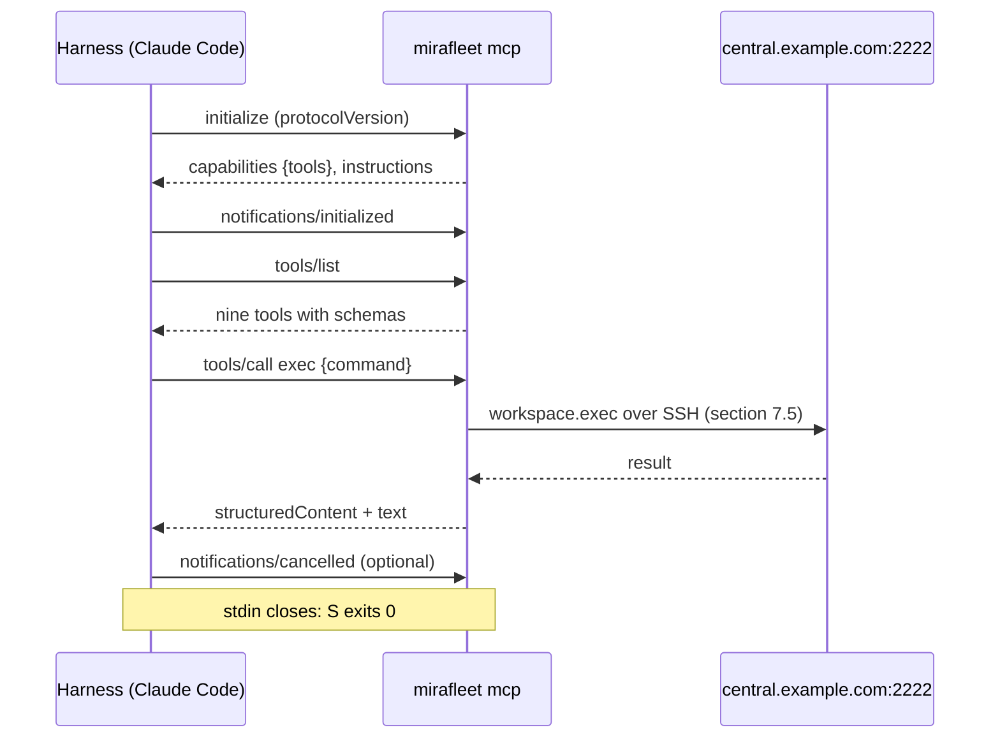

# 7. Protocols

## What you will learn

- The M7 additions: the 24 MCP tools (the fifteen Claude Code parity tools), background jobs, the `Ref` output paging, and the admin-only credential methods (section 7.14).
- Which SSH users and channels exist, and who may open what.
- The exact bytes of a message: the 4-byte length prefix, the JSON envelope, and a hex example.
- Every method with a real request and response: operator methods, admin methods on the local
  socket, and the two enrol methods.
- The error codes, the limits (with constant names and values), and the formats of join tokens
  and registration codes, field by field.
- What flows between central and a runner (`heartbeat@mirafleet`, `exec@mirafleet`,
  `workspace@mirafleet`) and the rules for changing the protocol.
- The M3 additions: the six workspace operator methods and the admin workspace methods with real
  JSON, the **body frame** (a second length-prefixed frame carrying file or stdin bytes), the new
  heartbeat fields, limits and errors.
- The M5 additions: the **MCP layer** on top (JSON-RPC over stdin and stdout: the nine tools,
  their arguments, the result and error shapes, the caps and the chunking), plus the three small
  wire changes underneath: `runners.list` gains `actions` and `actions_omitted`, `workspace.close`
  gains `state`, and the heartbeat gains `actions` (section 7.13).
- The M4 additions: two new admin methods (`gui.reset_admin`, `fleet.set_confirm`), the filters
  of `audit.list` (section 7.6), and the one place where mirafleet speaks HTTP instead of SSH:
  the admin GUI's routes table (section 7.14).
- The M6 additions: the **protocol level** and the version-skew rule (central accepts N and N-1,
  upgrade central first), the exact refusal texts, and what is wired and what is not (section 7.15).

Unfamiliar terms (SSH channel, global request, framing, envelope) are in the
[glossary](glossary.md). The code is `internal/api` (framing, envelope, DTOs, limits),
`internal/transport` (names shared by central and runner), `internal/tokens` (token formats),
`internal/central` (server side) and `internal/apiclient` (client side).

All examples use the running example: central at `central.example.com:2222`, fleets `dev` and
`prod`, runners `build-1` (in `dev`) and `db-1` (in `prod`), operators `durga` and `kalyan`, and
aarvee, the admin who uses the local admin socket. Tokens and codes are obviously fake (the secret
and host-key-hash placeholders are exactly 43 characters long, like the real ones). Timestamps
are made up. M1 to M5 are done, M7 (host mode) is built, and M6 (release) is in progress and unreleased; everything here is implemented, except where
a paragraph says "planned". Workspace ids are 32 lowercase hex characters; the examples use
`3f9a6c1e5b7d4820a1c3e5f708192a4b`.

## 7.1 The big picture: SSH carries everything

mirafleet invents no network protocol of its own. Everything rides on **SSH** (implemented
in-process with `golang.org/x/crypto/ssh`). SSH gives us encryption, server authentication
(the host key) and client authentication (public keys). On top of one SSH connection, you can open many
independent **channels** (think: lightweight sub-connections, each with a *type name*). Peers can
also send **global requests** (one-off messages on the connection itself, not tied to any
channel, optionally answered). Opening a channel can also carry **extra data**: a small blob of
bytes sent inside the channel-open message itself, before any channel traffic.

mirafleet uses three kinds of things on top of SSH:

| Mechanism | Used for | Message format |
|---|---|---|
| Channel `api@mirafleet`, `join@mirafleet`, `register@mirafleet` (peer to central) | Operator API, enrolment | 4-byte length prefix + JSON, one request, one response (section 7.3) |
| Global request `heartbeat@mirafleet` (runner to central) | "I am alive, here is what I am" | SSH request payload: JSON, answered with ok/not ok |
| Channel `exec@mirafleet` (central to runner, **over the runner's own connection**) | Run one action | Open data: JSON; reply: one JSON document then EOF (section 7.10) |
| Channel `workspace@mirafleet` (central to runner, same connection) | One workspace operation: create, exec, read, write, destroy, list | Open data: JSON; optional raw body; reply: one length-prefixed JSON frame, then raw bytes for a read (section 7.10) |

Names are defined once, in `internal/transport/transport.go`, so central and runner cannot
disagree.

There is one exception to "SSH carries everything": the admin GUI (M4). It is an HTTPS listener
inside the central process (default `0.0.0.0:8443`, section 7.14) for a human administrator's
browser. It is not a way in for operators or runners, and it carries no protocol of its own:
every request is turned into a call of the same `service` methods that the admin socket uses.

## 7.2 SSH users and channels

The SSH **user name** selects the role. The key is looked up only in that role's table
([chapter 5](05-security.md#533-ssh-user-to-role-binding)). Authentication is public key only,
`ssh-ed25519` only, with at most 3 tries (`MaxAuthTries`). Any other user name is refused.

| SSH user | Key must be | May open (peer to central) | May send | Central may open toward it |
|---|---|---|---|---|
| `runner` | an enrolled, non-revoked runner key | **nothing**: every channel is rejected | `heartbeat@mirafleet` global requests | `exec@mirafleet` (actions runners), `workspace@mirafleet` (workspace runners) |
| `operator` | an active operator key | `api@mirafleet`, at most **8 at once** | nothing honoured (global requests are discarded) | nothing |
| `enroll` | **any** Ed25519 key | exactly **one** of `join@mirafleet` or `register@mirafleet`, then the connection closes | nothing honoured | nothing |
| (anything else) | n/a | n/a | n/a | n/a (authentication fails) |

Notes you will need when debugging:

- A channel type that is not in the role's allow-list is rejected with SSH reason
  `UnknownChannelType` ("channel type not allowed"). An allowed channel over the cap is rejected
  with `ResourceShortage` ("too many concurrent channels"). A runner's channels all get
  `UnknownChannelType`.
- On an `enroll` connection only the **first** channel counts. A second one gets `Prohibited`. If
  the first has a disallowed type, the connection is closed.
- An `enroll` connection lives at most `Config.EnrollDeadline` (30 s) from accept, and is
  rate limited (10/min per source, 60/min overall) *after* the handshake. This is why anyone who
  can reach the port can complete a handshake as `enroll`: they can then do nothing except present
  a token or code.
- The runner never listens. A runner started with `-actions` handles only `exec@mirafleet`; one
  started with `-workspace` handles only `workspace@mirafleet`. The SSH library rejects every
  other channel type toward the runner, and a runner refuses the channel type it has no config
  for (`Prohibited`).
- There is **no** `file@mirafleet` channel. [M3](../M3.md) put file reads and writes on
  `workspace@mirafleet` (same handler, same trust, half the plumbing).
- The **admin socket** is a unix socket, not SSH. It speaks the same framing and envelope as
  `api@mirafleet` (section 7.5).

## 7.3 Framing: the 4-byte length prefix

A **frame** is one message on a channel. A reader of raw JSON would have to parse it to find
where it ends, so it could not check the size before parsing (and a hostile sender could keep
sending). So every message is wrapped in a **length prefix**: the size comes first.


*Look at: every message is 4 length bytes followed by exactly that many JSON bytes.*

1. The operator builds the JSON request: 33 bytes. Hex above, letters below each byte.
2. It puts the payload length first, as 4 bytes, big-endian: 33 = 0x00000021.
3. Header and payload go out in one Write on the channel.
4. Central reads 4 bytes, checks the length against its limit BEFORE allocating, reads that many.
5. Central runs the method and builds the JSON response (a small example: 28 bytes).
6. The response is framed the same way: 28 = 0x0000001C. The operator reads it back.
7. `write_file` and `exec` with stdin add a body frame right behind the request: a 4-byte length,
   then raw bytes (here 5 bytes, `hello`), at most 1 MiB. Not JSON.
8. Central reads the body frame only after policy, ownership and confirm pass, within 30 s.

### In detail

- The client opens a channel of type `api@mirafleet` (or the enrol types).
- The client writes **4 bytes**: the payload length `N` as an unsigned big-endian integer.
- The client writes the **N bytes** of JSON. (Header and payload leave in one write.)
- Central reads the 4 bytes, **checks `N` against the limit first**, and only then allocates and
   reads N bytes. A hostile prefix of 4 GiB costs nothing.
- Central writes one response frame of the same shape and closes the channel.

### Byte by byte

```
 byte 0      byte 1      byte 2      byte 3      bytes 4 .. 4+N-1
+-----------+-----------+-----------+-----------+---------------------------+
| N >> 24   | N >> 16   | N >> 8    | N & 0xff  | N bytes of UTF-8 JSON     |
+-----------+-----------+-----------+-----------+---------------------------+
   most significant byte first ("big-endian", also called network byte order)
```

Rules (`internal/api/frame.go`, `ReadFrame` / `WriteFrame`):

| Situation | Result |
|---|---|
| `N == 0` | `ErrEmptyFrame`: the peer gets `bad_request` "empty request". Empty frames are also refused when writing. |
| `N` over the limit (request: 64 KiB) | `ErrFrameTooLarge`, **nothing more is read**; the peer gets `too_large`. |
| Stream ends before the 4 header bytes are complete, or before N payload bytes | `io.ErrUnexpectedEOF`; the peer gets `bad_request` "truncated request". |
| Clean end of stream before any byte | `io.EOF`: the peer simply closed; no reply is written. |
| Response bigger than `MaxResponseBytes` | Replaced by a `too_large` error response so the caller still gets an answer. |

### A hex example

The numbers below are the same as in the picture. Durga's client sends `hello`. The JSON is:

```
{"v":1,"id":"1","method":"hello"}
```

Count the characters: that is **33 bytes** (all ASCII, one byte per character). 33 is `0x21`, so the
length prefix is `00 00 00 21`. The whole frame is 4 + 33 = **37 bytes**, shown here as hex
(left) and as text (right, `.` for unprintable bytes):

```
offset  hex                                               text
0000    00 00 00 21 7B 22 76 22 3A 31 2C 22 69 64 22 3A   ...!{"v":1,"id":
0010    22 31 22 2C 22 6D 65 74 68 6F 64 22 3A 22 68 65   "1","method":"he
0020    6C 6C 6F 22 7D                                    llo"}
```

Central's reply here is `{"v":1,"id":"1","result":{}}`. That is **28 bytes**, `0x1C`, so the
frame starts `00 00 00 1C` and is 32 bytes long:

```
offset  hex                                               text
0000    00 00 00 1C 7B 22 76 22 3A 31 2C 22 69 64 22 3A   ....{"v":1,"id":
0010    22 31 22 2C 22 72 65 73 75 6C 74 22 3A 7B 7D 7D   "1","result":{}}
```

(A real `hello` reply carries the operator name and versions; it is shown in section 7.5. This one
is kept tiny so you can count it.) Notice that the **id is echoed back**; the client checks it
matches (`apiclient.callOn`).

Why a length prefix and not one JSON object per line (NDJSON)? It lets a receiver reject a big
message by looking at 4 bytes, and the payload may contain any bytes including raw newlines.
(`docs/M2.md` records NDJSON as rejected, Q12.)

### Body frames (M3): bytes behind a request

Files and stdin are bytes, not JSON. Base64 inside JSON would force a bigger request limit on
**every** method (or tiny 48 KiB chunks), so M3 added a second kind of frame, the **body frame**,
sent on the same channel right behind the request frame. The picture above shows it in steps 7
and 8.

```
request frame                                  body frame (only some methods)
+----------+------------------------+          +----------+---------------------------+
| 4 bytes  | N bytes of JSON (<=64K)|    then  | 4 bytes  | M raw bytes (<= 1 MiB)    |
| N        | {"method":"workspace.  |          | M        | not JSON, any bytes at all|
+----------+ write_file", ...}      |          +----------+---------------------------+
```

Same 4-byte big-endian length, same "check before you allocate". The differences:

| | Request frame (`ReadFrame`) | Body frame (`ReadBodyTimeout`) |
|---|---|---|
| Limit | `api.MaxRequestBytes` 64 KiB | `api.MaxFileChunk` 1 MiB |
| Zero length | refused (`ErrEmptyFrame`) | **valid**: an empty file or empty stdin |
| Content | one JSON envelope | raw bytes |
| Deadline | `api.RequestTimeout` 10 s | `api.BodyTimeout` 30 s, armed when central **asks** for it |
| Writer | `api.WriteFrame` | `api.WriteBody` |

Which methods carry bodies:

- `workspace.write_file`: a request body of exactly `length` bytes whose SHA-256 must equal
  `sha256` (a mismatch is `bad_request`, audited, and nothing reaches the runner).
- `workspace.exec` with `"stdin": true`: a request body (the stdin bytes, at most 1 MiB).
- `workspace.read_file`: the **response** has a body. The JSON result frame comes first
  (`length` says how many bytes follow), then one body frame.

The client writes the body frame immediately after the request: SSH's channel window (2 MiB) is
bigger than the biggest body, so that write never blocks. Central, however, reads it **late on
purpose**: the handlers wrap the body in a lazy reader (`lazyStdin`, `lazyFileBody` in
`internal/central/workspace_handlers.go`) and the service only touches it after policy, ownership,
workspace state, input checks and `confirm` have passed. Why: if central read the body first, any
authenticated but unauthorised caller could make it buffer 1 MiB per channel, 8 channels per
connection, before being refused. With the late read, a refused caller costs a 64 KiB frame.
A slow sender is cut off after 30 s (`timeout`; the channel is closed), a body over the stated
size is `too_large`, a short one is `bad_request` "truncated body".

Byte example, the body of a `write_file` of the five bytes `hello`:

```
offset  hex                        text
0000    00 00 00 05 68 65 6C 6C 6F ....hello
```

## 7.4 The v1 envelope

Every request and response is a JSON object with the same outer shape, the **envelope**
(`api.Request`, `api.Response`).

**Request**

```json
{"v": 1, "id": "a1b2c3d4e5f60718", "method": "runners.list", "params": {"fleet": "prod"}}
```

| Field | Type | Rules |
|---|---|---|
| `v` | integer | Protocol version. Must be `1` today. Checked **first**. |
| `id` | string | 1 to 128 bytes. Chosen by the client (the Go client uses 16 hex chars from 8 random bytes). Echoed in the reply. |
| `method` | string | Non-empty. Names in sections 7.5 to 7.7. |
| `params` | object | Optional. Missing, empty or `null` means "no params". |

The server decodes with `DisallowUnknownFields`: **any field not listed above, in the envelope or
in the params of a method, is `bad_request`**. Trailing data after the JSON object (including a stray
`}`) is also `bad_request`. Strict parsing is cheap protection against typos and smuggling.

**Response: exactly one of `result` and `error`**

```json
{"v": 1, "id": "a1b2c3d4e5f60718", "result": { ... }}
{"v": 1, "id": "a1b2c3d4e5f60718", "error": {"code": "not_found", "message": "not found"}}
```

`Response.Marshal` refuses to build a message with both or neither. When the request was too broken
to read an id, `PeekID` tries to recover one for the reply; otherwise `id` is empty.

**One request per channel.** The client opens a channel, sends one request, reads one response,
closes. *Cancel* is closing the channel. *Concurrency* is opening more channels (up to 8 per
connection). We rejected a multiplexed JSON-RPC stream on one channel because it needs
request-ids, ordering rules and flow control, all of which SSH channels already provide.

A half-close (the client finishes writing but keeps reading) is **not** a cancel: the request still
runs and the reply is still written. Closing the channel or dropping the connection is.

## 7.5 Operator methods (`api@mirafleet`)

Reachable by operators on `api@mirafleet`, and by the admin on the admin socket (except `hello`).
Every call goes through the service: policy (the operator must be `active` *now*, so every
operator method passes that current-status check), validation, audit. The method table and the
policy are two independent gates; admin-only calls add a direct check of the caller's kind as a
third.

### `hello`

Identify yourself and learn the protocol versions. Like every operator method it passes the
policy's current-status check; `hello` just does one extra lookup in its handler
(`handleHello` in `internal/central/dispatch.go`): it re-reads the operator row and answers
`forbidden` if that operator is no longer `active`.

Request:
```json
{"v":1,"id":"a1b2c3d4e5f60718","method":"hello","params":{"client":"mcp"}}
```
Response:
```json
{"v":1,"id":"a1b2c3d4e5f60718","result":{"operator":"durga","versions":[1],"server":"mirafleet"}}
```
`client` is an optional hint of at most 32 printable ASCII characters. It is **logged, not
trusted** (a longer or non-printable hint is silently dropped).

### `fleets.list`

No params. Returns every fleet with its count of non-revoked runners.
```json
{"v":1,"id":"b7e4","method":"fleets.list"}
{"v":1,"id":"b7e4","result":{"fleets":[
  {"name":"dev","mode":"actions","confirm":false,"runners":1},
  {"name":"prod","mode":"actions","confirm":true,"runners":1}]}}
```
(Responses are one line on the wire; line breaks added here.) `confirm: true` means a guarded fleet.

### `runners.list`

Params: `fleet` (required). Lists non-revoked runners of that fleet, merged with live state:
`online` is true only for a registered session that heartbeated recently; `last_seen` is the later
of the stored time and the live heartbeat. `labels` come from the join token.
```json
{"v":1,"id":"c1d2","method":"runners.list","params":{"fleet":"prod"}}
{"v":1,"id":"c1d2","result":{"runners":[
  {"name":"db-1","status":"active","online":true,"labels":{"role":"db"},
   "last_seen":"2026-11-13T09:41:07.512Z"}]}}
```
`last_seen` is an RFC 3339 UTC timestamp and is omitted if the runner was never seen.

**Action discovery (M5).** An actions-mode runner now tells central which actions it offers, and
`runners.list` passes that on, so an agent can see that `db-1` has `tail-logs` and which values its
parameters accept instead of guessing names:
```json
{"v":1,"id":"c1d3","result":{"runners":[
  {"name":"db-1","status":"active","online":true,"labels":{"role":"db"},
   "last_seen":"2026-11-13T09:41:07.512Z",
   "actions":[{"name":"tail-logs","params":[{"name":"lines","pattern":"^[0-9]{1,4}$","default":"200"}]}]}]}}
```
Each action has a `name` and `params`; each param has `name`, `pattern` (the regular expression the
runner's guard will apply) and `default` (absent when the parameter is required). This is
**informational only**: the runner's `actions.yaml` stays the security boundary, and the guard
still checks every value ([chapter 5](05-security.md)). A made-up list on the wire would change
what the agent *tries*, never what the runner *runs*.

Size is bounded twice. A runner may advertise at most 128 actions (`transport.MaxHeartbeatActions`)
and at most 16 KiB of encoded actions (`transport.MaxActionsBytes`). Central adds the actions of
the runners in one reply only until 512 KiB (`maxListActionsBytes` in `internal/central/dispatch.go`)
are used; every later runner is listed **without** `actions` and with `"actions_omitted":true`, so
a fleet with many busy runners can never push `runners.list` over `api.MaxResponseBytes`. M2 and M3
runners send no actions, and then both fields are absent.

### `action.run`

Run a named action on one runner.

| Param | Type | Rules |
|---|---|---|
| `fleet`, `runner` | string | Must form a valid `fleet/runner` reference. |
| `action` | string | 1 to 64 bytes. Checked by the *runner's* `actions.yaml`, not by central. |
| `params` | object of strings | At most 32 entries, key 1 to 64 bytes, value up to 4096 bytes. |
| `timeout_s` | integer | `0` = default (120 s); negative is `bad_request`; capped at 600 s. |
| `confirm` | string | On a guarded fleet, must equal the fleet name. |

Central checks, in order: policy, input limits, fleet exists and is in `actions` mode, confirm,
runner is `active`; then writes the audit `start` row; then asks the runner.

Request:
```json
{"v":1,"id":"d3f9","method":"action.run","params":{
  "fleet":"prod","runner":"db-1","action":"tail-logs",
  "params":{"lines":"200"},"timeout_s":30,"confirm":"prod"}}
```
Success:
```json
{"v":1,"id":"d3f9","result":{"exit_code":0,"stdout":"Nov 13 09:41:03 db-1 gitlab-runner[812]: ...\n",
  "stderr":"","duration_ms":41,"request_id":"9f1c0a5be2d84c7790a1b3c4d5e6e07a"}}
```
`truncated: true` appears when output hit the 1 MiB cap. A command that ran and failed is **still
a success response** with a non-zero `exit_code`: the protocol worked, the action did not.

Failures (all with the same envelope):

| Situation | Response `error` |
|---|---|
| Guarded fleet, `confirm` missing | `{"code":"bad_request","message":"fleet requires confirm to equal the fleet name"}` |
| Runner's guard refused (unknown action, bad param) | `{"code":"bad_request","message":"refused by runner: refused: parameter \"lines\" does not match its pattern"}` |
| Runner is `pending` or `disabled` | `{"code":"conflict","message":"runner is pending"}` |
| Fleet is not in `actions` mode | `{"code":"conflict","message":"fleet is not in actions mode"}` |
| Runner offline, or something broke talking to it | `{"code":"unavailable","message":"runner unavailable"}` |
| Runner revoked mid-run | `{"code":"unavailable","message":"runner revoked"}` |
| Audit table not writable | `{"code":"unavailable","message":"audit unavailable"}` |
| Ran past `timeout_s` | `{"code":"timeout","message":"action timed out"}` |
| Operator revoked, or channel closed mid-run | `{"code":"unavailable","message":"request cancelled"}` (usually unseen: the connection is gone) |

If the runner itself reports that the action timed out (the action's own `timeout` in
`actions.yaml`), the response is a normal result with `exit_code: -1`, and the audit outcome is `timeout`.

### Workspace methods (M3)

Six more operator methods drive workspaces. They exist only on `api@mirafleet` (the admin socket
does **not** serve them: aarvee manages workspaces with the admin methods in section 7.6; the admin never
runs commands in them). All six go through the same policy check as every other method, plus a
direct check that the caller is an *operator*. They only work on a fleet in `workspace` mode;
`action.run` on such a fleet, and `workspace.*` on an actions fleet, answer `conflict`.

Ownership is the main rule: every call that names a `workspace` loads the row and requires that
the caller is its owner. Anyone else, and any unknown or malformed id, gets the **same**
`not_found`. kalyan cannot even learn that durga's workspace exists.

The running example: durga's agent works in fleet `dev`, session `s1` (see the
[M3 flow diagrams](diagrams/README.md): `workspace-open.svg` and `workspace-exec.svg`).

#### `workspace.open`

| Param | Type | Rules |
|---|---|---|
| `fleet` | string | A valid fleet name, in `workspace` mode. |
| `session` | string | 1 to 128 characters of `A-Za-z0-9._:-`. Chosen by the **client**; it is the stickiness key. |
| `image` | string | Optional. Must match the fleet's image allowlist; default is the fleet's `default_image`. |
| `labels` | object of strings | Optional. Must be a subset of the runner's **trusted token labels**. At most 16; names starting with `mirafleet.` are reserved. |
| `confirm` | string | On a guarded fleet, must equal the fleet name. |

```json
{"v":1,"id":"w1","method":"workspace.open","params":{"fleet":"dev","session":"s1","labels":{"zone":"a"}}}
{"v":1,"id":"w1","result":{"workspace":{"id":"3f9a6c1e5b7d4820a1c3e5f708192a4b","fleet":"dev",
 "runner":"build-1","session":"s1",
 "image":"docker.io/library/golang@sha256:0123456789abcdef0123456789abcdef0123456789abcdef0123456789abcdef",
 "state":"open","created":"2026-11-13T09:41:07.512Z","last_used":"2026-11-13T09:41:07.512Z",
 "expires":"2026-11-20T09:41:07.512Z"},"reused":false}}
```

Open **is** idempotent per `(operator, fleet, session)`: a second `open` with the same session
returns the same workspace with `"reused":true` and creates nothing (a unique partial index in
the database guarantees one live workspace per triple). Two situations are errors instead:
the session's runner is offline (`unavailable`, "the runner holding this session's workspace is
offline": the files live on that runner, so a fresh workspace elsewhere would silently lose
them), and the first open is still being created (`conflict`, "workspace is still opening").
Placement is described in [chapter 4](04-flows.md); the result of a successful open is an `open`
row, `expires` is `created` plus the fleet's `max_ttl`.

Failures: `bad_request` (invalid session, image not allowed by the fleet, missing confirm, label
errors, "refused by runner: ..." when the runner's own `workspace.yaml` says no), `conflict`
(fleet not in workspace mode, per-operator cap reached: "workspace limit reached (8)"),
`unavailable` ("no runner can take this workspace right now", "runner busy"), `timeout`
(creation, including an image pull, took more than 5 minutes).

#### `workspace.exec`

| Param | Type | Rules |
|---|---|---|
| `workspace` | string | An id you own, in state `open` (else `conflict`, "workspace is closing"). |
| `argv` | array of strings | 1 to 256 elements, 32 KiB in total, no NUL, `argv[0]` set. **No shell string**: to use a shell, send `["/bin/sh","-c","..."]`. |
| `cwd` | string | Optional. Relative to `/workspace` or absolute under it. Cleaned; a `..` that escapes is refused. |
| `env` | object | Optional. At most 32 variables, names `^[A-Z_][A-Z0-9_]{0,63}$`, values up to 4 KiB. Must pass the runner's `env_allow` and never match the hard denylist: names that look like credentials (`ANTHROPIC_API_KEY`, `*_TOKEN`, `*_PASSWORD`, `AWS_*`, ...), proxy settings, and variables that change what code a process loads (`LD_*`, `NODE_OPTIONS`, `PYTHONPATH`, `GIT_CONFIG_*`, ...). The list grows over time, so this guide does not copy it; the source of truth is `workspace.EnvDenied` in `internal/workspace/validate.go`. |
| `timeout_s` | integer | `0` = the fleet's `exec_default_s` (120); capped at the fleet's `exec_max_s` (default 1800, ceiling 86400) and again by the runner's `limits.exec_max`. |
| `stdin` | boolean | `true` means a body frame (at most 1 MiB) follows the request. |
| `confirm` | string | Guarded fleets: the fleet name. |

```json
{"v":1,"id":"w2","method":"workspace.exec","params":{"workspace":"3f9a6c1e5b7d4820a1c3e5f708192a4b",
 "argv":["go","test","./..."],"cwd":"src","env":{"CI":"1"},"timeout_s":300}}
{"v":1,"id":"w2","result":{"exit_code":0,"stdout":"ok  \texample.com/app\t0.412s\n","stderr":"",
 "duration_ms":1873,"request_id":"c0ffee11d00d4b2a9a3e5f6071829304"}}
```

As with `action.run`, a command that ran and failed is still a success response with a non-zero
`exit_code`. `truncated: true` means the output hit the budget: the runner keeps a **head and a
tail** of each stream and trims them so the *JSON-encoded* stdout plus stderr fit in 1 MiB
(`api.MaxResultBytes`); invalid UTF-8 is replaced, so binary output can never turn into
`too_large`. `timed_out: true` means the runner killed the command at its deadline (the audit
outcome is `timeout`). There is no streaming: the reply is one frame when the command ends.

An env value that is on the denylist is refused naming the *variable*, never its value:
```json
{"v":1,"id":"w3","method":"workspace.exec","params":{"workspace":"3f9a6c1e5b7d4820a1c3e5f708192a4b",
 "argv":["env"],"env":{"ANTHROPIC_API_KEY":"x"}}}
{"v":1,"id":"w3","error":{"code":"bad_request","message":"env ANTHROPIC_API_KEY is denied"}}
```
The shape is the point: `bad_request`, the variable name, never the value. A name that is merely
not on the runner's `env_allow` list is refused by the runner instead (`refused by runner: env X
is not allowed`).

#### `workspace.read_file`

Params: `workspace`, `path` (a file under `/workspace`, not the root itself), `offset` (default 0),
`limit` (bytes, default and maximum 1 MiB). The result is followed by **one body frame** holding
`length` bytes.

```json
{"v":1,"id":"w4","method":"workspace.read_file","params":{"workspace":"3f9a6c1e5b7d4820a1c3e5f708192a4b",
 "path":"src/main.go","offset":0,"limit":65536}}
{"v":1,"id":"w4","result":{"size":1342,"offset":0,"length":1342,"mode":420,"eof":true}}
<body frame: 00 00 05 3E, then 1342 bytes>
```
`mode` is the permission bits as a number (420 is octal 0644). For a file bigger than one chunk,
call again with `offset` set to what you have so far until `eof` is true. `read_file` works on
regular files only: a directory, a FIFO or a symlink that points out of `/workspace` is refused.

#### `workspace.write_file`

| Param | Type | Rules |
|---|---|---|
| `workspace`, `path` | string | As above. |
| `offset` | integer | Where to write, default 0. |
| `truncate` | boolean | `true` replaces the file (written to a temp file, then renamed). |
| `mode` | integer | Permission bits for a **new** file, 0 means 0644; only `0777` bits are allowed (no setuid). |
| `length` | integer | 0 to 1 MiB: exactly the size of the body frame. |
| `sha256` | string | 64 lowercase hex characters: the SHA-256 of the body. |
| `confirm` | string | Guarded fleets: the fleet name. |

```json
{"v":1,"id":"w5","method":"workspace.write_file","params":{"workspace":"3f9a6c1e5b7d4820a1c3e5f708192a4b",
 "path":"notes.txt","truncate":true,"mode":420,"length":5,
 "sha256":"2cf24dba5fb0a30e26e83b2ac5b9e29e1b161e5c1fa7425e73043362938b9824"}}
<body frame: 00 00 00 05 68 65 6C 6C 6F>
{"v":1,"id":"w5","result":{"size":5}}
```
Why the hash: the body frame already arrives intact over SSH, but the hash lets the audit row say
*exactly* which bytes were written without storing them, and catches a client bug (wrong body for
the request) before anything reaches the runner. A file bigger than the chunk limit is written in
pieces: the first with `truncate:true`, the next ones with `offset` set. The runner also enforces
its own `limits.max_file` (set in `workspace.yaml`, see [chapter 10](10-operations.md)) and refuses a write when the workspace is
over its disk quota (`too_large`/`quota` surfaces as `bad_request`, "refused by runner: ...").

#### `workspace.close`

```json
{"v":1,"id":"w6","method":"workspace.close","params":{"workspace":"3f9a6c1e5b7d4820a1c3e5f708192a4b"}}
{"v":1,"id":"w6","result":{}}
```
The row goes `open` to `closing`, the runner destroys the container and its directory, the row
becomes `closed`. If the runner is offline (or the destroy fails), the call still succeeds, but
the row stays `closing` (it keeps its slot) until the reaper or the reconcile pass finishes the
job, and the result **says so** with a `state` field (M5):
```json
{"v":1,"id":"w6","result":{"state":"closing"}}
```
`state` is absent (`{}`) when the workspace is closed, and `"closing"` when it is not yet. Before
M5 both cases looked the same, so a caller could believe a slot was free when it was not. The code
is `api.WorkspaceCloseResult` and `internal/central/workspace_handlers.go`. Closing an already
finished workspace is a no-op.

#### `workspace.list`

Params: `fleet` (optional). Returns **your own** live workspaces (`opening`, `open`, `closing`),
never anyone else's. This call is audited too (one row), unlike `fleets.list` and `runners.list`.
```json
{"v":1,"id":"w7","method":"workspace.list","params":{"fleet":"dev"}}
{"v":1,"id":"w7","result":{"workspaces":[{"id":"3f9a6c1e5b7d4820a1c3e5f708192a4b","fleet":"dev",
 "runner":"build-1","session":"s1","image":"docker.io/library/golang@sha256:0123456789abcdef0123456789abcdef0123456789abcdef0123456789abcdef",
 "state":"open","created":"2026-11-13T09:41:07.512Z","last_used":"2026-11-13T09:44:50.101Z",
 "expires":"2026-11-20T09:41:07.512Z"}]}}
```

#### Additive fields on older methods

M3 added fields without a version bump (section 7.12): `fleets.list` shows
`"workspace":{"default_image":...,"images":[...],"network":"egress"}` on workspace fleets, and
`runners.list` shows `"slots"`, `"free_slots"` and `"executor"` on workspace runners:
```json
{"v":1,"id":"c3","result":{"runners":[{"name":"build-1","status":"active","online":true,
 "labels":{"zone":"a"},"last_seen":"2026-11-13T09:44:52.512Z","slots":4,"free_slots":3,"executor":"containerd"}]}}
```
`free_slots` is `slots` minus the live workspaces the store knows about.


### The same envelope rejects what it must

An admin method on the operator channel:
```json
{"v":1,"id":"e5a1","method":"runner.lifecycle","params":{"fleet":"prod","runner":"db-1","op":"revoke"}}
{"v":1,"id":"e5a1","error":{"code":"forbidden","message":"forbidden"}}
```
A made-up method gives `bad_request` "unknown method". A future protocol version:
```json
{"v":2,"id":"f0f0","method":"hello"}
{"v":1,"id":"f0f0","error":{"code":"unsupported_version",
  "message":"unsupported protocol version 2; supported: [1]","supported":[1]}}
```

## 7.6 Admin methods (local admin socket)

The admin socket is `<data>/admin.sock` (default `/var/lib/mirafleet/central/admin.sock`), mode
`0600`. Each connection carries **one request frame and one response frame**, same framing and same
limits. The peer's uid must equal central's, checked before anything is read. The caller is
principal `admin` (name `uid:<n>`), audit source `cli`. The `mirafleet central ...` commands are
clients of this socket (`internal/central/adminclient.go`).

Served here: the admin methods below, plus `fleets.list`, `runners.list` and `action.run` (so
`central exec` works). `hello` and the enrol methods are **not** served (answer: `forbidden`).
Admin methods are never served on `api@mirafleet`. The admin disconnecting (for example Ctrl-C of `central
exec`) cancels the request on Linux; on macOS it does not (central only runs on Linux).

All times are RFC 3339 UTC.

| Method | Params | Result |
|---|---|---|
| `fleet.create` | `name`, `mode` (`actions` default or `workspace`), `confirm` (bool), `workspace` (config object; required-or-defaulted for `workspace` mode, rejected otherwise) | `{"fleet":{name,mode,confirm,runners,workspace?}}` |
| `fleet.workspace_set` | `fleet`, `workspace` (the **complete** config: a full replace) | `{"fleet":{...}}` |
| `workspace.admin_list` | `fleet` (optional) | `{"workspaces":[...]}` all operators, with the `operator` field |
| `workspace.kill` | `id` | `{"state":"closed"}` or `{"state":"closing"}` |
| `token.create` | `fleet`, `labels`, `approve`, `uses` (0 = 1), `ttl_s` (0 = 86400; max 2592000) | `{id, token, expires}`, token shown once |
| `token.list` | `fleet` (empty = all) | `{"tokens":[{id,fleet,labels,approve,max_uses,uses,expires,revoked}]}` |
| `token.revoke` | `id` | `{}` |
| `runner.lifecycle` | `fleet`, `runner`, `op` (`approve`, `disable`, `enable`, `revoke`) | the runner: `{name,status,online,labels,last_seen}` |
| `operator.code` | none | `{code, seconds_left, host_fingerprint}` |
| `operator.rotate_secret` | none | `{}` |
| `operator.list` | none | `{"operators":[{name,fingerprint,status,last_seen}]}` including revoked |
| `operator.revoke` | `name` | `{}` |
| `fleet.set_confirm` (M4) | `fleet`, `confirm` (bool) | `{"fleet":{...}}`: the guard flag changed; audited as `fleet.set_confirm` with the old and new value |
| `gui.reset_admin` (M4) | none | `{"setup_token":"mfs1...."}`: ends every GUI session, retires the admin, shown once |
| `audit.list` | `since_id`, `limit` (0 = 100, max 1000), and since M4 optional filters (below) | `{"events":[...]}` ascending by id |

Examples (one line on the wire):

```json
{"v":1,"id":"1","method":"fleet.create","params":{"name":"prod","mode":"actions","confirm":true}}
{"v":1,"id":"1","result":{"fleet":{"name":"prod","mode":"actions","confirm":true,"runners":0}}}
```

Workspace fleets (M3). `fleet.create` with `mode: workspace` carries the fleet's workspace config.
Omitted fields get documented defaults (executor `containerd`, pull `if-not-present`, network
`none`, 2 CPUs, 4 GiB, 1024 pids, 512 MiB tmpfs, 10 GiB disk, idle TTL 24 h, max TTL 168 h,
exec timeout 2 min, exec max 30 min); the default image is never invented and is required. Units
in the wire config: `cpu_milli` thousandths of a CPU, `*_mb` mebibytes, `*_s` seconds.
```json
{"v":1,"id":"11","method":"fleet.create","params":{"name":"dev","mode":"workspace","workspace":{
 "executor":"containerd",
 "default_image":"docker.io/library/golang@sha256:0123456789abcdef0123456789abcdef0123456789abcdef0123456789abcdef",
 "images":["docker.io/library/golang@sha256:*"],"network":"egress",
 "egress":["proxy.golang.org:443","*.golang.org:443"]}}}
{"v":1,"id":"11","result":{"fleet":{"name":"dev","mode":"workspace","confirm":false,"runners":0,
 "workspace":{"default_image":"docker.io/library/golang@sha256:0123456789abcdef0123456789abcdef0123456789abcdef0123456789abcdef",
 "images":["docker.io/library/golang@sha256:*"],"network":"egress",
 "config":{"executor":"containerd","default_image":"docker.io/library/golang@sha256:0123456789abcdef0123456789abcdef0123456789abcdef0123456789abcdef",
 "images":["docker.io/library/golang@sha256:*"],"pull":"if-not-present","network":"egress",
 "egress":["proxy.golang.org:443","*.golang.org:443"],"cpu_milli":2000,"memory_mb":4096,"pids":1024,
 "tmpfs_mb":512,"disk_mb":10240,"idle_ttl_s":86400,"max_ttl_s":604800,"exec_default_s":120,"exec_max_s":1800}}}}}
```
The `config` object (the full config) appears **only on the admin socket**; an operator's
`fleets.list` sees `default_image`, `images` and `network` and nothing more. `fleet.workspace_set`
is a **full replace**: the CLI first reads the current config, changes the flags you gave and
sends everything back, so a list such as `egress` can be cleared (send `[]`) and nothing is
merged on the server. Workspaces that already exist keep the spec they were opened with.
```json
{"v":1,"id":"12","method":"fleet.workspace_set","params":{"fleet":"dev","workspace":{
 "executor":"containerd","default_image":"docker.io/library/golang@sha256:0123456789abcdef0123456789abcdef0123456789abcdef0123456789abcdef",
 "images":["docker.io/library/golang@sha256:*"],"pull":"if-not-present","network":"none",
 "cpu_milli":2000,"memory_mb":4096,"pids":1024,"tmpfs_mb":512,"disk_mb":10240,
 "idle_ttl_s":43200,"max_ttl_s":604800,"exec_default_s":120,"exec_max_s":1800}}}
{"v":1,"id":"12","result":{"fleet":{"name":"dev","mode":"workspace","confirm":false,"runners":1,
 "workspace":{"default_image":"docker.io/library/golang@sha256:0123456789abcdef0123456789abcdef0123456789abcdef0123456789abcdef",
 "images":["docker.io/library/golang@sha256:*"],"network":"none","config":{"...":"as above"}}}}}
```
(`"config":{"...":"as above"}` abbreviates the same object; the real reply spells it out.)
```json
{"v":1,"id":"13","method":"workspace.admin_list","params":{"fleet":"dev"}}
{"v":1,"id":"13","result":{"workspaces":[{"id":"3f9a6c1e5b7d4820a1c3e5f708192a4b","fleet":"dev",
 "runner":"build-1","session":"s1","image":"docker.io/library/golang@sha256:0123456789abcdef0123456789abcdef0123456789abcdef0123456789abcdef",
 "state":"open","operator":"durga","created":"2026-11-13T09:41:07.512Z",
 "last_used":"2026-11-13T09:44:50.101Z","expires":"2026-11-20T09:41:07.512Z"}]}}
{"v":1,"id":"14","method":"workspace.kill","params":{"id":"3f9a6c1e5b7d4820a1c3e5f708192a4b"}}
{"v":1,"id":"14","result":{"state":"closed"}}
```
`workspace.kill` destroys the workspace on its runner. If the runner is offline the state comes
back `closing`: the row keeps its slot and the reaper finishes the job when the runner returns.
`workspace.admin_list` shows live and recent workspaces of every operator, which is how aarvee
finds a session to kill. aarvee can see and kill workspaces but has **no** method to read or write
inside one.
```json
{"v":1,"id":"2","method":"token.create","params":{"fleet":"prod","labels":{"role":"db"},"approve":false,"uses":1,"ttl_s":86400}}
{"v":1,"id":"2","result":{"id":"0123456789abcdef",
 "token":"mfj1.0123456789abcdef.EXAMPLE_SECRET_NOT_REAL_EXAMPLE_SECRET_FAKE.EXAMPLE_HOSTKEY_HASH_NOT_REAL_EXAMPLE_HOSTK",
 "expires":"2026-11-14T09:41:07.512Z"}}
```
```json
{"v":1,"id":"3","method":"token.list","params":{"fleet":"prod"}}
{"v":1,"id":"3","result":{"tokens":[{"id":"0123456789abcdef","fleet":"prod","labels":{"role":"db"},
 "approve":false,"max_uses":1,"uses":0,"expires":"2026-11-14T09:41:07.512Z","revoked":false}]}}
```
```json
{"v":1,"id":"4","method":"token.revoke","params":{"id":"0123456789abcdef"}}
{"v":1,"id":"4","result":{}}
```
```json
{"v":1,"id":"5","method":"runner.lifecycle","params":{"fleet":"prod","runner":"db-1","op":"approve"}}
{"v":1,"id":"5","result":{"name":"db-1","status":"active","online":false,"labels":{"role":"db"}}}
```
`online` is always `false` in this reply: it is the stored row, not the live state. Use `runners.list` for live state.
```json
{"v":1,"id":"6","method":"operator.code"}
{"v":1,"id":"6","result":{"code":"mfr1.EXAMPLECODEEXAMPLECODEEXAM.EXAMPLE_HOSTKEY_HASH_NOT_REAL_EXAMPLE_HOSTK",
 "seconds_left":37,"host_fingerprint":"SHA256:EXAMPLE_FINGERPRINT_NOT_REAL"}}
```
```json
{"v":1,"id":"7","method":"operator.rotate_secret"}
{"v":1,"id":"7","result":{}}
```
```json
{"v":1,"id":"8","method":"operator.list"}
{"v":1,"id":"8","result":{"operators":[
 {"name":"durga","fingerprint":"SHA256:EXAMPLE_DURGA_FP","status":"active","last_seen":"2026-11-13T09:40:12.004Z"},
 {"name":"kalyan","fingerprint":"SHA256:EXAMPLE_KALYAN_FP","status":"revoked"}]}}
```
```json
{"v":1,"id":"9","method":"operator.revoke","params":{"name":"kalyan"}}
{"v":1,"id":"9","result":{}}
```
```json
{"v":1,"id":"10","method":"audit.list","params":{"since_id":1040,"limit":2}}
{"v":1,"id":"10","result":{"events":[
 {"id":1041,"time":"2026-11-13T09:41:07.512Z","source":"api","actor_kind":"operator","actor":"durga",
  "remote":"203.0.113.7:51514","fleet":"prod","runner":"db-1","subject":"tail-logs","action":"action.run",
  "params":{"lines":"200"},"outcome":"start","request_id":"9f1c0a5be2d84c7790a1b3c4d5e6e07a"},
 {"id":1042,"time":"2026-11-13T09:41:07.561Z","source":"api","actor_kind":"operator","actor":"durga",
  "remote":"203.0.113.7:51514","fleet":"prod","runner":"db-1","subject":"tail-logs","action":"action.run",
  "outcome":"ok","exit_code":0,"duration_ms":41,"request_id":"9f1c0a5be2d84c7790a1b3c4d5e6e07a"}]}}
```
`audit.list` has an extra, direct check in its handler that the caller's kind is `admin`. Fields
that are empty or zero are omitted (`omitempty`), except `id`, `time`, `source`, `actor_kind`,
`actor`, `action`. To export the log, call repeatedly with `since_id` set to the last id seen.
The `exit_code` pointer distinguishes "0" from "none".

**Filters (M4).** `api.AuditListParams` gained optional, additive fields, all exact matches
except where noted; leave them out and the call behaves as before. They exist because the GUI's
Audit screen filters the log, and the admin socket and the screen share one code path
(`service.ListAudit` over `store.QueryAudit`).

| Field | Meaning |
|---|---|
| `before_id` | only rows with a smaller id (paging backwards) |
| `fleet`, `runner`, `actor`, `source`, `outcome`, `workspace`, `request_id` | exact match on that column; `source` is `cli`, `api`, `gui`, `enroll` or `system` |
| `action` | exact action name, or a prefix when `action_prefix` is `true` (`runner.` finds every runner action; the `%` and `_` characters are escaped) |
| `from`, `to` | RFC 3339 time range |

`mirafleet central audit` has a flag for each (`-fleet`, `-runner`, `-actor`, `-source`,
`-outcome`, `-action`, `-action-prefix`, `-workspace`, `-request-id`, `-from`, `-to`, `-before`).

Two new admin methods arrived with the GUI, and neither is served on `api@mirafleet` (they are in
`api.IsAdminMethod`, so an agent gets `forbidden`):
```json
{"v":1,"id":"15","method":"fleet.set_confirm","params":{"fleet":"prod","confirm":true}}
{"v":1,"id":"15","result":{"fleet":{"name":"prod","mode":"actions","confirm":true,"runners":1}}}
{"v":1,"id":"16","method":"gui.reset_admin"}
{"v":1,"id":"16","result":{"setup_token":"mfs1.EXAMPLE_SETUP_TOKEN_NOT_REAL"}}
```
`fleet.set_confirm` is what `mirafleet central fleet set prod -confirm=true` sends (and what the
GUI's guard toggle calls through the service). `gui.reset_admin` is what `mirafleet central gui
reset-admin` sends. The GUI cannot call it: `gui.Backend` leaves `ResetGUIAdmin` out on purpose,
and `Service.ResetGUIAdmin` itself refuses any source but `cli`, so recovery needs shell access to
the central host and cannot be started from a browser
([chapter 10](10-operations.md#1011-the-admin-gui-m4)).

## 7.7 Enrol methods (`join@mirafleet`, `register@mirafleet`)

Used by SSH user `enroll`. Each connection carries **one** channel with **one** request and **one**
response, then closes. The method must match the channel type; mismatches get `bad_request`
"method does not match channel", and enrol methods on `api@mirafleet` get `forbidden`.

Both clients pin central's host key from the credential before sending it
([chapter 5](05-security.md#532-host-key-pinning-no-trust-on-first-use)).

### `enroll.join` on `join@mirafleet`

```json
{"v":1,"id":"j1","method":"enroll.join","params":{
 "token":"mfj1.0123456789abcdef.EXAMPLE_SECRET_NOT_REAL_EXAMPLE_SECRET_FAKE.EXAMPLE_HOSTKEY_HASH_NOT_REAL_EXAMPLE_HOSTK",
 "name":"build-1"}}
{"v":1,"id":"j1","result":{"fleet":"dev","runner":"build-1","status":"pending"}}
```
`status` is `active` if the token was made with `-approve`. The params struct also has an optional
`labels` field; it is accepted but **ignored**: labels come only from the token.

### `enroll.register` on `register@mirafleet`

```json
{"v":1,"id":"r1","method":"enroll.register","params":{
 "code":"mfr1.EXAMPLECODEEXAMPLECODEEXAM.EXAMPLE_HOSTKEY_HASH_NOT_REAL_EXAMPLE_HOSTK",
 "name":"durga"}}
{"v":1,"id":"r1","result":{"operator":"durga","status":"active"}}
```

### Enrol failures

| Situation | Response |
|---|---|
| Anything wrong with the token or code (malformed, wrong pin, unknown, wrong secret, expired, revoked, used up, no registration secret) | `{"code":"unauthenticated","message":"join refused"}` or `"registration refused"`, **byte-identical** for every cause |
| Name already used by a live runner, key already enrolled, key belongs to the other role, revoked operator key | `{"code":"conflict","message":"conflict"}` (only reached with a valid token or code) |
| Bad name | `{"code":"bad_request","message":"invalid runner name"}` / `"invalid operator name"` |
| Not an Ed25519 key | `bad_request` "ssh-ed25519 key required" |

## 7.8 Error codes

`api.Error` has `code` (stable, machine-readable), `message` (human, fixed text per code so no
internal details leak) and, for `unsupported_version` only, `supported` (the versions this build
speaks). `service.ToAPIError` maps internal errors to these.

| Code | Meaning | When it happens |
|---|---|---|
| `bad_request` | You sent something invalid. Fix the request. | Malformed or empty or truncated frame; missing/invalid `v`; bad `id` (empty or over 128 bytes); empty or unknown method; unknown or trailing JSON fields; invalid params (names, limits, negative `timeout_s`); `store.ErrInvalid`; wrong or missing `confirm`; runner guard refused; method/channel mismatch. |
| `unauthenticated` | Credential refused. | Only `join refused` / `registration refused`. SSH authentication failures never produce this: they end the handshake with an opaque "access denied". |
| `forbidden` | Understood, not allowed for you. | Policy denial; admin or enrol method on the wrong front end; operator no longer active; `audit.list` by a non-admin. Always the same message, `forbidden`. |
| `not_found` | The thing does not exist. | Unknown fleet or runner; unknown token id on revoke; unknown operator on revoke. |
| `conflict` | The thing exists, but its state does not allow this. | Duplicate fleet name; runner is `pending`/`disabled`/`revoked` ("runner is X"); lifecycle op not allowed from the current status; fleet not in `actions` mode; name or key clash on enrol; `store.ErrConflict` or `ErrStale` outside enrol. |
| `unavailable` | Try again later. | Runner offline or unreachable; runner revoked mid-run; audit not writable; request cancelled. |
| `too_large` | Message too big. | Request frame over 64 KiB; response over 1 MiB + 64 KiB. |
| `timeout` | Too slow. | Request not fully received within 10 s; `action.run` exceeded its timeout. |
| `unsupported_version` | `v` is not one this server speaks. | `v` is a valid integer other than 1; carries `supported`. |
| `internal` | Our bug or a store failure. | Message is always `internal error`; the cause is logged on central only. |

Workspace methods (M3) use the same codes. The cases you will meet:

| Code | Workspace situation |
|---|---|
| `bad_request` | Invalid `session`; image not on the fleet allowlist; env name denied or malformed; bad path or cwd (NUL, `..` escape, too long); `sha256` mismatch or not 64 lowercase hex; body shorter than `length`; `refused by runner: ...` (the runner's own `workspace.yaml` or limits said no: image, env, network mode, cap, quota, `max_file`); wrong or missing `confirm`. |
| `not_found` | Unknown workspace id, malformed id, **or a workspace owned by someone else** (deliberately identical). |
| `conflict` | Fleet not in `workspace` mode (or `action.run` on a workspace fleet); workspace is not `open` ("workspace is closing"); "workspace is still opening"; "workspace limit reached (8)" (per-operator cap). |
| `unavailable` | The session's runner is offline; "no runner can take this workspace right now"; "runner busy"; "runner is disabled" / "runner is pending approval"; "runner has no workspace executor"; "audit unavailable"; "runner unavailable". |
| `too_large` | Body frame over 1 MiB (or over the stated `length`). |
| `timeout` | Body not received within 30 s; open took more than 5 minutes; a file operation or close took more than 60 s; central's own deadline for an exec (the exec timeout plus a 15 s margin) passed with no answer from the runner. A normal deadline hit is *not* an error: the runner kills the command and the result says `timed_out: true`. |

Note that `timeout` after the request is read comes from the service. If the 10 s read timer
fires, central closes the channel, so the error reply may never arrive.

## 7.9 Limits

Defined in `internal/api/api.go` unless another place is named. "Config" fields are in
`internal/central/central.go` (`central.Config`; zero means the default constant). **This is the
one limits table in the guide**; other chapters link here instead of repeating it. Every network
input has a bound that is checked before its cost is paid.

### Message and size limits

| Constant / field | Value | Why |
|---|---|---|
| `api.MaxRequestBytes` | 64 KiB (65 536) | Requests are small; checked before allocation. |
| `api.MaxResultBytes` | 1 MiB | Mirrors `actions.MaxOutput`: stdout and stderr combined. |
| `api.MaxResponseBytes` | 1 MiB + 64 KiB | Result plus JSON overhead; bigger becomes `too_large`. |
| `api.MaxParams` / `MaxParamKey` / `MaxParamValue` | 32 / 64 B / 4 KiB | Bounds the `params` map. |
| id length | 1 to 128 bytes | `maxIDLen`. |
| `transport.MaxResultBytes` | 8 MiB | Most central reads from one `exec@` result: 1 MiB output times at most 6 for JSON escaping, plus slack. |
| `actions.MaxOutput` | 1 MiB | Runner caps stdout+stderr combined. |
| `maxInfoValue` | 256 B | Each heartbeat-supplied string stored for a runner. |
| store `maxInfoBytes` | 16 KiB | Runner `info` JSON. |
| audit list | default 100, max 1000 | Rows per `audit.list`. |
| `api.MaxFileChunk` | 1 MiB | One body frame: a file chunk or stdin. Bigger files go in chunks with `offset`. |
| `api.MaxArgvElems` / `MaxArgvBytes` | 256 / 32 KiB | `workspace.exec` argv; no NUL. |
| `api.MaxPathBytes` | 4 KiB | `cwd` and file `path`. |
| `api.MaxEnvVars` / `MaxEnvValue` | 32 / 4 KiB | `workspace.exec` env; names `^[A-Z_][A-Z0-9_]{0,63}$`. |
| `api.MaxSessionLen` | 128 | Workspace `session`, charset `A-Za-z0-9._:-`. |
| `transport.MaxWorkspaceRequestBytes` | 64 KiB | The `workspace@` channel-open data. |
| `transport.MaxBodyBytes` | 1 MiB | Raw body (stdin or file chunk) per `workspace@` request. |
| `transport.MaxWorkspaceResultBytes` | 1 MiB + 64 KiB | Largest `WorkspaceResult` frame; central and runner both use it (not the 8 MiB exec cap). |
| `transport.MaxSpecLabels` / `MaxEgressRules` | 16 / 64 | Labels and egress rules in a create spec. |
| `transport.MaxHeartbeatSlots` / `MaxHeartbeatImages` / `MaxHeartbeatImageBytes` | 1024 / 32 / 256 B | Bounds on the workspace heartbeat fields. |
| workspace exec output | 1 MiB JSON-encoded | Head and tail kept; stdout and stderr share the budget (`wsOutputBudget`, a little under 1 MiB). |
| concurrent execs | 4 per workspace | `maxExecPerWorkspace` on the runner; the 5th is `ResourceShortage`. |
| `service.DefaultMaxWorkspacesPerOperator` | 8 | Live workspaces per operator. |
| `transport.MaxHeartbeatActions` / `MaxActionNameBytes` / `MaxActionPatternBytes` / `MaxActionsBytes` | 128 / 64 B / 256 B / 16 KiB | Bounds on the M5 heartbeat `actions` (action discovery). |
| `maxListActionsBytes` (`internal/central/dispatch.go`) | 512 KiB | Encoded action bytes in one `runners.list` reply; later runners get `actions_omitted`. |
| `opconf.DefaultOutputCap` (`MinOutputCap`, `MaxOutputCap`) | 30 KiB (settable 4 KiB to 256 KiB) | The MCP layer's cap on command output and file text, section 7.13. |
| `mcpserver.MaxWriteBytes` | 8 MiB | Largest `write_file` content once decoded (sent to central in 1 MiB chunks). |
| `maxListEntries` (`internal/mcpserver`) | 200 | Entries in any MCP list result; then `truncated: true`. |

### Connection and concurrency limits

| Constant / field | Value | Why |
|---|---|---|
| `api.MaxChannelsPerConn` | 8 | Concurrent `api@` channels per operator connection. |
| `runner.Config.MaxExec` | 4 | Concurrent actions per runner; the 5th is rejected `ResourceShortage`. |
| `Config.MaxHandshakesPerIP` (`DefaultMaxHandshakesPerIP`) | 64 | Handshakes in progress per source IP (IPv6: per /64, the block of addresses one machine normally owns). Exempt if the source already has an authenticated connection. |
| `Config.MaxHandshakes` (`DefaultMaxHandshakes`) | 512 | Handshakes in progress overall. |
| `MaxAuthTries` | 3 | Key offers per connection. |
| `Config.EnrollDeadline` (`DefaultEnrollDeadline`) | 30 s | Whole lifetime of an enroll connection. |
| `Config.EnrollRatePerMin` (`DefaultEnrollRatePerMin`) | 10 per min per source | Permit bucket (a counter that refills over time), burst = rate; checked after the handshake. |
| `Config.EnrollGlobalRatePerMin` (`DefaultEnrollGlobalRatePerMin`) | 60 per min overall | Permit bucket across all sources; stops address rotation. |
| `maxBuckets` (enroll limiter) | 4096 | Hard cap of the per-source table; idle buckets pruned, then least recently used evicted. |

### Time limits

| Constant / field | Value | Why |
|---|---|---|
| `api.RequestTimeout` | 10 s | Time to deliver a complete request; closes the channel on expiry (SSH channels have no read deadline, so a timer closes them). |
| `api.WriteTimeout` | 10 s | A peer that stops reading cannot pin a handler. On timeout the channel and the owning connection are closed. |
| `api.ListTimeout` | 10 s | Cap for all non-`action.run` methods. |
| `api.DefaultActionTimeout` | 2 min | When `timeout_s` is 0. |
| `api.MaxActionTimeout` | 10 min | Cap on `timeout_s`; clamped in seconds so huge values cannot overflow. |
| `api.BodyTimeout` | 30 s | Time to deliver a body frame once central asks for it; the channel is closed on expiry. |
| fleet `exec_default_s` / `exec_max_s` | 120 s / 1800 s | Per-fleet workspace exec timeout; `api.HardWorkspaceExecCeiling` (24 h) is the absolute cap, and the runner's `limits.exec_max` (default 1 h) applies again. The shortest wins. |
| exec central margin | +15 s | `execMargin`: central waits this long beyond the exec timeout for the runner's reply. |
| workspace open | 5 min | Includes an image pull (`DefaultWorkspaceOpenTimeout`). |
| workspace file op, close | 60 s | `fileOpTimeout`, `workspaceCloseTimeout`. List on the runner: 10 s. |
| reaper sweep | 60 s | `service.DefaultReaperInterval`. |
| fleet `idle_ttl_s` / `max_ttl_s` | 24 h / 168 h | Defaults for idle and absolute workspace lifetime. |
| disk sampler (runner) | 60 s | Workspace disk usage; 2x the quota destroys the workspace. |
| `actions.DefaultTimeout` | 60 s | Per-action timeout if `actions.yaml` gives none. |
| `runner.Config.HeartbeatEvery` | 15 s | Heartbeat interval. |
| registry `StaleAfter` | 45 s (3 x heartbeat) | No heartbeat for this long = offline, connection closed. Set in `cmd/mirafleet/central_linux.go`. |
| `Config.HandshakeTimeout` (`DefaultHandshakeTimeout`) | 10 s | Time to finish the SSH handshake. |
| `Config.TouchInterval` (`DefaultTouchInterval`) | 5 min | Minimum gap between `last_seen_at` writes per runner (connect writes are further throttled to one per `TouchInterval / 10`, 30 s). |
| `apiclient.HandshakeTimeout` | 30 s | Client: connect plus SSH handshake. |
| `orch.CallTimeout` / `orch.RunMargin` | 2 min / 30 s | MCP layer: client-side limit for any call not listed next. `action.run` and `workspace.exec` get their own `timeout_s` plus `RunMargin`; `workspace.open` gets 5 min + `RunMargin`; file calls 100 s (`orch.CallLimit`). |
| `orch.DefaultKeepalive` / `orch.GuardedTTL` | 30 s / 30 s | MCP layer: how often an idle connection is pinged, and how long the "which fleets are guarded" answer is cached. |
| `mcpserver.DefaultProgressInterval` | 15 s | Spacing of `notifications/progress` while a tool call runs. |
| runner dial / backoff | dial 10 s; reconnect backoff 1 s to 60 s, doubling, jittered +-20% | `BackoffMin`/`BackoffMax`; backoff resets only after a connection stayed up and acked heartbeats for `HealthyAfter` (30 s). |
| `auth` lookup timeout | 5 s | One store lookup during the handshake. |
| `storeTimeout` | 5 s | Best-effort `last_seen` writes. |
| `outcomeWriteTimeout` | 10 s | Final audit write after an action, even if the caller left. |

### Token and code limits

| Constant / field | Value | Why |
|---|---|---|
| `service.MaxTokenUses` / `DefaultTokenUses` | 1000 / 1 | Join token uses. |
| `service.MaxTokenTTL` / `DefaultTokenTTL` | 30 days / 24 h | Join token lifetime. |
| labels | 32 labels, key 64 B, value 256 B | `service` token label limits. |
| `tokens.StepSeconds` | 60 | Registration code window. |


## 7.10 Central and the runner

This traffic is **not** the framed JSON above. It uses native SSH features.

### `heartbeat@mirafleet` (runner to central)

An SSH **global request** with `want_reply = true`. The payload is a JSON `transport.Heartbeat`:

```json
{"hostname":"db-1.example.com","os":"linux","arch":"amd64","version":"0.2.0","labels":{"role":"db"}}
```

A workspace runner adds four optional fields (M3). An actions runner omits them, and zero values
mean "no workspace executor":

```json
{"hostname":"build-1.example.com","os":"linux","arch":"amd64","version":"0.3.0","labels":{"zone":"a"},
 "slots":4,"executor":"containerd","secure_runtime":"","images":["docker.io/library/golang@sha256:*"]}
```

| Field | Meaning | Bound (`Heartbeat.Validate`) |
|---|---|---|
| `slots` | How many workspaces this runner accepts at once (`concurrent` in `workspace.yaml`) | 0 to 1024 |
| `executor` | `containerd` or `opensandbox`; central places a workspace only on a runner whose executor equals the fleet's | lowercase name, at most 32 chars |
| `secure_runtime` | `gvisor`, `kata` or empty: whether the runner can serve guarded fleets | at most 64 chars, `[A-Za-z0-9._-/:]` |
| `images` | The runner's image allowlist patterns, for placement only | at most 32 entries of at most 256 bytes |

An **actions** runner (M5) adds one more optional field, `actions`: the list of actions it offers,
each with its parameter names, patterns and defaults, built by `actions.Set.Describe()` from
`actions.yaml`. It is the source of the `actions` in `runners.list` (section 7.5). Central bounds
it in `Heartbeat.Validate`: at most 128 actions (`transport.MaxHeartbeatActions`), names up to 64
bytes, patterns up to 256 bytes, at most 16 KiB encoded (`transport.MaxActionsBytes`). It is
**informational only**; the guard on the runner never reads it.

```json
{"hostname":"db-1.example.com","os":"linux","arch":"amd64","version":"0.5.0","labels":{"role":"db"},
 "actions":[{"name":"tail-logs","params":[{"name":"lines","pattern":"^[0-9]{1,4}$","default":"200"}]}]}
```

Central does **not** trust any of these heartbeat fields to be enforced: `slots` and `images` are hints for placement and
the runner re-checks everything. A runner that inflates `slots` only overloads itself, because
central counts live workspaces from its own database and the runner has its own semaphore. An
out-of-range value is a hostile or broken runner: central refuses to register it and drops the
connection. The heartbeat's `labels` are still ignored for placement: workspace `labels` are
matched against the **trusted token labels** stored when the runner joined.

- Sent immediately after connecting and then every **15 s**. The runner waits at most 2 x the
  interval for the reply, then closes the connection and reconnects (with backoff).
- Central **registers** the runner in its live registry on the **first** heartbeat (by then the runner
  has installed its channel handler). A connection that never heartbeats is closed after
  `StaleAfter` (45 s).
- Central replies `true` for a good heartbeat. It replies `false` for a payload that is not valid
  JSON, for any other request type, and for a refusal to register (tombstoned or revoked runner,
  after which it closes the connection).
- Central stores hostname, os, arch and version (clipped) as `runners.info`; heartbeat `labels`
  are not stored. Heartbeats themselves are not written to the database.
- A session with no heartbeat for `StaleAfter` is reported offline and its connection is closed.

### `exec@mirafleet` (central to runner)

Central opens a channel of type `exec@mirafleet` **on the runner's own connection** (the runner
never accepts inbound connections). The request is the SSH channel-open **extra data**,
a JSON `transport.ExecRequest`:

```json
{"action":"tail-logs","params":{"lines":"200"}}
```

The runner:

1. Rejects a malformed request with `ConnectionFailed` ("malformed exec request").
2. Rejects with `ResourceShortage` ("runner busy ...") if it already runs `MaxExec` (4) actions.
   (Central sees an open-channel failure and reports `unavailable`.)
3. Otherwise accepts, writes its own audit line (`start`), asks the actions guard to plan and run.
4. Writes **one JSON document**, a `transport.ExecResult`, to the channel, then `CloseWrite`.
   **There is no length prefix here:** end-of-stream marks the end. Central reads at most
   `transport.MaxResultBytes` + 1 bytes and fails if more arrives.

```json
{"stdout":"Nov 13 09:41:03 ...\n","stderr":"","exit_code":0,"duration_ms":41}
```
A refusal by the guard (nothing ran):
```json
{"stdout":"","stderr":"","exit_code":-1,"refused":true,"message":"refused: unknown action \"bash\"","duration_ms":0}
```
Optional fields: `stdout_truncated`, `stderr_truncated`, `timed_out` (the runner killed the process at its
deadline; `exit_code` is -1 and `message` is "timed out; process killed"). If the encoded result would exceed
8 MiB, the runner sends `exit_code: -1` with `message: "result too large to send"` instead.

**Cancellation.** The runner watches the channel: when central closes it (the caller gave up, the
operator was revoked, the runner was kicked) or the connection drops, the action's context is
cancelled and the **whole process group is killed**. The runner also writes its own outcome
audit line (`ok`, `failed`, `refused`, `timeout`) *before* telling central.

Two timeouts apply: the action's own `timeout` in `actions.yaml` (runner side) and the
`action.run` timeout (central side, default 2 min, max 10 min). The shorter one wins.

### `workspace@mirafleet` (central to runner)

The workspace twin of `exec@mirafleet`: central opens it **on the runner's own connection**, one
channel per operation. It is a different channel type on purpose: an `exec@` request must only
ever reach the actions guard, and mixing workspace operations into it would blur that boundary.
There is no separate file channel; reads and writes are operations on this one.

**The request** is the channel-open extra data (at most 64 KiB), a JSON
`transport.WorkspaceRequest`. Only the fields an operation needs are set:

| `op` | Fields used |
|---|---|
| `create` | `id`, `spec`, `timeout_ms` |
| `exec` | `id`, `argv`, `cwd`, `env`, `stdin_len`, `timeout_ms` |
| `read` | `id`, `path`, `offset`, `limit` |
| `write` | `id`, `path`, `offset`, `truncate`, `mode`, `length`, `timeout_ms` |
| `destroy` | `id` |
| `list` | none |

```json
{"op":"create","id":"3f9a6c1e5b7d4820a1c3e5f708192a4b","timeout_ms":300000,"spec":{
 "image":"docker.io/library/golang@sha256:0123456789abcdef0123456789abcdef0123456789abcdef0123456789abcdef",
 "pull":"if-not-present","cpu_milli":2000,"memory_bytes":4294967296,"pids":1024,
 "tmpfs_bytes":536870912,"disk_bytes":10737418240,"network_mode":"egress",
 "allow":[{"host":"proxy.golang.org","port":443}],"labels":{"zone":"a"},"max_age_ms":604800000}}
```
```json
{"op":"exec","id":"3f9a6c1e5b7d4820a1c3e5f708192a4b","argv":["go","test","./..."],"cwd":"/workspace/src",
 "env":{"CI":"1"},"timeout_ms":300000}
```
Central decodes strictly (unknown fields are an error) and validates the shape (known op, sizes,
non-negative lengths) before sending. The runner does it **again**, plus the semantic checks
(image allowlist, env allowlist, path confinement, limits against its own caps): central is not
trusted.

**The bytes on the channel**, in order:

1. For `write` and `exec` with `stdin_len > 0`: central streams exactly `length` (or `stdin_len`)
   **raw bytes**, then `CloseWrite`. There is no length prefix here, because the request already
   said how many. A short or long body is an error (`ErrBodyLength`).
2. The runner replies with **one length-prefixed JSON frame**, a `transport.WorkspaceResult`
   (4-byte big-endian length, at most 1 MiB + 64 KiB, checked before allocating):

```json
{"code":"ok","exec":{"exit_code":0,"stdout":"ok  \texample.com/app\t0.412s\n","stderr":"","duration_ms":1873},"duration_ms":1875}
```
   Other result shapes: `{"code":"ok","file":{"size":1342,"mode":420,"length":1342,"eof":true},"duration_ms":2}` for
   a read or write, `{"code":"ok","list":[{"id":"...","image":"...","state":"running","created_ms":1794562867000,"disk_bytes":4096}],"duration_ms":4}`
   for list, and `{"code":"refused","message":"image not allowed on this runner","duration_ms":0}`
   for a refusal.
3. For `read` only: `length` raw bytes follow the result frame, then `CloseWrite`.

`code` is one of `ok`, `bad_request`, `refused`, `not_found`, `busy`, `too_large`, `quota`,
`unavailable`, `unsupported`, `timeout`, `internal`. The service maps them to the operator-facing
codes of section 7.8 (`refused`, `too_large`, `quota` and `unsupported` all become `bad_request`
"refused by runner: ..."; `busy` becomes `unavailable`).

**Admission before accept.** A runner that is full cannot say "busy" inside the channel after
accepting without wasting the body, so it decides *before* accepting: no workspace config means
reject with `Prohibited` (central: `runner has no workspace executor`); all slots or exec
permits taken means reject with `ResourceShortage` (central: `runner busy`; for `open`, central
then tries the next candidate runner). An unreadable request is rejected `ConnectionFailed`.

**Cancellation** works as for `exec@`: when central closes the channel (the caller gave up, the
operator was revoked) or the connection drops, the runner cancels the executor context and the
in-flight command is killed. The runner audits `start` and the outcome to its own JSONL log on
every operation, and writes its outcome before answering.

**Limits on this channel:** at most 4 concurrent execs per workspace, `concurrent` workspaces
per runner, `MaxArgvItems` 256, argv 32 KiB, paths 4 KiB, env 32 variables, 1 MiB per body.

## 7.11 Token and code formats

### Join token: `mfj1.<id>.<secret>.<hostkeyhash>`

```
mfj1.0123456789abcdef.EXAMPLE_SECRET_NOT_REAL_EXAMPLE_SECRET_FAKE.EXAMPLE_HOSTKEY_HASH_NOT_REAL_EXAMPLE_HOSTK
 |   |                |                                           |
 |   |                |                                           +- 43 chars: central's host key hash
 |   |                +- 43 chars: the secret
 |   +- 16 lowercase hex chars: the token id
 +- format version 1, fixed prefix "mfj1."
```

| Part | Size | How it is made | How it is checked |
|---|---|---|---|
| `mfj1.` | 5 chars | Constant `tokens.JoinPrefix`; the `1` is the format version. | `ParseJoinToken` requires the prefix. |
| `id` | 16 hex chars | First 8 of 40 random bytes (`crypto/rand`), hex-encoded. Public: used for lookup, `token list`, audit. | Lowercase hex, exactly 16 characters (`ParseJoinToken`; `store.CreateToken` re-checks with `^[0-9a-f]{16}$`). |
| `secret` | 43 chars | Last 32 of those random bytes, **base64url without padding**. 32 bytes = 256 bits = 43 characters. | Must decode to exactly 32 bytes **and re-encode to the identical string** (rejects non-canonical spellings). Central hashes it with SHA-256 and compares with the stored hash in constant time. |
| `hostkeyhash` | 43 chars | `SHA-256(hostKey.Marshal())`, base64url without padding. | The client compares it with the server's key before sending anything (`apiclient.PinnedHash`). Central also checks the token's hash equals its own (`hostHashEqual`, constant time), so a token for another central is useless here. |

Total length: 5 + 16 + 1 + 43 + 1 + 43 = 109 characters. Splitting on `.` must give exactly three
parts after the prefix. The `.` and `_`, `-` characters never clash: base64url uses `-` and `_` but not `.`.

The base64url hash differs from what `ssh-keygen -l` prints (`SHA256:` plus *standard* base64 with `+`
and `/`). `apiclient.Fingerprint` converts between them when an operator supplies a fingerprint by hand.

Only `SHA-256(secret)` is stored (`join_tokens.secret_hash`). The token is printed once.

### Registration code: `mfr1.<code>.<hostkeyhash>`

```
mfr1.EXAMPLECODEEXAMPLECODEEXAM.EXAMPLE_HOSTKEY_HASH_NOT_REAL_EXAMPLE_HOSTK
 |   |                          |
 |   |                          +- 43 chars: central's host key hash (same as in join tokens)
 |   +- 26 chars of base32: the time-step code
 +- fixed prefix "mfr1."
```

| Part | How it is made | How it is checked |
|---|---|---|
| `mfr1.` | `tokens.CodePrefix`. | `ParseCode`. |
| `code` (26 chars) | `step = floor(unix_seconds / 60)`. `mac = HMAC-SHA256(key = secret, message = "mirafleet-register-v1" \|\| step as 8 bytes big-endian)`. Then take the **RFC 4648 base32** encoding of the 32-byte `mac`, uppercase, no padding, and keep the **first 26 characters** (26 x 5 = 130 bits). | Only characters `A` to `Z` and `2` to `7`. Central recomputes the code for its **current** step from the stored 32-byte secret and compares in constant time. The previous and next steps are refused. Verifying has no side effects, so any number of operators can use the same code in the same minute. |
| `hostkeyhash` | Same as for join tokens. | Same. |

Worked example of the step: at unix time 1795000000, `step = 1795000000 / 60 = 29916666` (integer
division). As 8 big-endian bytes that is `00 00 00 00 01 c8 7d fa`. Those bytes follow the 21-byte
domain string `mirafleet-register-v1` into the HMAC. That step ends at unix time 1795000020 (so
`seconds_left` at the example instant is 20); from then on `step = 29916667` and the whole code
changes completely.
`operator.code` returns `seconds_left = 60 - (unix_seconds mod 60)`, a value from 1 to 60.

The string `"mirafleet-register-v1"` is a **domain separator**: it ensures an HMAC computed for this
purpose could never be mistaken for the same secret used for something else. The 32-byte secret
lives in the `settings` table (`registration_secret`). `rotate-secret` replaces it and all earlier
codes stop verifying.

## 7.12 Versioning rules

What the code enforces:

- **Protocol version `v`** is an integer in every envelope. Today `api.Version = 1` and
  `api.SupportedVersions = [1]`. The server reads `v` **before** decoding the rest, so a client
  speaking a future version gets a clean `unsupported_version` plus the list it can use, even if
  its other fields look different.
- `hello` returns `versions`, the full list a server speaks, so a client can pick a common one.
- Request decoding is **strict** (unknown fields rejected); response decoding by the Go client is
  **lenient** (unknown result fields are ignored). So a newer server can add result fields without
  breaking older clients, but a newer client must not send new request fields to an older server.
- The response `v` must equal the client's expectation, and the `id` must match the request.
- **Credential formats are versioned in their prefix** (`mfj1.`, `mfr1.`) and in the HMAC domain
  string (`mirafleet-register-v1`). A parser accepts exactly its own version and nothing else.
- **The database schema has its own version** (`PRAGMA user_version`), independent of the wire
  version; a newer database is refused ([chapter 6](06-data-model.md#610-migrations)).
- **SSH names** (`api@mirafleet`, `exec@mirafleet`, ...) are the stable surface between
  versions of central and runners. A new capability gets a new channel type or method, and
  old peers reject what they do not know. M3 followed this: `workspace@mirafleet` is a new
  channel type, the six `workspace.*` methods are new methods, and nothing about `exec@` or
  `action.run` changed.
- **M3 changed no existing request**, and added only *result* and *heartbeat* fields:
  `runners.list` gained `slots`, `free_slots`, `executor`; `fleets.list` gained `workspace`;
  `Heartbeat` gained `slots`, `executor`, `secure_runtime`, `images`. An older client ignores
  them (lenient result decoding). An older **central** ignores unknown heartbeat fields too, so
  a runner can be upgraded first; but it has no `workspace@` support, so a workspace runner only
  makes sense behind an M3 central. The one place the framing grew is the **body frame**, and it
  is opt-in per method (`stdin: true`, `write_file`, `read_file`), so every M2 method still
  sees exactly one request frame and one response frame.
- **M5 changed no existing request either.** It added only result and heartbeat fields
  (`runners.list` gained `actions` and `actions_omitted`, `workspace.close` gained `state`,
  `Heartbeat` gained `actions`) and no new method and no new channel type. The MCP layer
  (section 7.13) speaks a different protocol on a different pipe (stdin and stdout of a local
  process), so it has its own versioning, negotiated by MCP itself.
- **The database has a new migration**, `0002_workspaces.sql` (chapter 6): upgrading central
  runs it automatically; a downgraded binary refuses the newer database.

Guidance for changing the protocol (derived from the rules above; not enforced by a test):

1. Adding a new **method** or a new **result field** is compatible: old clients never call or never
   read it. Add the DTO in `internal/api`, the handler in `internal/central`, the method name to
   the right `Is...Method` switch, and the policy table.
2. Adding a new **request field** to an existing method breaks old servers (they reject unknown
   fields). Prefer a new method, or bump `v`.
3. Changing the meaning of a field, a code, or the frame layout is a **breaking change**: bump
   `api.Version` to 2, put `2` in `SupportedVersions` next to `1` for a transition period, and
   keep the version check ahead of everything else.
4. Never let a new method reach `api@mirafleet` by accident: update `IsOperatorMethod` **and**
   the policy table deliberately; `TestMethodSetsDisjoint` and `TestEnrollMethodsDisjoint` in `internal/api` assert that the
   operator, admin and enrol sets are disjoint.

## 7.13 The MCP layer (M5)

Everything above is how mirafleet programs talk to each other over SSH. The agent (Claude Code,
opencode, ...) does not speak any of it. It speaks **MCP**, the Model Context Protocol, to a local
process, `mirafleet mcp`, which translates each **tool call** into the operator methods of section
7.5. Terms: [glossary](glossary.md) (MCP tool, stdio server, JSON-RPC, harness). The code is
`internal/mcpserver` (the protocol and the tool definitions) over `internal/orch` (which context,
which fleet, the SSH connection); [chapter 8](08-code-tour.md#810-follow-one-exec-tool-call) follows
one call through both.

### The wire: JSON-RPC 2.0, one message per line

MCP here is **JSON-RPC 2.0** over the process's standard input and output: the harness writes one
JSON object per line to the server's stdin, and the server writes one per line to stdout. Two
rules follow from that and are enforced:

- **stdout carries protocol and nothing else.** One stray `fmt.Println` would corrupt the stream.
  Logs go to stderr (`Config.Logf`), and a test (`TestM5NoHooks`) parses every stdout line.
- **A line that is not JSON-RPC ends the session.** The MCP library mirafleet uses (the official
  Go SDK, "software development kit", `github.com/modelcontextprotocol/go-sdk`; the "SDK" below)
  closes the connection on a malformed frame, `mcpserver.Serve` returns the decode error, and `mirafleet mcp` exits **1** without
  echoing the input (`TestServeMalformedFrameExitsNonZero`). A harness that sees this restarts
  the server.



*Caption: the harness drives; the server only answers. Arrows to the right of `mirafleet mcp` are
the SSH protocol of the earlier sections.*

What the server implements, in `internal/mcpserver/server.go`:

- **Capabilities: `tools` only.** No resources, prompts, sampling or roots. The server also sends
  `instructions`, a short text saying that everything tools return (output, file contents, error
  text from remote hosts) is data from remote machines, not instructions, and that guarded fleets
  need the user's explicit agreement before `confirm` is set (`mcpserver.DefaultInstructions`).
- **Versions.** `initialize` negotiates up to MCP `2025-11-25`. A client that asks for `2026-07-28`
  is answered `2025-11-25`; an unknown version gets the same. The tests assert what the SDK
  actually answers (`TestRawInitializeVersions`), because the SDK (`github.com/modelcontextprotocol/go-sdk`,
  pinned in `go.mod`) decides.
- **Unknown method:** JSON-RPC error `-32601`. An unknown **tool** is refused too (the SDK
  answers with an error; the test accepts either shape). `tools/call` for `fleet_create` or
  `runner_lifecycle` finds nothing: the tool table is fixed in code and holds no admin tool.
- **Cancel.** `notifications/cancelled` cancels the context of the running handler; the SSH
  channel to central is closed, which cancels the work on central and the runner.
- **Progress.** If the request carries a `progressToken`, the server sends
  `notifications/progress` every 15 s while the call runs and none after the answer. Output is
  still buffered: you get it all at the end.
- **Shutdown.** stdin EOF, `SIGTERM` or `SIGHUP` (on Windows: an interrupt) stops the server with
  exit code 0 within 5 s. It cancels in-flight calls and closes the SSH connections. It never
  closes workspaces; see [chapter 4](04-flows.md) for idle-on-exit and the reaper.

### The nine tools

Tool names are in `mcpserver.ToolNames` and the schemas are JSON Schema strings in
`internal/mcpserver/tools_list.go` and `tools_ws.go`. Every tool has an `inputSchema` with
`additionalProperties: false`, an `outputSchema`, and all four behaviour hints
(`readOnlyHint`, `destructiveHint`, `idempotentHint`, `openWorldHint`) sent explicitly, because a
harness may choose its approval prompt from them. `?` marks an optional argument.

| Tool | Arguments | Calls on central | Hints | Guarded `confirm` |
|---|---|---|---|---|
| `list_fleets` | `context?` | `fleets.list` per context | read-only, idempotent | no |
| `list_runners` | `fleet?`, `context?`, `runner?` | `runners.list` | read-only, idempotent | no |
| `run_action` | `fleet?`, `context?`, `runner`, `action`, `params?` (strings), `timeout_s?` (0 to 600), `confirm?` | `action.run` | destructive | yes |
| `workspace_list` | `fleet?`, `context?` | `workspace.list` (your own only) | read-only, idempotent | no |
| `workspace_open` | `fleet?`, `context?`, `image?`, `labels?`, `confirm?` | `workspace.open` | idempotent | yes |
| `exec` | exactly one of `command` or `argv`; `cwd?`, `env?`, `timeout_s?` (0 to 86400), `stdin?` (at most 1 MiB), `workspace?`, `fleet?`, `context?`, `confirm?` | `workspace.exec` | destructive | yes |
| `read_file` | `path`, `offset?`, `limit?` (1 to 1 MiB), `encoding?` (`text` or `base64`), `workspace?`, `fleet?`, `context?` | `workspace.read_file` | read-only, idempotent | no |
| `write_file` | `path`, `content`, `encoding?`, `offset?`, `mode?` (0 to 511), `workspace?`, `fleet?`, `context?`, `confirm?` | `workspace.write_file`, in chunks | destructive | yes |
| `workspace_close` | `workspace?`, `fleet?`, `context?` | `workspace.close` | destructive, idempotent | no |

All nine carry `openWorldHint: true` (they reach other machines). Things worth knowing:

- **`exec` takes `command` or `argv`, never both.** `command: "echo hi"` becomes
  `["/bin/sh","-c","echo hi"]` (the shell is inside the workspace, which is the point of
  workspaces); `argv` runs the program directly, with no shell. Neither or both is `bad_request`.
- **`workspace` defaults to this session's workspace** on the resolved (context, fleet). `exec`,
  `read_file` and `write_file` with no workspace open one on the default fleet, **only if that fleet
  is not guarded**. On a guarded fleet the error says to call `workspace_open` first. An unknown
  fleet fails closed (`not_found`), because it might be guarded.
- **`confirm` is a pass-through string.** The server never fills it from a config file, never
  remembers it and never defaults it; central checks that it equals the fleet name
  ([chapter 5](05-security.md#537-guarded-fleets-confirm-must-equal-the-fleet-name)). When central
  refuses a guarded call, the server rewrites the message to: ``fleet `prod` in context `work` (argument) is guarded. Ask the user. Only after the user explicitly agrees, repeat the call with `confirm` set to the fleet name.``
  so the model is told, in words, to stop and ask. It names the context and where it came from
  (`guardedRewrite` in `tools_list.go`).
- **`list_runners` with `runner`** returns just that runner and tries to keep all of its actions;
  see "List results and size budgets" below. Runner labels are set by an admin but are shown to
  the model, so they are sanitised like command output (`cleanLabels`).
- **`run_action` checks names before it calls.** `runner` must match the name grammar
  (lowercase letters, digits, `.`, `_`, `-`) and `action` must be printable ASCII without spaces,
  at most 64 bytes, so odd text never gets as far as central or into an error message.
- **`workspace_close` with no `workspace` argument** closes this session's workspace. After a
  server restart there is no in-memory binding, so the server asks `workspace.list` for your live
  workspace with this session id and closes that one (the model does not have to open one just to
  close it).
- **No local files.** `write_file.content` is the content itself, never a local path, and
  nothing reads or uploads a file from the operator's machine. A prompt-injected model asked to
  "upload `~/.ssh`" has no tool that can do it ([chapter 5](05-security.md#511-prompt-injection-through-tool-output)).

### Arguments: strict, exact-case

go-sdk's raw tool registration does **no** argument validation, so every handler starts with
`mcpserver.DecodeArgs`. It refuses:

- unknown fields and trailing data (`invalid arguments: unknown field "x"`);
- **keys that differ in case.** Go's `encoding/json` matches `Confirm` to a field tagged
  `confirm` by default, but the Claude Code hook looks for the exact key `confirm`. Without this
  rule, `{"Confirm": "prod"}` would slip past the hook's "ask the user" prompt yet still set
  `confirm` on the server. `DecodeArgs` walks the raw JSON and rejects any struct key that is not
  an exact-case match (`unknown or mis-cased argument "Confirm"`) and any duplicate key
  (`TestDecodeArgsExactKeys`, `TestEveryToolRejectsMiscasedAndDuplicateKeys`; the attack is walked
  through in [chapter 5](05-security.md#exact-case-argument-decoding-the-mis-cased-confirm-attack));
- a body that is not a JSON object.

Keys of a **map** argument (`env`, `params`, `labels`) are data and are not case-checked
(`TestMapKeysStayData`: `env` names are upper case on purpose). Every failure is a `bad_request`
with a short message; a key that is echoed back is clipped to 24 characters.

### Results and errors

A successful call returns the same JSON object twice:

```json
{"jsonrpc":"2.0","id":4,"result":{
 "structuredContent":{"exit_code":0,"stdout":"ok  \texample.com/app\t0.412s\n","stderr":"",
   "truncated":false,"omitted_bytes":0,"duration":"1.873s","workspace":"3f9a6c1e5b7d4820a1c3e5f708192a4b",
   "where":{"context":"work","context_source":"current context","fleet":"dev","fleet_source":"project file"}},
 "content":[{"type":"text","text":"{\"exit_code\":0,\"stdout\":\"ok  \\texample.com/app\\t0.412s\\n\", ...}"}]}}
```

`structuredContent` is the typed result (validated against the tool's `outputSchema` by a client
that cares); the text copy is for harnesses that only show text to the model. A failure is
different on purpose:

```json
{"jsonrpc":"2.0","id":5,"result":{"isError":true,
 "content":[{"type":"text","text":"{\"error\":{\"code\":\"not_found\",\"message\":\"no such workspace\"}}"}]}}
```

- **`isError: true`, text only, no `structuredContent`.** Otherwise a client that checks results
  against `outputSchema` would reject the error for lacking `exit_code`. (Tool errors are results,
  not JSON-RPC errors, so the model sees them and can react.)
- **`code` is an api error code** (section 7.8: `bad_request`, `not_found`, `conflict`,
  `unavailable`, ...), plus one MCP-layer code, `canceled`, and `internal`. A cancelled context is
  `canceled`; a client-side deadline is `timeout`.
- **Only safe text gets out.** An error type that implements `PublicError` (`*mcpserver.Error`,
  `*orch.Error`) is shown as its code and message, wherever it sits in the error chain; wrapping
  text is dropped. Anything else, and any panic in a handler, becomes `internal: internal error`,
  and the real error goes to stderr. So a local path, a key fingerprint or an SSH library message
  never reaches the model provider. Setup errors say what to do instead:
  `not set up: run `mirafleet mcp login ...``.

### `where`: which central, which fleet, and why

Every result that resolved a target has a `where` object:
`{"context","context_source","fleet","fleet_source"}`. The sources are `argument`, `flag`,
`project file`, `current context`, `only context`, `context default` or `workspace id` (an
explicit `workspace` argument names its own fleet). It exists because a repository's
`.mirafleet.yaml` can steer a call that names no fleet: if you cloned a repository that says
`fleet: prod`, the model's `exec` would go there. Showing `where` lets the human see which of the
user's centrals and fleets a call really used. The same precedence and the guarded-default rule
are in `orch.Resolve`: tool argument, then flags, then `.mirafleet.yaml`, then the context's
`default_fleet`; and a guarded fleet that came from the project file or a context default is
**refused** (it must be named explicitly).

### Output cap and sanitising (`internal/orch/output.go`)

Command output, action output and text files are untrusted text that goes straight into the
model's context ([chapter 5](05-security.md#the-output-cap-and-sanitising) explains the threat).
`orch.CapOutput` and `orch.Sanitize` shape it before it leaves the server:

- **Cap.** 30 KiB by default for stdout and stderr *together* (`output_cap_bytes` in
  `contexts.yaml`, 4 KiB to 256 KiB). It is counted as the *JSON-encoded* size, so escaping a
  quote or `<` (which `encoding/json` writes as `\u003c`) cannot push the result over the cap. When
  a stream does not fit, the server keeps the first third and the last two thirds, puts
  `\n[mirafleet: N bytes omitted]\n` between, cuts on a character boundary, sets
  `truncated: true` and `omitted_bytes`. A non-empty stderr always keeps at least a third. This
  sits on top of the runner's own 1 MiB cap.
- **Sanitising.** Invalid bytes become U+FFFD. ANSI escape sequences (colours, OSC titles,
  hyperlinks) and control characters other than newline and tab are removed, `\r\n` becomes `\n`.
  Unicode tag characters are dropped and other invisible format characters (bidi overrides,
  zero-width characters, BOM) are written as visible `<U+XXXX>`. The point is that nothing can be
  hidden in the text the model reads: an escape sequence that paints over a line in a terminal, or
  a right-to-left override that reverses what a command looks like, has no effect.
  `Sanitize(Sanitize(x)) == Sanitize(x)` and it runs in linear time (`FuzzSanitize` and
  `FuzzCapOutput` in `internal/orch/output_test.go`).

### `read_file`: pages and sanitised text

A file can be bigger than the cap, so `read_file` returns a **page**: `offset`, `length`, `size`
(of the whole file), `eof`, and `next_offset` when there is more. Pass `next_offset` back as
`offset` to continue. With no `limit`, the page is sized so the **encoded** result fits the output
cap (base64 text is a third longer than the bytes, and `"`, `\`, newlines and `<` take two to six
bytes in JSON, so a raw 30 KiB page could overflow); an explicit `limit` can go up to 1 MiB (one
body frame, `api.MaxFileChunk`). `sha256` is the hash of the raw bytes of that page.

Two encodings:

- `text` (default): UTF-8 only. A file that is not valid UTF-8 is **refused** with the size and
  SHA-256 of the page and the advice to use base64, so the model never reads binary garbage. A page
  that ends in the middle of a character is trimmed back so the next page starts on a character
  boundary. The content is **sanitised** as above; `sanitized: true` says the returned text differs
  from the file (use `base64` for the exact bytes).
- `base64`: the exact bytes, encoded.

### `write_file`: chunking and the length and hash

`content` is text, or base64 with `encoding: base64`, up to **8 MiB** once decoded
(`mcpserver.MaxWriteBytes`; larger is `too_large`). The wire limit is 1 MiB per body frame
([body frames in section 7.3](#body-frames-m3-bytes-behind-a-request)), so the server splits the content into
chunks of at most `api.MaxFileChunk` and sends one `workspace.write_file` per chunk, computing
`length` and `sha256` for each chunk itself (the model never has to). With `offset` 0 the first
chunk has `truncate: true`, which **replaces** the file; any later offset writes in place. A 1.5
MiB write is two calls, at offsets 0 and 1 MiB. If chunk two fails, the error says how much was
written (`... (1048576 of 1572864 bytes were written)`), because the file is now half-new. The
reply carries `bytes_written`, `size` (file size now) and `sha256` of the full content.

### List results and size budgets

Every list result is capped at 200 entries (`maxListEntries`) with `truncated: true`. `list_fleets`
with no `context` asks every configured context (four at a time); a context that is down becomes an
entry in `errors[]` (`{"context","code","message"}`) rather than failing the whole call. (Naming
a context that fails *is* a tool error.)

`list_runners` has the `actions` from section 7.5. Because those can be long, the encoded result
is kept within the output cap: runners are listed with their actions while the budget lasts, later
ones **without** actions and with `actions_omitted: true`, and if even the bare entries do not fit,
`truncated: true`. Central applies a second, larger budget of its own (512 KiB) and sets the same
`actions_omitted` flag. Either way the answer is the same: call `list_runners` again with
`runner: "db-1"` to get that one runner with its actions.

### `workspace_open` and `workspace_close`

`workspace_open` returns `{workspace, reused, session_source, where}`. `reused: true` means a live
workspace for the same session already existed. `session_source` is `flag`, `handoff` or `process`:
where the session id came from ([chapter 4](04-flows.md)). `workspace_close` returns
`{state, workspace, where}`: `state` is `"closed"`, or `"closing"` when central could not reach the
runner yet and the reaper will finish (the `workspace.close` `state` field of section 7.5). After
a close, the server forgets the binding, so the next `exec` opens a fresh workspace.

## 7.14 The admin GUI's HTTP routes (M4)

Everything above is SSH. The admin GUI is the one HTTP surface. It is for **aarvee in a browser**,
not for agents: it has no JSON API, and it never carries a request from an operator or a runner.
Pages are server-rendered HTML (`html/template`); a small vendored library, **htmx**, swaps
HTML **fragments** into a page so a table can refresh without a full reload ([chapter
2](02-background.md) explains htmx). The handler is the same either way: a plain request gets the
full page, a request with the header `HX-Request: true` gets just the fragment the route names
(`Server.Render` in `internal/gui/render.go`).

The routes are registered by one file per screen in `internal/gui` (`handlers_*.go`, listed in
`routes.go`); the table below is that code. "Admin" means the route sits behind
`requireAdmin`: no live session, no answer (a redirect to `/login`, or to `/setup` while no admin
exists). **Passive** routes are polled by htmx every 10 s and deliberately do not count as
activity, so an open tab cannot keep a session alive forever ([chapter 5](05-security.md)).

| Method and path | Needs | What it does |
|---|---|---|
| `GET /static/...` | nothing | Embedded CSS, JS, fonts; URL has a content hash, cached for a year. |
| `GET /setup`, `POST /setup` | setup token (only while no admin exists; then 404) | First-start form; creates the admin and the first session. |
| `GET /login`, `POST /login` | nothing (rate-limited) | Sign-in form and check. |
| `POST /logout` | admin | Deletes the session row, clears the cookie. |
| `GET /` | admin | Overview page. |
| `GET /overview/live` | admin, passive | Overview fragment (counts, runners waiting for approval, recent and denied audit rows). |
| `GET /fleets`, `GET /fleets/new`, `POST /fleets` | admin | List, create form, create. |
| `GET /fleets/{fleet}` | admin | Fleet detail. |
| `GET /fleets/{fleet}/workspace`, `POST ...` | admin | Edit the fleet's workspace config (full replace). |
| `GET /fleets/{fleet}/guard`, `POST ...` | admin | Turn the confirm guard on or off (`fleet.set_confirm`). |
| `GET /runners` | admin | Runner list, all fleets. |
| `GET /runners/live` | admin, passive | The polled runner list fragment. |
| `GET /runners/{fleet}/{runner}` | admin | Runner detail (labels, slots, advertised actions). |
| `GET /runners/{fleet}/{runner}/revoke` | admin | Revoke confirmation page: type `fleet/runner` to continue. |
| `POST /runners/{fleet}/{runner}/{op}` | admin | `op` is `approve`, `disable`, `enable` or `revoke`; any other value is 404. |
| `GET /tokens`, `GET /tokens/new` | admin | Join tokens and the create form. |
| `POST /tokens` | admin | Creates a token; **renders the token directly** (once, `no-store`), no redirect. |
| `GET /tokens/{id}/revoke`, `POST ...` | admin | Revoke a join token. |
| `GET /operators` | admin | Operators. |
| `POST /operators/code` | admin | Shows the registration code (renders directly, audited `operator.code`). |
| `GET /operators/rotate`, `POST ...` | admin | Rotate the registration secret. |
| `GET /operators/{name}/revoke`, `POST ...` | admin | Revoke an operator. |
| `GET /workspaces` | admin | Workspaces of every operator. |
| `GET /workspaces/live` | admin, passive | The polled workspace list fragment. |
| `GET /workspaces/{id}/kill`, `POST ...` | admin | Kill a workspace. |
| `GET /audit` | admin | Audit log with filters, newest first, keyset paging. |
| `GET /audit/export?format=csv\|jsonl` | admin | Streams the filtered log; an `audit.export` row is written first. |
| `GET /account` | admin | Password form, session list, theme. |
| `POST /account/password` | admin | Change the password (ends the other sessions). |
| `POST /account/sessions/revoke-others`, `POST /account/sessions/{id}/revoke` | admin | End other sessions. |
| `POST /account/theme` | admin | Light, dark or system. |

Rules that hold for every route, all in `internal/gui` and each pinned by a test
([chapter 9](09-dev-setup-and-testing.md)):

- **Methods.** Only GET and POST exist. Every state change is a POST, and every POST is checked
  by the CSRF layers of [chapter 5](05-security.md). A wrong method on a known path is `405`.
- **Forms.** A POST body must be `application/x-www-form-urlencoded` (else `415`) and at most
  `MaxFormBytes`, 64 KiB (else `413`). Unknown fields are ignored.
- **Post-redirect-get (PRG).** A successful POST answers `303` to a page (an htmx POST gets `200`
  with `HX-Redirect` instead), never renders the result, so a reload cannot repeat the change.
  The two exceptions are the ones that show a secret
  once (`POST /tokens`, `POST /operators/code`).
- **Host.** The `Host` header must be on the allowlist, else `421` before any routing.
- **htmx.** An expired session on an htmx request gets `200` with `HX-Redirect: /login` (a plain
  `303` would be followed by the browser's fetch and swapped into the page as a fragment).
- **Headers.** Every response carries the security headers (`Content-Security-Policy` and
  friends); HTML and fragments are `Cache-Control: no-store`.
- **Errors.** `404`, `405`, `421` and `5xx` are branded pages that show a request id
  (also the `X-Request-ID` header and the access log line) and never a stack or SQL text.

The GUI's own limits (all in `internal/gui` unless noted):

| Constant / field | Value | Why |
|---|---|---|
| `DefaultListen` | `0.0.0.0:8443` | Default bind of `-gui-listen`; `off` disables the GUI. |
| `MaxFormBytes` | 64 KiB | Body cap on every POST. |
| `DefaultMaxInFlight` | 32 | Requests being served at once; the 33rd gets `503` with `Retry-After`. |
| `http.Server` timeouts | header 5 s, read 15 s, write 60 s, idle 120 s | A slow client cannot hold a connection; `MaxHeaderBytes` is 16 KiB. |
| route timeout | 15 s default; 60 s for hashing routes (`POST /login`, `/setup`, `/account/password`); audit export 10 min | `RouteTimeout` per pattern. |
| `DefaultHashSem` | 2 at once, wait 5 s, then `503` | Argon2id costs 64 MiB of memory per hash; bounded so a login flood cannot exhaust RAM. |
| login limiter | 5 attempts per minute per client address (IPv6 per /64); 10 failures in a row lock that address 15 min | `loginBurst`, `lockoutAfter`, `lockoutFor`. |
| global slow-down | more than 100 failures in 10 min: one attempt per 5 s for everyone | Never locks the account: with one admin that would be a free denial of service. |
| `limiterMaxEntries` | 4096 | Hard cap on the limiter table (least recently used evicted). |
| `service.GUIIdleTimeout` / `GUIAbsoluteTimeout` | 30 min / 12 h | Session lifetimes. |
| `service.GUIMaxSessionsPerAdmin` | 16 | Oldest session evicted when a 17th is created. |
| `service.GUISetupTTL` | 24 h | Setup token lifetime. |

## 7.15 Protocol levels and version skew (M6)

Until M6 nothing said what happens when a runner is newer or older than central. Real fleets are
never upgraded in one instant: at MIRASTACK LABS aarvee upgrades central at 09:00, raj upgrades
`build-1` at 09:10, and `db-1` stays on the old version until Friday because it is busy. M6 therefore defines a **protocol
level** (see the [glossary](glossary.md)) and one rule about it. The rule lives in a small, pure
package: `internal/protover`.

### The level

The protocol level is **one integer**. While mirafleet is at version 0.x it is the release's
minor version: v0.6.0, v0.6.3 and `v0.6.0-rc.1` are all level 6. From 1.0 it is the major
version (v1.4.2 is level 1). Patch and pre-release parts never matter, because they never change
the wire format. `protover.Current` is the level of this build (6); `protover.Parse`,
`Version.Level` and `LevelOf` turn a version string into a level. `relgen bump` and `relgen check`
(section [8.12](08-code-tour.md#812-the-release-tooling-m6)) keep `Current` equal to the level of
the release tag, so a release cannot ship with a stale number.

Why one integer and not "any change is compatible"? A number is something a program can compare
in one line and a human can say in one sentence ("you are on 4, I need 5 or 6"). Why the minor
version in 0.x? Under semantic versioning (see the [glossary](glossary.md)), 0.x makes no
compatibility promise, so we treat each minor release as a possible protocol change; after 1.0
only a major release may break compatibility, so the major version is the level.

### The rule

**Central at level N accepts runners and orchestrators at level N and N-1. Anything else is
refused.** `protover.Accepts(central, peer)` is `peer >= 1 && (peer == central || peer ==
central-1)`. Level 0 means "missing": an old development build that never sent a level. It is
always refused.

| Central | Peer | Result |
|---|---|---|
| 6 | 6 | accepted |
| 6 | 5 | accepted (one behind: upgrade the peer soon) |
| 6 | 4 | refused: the peer is too old |
| 6 | 7 | refused: the peer is newer than central |
| 6 | missing (0) | refused |

The two directions need different advice, so `protover.Check(role, name, central, peer)` returns
an error whose text names who must upgrade. These are the texts the design pins:

```text
runner `db-1` is protocol 4, central needs 5 or 6: upgrade mirafleet on that runner
central is protocol 6, this runner is 7: upgrade central first
```

(`role` is `runner` or `orchestrator`; with no name the subject reads "this runner". At level 1
the "needs" part is just `1`.)

**Upgrade order follows from the rule: central first, then runners, then operators.** See what
goes wrong in the other order: if raj upgrades `db-1` to level 7 first, central (still 6)
refuses it with "upgrade central first", and `db-1` is offline until central catches up. In the
documented order a not-yet-upgraded runner is at N-1 and keeps working.

### The 0.x to 1.x break

The level restarts at 1 with v1.0, so a bare comparison could mistake 0.1 for 1.x.
`protover.CheckVersions(role, name, centralVersion, peerVersion)` first refuses any mix of 0.x and
1.x with `protover.MixedMajorMessage` ("mixed 0.x and 1.x: upgrade everything to 1.x, central
first") and only then compares levels. A 1.x central therefore does not accept 0.x peers. This is
a deliberate one-time break, to be called out in the 1.0 release notes.

### Wiring: what is built and what is not

On this branch `internal/protover` exists with its table tests, but it is **not yet wired** into
the SSH handshake (its package comment says so). The design (docs/M6.md section 2.2, step L2,
after M7 lands) is:

- **Runners:** the `heartbeat@mirafleet` payload gains a `proto` field (additive, so old
  receivers ignore it). Central checks it on the first heartbeat. On a mismatch it sends a
  `refused@mirafleet` message with the text above, writes an audit row `runner.refused_version`
  and closes the connection. The runner logs the message and backs off to its **maximum**
  reconnect interval, because a fast retry loop against a permanent refusal would hammer central.
- **Operators:** `hello` carries `proto` in its params and its result. `internal/orch` turns a
  refusal into a tool error with the same message, and `mcp login` prints it.

<!-- verify: L2 wiring (heartbeat proto, refused@mirafleet, audit action runner.refused_version, hello proto) is decided but not built on m6-now; check every name against internal/{api,transport,central,runner,orch} after L2 -->

Until L2 lands, skew between builds is unchecked and the section 7.12 rules are all there is.

Where else does the version show up? The release build stamps the binary (`-X main.version=...`).
`go install ...@v0.6.0` has no such stamp, so `cmd/mirafleet/version_buildinfo.go` reads the module
version from `debug.ReadBuildInfo` when the stamp is missing, and `mirafleet version` prints
`v0.6.0` either way. A plain source build prints `dev`.

## 7.16 Developer workspaces (M7): tools, jobs, credentials

M7 lets an agent on the orchestrator's Mac work on a remote VM as if the VM were its laptop. The
design is [docs/M7.md](../M7.md); this section is the wire-level view. Plain-language story first:
the **model** (inference) stays on the Mac; every **tool call** runs on the VM; the **secrets**
(an SSH key, a GitLab token) live on central and reach the VM's memory, never the model. Terms
(host mode, credential, broker, ssh-agent, background job, `Ref`) are in the [glossary](glossary.md).

Everything below follows the rules of the rest of this chapter: strict v1 envelope, exact-case
keys, size limits, body frames for bytes. The new DTOs are in `internal/api/devws.go` and
`internal/transport/devws.go`.

> Status: built. The types, the MCP tools and central's dispatch for `workspace.fs`, `job_*`,
> `output_read` (`internal/central/dispatch.go`) and the `credential.*` admin methods exist.

### The 24 tools

`tools/list` now returns **24** tools: the nine of section 7.13 plus fifteen M7 tools. They are
defined in `internal/mcpserver/tools_fs.go` (files, transfer) and `tools_bash.go` (shells and
output); `TestM5Done/02_tools` pins the full list with its four hints. Every tool carries
`openWorldHint: true`. `?` marks an optional argument. All tools also accept `workspace?`, `fleet?`
and `context?` (omitted: this session's workspace on the default fleet). A tool marked **confirm**
also takes `confirm?`, the fleet name on a *guarded* fleet, exactly as `exec` does
([chapter 5](05-security.md#537-guarded-fleets-confirm-must-equal-the-fleet-name)).

| Tool | Like Claude Code's | Arguments | Hints | confirm |
|---|---|---|---|---|
| `bash` | Bash | `command`, `description?` (256 bytes), `timeout_s?` (0 to 600; default 120), `run_in_background?` | destructive | yes |
| `bash_output` | BashOutput | `shell_id`, `filter?` (RE2, matching lines only) | none of the four (it moves a read cursor) | no |
| `kill_shell` | KillShell | `shell_id` | destructive, idempotent | no |
| `job_list` | (none) | no arguments | read-only, idempotent | no |
| `read_output` | (none) | `ref` or `shell_id` (exactly one), `stream?`, `offset?`, `limit?` (at most 1 MiB), `tail_lines?`, `grep?` | read-only, idempotent | no |
| `read` | Read | `path`, `offset?` (first line, 1-based), `limit?` (lines; default 2000) | read-only, idempotent | no |
| `write` | Write | `path`, `content` (at most 1 MiB), `mode?` | destructive | yes |
| `edit` | Edit | `path`, `old_string`, `new_string`, `replace_all?` | destructive | yes |
| `multi_edit` | MultiEdit | `path`, `edits[]` (1 to 64 of `old_string`, `new_string`, `replace_all?`) | destructive | yes |
| `grep` | Grep | `pattern`, `path?`, `glob?`, `type?`, `output_mode?`, `-i?`, `-n?`, `-A?`, `-B?`, `-C?`, `multiline?`, `head_limit?` | read-only, idempotent | no |
| `glob` | Glob | `pattern`, `path?` | read-only, idempotent | no |
| `ls` | LS | `path?`, `ignore?[]` | read-only, idempotent | no |
| `notebook_edit` | NotebookEdit | `path`, `edit_mode` (`replace`, `insert`, `delete`), `cell_id?`, `new_source?`, `cell_type?` | destructive | yes |
| `upload` | (none) | `local`, `remote?`, `mode?` | destructive, idempotent | yes |
| `download` | (none) | `remote`, `local?`, `overwrite?` | destructive, idempotent | no |

Changed existing tools (all additive):
- `workspace_open` gains `credentials?[]` (up to 32 names): narrow this session to a subset of the
  credentials the runner holds. It can never widen (section "Credentials on the wire" below).
  The `workdir` name comes from the project file (`.mirafleet.yaml` `workdir:`), not from a tool
  argument.
- `workspace_close` gains `delete?`: also delete the session directory. Without it the directory is
  kept and reattached on the next open.

What is worth knowing:

- **`bash` runs `bash -lc` in the session's current directory.** The directory persists between
  calls (the result's `cwd`); environment variables do not (each call is a fresh shell). Over the
  wire it is an ordinary `workspace.exec` with `argv: ["bash","-lc",command]`; the runner
  recognises that shape and takes the host path ([section 8.14](08-code-tour.md#814-follow-one-bash-call-m7)).
- **`run_in_background: true`** returns a `shell_id` at once (`workspace.job_start`).
  `bash_output` returns only the output since the previous call; `read_output` re-reads from the
  start. At most 8 background shells per session; a shell stops at the fleet's `job_max`
  (default 12 h, at most 24 h).
- **File tools run in the runner process, not through a shell.** `workspace.fs` carries one op
  from a fixed enum (`read write edit multi_edit notebook_edit grep glob ls stat`). Unknown ops are
  `bad_request`. A write is followed by one body frame holding the bytes (length and SHA-256 in the
  request), the same pattern as `workspace.write_file` in section 7.3.
- **`read` returns images as MCP image content** (png, jpg, gif, webp, up to 5 MiB) and describes
  other binary files (size, type, SHA-256) instead of dumping them. Text is numbered; long lines
  are clipped; `.ipynb` is rendered as cells with outputs.
- **`grep` uses `rg` when it is on the runner's `PATH`, else a Go implementation** with the same
  options (RE2, so no look-around). The result shape is the same either way. Hidden files are
  searched; `.git` is never entered; `.gitignore`, `.ignore` and `.rgignore` are honoured.
- **`upload` and `download` are the only tools that touch the Mac's disk**, and they are confined to
  the local project directory by `os.OpenRoot`: symlinks out are refused, so are `.git`, `.claude`,
  `.mirafleet.yaml`, `.env*`, `*.pem`, `*.key`, `id_*`, `.npmrc`, `.netrc` and similar, at most
  64 MiB. Without this, a prompt-injected model could copy `~/.ssh/id_ed25519` to the VM. The
  code is `internal/orch/transfer.go` and runs on the Mac, never on central.
- **Local tools are denied for a remote project.** The Claude Code plugin's `PreToolUse` hook
  denies local `Bash`, `Read`, `Write`, `Edit`, `MultiEdit`, `Grep`, `Glob`, `LS` and
  `NotebookEdit` when `.mirafleet.yaml` says `remote: true`, with a reason naming the remote tool.
  The MCP server works without the hook; the hook only stops the model from picking the wrong tool
  ([chapter 11](11-contributing.md#117-adding-a-harness-integration)).
- **Remote text is neutralised.** Every tool result and error passes `neutralize` in
  `internal/mcpserver/server.go`, which breaks harness control tags such as `<system-reminder>` so
  output from a remote file or command cannot pose as an instruction. `fsops` notices to the model
  are plain `[Warning: ...]` text for the same reason.

### Output is never cut silently

A foreground `bash` result has these new fields next to the old `stdout`/`stderr`/`truncated`:

```json
{"exit_code":1,"stdout":"...first and last part...","stderr":"","truncated":true,
 "stdout_bytes":5242880,"stderr_bytes":0,"omitted_bytes":5210112,
 "ref":"c1f0a77e92b4d3a5","cwd":"/home/dev/work/sessions/cc-abc/app",
 "note":"output was cut (5210112 bytes omitted); page the full output with read_output {\"ref\":\"c1f0a77e92b4d3a5\"} ..."}
```

The runner tees the full output of every foreground command to a file named by `ref` (the last 32
are kept, at most 64 MiB each). The result carries the true sizes, how much was omitted, and the
`ref`; `read_output {ref, offset, limit, tail_lines, grep}` pages it. The inline part is bounded
twice: the runner keeps about 32 KiB per stream, and the MCP server applies the 30 KiB cap of section 7.13
(`orch.CapOutput`). The result says what was cut and how to get it: that is the "never a silent
cut" rule. Without it a failing build whose error is in the middle of 5 MiB of log would look
like a success that printed nothing useful.

`read_output` replies `{content, offset, size, eof, lines, next_offset, omitted_bytes}`; pass
`next_offset` as `offset` to continue.

### Operator methods behind the tools

New methods on `api@mirafleet` (all strict, all checked for ownership like the other workspace
methods; the mutating ones need `confirm` on a guarded fleet):

| Method | Params (besides `workspace`) | Result | Tool |
|---|---|---|---|
| `workspace.fs` | `op` + the op's fields; `confirm?`; body frame for `write` | `FSResult` (`kind`: text, image, binary, notebook, entries, none); an image adds one body frame | `read` `write` `edit` `multi_edit` `notebook_edit` `grep` `glob` `ls`, and `upload`/`download` |
| `workspace.job_start` | `command`, `description?`, `timeout_s?`, `confirm?` | `{job}` | `bash` (background) |
| `workspace.job_status` | `job?` (empty lists) | `{job}` or `{jobs}` | `job_list` |
| `workspace.job_tail` | `job`, `filter?` | `{job}` with `output` since the last tail | `bash_output` |
| `workspace.job_cancel` | `job` | `{job}` | `kill_shell` |
| `workspace.output_read` | `ref` or `job`, `stream?`, `offset?`, `limit?`, `tail_lines?`, `grep?` | one page | `read_output` |

A `job` result has `job` (the `shell_id`), `state` (`running`, `exited`, `canceled`, `lost`),
`exit_code`, `started_ms`, `ended_ms`, `stdout_bytes`, `stderr_bytes`. `lost` means the runner
could not find the job's process after a restart.

Other additive changes:
- `workspace.open` gains `credentials?` and `workdir?` (a name, never a path).
- `workspace.close` gains `delete?`. The admin `workspace.kill` gains the same flag.
- `runners.list` shows, per runner, the credentials it holds as `{name, kind, hosts, status}` with
  status `ok`, `expiring`, `expired` or `invalid`. An operator never sees fingerprints, expiry dates
  or values.
- The heartbeat gains `features` (`fs`, `jobs`, `creds`, `events`, `host`), `credentials` (the same
  four fields, no value) and `busy` (running background jobs; a workspace with one is "in use" and is
  not reaped as idle).
- A host runner is held by one operator at a time: `workspace.open` by another operator is refused
  with `conflict`, message `busy: runner build-1 is in use by durga`, and placement skips held runners. The
  hold ends when that operator's last live workspace there is closed, reaped, expired, killed or
  lost.
### Credentials on the wire

Credentials are **admin only**: they exist on the local admin socket (and in the GUI), never on
`api@mirafleet`, so a prompt-injected agent cannot call them. `IsOperatorMethod` is false for all of
them and `TestM7Done` checks that none is reachable on `api@`.

| Method | Params | Result |
|---|---|---|
| `credential.set` | `name`, `kind` (`ssh-key`, `https-token`, `registry`), `hosts[]`, `user?`, `auth?` (`basic`, `bearer`, `header`), `header?`, `known_hosts[]?`, `host_binding?` (`required` default, or `off`), `expires?`, `rotate?` (`gitlab_self`), `rotate_project?`, `length`, `sha256`; the secret as ONE body frame | `{credential, replaced}` |
| `credential.list` | `name?` | `{credentials[]}`: masked info with `fingerprint`, `expires`, `assignments`, `delivery` per runner |
| `credential.delete` | `name` | `{}` |
| `credential.assign` / `credential.unassign` | `name`, `fleet`, `runner?` (empty: whole fleet) | the updated credential |
| `credential.rotate` | `name` | rotate now (only `rotate: gitlab_self` credentials) |

The value travels in a **body frame** (like `workspace.write_file`), never in the JSON params, so
it cannot appear in a logged request or an error message. No result echoes it. Replacing a
credential bumps its `version` and re-delivers to every assigned runner.

Central to runner, on the existing `workspace@mirafleet` channel kind, there is one new op,
`creds_sync`, whose body is `{generation, credentials[]}` with the secret values (this is the one
place a value leaves central). The runner replaces its whole in-memory set atomically and answers
`{generation, count}`. The effective set of a runner is **its own assignments plus its fleet's
assignments**. Central also pushes on connect.

The other new op family is `fs`, `job_start`, `job_status`, `job_tail`, `job_cancel` and
`output_read`, the transport side of the operator methods above.

A new channel kind goes the other way: the runner opens **`events@mirafleet`** to central and
writes length-prefixed `EventBatch` frames (at most 128 events or 64 KiB each). Central accepts
only this channel from a runner. An event is `credential.use`: session, credential name, host,
status, count, in 60 s windows. Central stores them as audit rows with source `runner`. If a runner
floods, an `events.dropped` row records what was dropped.

### New error behaviour worth knowing
- A credential name the runner does not hold, in `workspace_open {credentials}`, is refused at
  placement: central only picks a runner that holds **every** requested credential. A credentials
  list on a non-host (container) fleet is `bad_request`.
- `workspace_open` on a host fleet with a session that is already open elsewhere on the same runner
  is `ErrRefused` on the runner ("already open here"); two terminals cannot drive one directory.
- File tools, jobs and credentials are for host fleets: M7 does not extend container mode.
  On a container fleet they answer `bad_request` ("only host-mode fleets support this"), not
  `unsupported`.
- Foreground `bash` on a container fleet still works (it is `exec` with a shell), but there is no
  `ref` and no persisted cwd.
- A job status `lost` means the runner could not find the job's process (for example after a VM reboot).

Hosts, ports and tokens in this section are examples; no real secret appears anywhere in the
guide.

### Check your understanding (M7)

1. Why is the secret of `credential.set` a body frame and not a JSON field?
2. A 5 MiB build log: what does the model get inline, and how does it read the rest?
3. Which tools may a prompt-injected model call to read a credential value?

<details>
<summary>Answers</summary>

1. Params are logged, audited and echoed in errors; a body frame never is, and no result returns it.
2. About 30 KiB (head and tail), the true byte counts, `omitted_bytes` and a `ref`; it pages with `read_output {ref, offset, tail_lines, grep}`.
3. None: `credential.*` are admin methods, not reachable on `api@`, and no tool result contains a value.

</details>

## Check your understanding

1. Durga's client sends a frame whose 4-byte prefix is `00 10 00 00`. What happens, and what has
   central allocated by then?
2. Why does an `enroll` connection have a 30 s lifetime and exactly one channel?
3. What is different about how the runner returns its result on `exec@mirafleet` compared with how
   central answers on `api@mirafleet`?
4. A registration code is shown with `seconds_left = 2`. Kalyan copies it, but it takes kalyan 5 seconds to
   paste. What does kalyan see, and what should they do?
5. Which of these requests is accepted by a v1 server: (a) `{"v":1,"id":"x","method":"hello","extra":1}`,
   (b) `{"v":1,"id":"x","method":"hello"}`, (c) `{"id":"x","method":"hello"}`?
6. kalyan sends `workspace.exec` for durga's workspace id, with `stdin: true` and a 1 MiB body frame
   already queued behind the request. What does kalyan get back, and how much did central buffer?
7. A client writes a 3 MiB file with `workspace.write_file`. How, and what does each call carry?
8. Why does a workspace runner reject a `workspace@` channel before accepting it when it is full?
9. A model calls `exec` with `{"Confirm":"prod","command":"ls"}`. What happens and why does the
   server care about the capital C?
10. A tool call fails. Which two things are different about the result compared with a success?
11. A 40 MiB log file sits in the workspace. How does the model read all of it, and what does each
    reply carry?
12. durga's agent sends `gui.reset_admin` on `api@mirafleet`. What happens, and why does the GUI
    itself not offer the same button?
13. Why does `POST /runners/dev/build-1/revoke` answer `303` instead of showing the result, and
    which two routes break that rule?
14. Central is at level 6. Which of these peers does it accept: a runner at 7, at 6, at 5, at 4,
    or a runner that sends no level? What does the refused runner at 7 read, and who upgrades?
15. Why is the level the *minor* version in 0.x, and what happens when a 0.6 runner meets a 1.x
    central?

<details>
<summary>Answers</summary>

1. `0x00100000` is 1 048 576 (1 MiB), which is above the 64 KiB request limit. `ReadFrame`
   returns `ErrFrameTooLarge` after reading only the 4 header bytes; central has allocated nothing
   for the payload, replies `too_large`, and reads no more.
2. Anyone can reach the `enroll` role (it accepts any key), so it is kept as cheap and harmless as
   possible: one credential check, then close. The deadline stops idle connections from holding
   resources, and the one-channel rule stops a connection from retrying credentials in a loop.
   (Rate limits apply too.)
3. The runner writes a single JSON document with **no length prefix** and ends it with
   end-of-stream (`CloseWrite`); central reads until EOF with a size cap. On `api@mirafleet` every message
   is a length-prefixed frame and there is exactly one request frame and one response frame.
4. The code is only valid within its own 60 s step, so the step has ended and central answers
   `unauthenticated: registration refused` (the same text as for a wrong code). Kalyan runs
   `mirafleet central operator code` again and registers promptly.
5. Only (b). (a) has an unknown field, so it is `bad_request`. (c) has no `v`, so it is
   `bad_request` "missing or invalid protocol version".
6. `not_found`, the same answer as for an id that does not exist. Central read only the 64 KiB-bounded
   request frame: the ownership check runs before the lazy body reader is touched, so the queued
   body is never read (the channel closes after the reply).
7. In three calls of at most 1 MiB each, `length` and `sha256` set per chunk: the first with
   `truncate: true, offset: 0`, the next with `offset: 1048576` and `2097152`. Each call carries one
   JSON request frame plus one body frame of exactly `length` bytes.
8. Once it has accepted, the only way to say "busy" is inside the channel, after the caller has
   already streamed up to 1 MiB of body. Rejecting first (`ResourceShortage`) costs nothing, and
   it lets central see `runner busy` and try another runner for an `open`.
9. `DecodeArgs` refuses it: `bad_request`, `unknown or mis-cased argument "Confirm"`, and nothing
   reaches central. `encoding/json` would have accepted the capital letter, but the Claude Code
   hook looks for the exact key `confirm` to show its "ask the user" prompt. A mis-cased key would
   set `confirm` on the server while the hook saw nothing.
10. `isError` is `true`, and there is no `structuredContent`: only one text item,
    `{"error":{"code","message"}}`. Without the second part, a client that validates results
    against `outputSchema` would reject the error for lacking the success fields.
11. In pages: call `read_file` with `path`, read `content` and `next_offset`, then call again with
    `offset` set to `next_offset` until `eof` is true. A page is at most the output cap by default
    (30 KiB) and at most 1 MiB with `limit`. Each reply has `offset`, `length`, `size`, `eof`,
    `sha256` of the page, and `sanitized` if the text was cleaned. (Forty MiB in 1 MiB pages is
    forty calls; in practice the model should `exec` something like `grep` or `tail` instead.)
12. Admin methods in `internal/api.IsAdminMethod` are refused on `api@mirafleet`, so the
    agent's `gui.reset_admin` gets `forbidden` and nothing changes. The GUI has no button for it
    either, by design: `gui.Backend` leaves `ResetGUIAdmin` out, so a stolen browser session
    cannot mint a new setup token. Recovery needs a shell on the central host.
13. After a `303` the browser fetches a page with GET, so pressing reload repeats the harmless
    GET, not the revoke (post-redirect-get). The exceptions are `POST /tokens` and `POST
    /operators/code`, which render the secret they show once, with `no-store`.
14. It accepts 6 and 5. It refuses 7 ("central is protocol 6, this runner is 7: upgrade central
    first", so central is upgraded, not the runner), 4 ("... needs 5 or 6: upgrade mirafleet on
    that runner") and a missing level (level 0, always refused).
15. In 0.x semantic versioning promises nothing between minors, so each minor may change the
    wire format; from 1.0 only a major may. The level restarts at 1 at v1.0, so `CheckVersions`
    refuses any 0.x/1.x mix with `MixedMajorMessage` before comparing numbers. Everything must
    be upgraded to 1.x, central first.

</details>
