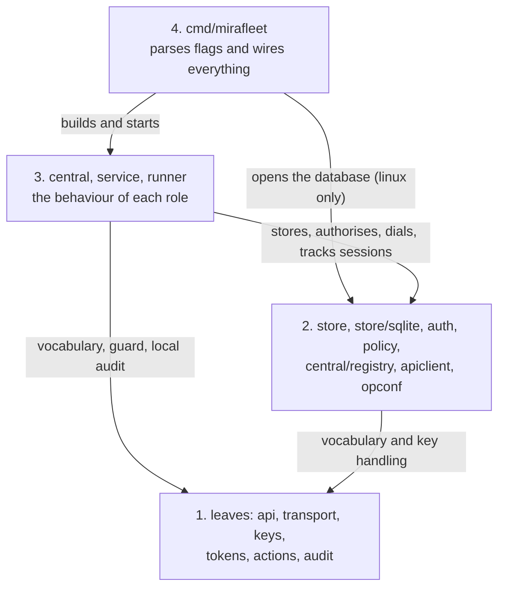

# 8. Code tour

This chapter walks through the repository package by package, then follows three real requests
through the code, function by function. Keep a terminal open next to it and look at the files as
you read. Names of files and functions are stable; line numbers are not, so the guide does not
use them.

## What you will learn

- Where every directory and file group lives, and what it is for.
- Which package imports which, and why the arrows only point one way.
- The key types and functions of each package, and the traps ("gotchas") that bit us before.
- The exact function-by-function path of an `action.run`, a runner join and a revoke.
- How build tags keep SQLite out of the macOS and Windows binaries, and where to add a new
  operator method, admin command, store method or action field.

Terms used here (principal, channel, tombstone, ...) are explained in [glossary.md](glossary.md).
The ideas behind them are in chapters [3](03-architecture.md), [5](05-security.md) and
[7](07-protocols.md).

## 8.1 Repository layout

```text
mirafleet/
├── CLAUDE.md                  ground rules for contributors and for Claude Code (read it first)
├── README.md                  quickstart and disclaimer
├── go.mod, go.sum             module github.com/mirastacklabs-ai/mirafleet, Go 1.27.3
├── LICENSE, NOTICE            Apache-2.0
├── scripts/
│   └── dev.sh                 every build/test/lint step, run inside a pinned container
├── docs/
│   ├── ARCHITECTURE.md        the design
│   ├── PLAN.md                milestones M1..M6 and the build order
│   ├── M2.md, M3.md           per-milestone plans and decisions
│   ├── BRAND.md               colours, fonts, tone
│   └── guide/                 this developer guide
├── cmd/mirafleet/             the one binary: central | runner | mcp | version
│   ├── main.go                os.Args switch, usage text, requireServerOS
│   ├── admin.go               every `mirafleet central <admin command>` (a socket client)
│   ├── mcp.go                 `mirafleet mcp login|api` (operator side, cross-platform)
│   ├── central_linux.go       `central init|run`: opens SQLite, builds service, starts server
│   ├── server_linux.go        `runner join|run`, heartbeat constant (linux only)
│   ├── lock_linux.go          flock on <data>/central.lock
│   ├── server_other.go        !linux stubs that return "supported on linux only"
│   ├── platform_linux.go      const serverSupported = true
│   ├── platform_other.go      const serverSupported = false
│   └── *_test.go              CLI parsing, central init, enrol end to end, deps_test.go
└── internal/                  all other code; nothing outside the module can import it
    ├── api/                   wire protocol: methods, DTOs, error codes, framing, limits
    ├── transport/             SSH names (channel types, users), Heartbeat, ExecRequest/Result
    ├── keys/                  Ed25519 generate/load, permission checks, known_hosts pinning
    ├── tokens/                join token (mfj1.) and registration code (mfr1.) formats
    ├── auth/                  who is this SSH peer? Principal, KeyAuth, Encode/Decode
    ├── policy/                may this principal do this? TablePolicy
    ├── audit/                 JSON-lines audit writer (runner side) and the Sink interface
    ├── actions/               the runner's guard: actions.yaml, Plan, Run
    ├── store/                 persistence interface, domain types, validation, errors
    │   ├── sqlite/            the SQLite implementation and migrations/0001_init.sql
    │   └── storetest/         conformance suite every Store must pass
    ├── service/               the single code path behind CLI, API (and later GUI)
    ├── central/               the SSH server, role handlers, admin socket
    │   └── registry/          live runner sessions, Exec, Kick, tombstones
    ├── runner/                dial-out loop, heartbeat, exec@ handler, runner.yaml, join
    ├── apiclient/             SSH client for operators and enrol (cross-platform)
    └── opconf/                operator config dir: key, known_hosts, contexts.yaml
```

A rule of thumb: `cmd/` only parses flags and wires things together. All behaviour lives in
`internal/`, which is why almost everything is testable without starting the binary.

## 8.2 Who imports whom

The picture groups the packages into four layers. An arrow `A --> B` means "code in A imports
code in B". Every arrow points down or sideways inside a layer, never up, which is why Go never
reports an import cycle. The groups come from the real `import` lines of the non-test files.



`storetest` (imports only `store`) is test support and is not drawn. Inside layer 2 and 3 the
details are: `central` calls `service` and `registry`; `service` calls `policy`, `registry`
and `store`; `policy` and `auth` use `store`; `store/sqlite` implements `store`; `runner` calls
`apiclient` and `actions`. The full table:

| Package | Imports (inside this repo) |
|---|---|
| `cmd/mirafleet` | actions, api, apiclient, audit, auth, central, central/registry, keys, opconf, policy, runner, service, store, store/sqlite, transport |
| `internal/central` | api, auth, central/registry, service, store, transport |
| `internal/central/registry` | transport |
| `internal/service` | api, auth, central/registry, policy, store, tokens, transport |
| `internal/policy` | api, auth, store |
| `internal/auth` | store |
| `internal/store` | keys |
| `internal/store/sqlite` | store |
| `internal/store/storetest` | store |
| `internal/runner` | actions, api, apiclient, audit, keys, transport |
| `internal/apiclient` | api, keys, tokens, transport |
| `internal/opconf` | keys |
| `internal/api`, `transport`, `keys`, `tokens`, `actions`, `audit` | nothing (leaves) |

Three consequences worth remembering:

1. **`internal/central` never imports `store/sqlite`.** It sees only the `store.Store`
   interface. Only `cmd/mirafleet/central_linux.go` (a file that exists only on Linux) imports
   `internal/store/sqlite`; `server_linux.go` holds the runner commands. That is how the macOS
   and Windows binaries avoid linking SQLite (section 8.7).
2. **`api`, `transport`, `tokens`, `actions` and `audit` are leaves.** They import nothing from
   the repo, so they can never create an import cycle and are cheap to reuse.
3. **`runner` does not import `central`, and `central` does not import `runner`.** They only
   share the vocabulary in `transport` and `api`. (Tests are the exception: `internal/central`'s
   tests start a real `runner` in process.)

## 8.3 Package by package

Each package below has an **If you only read one** line: the single file to open first.

### `internal/api`: the wire protocol

- **If you only read one:** `internal/api/api.go` (methods, DTOs, error codes).
- **Purpose:** everything two sides must agree on to talk `api@mirafleet`, the admin socket and
  the enrol channels. No SSH, no unix-only calls.
- **Key names:** method constants (`MethodActionRun`, `MethodFleetsList`, ...);
  `IsOperatorMethod`, `IsAdminMethod`, `IsEnrollMethod` (three disjoint sets, each a `switch`
  so they cannot change at run time); `Request`, `Response`, `Error` and the `Code*` constants;
  DTOs such as `ActionRunParams` and `ActionRunResult`; limits (`MaxRequestBytes` 64 KiB,
  `MaxResultBytes` 1 MiB, `MaxParams` 32, `DefaultActionTimeout` 2 min, `MaxActionTimeout`
  10 min).
- **Functions:** `ReadFrame` / `WriteFrame` (4-byte length prefix, see `frame.go`),
  `ReadRequestTimeout` (reads one request with an arrival deadline), `ParseRequest`,
  `DecodeParams` (strict: unknown fields are `bad_request`), `WriteResponse`, `ActionTimeout`.
- **Used by:** almost everything.
- **Gotchas:** `ReadRequest` only works for readers with `SetReadDeadline` (a `net.Conn`). An
  `ssh.Channel` has no deadline, so every handler on a channel must call `ReadRequestTimeout`
  instead, or a silent peer can hold a goroutine forever. `api.Internal(err)` deliberately drops
  the cause so nothing internal can leak to the peer.

### `internal/transport`: SSH vocabulary

- **If you only read one:** `internal/transport/transport.go`.
- **Purpose:** the strings and tiny structs shared by central and runner.
- **Key names:** `ChanExec` (`exec@mirafleet`), `ChanAPI`, `ChanJoin`, `ChanRegister`,
  `ReqHeartbeat`; users `UserOperator`, `UserEnroll`, `UserRunner`; `Heartbeat`, `ExecRequest`,
  `ExecResult`; `MaxResultBytes` (8 MiB, the most central will read back from a runner).
- **Gotcha:** the SSH *user name* decides the role. It is not a login name. See
  [chapter 7](07-protocols.md).

### `internal/keys`: Ed25519 keys and pinning

- **If you only read one:** the file with `LoadSigner` and `PinnedHostKeys`.
- **Key functions:** `Generate(dir, name, comment)` (private key 0600 plus `.pub` 0644, refuses
  to overwrite via `O_EXCL`), `LoadSigner(path)` (refuses any key readable by group or others),
  `EnsureDir` (0700, tightened if it exists), `PinnedHostKeys(path)` (a `HostKeyCallback` that
  accepts only keys listed in a known_hosts-style file, re-read on every connection),
  `RunnerNameRE`.
- **Platform files:** `perm_unix.go` checks the mode bits; `perm_windows.go` and `perm_other.go`
  fail closed (key loading returns an error) because owner-only ACL checks are not written yet
  (planned for M5).
- **Gotcha:** `PinnedHostKeys` has no "trust on first use" mode. A key not in the file is an
  error: `host key for ... not pinned in ...`.

### `internal/tokens`: join tokens and registration codes

- **If you only read one:** the file with `Code` and `VerifyCode`.
- **Formats:** join token `mfj1.<id>.<secret>.<host-key hash>`, registration code
  `mfr1.<26 base32>.<host-key hash>`. See [chapter 5](05-security.md) for why both carry the
  host-key hash.
- **Key functions:** `NewJoinToken(hostKey)` (returns the token, its id and `SHA-256(secret)`;
  central stores only the hash), `ParseJoinToken`, `Code(secret, step, hostKey)`, `ParseCode`,
  `VerifyCode` (current 60-second step only, constant-time compare), `Step`, `SecondsLeft`,
  `HostKeyHash`.
- **Gotcha:** parsers are strict and canonical: a value must re-encode to exactly the same
  string. `kat_test.go` and `tokens_test.go` pin the format with a known-answer test, so
  changing the HMAC input breaks old codes and the test tells you.

### `internal/auth`: who is this peer?

- **If you only read one:** the file defining `Principal` and `KeyAuth`.
- **Key names:** `Principal{Kind, ID, Name, Fingerprint, Remote, Status}`; kinds `KindRunner`,
  `KindOperator`, `KindEnroll`, `KindAdmin`; `AuthProvider` interface; `KeyAuth` (the OSS
  provider, looks keys up in the store); `Encode` / `Decode` (identity travels in
  `ssh.Permissions.Extensions`); `PublicKeyCallback`; `LocalAdmin(uid)`.
- **Gotcha:** `Decode` fails closed and never accepts `KindAdmin`: the admin principal exists
  only on the local socket. Identity must never be kept in closure variables shared between
  connections (an old class of SSH-library bugs); that is why it rides in the permissions of
  the one connection.

### `internal/policy`: may they?

- **If you only read one:** `internal/policy/policy.go` (it is short).
- **Key names:** `PolicyEngine` interface (`Authorize(ctx, principal, action, resource)`),
  `TablePolicy` (the OSS implementation), `ErrForbidden`, `Resource`.
- **Rules in `TablePolicy`:** admin may do anything; an operator may do `hello`, `fleets.list`,
  `runners.list` and `action.run` only while its **current** status is `active`; an enrol
  principal may do the two enrol methods; everything else is forbidden (deny by default).
- **Gotcha:** the policy cannot look anything up. The caller (`service.authorize`) loads the
  operator's current status and passes it in `Resource.ActorStatus`. This is the "seam" for an
  enterprise RBAC policy later.

### `internal/audit`: the runner-side log and the Sink interface

- **If you only read one:** the file with `Writer` and `Sink`.
- **Key names:** `Event`, `Writer` (`Open(path)` appends JSON lines, mode 0600), `Sink`
  interface with `Record(ctx, ev) error`, `Writer.Log` (best effort, swallows errors).
- **Gotcha:** a nil `*Writer` is a valid no-op sink. Anything that must fail closed on an audit
  failure calls `Record` and checks the error, never `Log`. Central's audit is *not* this
  package: central writes audit rows through `store.Store`.

### `internal/actions`: the guard

- **If you only read one:** `internal/actions/actions.go` (`Parse` and `Plan`).
- **Key names:** `Set`, `Action`, `ParamSpec`; `Load(path)` / `Parse(bytes)`; `Set.Plan(name,
  params)` returns the final argv and timeout or a `*RefusedError`; `Set.Run(ctx, name,
  params)`; `Set.Names()`; `MaxOutput` (1 MiB, stdout and stderr combined).
- **Why it matters:** this is the security boundary in actions mode. `Parse` rejects unknown
  YAML fields (`KnownFields(true)`), resolves a bare command name to an absolute path **once at
  load time** against a fixed `PATH`, compiles every param pattern twice (alone first, then
  wrapped in `\A(?:...)\z` so the author's anchors cannot be escaped), and checks that every
  `{{placeholder}}` has a param. `Plan` substitutes in a single pass, so a value is never
  re-scanned for placeholders.
- **Files:** `kill_unix.go` puts the child in its own process group and kills the group;
  `kill_other.go` is a fallback that is unreachable in shipped runners.
- **Gotcha:** `execArgv` gives the child an empty environment except `PATH` and `LANG=C`, and
  `/` as working directory. Actions that "work in my shell" often fail here for that reason.

### `internal/store`: persistence interface

- **If you only read one:** `internal/store/store.go` (the interface and its doc comments).
- **Key names:** `Store` interface; types `Fleet`, `Runner`, `JoinToken`, `Operator`,
  `AuditEvent`; `Status` / `CanTransition` (pending to active, active to and from disabled, any
  non-revoked to revoked, revoked is final); `ParseRef` ("fleet/runner"); name validators;
  errors `ErrNotFound`, `ErrInvalid`, `ErrConflict`, `ErrStale`.
- **Rule written into the interface:** every state-changing method takes an `AuditEvent` and
  commits it **in the same transaction** as the change. No method calls `time.Now()`; the
  caller passes `now`.
- **Gotcha:** `Enroll` maps an unknown token id and a wrong secret to the same `ErrNotFound`,
  and the service maps both that and `ErrStale` to one identical error, so a probe learns
  nothing.

### `internal/store/sqlite`: the SQLite implementation

- **If you only read one:** `migrations/0001_init.sql` (the whole schema).
- **Files:** `sqlite.go` (`Open`, two connection pools), `migrate.go` (embedded migrations),
  one file per entity (`fleets.go`, `runners.go`, `tokens.go`, `operators.go`, `settings.go`,
  `audit.go`), `driver.go` (maps driver error codes to `ErrConflict`), `open_unix.go` /
  `open_other.go` (open with `O_NOFOLLOW` on unix), `migrations/0001_init.sql`.
- **How it works:** one single-connection *writer* pool doing `BEGIN IMMEDIATE` transactions,
  plus a small `query_only` *reader* pool, in WAL mode with `busy_timeout(5000)` and
  `foreign_keys(1)`. Migrations are numbered `NNNN_name.sql`, must be contiguous from 0001, run
  in one transaction and are tracked in `PRAGMA user_version`. A database whose version is
  newer than the binary is refused.
- **Gotchas:** `Open` refuses `:memory:` (each pooled connection would get its own empty
  database), refuses symlinks and non-regular files, and tightens the file to 0600. Use
  `filepath.Join(t.TempDir(), "mirafleet.db")` in tests. The audit table has triggers that
  abort every `UPDATE` and `DELETE`, so "append-only" is enforced by the database itself.

### `internal/store/storetest`: the conformance suite

**If you only read one:** `internal/store/storetest/storetest.go`.

`storetest.Run(t, newStore)` runs the same subtests (`Fleets`, `Audit`, `Enroll`,
`EnrollRaceSingleUse`, `KeyDisjoint`, `Runners`, `Tokens`, `Operators`, `Settings`,
`Validation`, `ContextCancelled`, ...) against any `store.Store`. `store/sqlite/sqlite_test.go`
calls it from `TestConformance`. A future Postgres store will call the same function.

### `internal/service`: the one code path

- **If you only read one:** `internal/service/exec.go` (`RunAction`).
- **Purpose:** every front end (the operator API, the admin socket and the enrol channels now,
  the GUI in M4) calls the same `*Service` methods. Each method authorises, validates, changes
  state and audits.
- **Files:** `service.go` (`Config`, `New`, `authorize`, `deny`, `ToAPIError`, `Source`),
  `exec.go` (`RunAction`), `lifecycle.go` (`ListRunners`, `Approve`, `Disable`, `Enable`,
  `Revoke`, `Lifecycle`), `enroll.go` (`Join`, `Register`), `operators.go`
  (`InitRegistrationSecret`, `RotateRegistrationSecret`, `OperatorCode`, `ListOperators`,
  `RevokeOperator`), `tokens.go` (`CreateToken`, `ListTokens`, `RevokeToken`), `fleets.go`.
- **Dependencies are injected** through `service.Config`: `Store`, `Policy`, `Live` (the
  `registry.Live` interface), `HostKey`, `Now`, `OperatorConns`, `Logf`. Tests pass fakes
  (`fakeLive`, `fakeConns`) and a fixed clock.
- **Gotchas:** `authorize` applies the policy *and*, for admin-only methods, a direct
  `p.Kind == auth.KindAdmin` check. The method table (in `central`) and the policy are two
  independent gates; the direct kind check is a third for admin-only calls, so a buggy policy
  cannot open an admin door. A denial is
  audited with outcome `denied`. `ToAPIError` gives every error a fixed message per code so SQL
  or paths cannot leak.

### `internal/central`: the SSH server

- **If you only read one:** `internal/central/roles.go` (`dispatch`, `serveRunner`).
- **Files:** `central.go` (`Config`, `Server`, `New`, `Start`, `Close`, `handle`), `roles.go`
  (`dispatch`, `serveRunner`, the channel allow-list), `api.go` (`serveOperator`,
  `serveAPIChannel`), `dispatch.go` (`methodTable`, `operatorTable`, the four operator
  handlers), `enroll.go` (`serveEnroll`, `enrollCall`, per-IP limiter), `hslimit.go`
  (pre-handshake connection caps), `conns.go` (`OperatorConns`), `admin.go` (`ServeAdmin`,
  `adminTable`, `adminConn`), `admin_handlers.go` (the admin handlers), `adminclient.go`
  (`AdminCall`, the client end of the socket).
- **Platform files:** `admin_unix.go` (socket + `checkPeer`), `admin_peer_linux.go`
  (`SO_PEERCRED`), `admin_peer_darwin.go` (`LOCAL_PEERCRED`), `admin_peer_other.go` (other unix:
  rejects every peer), `admin_other.go` (non-unix: fails closed).
- **Roles:** `dispatch` switches on `p.Kind` to `serveRunner`, `serveOperator` or `serveEnroll`.
  The allowed channel types per role live in one map, `allowedChannels`.
- **Gotchas:** `methodTable.serve` has its own `allowed` predicate in front of the policy, so
  a method that is not in a table's set never reaches a handler. `serveRunner` registers a
  session on the **first heartbeat**, not at connect time, because only then has the runner
  installed its channel handler. Database writes of `last_seen_at` happen in a background
  `toucher` so a slow disk never delays a heartbeat reply.

### `internal/central/registry`: live sessions

- **If you only read one:** the file with `Registry.Exec` and `Registry.Kick`.
- **Key names:** `Registry`, `Session`, the `Live` interface (`Exec`, `Kick`, `Tombstone`,
  `ClearTombstone`, `SetStatus`, `Snapshot`), `KickError`, `ErrPending`, `ErrDisabled`,
  `ErrTombstoned`, `Options{StaleAfter}`.
- **How it works:** sessions are keyed by the runner's database id. `Register` rejects a
  tombstoned id under the same lock that inserts the session, so a revoke cannot slip in between.
  `Exec` opens an `exec@mirafleet` channel **on the runner's own connection** (`execOn`). A
  session context derived from `context.WithCancelCause` lets `Kick` cancel an in-flight exec with
  the reason.
- **Gotcha:** tombstones live in memory only. After a restart, revoked runners are refused at
  authentication because their database status is `revoked`; the tombstone only closes the short
  window while a revoke is in flight.

### `internal/runner`: the runner library

- **If you only read one:** `internal/runner/runner.go` (`Run`, `serveExec`).
- **Files:** `runner.go` (`Config`, `New`, `Run`, `session`, `heartbeat`, `serveExec`,
  `execute`), `join.go` (`Join`), `config.go` (`FileConfig`, `LoadConfig`, `SaveConfig`, path
  helpers, `ErrNotJoined`, `ErrAlreadyJoined`).
- **How it works:** `Run` loops forever: dial, authenticate as SSH user `runner`, heartbeat every
  15 s, serve `exec@mirafleet` channels, and on any failure back off exponentially (1 s up to
  60 s, plus or minus 20% jitter). A connection only resets the backoff after it stayed up 30 s
  with an acknowledged heartbeat.
- **Gotchas:** a semaphore (`MaxExec`, default 4) caps concurrent actions; extra ones are
  rejected with `runner busy`. `Join` writes `runner.yaml` **last**, so its existence means "the
  join fully succeeded". The runner never listens on a port.

### `internal/apiclient` and `internal/opconf`: the operator side

- **If you only read one:** the file with `apiclient.Dial` and `Client.Call`.
- **`apiclient`:** `Dial(ctx, addr, user, signer, hostKeyCallback)` (callback mandatory, no
  fallback), `Client.Call`, typed helpers (`Hello`, `FleetsList`, `RunnersList`, `ActionRun`),
  `Join` and `Register` (enrol with the host key pinned from the token or code), host-key
  callbacks `PinnedHash`, `KnownHosts`, `Fingerprint`, `Prompt`.
- **`opconf`:** `Dir()` (`$MIRAFLEET_CONFIG_DIR` or the OS user config dir plus `mirafleet`),
  `KeyPath`, `KnownHostsPath`, `ContextsPath`, `Contexts` with `LoadContexts` / `SaveContexts`.
- **Gotcha:** both are cross-platform on purpose (the operator runs on a laptop). They must not
  import anything unix-only. `Prompt` refuses to ask when stdin is not a terminal, so a script
  can never be tricked into trust-on-first-use.

### `cmd/mirafleet`

**If you only read one:** `cmd/mirafleet/admin.go`.

`main.go` switches on `os.Args[1]`. `central` and `runner` first call `requireServerOS`. All
admin subcommands go through `adminCLI.run` in `admin.go`; its `call` field is a function value
(normally `central.AdminCall`) so tests replace it with a fake and never need a running central.
`adminParse` lets flags appear after positional arguments (`fleet create web -mode workspace`).

## 8.4 Follow one request: `action.run`

alice's agent runs this on her laptop. `prod` is a guarded fleet (created with `-confirm`), so
the call must carry `"confirm":"prod"`:

```bash
mirafleet mcp api action.run '{"fleet":"prod","runner":"db-1","action":"tail-logs","params":{"lines":"200"},"confirm":"prod"}'
```


*Look at: the request goes down through central into the runner and back up; both audit rows
(`start` and the outcome) share one `request_id`.*

1. alice's agent calls `action.run` (`prod/db-1`, `tail-logs`, `lines=200`) through `mirafleet mcp`.
2. `mcp` sends one frame (4-byte length + JSON) on an `api@` channel. The operator method table routes it.
3. `service.RunAction` checks policy, fleet mode, confirm "prod" (guarded fleet's name), runner active.
4. The audit row "start" is written first. If that fails, nothing runs (fail closed).
5. `registry.Exec` opens an `exec@` channel on the runner's own connection and sends the request.
6. The runner's actions guard checks `tail-logs` and regex-checks `lines=200` into an argv.
7. The process runs (no shell, own process group, timeout). The result JSON goes back.
8. The audit row "outcome" is written with the same `request_id`.
9. The response frame returns the same way: exit code, stdout, stderr.

### In detail

The list below is the same journey with function names. Follow it with the files open.

**On alice's laptop**

1. `main` in `cmd/mirafleet/main.go` sees `mcp` and calls `mcpMain`, which calls `mcpAPI`
   (`cmd/mirafleet/mcp.go`).
2. `mcpAPI` checks the JSON with `json.Valid`, then finds the config directory
   (`opconf.Dir`), reads `contexts.yaml` (`opconf.LoadContexts`) and picks the address of the
   current context. It loads the key with `loadOperatorKey`, which calls `keys.LoadSigner`.
3. `apiclient.Dial` opens TCP and runs the SSH handshake as user `transport.UserOperator`. The
   host-key callback is `apiclient.KnownHosts`, i.e. `keys.PinnedHostKeys` over the
   `known_hosts` file in the operator config directory (`opconf.KnownHostsPath`, found with
   `os.UserConfigDir`, e.g. `~/.config/mirafleet` on Linux): central's key must have been
   pinned at `mcp login`.
4. `Client.Call` calls `callOn`, which builds an `api.Request` (random 16-hex id), opens one
   channel of type `api@mirafleet`, sends the request with `api.WriteFrame` and waits in
   `api.ReadFrame`.

**On central**

5. `Server.handle` (`central.go`) first asks `hsLimiter.acquire` for a handshake slot, then runs
   `ssh.NewServerConn`. During the handshake the public-key callback is
   `auth.PublicKeyCallback`, which calls `KeyAuth.Authenticate`. Because the user is `operator`,
   it calls `store.GetOperatorByKey`; a revoked operator or unknown key gives `auth.ErrDenied`.
6. `handle` recovers the identity with `auth.Decode` and calls `Server.dispatch` (`roles.go`),
   which calls `serveOperator` (`api.go`).
7. `serveOperator` registers the connection in `OperatorConns` (so a revoke can kick it), then
   reloads the operator by id (`GetOperatorByID`) and closes if it is not `active`, then
   `TouchOperator`. It builds `operatorTable()` and a `callCtx`.
8. For each new channel it checks `channelAllowed(auth.KindOperator, ...)` and a per-connection
   cap of `api.MaxChannelsPerConn`, then runs `serveAPIChannel`.
9. `serveAPIChannel` reads the request with `api.ReadRequestTimeout` (size and time limits),
   then calls `methodTable.serve` (`dispatch.go`).
10. `serve` checks the allow predicate `api.IsOperatorMethod`, looks up `handleActionRun`,
    and applies a timeout (none for `action.run`; the service sets its own). `handleActionRun`
    decodes the params strictly with `api.DecodeParams` and calls `Service.RunAction`.

**In the service**

11. `Service.RunAction` (`service/exec.go`) calls `authorize`, which loads the operator's
    current status and calls `policy.TablePolicy.Authorize`. A denial is audited and returned as
    `forbidden`.
12. It validates the input (`store.ParseRef`, `api.ValidateActionParams`,
    `api.ValidateTimeoutS`, `api.ActionTimeout`), loads the fleet (`GetFleet`), requires mode
    `actions`, checks the `confirm` guard, loads the runner (`GetRunner`) and requires status
    `active`.
13. It creates a `request_id` (`newRequestID`) and writes the **start** audit row with
    `store.RecordAudit`. If that write fails, nothing runs (`unavailable: audit unavailable`).
14. It calls `s.live.Exec`, i.e. `registry.Registry.Exec`. `Exec` finds the live session
    (`Get`), re-checks the session status (pending and disabled are refused), and `execOn` opens
    a channel of type `exec@mirafleet` **on the runner's own SSH connection**, carrying the
    `ExecRequest` JSON as channel data.

**On the runner**

15. In `Runner.session`, `client.HandleChannelOpen(transport.ChanExec)` hands the channel to
    `serveExec` (`runner.go`).
16. `serveExec` decodes the request, takes a slot from the semaphore, accepts the channel and
    logs a `start` event to the local `audit.jsonl`.
17. `execute` calls `actions.Set.Run`, which calls `Plan` (the guard: unknown action, unknown or
    missing parameter, pattern, leading dash, then single-pass substitution) and `execArgv`
    (`exec.CommandContext`, no shell, minimal environment, own process group, output cap,
    timeout). A refusal becomes an `ExecResult{Refused: true}`; nothing ran.
18. `serveExec` encodes the result (`encodeResult`), logs the outcome event **before** replying,
    then writes the JSON to the channel and calls `CloseWrite`.

**Back up**

19. `execOn` in central reads at most `transport.MaxResultBytes`, decodes the `ExecResult` and
    returns it. `RunAction` builds the **outcome** audit row (`ok`, `timeout`, `cancelled` or
    `error`, same `request_id`) and writes it with a context that survives cancellation
    (`context.WithoutCancel`). A runner refusal becomes `bad_request: refused by runner: ...`.
20. `RunAction` returns `api.ActionRunResult`. `methodTable.serve` wraps it with
    `api.NewResult`; `writeResponseTimeout` writes the frame (and closes the connection if the
    peer stops reading).
21. Back in `callOn`, the client checks version and id, decodes the result, and `mcpAPI`
    pretty-prints it with `json.Indent`.

That is two SSH connections, two audit tables (central's SQLite and the runner's file) and four
checks (policy, service rules, registry status, runner guard) for one command.

## 8.5 Follow a runner join

Dana (the Acme admin) has created a token on central with
`mirafleet central token create -fleet dev` and pipes it into `runner join` on `build-1`.


*Look at: the host-key hash inside the token pins central before anything secret is sent.*

1. Dana runs `token create` on central. It prints `mfj1.ID.SECRET.HASH` once (HASH pins central).
2. Dana hands the token to the build-1 host by any channel, never through central.
3. `runner join` dials `:2222` as user `enroll`. A host key not matching HASH is refused (no TOFU).
4. It sends one `join@mirafleet` frame: token, runner name, labels.
5. `Store.Enroll`, one transaction: look up by ID, constant-time compare, check stale, insert.
6. Status is `pending` (`active` only if the token auto-approves). The enroll connection closes.
7. Dana runs `runner approve dev/build-1`: status becomes `active`.
8. The runner reconnects as user `runner` with its own key and sends heartbeats.

### In detail

**On `build-1`**

1. `main` calls `runnerMain` (`server_linux.go`), which calls `runnerJoin`.
2. `runnerJoin` parses flags (`splitAddr` takes the address off first so flags may follow it),
   insists on `-token -`, sets `umask 077`, and **refuses before reading stdin** if
   `runner.yaml` already exists (`runner.ErrAlreadyJoined`). Then `readSecret` reads the token
   from stdin (max 4096 bytes).
3. `runner.Join` (`join.go`) validates the address and name, calls `keys.EnsureDir` (0700),
   generates `runner_ed25519` if absent (`keys.Generate`) and loads it (`keys.LoadSigner`).
4. `apiclient.Join` parses the token (`tokens.ParseJoinToken`), takes the embedded host-key hash
   and calls `enroll`. `enroll` wraps `PinnedHash(hash)` as the host-key callback, then
   `Dial(..., transport.UserEnroll, ...)` and `callOn(..., transport.ChanJoin,
   api.MethodEnrollJoin, ...)`. If central presents any other host key, the dial fails with
   `host key does not match the pinned key` **before any secret is sent**.

**On central**

5. `Server.handle` runs the handshake. For SSH user `enroll`, `KeyAuth.Authenticate` accepts any
   Ed25519 key and returns `Principal{Kind: KindEnroll}`; the wrapper in `central.New` adds the
   presented key to the permissions under `extPubKey`.
6. `dispatch` calls `serveEnroll` (`central/enroll.go`): `ipLimiter.allow` (per-IP and global
   rate limits), a hard deadline (`EnrollDeadline`, 30 s), `enrollKey` (cross-checks the key
   against the authenticated fingerprint), then exactly **one** channel.
7. `serveEnrollChannel` reads the request (`api.ReadRequestTimeout`) and `enrollCall`, which
   requires the method to match the channel (`join@mirafleet` with `enroll.join`) and calls
   `Service.Join`.
8. `Service.Join` (`service/enroll.go`): `requireEnroll` (policy plus a direct kind check),
   validates the key and name, `tokens.ParseJoinToken`, compares the token's host-key pin with
   `tokens.HostKeyHash(s.hostKey)` in constant time, hashes the secret and calls
   `store.Enroll`.
9. `sqlite.DB.Enroll` runs one transaction, in this order: look up the token id; compare the
   hash in constant time (against a dummy hash when the id is unknown); do a conditional
   `uses+1` that fails if the token is stale (expired, revoked or used up); refuse a key already
   held by an operator; insert the runner (`pending`, or `active` if the token was made with
   `-approve`); write the `enroll.join` audit row. All succeed or none.
10. Every failure except a name/key conflict returns the same `unauthenticated: join refused`;
    the real reason is only in central's log.

**Back on `build-1`**

11. `runner.Join` writes `known_hosts` (the verified host key, `apiclient.KnownHostsLine`) and
    finally `runner.yaml` (`SaveConfig`). `runnerJoin` prints the status; if it is not `active`
    it says an admin must approve.
12. Later `runner run` calls `runnerRun`: `runner.LoadConfig`, `keys.LoadSigner`,
    `actions.Load`, `audit.Open`, then `runner.New(cfg).Run(ctx)`. The runner connects as user
    `runner`; `serveRunner` on central registers it on the first heartbeat
    (`Server.register` then `Registry.Register`) with its current database status.
13. On central, `mirafleet central runner approve dev/build-1` goes
    `adminCLI.lifecycle(api.OpApprove)` then `central.AdminCall` then the admin socket
    (`adminConn` then `methodTable.serve` then `handleRunnerLifecycle`) then
    `Service.Lifecycle`, which calls `store.SetRunnerStatus` (status change plus audit in one
    transaction) and `Registry.SetStatus` (so the live session can exec at once).

## 8.6 Follow a revoke

Dana revokes `dev/build-1` while an action is running on it:

```bash
mirafleet central runner revoke dev/build-1
```


*Look at: the tombstone and kick happen before the database commit, so nothing can slip through
the gap.*

1. Dana runs `central runner revoke dev/build-1`. The CLI sends `runner.lifecycle` (op `revoke`) over the admin socket.
2. Tombstone: build-1's id goes into the registry, so no new session can slip in during the commit.
3. Kick: the session context is cancelled and the runner's SSH connection is closed.
4. In-flight action cancelled: the runner kills the process group; the outcome row says `cancelled`.
5. Commit: `status = revoked` and the audit row are written in one transaction.
6. The runner redials. Auth finds a revoked key and refuses it: it never gets a session.

### In detail

1. `main` calls `centralMain` (`admin.go`); the first word is not `init`/`run`, so it goes to
   `defaultAdminCLI().run`, then `group`, then `adminCLI.lifecycle(api.OpRevoke)`. It validates
   the reference with `store.ParseRef` and calls `central.AdminCall(sock,
   api.MethodRunnerLifecycle, ...)`.
2. `AdminCall` dials the unix socket `<data>/admin.sock`, writes one frame and waits. In central,
   the `ServeAdmin` accept loop runs `checkPeer` first (same UID or the connection is dropped
   before anything is read), then `adminConn` reads the request and calls `methodTable.serve`
   on `adminTable()`, which reaches `handleRunnerLifecycle` and `Service.Lifecycle`.
3. `Service.Lifecycle` calls `authorize(..., adminOnly=true)`, loads the runner, and checks that
   `CanTransition` allows the move. For `revoke` only, it then does, **in this order**:
   `Registry.Tombstone(id)` (future registrations are refused), `Registry.Kick(id,
   "runner revoked")` (session context cancelled with a `KickError`, connection closed), then
   `store.SetRunnerStatus` which commits the new status and the `runner.revoke` audit row.
4. The in-flight `RunAction` (in the operator's handler goroutine) is blocked in
   `registry.execOn`. Its context was cancelled by the kick, so `Registry.Exec` returns
   `context.Cause(session ctx)`, a `*registry.KickError`. `RunAction` matches it with
   `errors.As`, writes the outcome row `cancelled` with message `runner revoked`, and returns
   `unavailable: runner revoked` to the operator.
5. If `SetRunnerStatus` fails, `Lifecycle` clears the tombstone, but only if a fresh read shows
   the runner is verifiably not revoked. If it cannot tell, it keeps the tombstone (fail closed).
6. The runner reconnects within seconds. `KeyAuth.Authenticate` sees `StatusRevoked` and returns
   `ErrDenied`; and even if it did not, `Registry.Register` would return `ErrTombstoned`.

Revoking an *operator* is the same shape: `Service.RevokeOperator` commits first, then calls
`OperatorConns.KickOperator`, which closes the SSH connection; the operator's handler context
dies with it, which cancels its in-flight `action.run`. The window between "authenticated" and
"added to `OperatorConns`" is closed by the re-check in `serveOperator` (step 7 above).

## 8.7 Build tags and why

A **build tag** (or a file-name suffix such as `_linux.go`) tells the Go compiler to include a
file only on some platforms. mirafleet uses them for two reasons.

**1. Server roles are Linux-only.** Central and runner run on Linux servers; only `mirafleet
mcp` also runs on macOS and Windows (a developer's laptop). The binary still *builds* for all six
targets (`linux`, `darwin`, `windows` times `amd64`, `arm64`), which `scripts/dev.sh cross`
checks.

| File | Tag | What it does |
|---|---|---|
| `cmd/mirafleet/platform_linux.go` / `platform_other.go` | `linux` / `!linux` | `serverSupported` true or false; `main` refuses `central` and `runner` otherwise |
| `cmd/mirafleet/central_linux.go`, `server_linux.go`, `lock_linux.go` | `_linux` suffix | the real `central init/run`, `runner join/run`, `flock` |
| `cmd/mirafleet/server_other.go` | `!linux` | stubs returning `central and runner are supported on linux only` |
| `internal/central/admin_unix.go` | `unix` | unix socket with umask 077, `checkPeer` |
| `internal/central/admin_peer_linux.go` / `_darwin.go` | `linux` / `darwin` | read the peer's UID (`SO_PEERCRED` / `LOCAL_PEERCRED`) |
| `internal/central/admin_peer_other.go` | `unix && !linux && !darwin` | rejects every peer |
| `internal/central/admin_other.go` | `!unix` | every admin-socket function returns an error (fails closed) |
| `internal/keys/perm_unix.go` | `unix` | refuse keys with group/other mode bits |
| `internal/keys/perm_windows.go`, `perm_other.go` | `windows`, `!unix && !windows` | refuse to load any key (no ACL check yet) |
| `internal/actions/kill_unix.go` / `kill_other.go` | `unix` / `!unix` | kill the whole process group / plain `Kill` |
| `internal/store/sqlite/open_unix.go` / `open_other.go` | `unix` / `!unix` | open with `O_NOFOLLOW` / without |

The pattern is **fail closed**: where a security check cannot be done on a platform, the code
returns an error instead of silently skipping the check.

**2. The darwin and windows binaries never link SQLite.** `modernc.org/sqlite` is large. The
admin CLI in `admin.go` compiles on every platform and imports `internal/central`, but
`internal/central` only knows the `store.Store` interface. The only import of
`store/sqlite` in `cmd/mirafleet` is in `central_linux.go`. `cmd/mirafleet/deps_test.go`
proves it: `TestNoSQLiteOnNonLinux` runs `go list -deps` with `GOOS=darwin` and `windows` and
fails if any `modernc.org/...` or `internal/store/sqlite` package appears, and
`TestLinuxLinksSQLite` is the positive control (without it, a broken filter would let the first
test pass for the wrong reason). If you add an import of `sqlite` anywhere outside the
`_linux.go` files, that test fails.

## 8.8 Where to add things

Each recipe lists the files in the order you should touch them. Always add the test in the same
change.

### A new operator method (something an agent may call over `api@mirafleet`)

Example: `runners.get`.

1. `internal/api/api.go`: add `MethodRunnersGet`, add it to `IsOperatorMethod`, add
   `RunnersGetParams` / `RunnersGetResult`. `TestMethodSetsDisjoint` must still pass.
2. `internal/policy/policy.go`: add it to the operator `case` in `TablePolicy.Authorize`.
   Forget this and every call returns `forbidden`.
3. `internal/service/`: add the method, starting with `s.authorize(ctx, p, src,
   api.MethodRunnersGet, false)`. Validate input; use `s.fail` for store errors.
4. `internal/central/dispatch.go`: write `handleRunnersGet` (decode with `api.DecodeParams`,
   call the service, map to the DTO) and add it to `operatorTable().handlers`.
5. `internal/central/admin.go`: if admins may use it too, add it to `adminTable()`.
6. `internal/apiclient/client.go`: add a typed helper next to `RunnersList`.
7. Tests: `internal/service/service_test.go` (policy and behaviour), `internal/central/
   api_test.go` (end to end over SSH), and extend the method-set tests.
8. Docs: update [chapter 7](07-protocols.md) and the CLI reference in [chapter 10](10-operations.md).

### A new admin command (CLI only, never exposed to agents)

Example: `mirafleet central fleet delete`.

1. `internal/api/api.go`: add `MethodFleetDelete`, add it to `IsAdminMethod` (not to the
   operator set), add the DTOs.
2. `internal/service/`: method that calls `s.authorize(..., true)` (the `true` adds the direct
   admin-kind check on top of the method table and the policy).
3. `internal/central/admin_handlers.go`: the handler; register it in `adminTable()` in
   `admin.go`.
4. `cmd/mirafleet/admin.go`: add a method on `adminCLI` (flags via `c.flags`, positional
   arguments via `adminParse` / `adminWantArgs`), add it to the map in `adminCLI.run`.
5. `cmd/mirafleet/main.go`: add a line to the `usage` text.
6. Tests: `cmd/mirafleet/admin_test.go` (argument parsing with the fake `call`),
   `internal/central/admin_test.go` (`TestAdminMethodsEndToEnd`), service tests including
   "non-admin is forbidden and audited" (`TestNonAdminForbiddenAndAudited`).

### A new store method and a migration

1. `internal/store/store.go`: add the method to the `Store` interface with a doc comment that
   says which errors it returns and that it audits in the same transaction if it changes state.
2. `internal/store/sqlite/`: implement it in the matching file. State changes use the writer
   pool inside a transaction that also inserts the audit row.
3. If the schema changes: add `internal/store/sqlite/migrations/0002_<name>.sql`. Numbers must
   be contiguous and files are embedded automatically. **Never edit `0001_init.sql`** after it
   shipped; a deployed database has already run it. `TestMigrationsContiguous` guards the
   numbering; extend `TestFreshMigrateAndReopen` in `sqlite_test.go` for new tables.
4. `internal/store/storetest/storetest.go`: add a subtest to the conformance suite so every
   future store must behave the same.
5. Update any test double that implements `store.Store` by hand (most embed `store.Store` and
   override one method, so they keep compiling).
6. Update [chapter 6](06-data-model.md).

### A new field in `actions.yaml`

Example: an `env` list.

1. `internal/actions/actions.go`: add the field with a `yaml:"..."` tag to `Action` or
   `ParamSpec`. `KnownFields(true)` means a runner running an *older* binary will reject a file
   that uses the new field. That is intended, but mention it in release notes.
2. Validate it in `Parse` (fail at load, never at run time).
3. Use it in `Plan` or `execArgv`. Keep the security properties: argv only, no shell, a
   parameter value only ever inside one argv element.
4. Tests in `internal/actions/actions_test.go`, including an injection attempt.
5. Update the YAML reference in [chapter 10](10-operations.md) and the threat discussion in
   [chapter 5](05-security.md).

## Check your understanding

1. `internal/central` handles SSH connections for a database-backed server, yet it does not
   import `internal/store/sqlite`. How does it get a store, and what does this buy us?
2. In the `action.run` trace, name the two places where a start audit row and an outcome audit
   row are written, and say what happens if the first write fails.
3. A teammate adds a new operator method and registers a handler in `operatorTable()`, but
   every call returns `forbidden`. Name three other places a new operator method must be
   wired, and say which of them they forgot.
4. Why does `Service.Lifecycle` tombstone and kick a runner *before* committing the revoke to
   the database?
5. You add `import ".../internal/store/sqlite"` to `cmd/mirafleet/mcp.go`. Which test fails, and
   why does that matter to someone on a MacBook?
<details>
<summary>Answers</summary>

1. `cmd/mirafleet/central_linux.go` opens the database with `sqlite.Open` and passes the value
   as a `store.Store` in `central.Config`. Central only knows the interface, so tests can use a
   fake or temp store, a future Postgres store needs no change in `central`, and the macOS and
   Windows binaries do not link SQLite.
2. Both are written in `Service.RunAction` through `store.RecordAudit`: `start` before
   `registry.Exec`, the outcome after. If the start write fails, `RunAction` returns
   `unavailable: audit unavailable` and nothing is executed (fail closed). A failed outcome
   write is only logged, because the action already ran.
3. (1) `api.IsOperatorMethod` in `internal/api/api.go`, so `methodTable.serve` lets the method
   through; (2) the `case` in `policy.TablePolicy.Authorize` (deny by default); (3) the
   service method's `authorize` call, which must use the same method name. They forgot the
   policy entry: a call that passes the method table but not the policy returns `forbidden`.
4. Without the early tombstone and kick, a runner could reconnect or finish starting a new
   action in the time between "revoke decided" and "database updated". Tombstone plus kick close
   that window, and if the commit fails the tombstone is undone only when the runner is
   verifiably not revoked.
5. `TestNoSQLiteOnNonLinux` in `cmd/mirafleet/deps_test.go` fails because the darwin build now
   links `internal/store/sqlite` and `modernc.org/...`. It matters because the laptop binary
   would grow by several megabytes and drag in a database engine the operator never uses.

</details>
