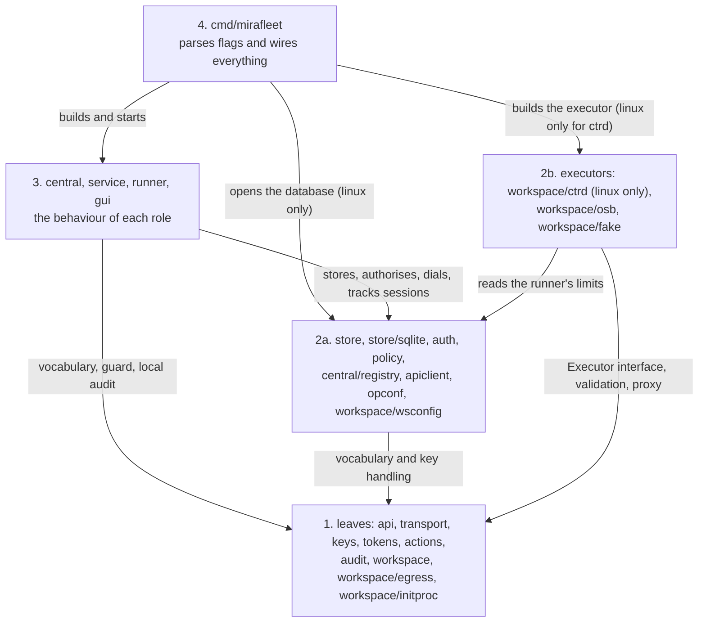

# 8. Code tour

This chapter walks through the repository package by package, then follows three real requests
through the code, function by function. Keep a terminal open next to it and look at the files as
you read. Names of files and functions are stable; line numbers are not, so the guide does not
use them.

## What you will learn

- Where every directory and file group lives, and what it is for.
- Which package imports which, and why the arrows only point one way.
- The key types and functions of each package, and the traps ("gotchas") that bit us before.
- The exact function-by-function path of an `action.run`, a runner join and a revoke, and (section
  8.9) of one `workspace.exec` from the agent into a container and back (section 8.10 adds the
  agent's side: the MCP tool call that starts it).
- The M3 packages: `internal/workspace` and its children (`ctrd`, `osb`, `egress`, `wsconfig`,
  `initproc`, `fake`), and where each sits in the import layers.
- The M5 packages on the operator side (`internal/orch`, `internal/mcpserver`,
  `internal/handoff`, `integrations/claude-code/hook`), the import rules that keep them light
  (`TestOrchestratorDeps`), the function-by-function path of one `exec` **tool call** (section
  8.10), and how to add a tool (section 8.8).
- The M4 package `internal/gui` (the admin GUI): its files, why it may import only `service`,
  `api`, `auth` and `store` types (`TestGUIDeps`), the function-by-function path of one
  **Revoke click** (section 8.11), and how to add a screen (section 8.8).
- How build tags keep SQLite out of the macOS and Windows binaries (and containerd out of every
  non-Linux build), and where to add a new operator method, admin command, store method,
  action field or **workspace executor**.

Terms used here (principal, channel, tombstone, ...) are explained in [glossary.md](glossary.md).
The ideas behind them are in chapters [3](03-architecture.md), [5](05-security.md) and
[7](07-protocols.md).

## 8.1 Repository layout

```text
mirafleet/
├── CLAUDE.md                  ground rules for contributors and for Claude Code (read it first)
├── README.md                  quickstart and disclaimer
├── go.mod, go.sum             module github.com/mirastacklabs-ai/mirafleet, Go 1.27.3
├── LICENSE, NOTICE            Apache-2.0
├── scripts/
│   └── dev.sh                 every build/test/lint step, run inside a pinned container
│                              (`integration` runs the containerd tests in a privileged dind)
├── docs/
│   ├── ARCHITECTURE.md        the design
│   ├── PLAN.md                milestones M1..M6 and the build order
│   ├── M2.md, M3.md, M4.md, M5.md   per-milestone plans and decisions (M3 = workspaces, M4 = GUI, M5 = MCP)
│   ├── BRAND.md               colours, fonts, tone
│   └── guide/                 this developer guide
├── cmd/mirafleet/             the one binary: central | runner | mcp | version
│   ├── main.go                os.Args switch, usage text, requireServerOS
│   ├── admin.go               every `mirafleet central <admin command>` (a socket client)
│   ├── mcp.go                 `mirafleet mcp` routing and the helpers shared by the mcp files
│   ├── mcp_serve.go           `mcp [serve]`: flags, signals, wires orch to the MCP server (M5)
│   ├── mcp_context.go         `mcp context list|use|remove` (M5)
│   ├── mcp_hook.go            `mcp hook claude-code <event>`: routes to integrations/ (M5)
│   ├── mcp_login.go, mcp_api.go   `mcp login` and `mcp api` (operator side, cross-platform)
│   ├── central_linux.go       `central init|run`: opens SQLite, builds service, starts server
│   ├── central_gui_linux.go   the `-gui-*` flags of `central run`; starts and stops `internal/gui` (M4)
│   ├── admin_gui.go           `central gui reset-admin`, `central fleet set -confirm` (M4)
│   ├── server_linux.go        `runner join|run`, heartbeat constant (linux only)
│   ├── runner_ws_linux.go     `runner run -workspace`, `tls-init`, `tls-front`, `workspace list|prune`;
│   │                          the only file besides ctrd that links containerd (linux only)
│   ├── admin_workspace.go     the workspace flags of `fleet create|workspace set`, `workspace list|kill`
│   ├── lock_linux.go          flock on <data>/central.lock
│   ├── server_other.go        !linux stubs that return "supported on linux only"
│   ├── platform_linux.go      const serverSupported = true
│   ├── platform_other.go      const serverSupported = false
│   └── *_test.go              CLI parsing, central init, enrol end to end, deps_test.go,
│                              e2e_integration_linux_test.go (built binary, real containerd),
│                              mcp_stdio_linux_test.go (TestM5NoHooks: the built `mcp` over stdio)
├── integrations/              harness-specific files, one directory each (M5)
│   ├── claude-code/           the plugin: .claude-plugin/, .mcp.json, hooks/hooks.json, skills/,
│   │   └── hook/              Go package behind `mirafleet mcp hook claude-code <event>`
│   ├── opencode/, generic/   commands and config snippets for other harnesses (no hooks)
│   ├── commands/mirafleet.md  the one shared command body
│   └── *_test.go              the plugin and the harness files are checked by tests
├── .github/workflows/         orchestrator.yml: tests on windows-latest and macos-latest (M5)
└── internal/                  all other code; nothing outside the module can import it
    ├── api/                   wire protocol: methods, DTOs, error codes, framing, limits
    ├── transport/             SSH names (channel types, users), Heartbeat, ExecRequest/Result
    ├── keys/                  Ed25519 generate/load, permission checks, known_hosts pinning
    ├── tokens/                join token (mfj1.) and registration code (mfr1.) formats
    ├── auth/                  who is this SSH peer? Principal, KeyAuth, Encode/Decode
    ├── policy/                may this principal do this? TablePolicy
    ├── audit/                 JSON-lines audit writer (runner side) and the Sink interface
    ├── actions/               the runner's guard: actions.yaml, Plan, Run
    ├── store/                 persistence interface, domain types, validation, errors
    │   ├── sqlite/            the SQLite implementation and migrations/0001_init.sql, 0002_workspaces.sql, 0003_gui.sql
    │   └── storetest/         conformance suite every Store must pass
    ├── service/               the single code path behind CLI, API and GUI
    ├── central/               the SSH server, role handlers, admin socket
    │   └── registry/          live runner sessions, Exec, Kick, tombstones
    ├── gui/                   M4: the admin GUI (HTTPS, html/template, htmx); templates/ and static/ embedded
    ├── runner/                dial-out loop, heartbeat, exec@ and workspace@ handlers, runner.yaml, join
    ├── workspace/             M3: the Executor interface, validation helpers, output capture
    │   ├── fake/              in-memory Executor for unit tests
    │   ├── wsconfig/          parse and validate the runner's workspace.yaml (fail closed)
    │   ├── egress/            allow-list HTTP/CONNECT proxy, private-range blocking, setns helper
    │   ├── initproc/          `mirafleet workspace-init`: PID 1 inside a container
    │   ├── ctrd/              containerd executor (linux only)
    │   └── osb/               OpenSandbox executor, TLS client, TLS front, PKI
    ├── apiclient/             SSH client for operators and enrol (cross-platform)
    ├── opconf/                operator config and state dirs, contexts.yaml, .mirafleet.yaml (cross-platform)
    ├── handoff/               M5: the session id a hook leaves for the MCP server (cross-platform)
    ├── orch/                  M5: context/fleet/session resolution, SSH pool, typed calls, output cap
    └── mcpserver/             M5: the MCP stdio server and the nine tools (the only go-sdk importer)
```

A rule of thumb: `cmd/` only parses flags and wires things together. All behaviour lives in
`internal/`, which is why almost everything is testable without starting the binary.

## 8.2 Who imports whom

The picture groups the packages into four layers. An arrow `A --> B` means "code in A imports
code in B". Every arrow points down or sideways inside a layer, never up, which is why Go never
reports an import cycle. The groups come from the real `import` lines of the non-test files
(M3 added the `internal/workspace` family; `go list -f '{{.Imports}}'` reproduces the table).



`storetest` (imports only `store`) is test support and is not drawn. `runner` does not import any
executor: it is handed a `workspace.Executor` value (the interface, in a leaf package), and only
`cmd/mirafleet` knows which concrete executor it is. Inside layers 2 and 3 the details are:
`central` calls `service` and `registry`; `service` calls `policy`, `registry` and `store`;
`policy` and `auth` use `store`; `store/sqlite` implements `store`; `runner` calls `apiclient`,
`actions` and the egress proxy. The full table (this is the Linux build; the darwin and windows
`cmd/mirafleet` drops `ctrd` and `store/sqlite`):

| Package | Imports (inside this repo) |
|---|---|
| `cmd/mirafleet` | actions, api, apiclient, audit, auth, central, central/registry, gui, keys, mcpserver, opconf, orch, policy, runner, service, store, store/sqlite, transport, workspace, workspace/ctrd, workspace/initproc, workspace/osb, workspace/wsconfig, and `integrations/claude-code/hook` |
| `internal/central` | api, auth, central/registry, service, store, transport |
| `internal/central/registry` | transport |
| `internal/gui` (M4) | api, auth, service, store, workspace, workspace/units |
| `internal/service` | api, auth, central/registry, policy, store, tokens, transport, workspace |
| `internal/policy` | api, auth, store |
| `internal/auth` | store |
| `internal/store` | keys, workspace, workspace/egress |
| `internal/store/sqlite` | store |
| `internal/store/storetest` | store |
| `internal/runner` | actions, api, apiclient, audit, keys, transport, workspace, workspace/egress, workspace/wsconfig |
| `internal/workspace/ctrd` | workspace, workspace/egress, workspace/wsconfig |
| `internal/workspace/osb` | workspace, workspace/wsconfig |
| `internal/workspace/wsconfig` | workspace |
| `internal/workspace/fake` | workspace |
| `internal/apiclient` | api, keys, tokens, transport |
| `internal/opconf` | keys |
| `internal/handoff` (M5) | api |
| `internal/orch` (M5) | api, apiclient, handoff, keys, opconf, transport |
| `internal/mcpserver` (M5) | api, orch (and the go-sdk, from here only) |
| `integrations/claude-code/hook` (M5) | api, handoff, opconf, orch |
| `internal/api` | workspace (for the shared validators `CleanPath`, `ValidArgv`, `FilterEnv`) |
| `transport`, `keys`, `tokens`, `actions`, `audit`, `workspace`, `workspace/egress`, `workspace/initproc` | nothing (leaves) |

The M5 packages form a separate, small stack: the **orchestrator side** (what runs on the
operator's laptop). `mcpserver` sits on `orch`, `orch` on `apiclient`, `opconf`, `handoff` and
`keys`, and the Claude Code hook package sits beside `mcpserver` on the same `orch`. None of it
imports the server side, which `TestOrchestratorDeps` enforces (section 8.7, point 4).

The M4 package `internal/gui` is a fourth kind: a second front end on the server side, beside
`central`. It sits on `service` and never touches the store, the registry or the SSH server
directly, which `TestGUIDeps` enforces (section 8.7, point 5).

Six consequences worth remembering:

1. **`internal/central` never imports `store/sqlite`.** It sees only the `store.Store`
   interface. Only `cmd/mirafleet/central_linux.go` (a file that exists only on Linux) imports
   `internal/store/sqlite`; `server_linux.go` holds the runner commands. That is how the macOS
   and Windows binaries avoid linking SQLite (section 8.7).
2. **`transport`, `tokens`, `actions`, `audit` and `workspace` are leaves.** They import nothing
   from the repo, so they can never create an import cycle and are cheap to reuse. (`api` sits
   one step above: it imports only `workspace`, so central and the runner validate paths, argv
   and env with literally the same code. `workspace` itself is pure stdlib Go on purpose.)
3. **`runner` does not import `central`, and `central` does not import `runner`.** They only
   share the vocabulary in `transport` and `api`. (Tests are the exception: `internal/central`'s
   tests start a real `runner` in process.)
4. **Nothing above `cmd` imports `ctrd`.** `runner` talks to whatever implements
   `workspace.Executor`; `service` never touches a container at all (it sends `workspace@`
   requests through `registry`). So containerd and gRPC reach exactly one place in the linked
   binary, `cmd/mirafleet/runner_ws_linux.go`, and only on Linux (section 8.7).
5. **`orch`, `mcpserver` and the hook never import the server side.** Not `service`, `store`,
   `central`, `runner`, `workspace/ctrd`, SQLite or containerd. They reach central only the way a
   remote operator does: over SSH, through `apiclient`. Without this rule the laptop binary could
   quietly start linking the database, and an agent's tool call could bypass the SSH boundary
   with a function call.
6. **`internal/gui` never imports `central`, `central/registry`, `store/sqlite`, `apiclient`,
   `orch` or `mcpserver`.** It calls `*service.Service` through the small `gui.Backend`
   interface. That is why a revoke from a browser takes exactly the code path of `central runner
   revoke`: there is no second implementation to keep in line.

## 8.3 Package by package

Each package below has an **If you only read one** line: the single file to open first.

### `internal/api`: the wire protocol

- **If you only read one:** `internal/api/api.go` (methods, DTOs, error codes).
- **Purpose:** everything two sides must agree on to talk `api@mirafleet`, the admin socket and
  the enrol channels. No SSH, no unix-only calls.
- **Key names:** method constants (`MethodActionRun`, `MethodFleetsList`, ...);
  `IsOperatorMethod`, `IsAdminMethod`, `IsEnrollMethod` (three disjoint sets, each a `switch`
  so they cannot change at run time); `Request`, `Response`, `Error` and the `Code*` constants;
  DTOs such as `ActionRunParams` and `ActionRunResult` and, from M3, the `Workspace*` DTOs and
  methods (`MethodWorkspaceOpen`, ...); limits (`MaxRequestBytes` 64 KiB,
  `MaxResultBytes` 1 MiB, `MaxParams` 32, `DefaultActionTimeout` 2 min, `MaxActionTimeout`
  10 min).
- **Functions:** `ReadFrame` / `WriteFrame` (4-byte length prefix, see `frame.go`),
  `ReadRequestTimeout` (reads one request with an arrival deadline), `ParseRequest`,
  `DecodeParams` (strict: unknown fields are `bad_request`), `WriteResponse`, `ActionTimeout`.
- **Body frames (M3):** `frame.go` also has `WriteBody` and `ReadBodyTimeout`: the second
  length-prefixed frame behind a request (limit `MaxFileChunk` 1 MiB, zero length allowed,
  `BodyTimeout` 30 s). `ValidateArgv`, `ValidatePath`, `ValidateEnv`, `ValidateSession` and
  `WorkspaceExecTimeout` wrap the shared validators of `internal/workspace`.
- **Used by:** almost everything.
- **Gotchas:** `ReadRequest` only works for readers with `SetReadDeadline` (a `net.Conn`). An
  `ssh.Channel` has no deadline, so every handler on a channel must call `ReadRequestTimeout`
  instead, or a silent peer can hold a goroutine forever. `api.Internal(err)` deliberately drops
  the cause so nothing internal can leak to the peer.

### `internal/transport`: SSH vocabulary

- **If you only read one:** `internal/transport/transport.go`.
- **Purpose:** the strings and tiny structs shared by central and runner.
- **Key names:** `ChanExec` (`exec@mirafleet`), `ChanAPI`, `ChanJoin`, `ChanRegister`,
  `ReqHeartbeat`; users `UserOperator`, `UserEnroll`, `UserRunner`; `Heartbeat`, `ExecRequest`,
  `ExecResult`; `MaxResultBytes` (8 MiB, the most central will read back from a runner). M3 adds
  `workspace.go`: `ChanWorkspace` (`workspace@mirafleet`), the ops (`OpCreate`, `OpExec`, `OpRead`,
  `OpWrite`, `OpDestroy`, `OpList`), `WorkspaceRequest` / `WorkspaceResult` / `WorkspaceSpec`,
  `Encode/DecodeWorkspaceRequest`, `WriteResult` / `ReadResult` (one length-prefixed result frame),
  `CopyBody` / `WriteBody` (exactly N raw bytes, then EOF) and the workspace fields of `Heartbeat`
  (`Slots`, `Executor`, `SecureRuntime`, `Images`, checked by `Heartbeat.Validate`).
- **Gotcha:** the SSH *user name* decides the role. It is not a login name. See
  [chapter 7](07-protocols.md).

### `internal/keys`: Ed25519 keys and pinning

- **If you only read one:** the file with `LoadSigner` and `PinnedHostKeys`.
- **Key functions:** `Generate(dir, name, comment)` (private key 0600 plus `.pub` 0644, refuses
  to overwrite via `O_EXCL`), `LoadSigner(path)` (refuses any key readable by group or others),
  `EnsureDir` (0700, tightened if it exists), `PinnedHostKeys(path)` (a `HostKeyCallback` that
  accepts only keys listed in a known_hosts-style file, re-read on every connection),
  `RunnerNameRE`.
- **Platform files:** `perm_unix.go` checks the mode bits. On Windows (M5), `acl_windows.go`
  creates every directory and private file with a protected DACL (inheritance off, owner is the
  current user, allow-entries only for that user, SYSTEM and Administrators) and
  `perm_windows.go` re-checks all of it on load; anything else fails closed. `perm_other.go` (not
  unix, not Windows) still refuses to load any key.
- **Gotcha:** `PinnedHostKeys` has no "trust on first use" mode. A key not in the file is an
  error: `host key for ... not pinned in ...`.

### `internal/tokens`: join tokens and registration codes

- **If you only read one:** the file with `Code` and `VerifyCode`.
- **Formats:** join token `mfj1.<id>.<secret>.<host-key hash>`, registration code
  `mfr1.<26 base32>.<host-key hash>`. See [chapter 5](05-security.md) for why both carry the
  host-key hash.
- **Key functions:** `NewJoinToken(hostKey)` (returns the token, its id and `SHA-256(secret)`;
  central stores only the hash), `ParseJoinToken`, `Code(secret, step, hostKey)`, `ParseCode`,
  `VerifyCode` (current 60-second step only, constant-time compare), `Step`, `SecondsLeft`,
  `HostKeyHash`.
- **Gotcha:** parsers are strict and canonical: a value must re-encode to exactly the same
  string. `kat_test.go` and `tokens_test.go` pin the format with a known-answer test, so
  changing the HMAC input breaks old codes and the test tells you.

### `internal/auth`: who is this peer?

- **If you only read one:** the file defining `Principal` and `KeyAuth`.
- **Key names:** `Principal{Kind, ID, Name, Fingerprint, Remote, Status}`; kinds `KindRunner`,
  `KindOperator`, `KindEnroll`, `KindAdmin`; `AuthProvider` interface; `KeyAuth` (the OSS
  provider, looks keys up in the store); `Encode` / `Decode` (identity travels in
  `ssh.Permissions.Extensions`); `PublicKeyCallback`; `LocalAdmin(uid)`.
- **Gotcha:** `Decode` fails closed and never accepts `KindAdmin`: the admin principal exists
  only on the local socket. Identity must never be kept in closure variables shared between
  connections (an old class of SSH-library bugs); that is why it rides in the permissions of
  the one connection.

### `internal/policy`: may they?

- **If you only read one:** `internal/policy/policy.go` (it is short).
- **Key names:** `PolicyEngine` interface (`Authorize(ctx, principal, action, resource)`),
  `TablePolicy` (the OSS implementation), `ErrForbidden`, `Resource`.
- **Rules in `TablePolicy`:** admin may do anything; an operator may do `hello`, `fleets.list`,
  `runners.list` and `action.run` only while its **current** status is `active`; an enrol
  principal may do the two enrol methods; everything else is forbidden (deny by default).
- **Gotcha:** the policy cannot look anything up. The caller (`service.authorize`) loads the
  operator's current status and passes it in `Resource.ActorStatus`. This is the "seam" for an
  enterprise RBAC policy later.

### `internal/audit`: the runner-side log and the Sink interface

- **If you only read one:** the file with `Writer` and `Sink`.
- **Key names:** `Event`, `Writer` (`Open(path)` appends JSON lines, mode 0600), `Sink`
  interface with `Record(ctx, ev) error`, `Writer.Log` (best effort, swallows errors).
- **Gotcha:** a nil `*Writer` is a valid no-op sink. Anything that must fail closed on an audit
  failure calls `Record` and checks the error, never `Log`. Central's audit is *not* this
  package: central writes audit rows through `store.Store`.

### `internal/actions`: the guard

- **If you only read one:** `internal/actions/actions.go` (`Parse` and `Plan`).
- **Key names:** `Set`, `Action`, `ParamSpec`; `Load(path)` / `Parse(bytes)`; `Set.Plan(name,
  params)` returns the final argv and timeout or a `*RefusedError`; `Set.Run(ctx, name,
  params)`; `Set.Names()`; `MaxOutput` (1 MiB, stdout and stderr combined).
- **Why it matters:** this is the security boundary in actions mode. `Parse` rejects unknown
  YAML fields (`KnownFields(true)`), resolves a bare command name to an absolute path **once at
  load time** against a fixed `PATH`, compiles every param pattern twice (alone first, then
  wrapped in `\A(?:...)\z` so the author's anchors cannot be escaped), and checks that every
  `{{placeholder}}` has a param. `Plan` substitutes in a single pass, so a value is never
  re-scanned for placeholders.
- **Files:** `kill_unix.go` puts the child in its own process group and kills the group;
  `kill_other.go` is a fallback that is unreachable in shipped runners.
- **Gotcha:** `execArgv` gives the child an empty environment except `PATH` and `LANG=C`, and
  `/` as working directory. Actions that "work in my shell" often fail here for that reason.

### `internal/store`: persistence interface

- **If you only read one:** `internal/store/store.go` (the interface and its doc comments).
- **Key names:** `Store` interface; types `Fleet`, `Runner`, `JoinToken`, `Operator`,
  `AuditEvent`, and for M3 `WorkspaceConfig` (with `Validate` and `ImageAllowed`), `Workspace`,
  `WorkspaceState` (`CanTransitionWorkspace`), `WorkspaceFilter`, `ErrFull`; `Status` / `CanTransition` (pending to active, active to and from disabled, any
  non-revoked to revoked, revoked is final); `ParseRef` ("fleet/runner"); name validators;
  errors `ErrNotFound`, `ErrInvalid`, `ErrConflict`, `ErrStale`.
- **Rule written into the interface:** every state-changing method takes an `AuditEvent` and
  commits it **in the same transaction** as the change. No method calls `time.Now()`; the
  caller passes `now`.
- **Gotcha:** `Enroll` maps an unknown token id and a wrong secret to the same `ErrNotFound`,
  and the service maps both that and `ErrStale` to one identical error, so a probe learns
  nothing.

### `internal/store/sqlite`: the SQLite implementation

- **If you only read one:** `migrations/0001_init.sql` (the whole schema).
- **Files:** `sqlite.go` (`Open`, two connection pools), `migrate.go` (embedded migrations),
  one file per entity (`fleets.go`, `runners.go`, `tokens.go`, `operators.go`, `settings.go`,
  `audit.go`, and for M3 `fleetws.go` and `workspaces.go`, and for M4 `gui.go`: the admin,
  setup-token and session tables), `driver.go` (maps driver error codes to `ErrConflict`), `open_unix.go` /
  `open_other.go` (open with `O_NOFOLLOW` on unix), `migrations/0001_init.sql`,
  `0002_workspaces.sql` and `0003_gui.sql`. `audit.go` also has `QueryAudit`, the filtered
  keyset read behind `audit.list` and the Audit screen.
- **How it works:** one single-connection *writer* pool doing `BEGIN IMMEDIATE` transactions,
  plus a small `query_only` *reader* pool, in WAL mode with `busy_timeout(5000)` and
  `foreign_keys(1)`. Migrations are numbered `NNNN_name.sql`, must be contiguous from 0001, run
  in one transaction and are tracked in `PRAGMA user_version`. A database whose version is
  newer than the binary is refused.
- **Gotchas:** `Open` refuses `:memory:` (each pooled connection would get its own empty
  database), refuses symlinks and non-regular files, and tightens the file to 0600. Use
  `filepath.Join(t.TempDir(), "mirafleet.db")` in tests. The audit table has triggers that
  abort every `UPDATE` and `DELETE`, so "append-only" is enforced by the database itself.

### `internal/store/storetest`: the conformance suite

**If you only read one:** `internal/store/storetest/storetest.go`.

`storetest.Run(t, newStore)` runs the same subtests (`Fleets`, `Audit`, `Enroll`,
`EnrollRaceSingleUse`, `KeyDisjoint`, `Runners`, `Tokens`, `Operators`, `Settings`,
`Validation`, `ContextCancelled`, ...) against any `store.Store`. `store/sqlite/sqlite_test.go`
calls it from `TestConformance`. A future Postgres store will call the same function.

### `internal/service`: the one code path

- **If you only read one:** `internal/service/exec.go` (`RunAction`).
- **Purpose:** every front end (the operator API, the admin socket, the enrol channels and, since
  M4, the GUI) calls the same `*Service` methods. Each method authorises, validates, changes
  state and audits.
- **Files:** `service.go` (`Config`, `New`, `authorize`, `deny`, `ToAPIError`, `Source`),
  `exec.go` (`RunAction`), `lifecycle.go` (`ListRunners`, `Approve`, `Disable`, `Enable`,
  `Revoke`, `Lifecycle`), `enroll.go` (`Join`, `Register`), `operators.go`
  (`InitRegistrationSecret`, `RotateRegistrationSecret`, `OperatorCode`, `ListOperators`,
  `RevokeOperator`), `tokens.go` (`CreateToken`, `ListTokens`, `RevokeToken`), `fleets.go`.
  M3 added `workspace.go` (`OpenWorkspace`, `CloseWorkspace`, `SetFleetWorkspace`,
  `WorkspaceDefaults`, the sticky `reuse`), `workspace_sched.go` (`candidates`: placement),
  `workspace_ops.go` (`ExecWorkspace`, `ReadWorkspaceFile`, `WriteWorkspaceFile`,
  `ListWorkspaces`, `classify`), `workspace_admin.go` (`AdminListWorkspaces`, `KillWorkspace`)
  and `workspace_reaper.go` (`RunReaper`, `ReapOnce`, `ReconcileRunner`, `RecoverWorkspaces`).
  M4 added `gui.go` (the admin account and its sessions: `EnsureGUISetup`, `CompleteGUISetup`,
  `GUILogin`, `GUIAuthenticate`, `ChangeGUIPassword`, `ResetGUIAdmin`, `GUILogout`,
  `PurgeGUISessions`, and the `Action*` names of the `gui.*` audit rows) and `audit.go`
  (`ListAudit`, `RecordAuditExport`); `SetFleetConfirm` is in `fleets.go` and `ListRunnersAll`
  in `lifecycle.go`. The principal of a GUI request is `auth.GUIAdmin(username, remote)` and the
  source is `service.SourceGUI`.
- **Dependencies are injected** through `service.Config`: `Store`, `Policy`, `Live` (the
  `registry.Live` interface), `HostKey`, `Now`, `OperatorConns`, `Logf`. Tests pass fakes
  (`fakeLive`, `fakeConns`) and a fixed clock.
- **Gotchas:** `authorize` applies the policy *and*, for admin-only methods, a direct
  `p.Kind == auth.KindAdmin` check. The method table (in `central`) and the policy are two
  independent gates; the direct kind check is a third for admin-only calls, so a buggy policy
  cannot open an admin door. A denial is
  audited with outcome `denied`. `ToAPIError` gives every error a fixed message per code so SQL
  or paths cannot leak.

### `internal/central`: the SSH server

- **If you only read one:** `internal/central/roles.go` (`dispatch`, `serveRunner`).
- **Files:** `central.go` (`Config`, `Server`, `New`, `Start`, `Close`, `handle`), `roles.go`
  (`dispatch`, `serveRunner`, the channel allow-list), `api.go` (`serveOperator`,
  `serveAPIChannel`), `dispatch.go` (`methodTable`, `operatorTable`, the four operator
  handlers), `enroll.go` (`serveEnroll`, `enrollCall`, per-IP limiter), `hslimit.go`
  (pre-handshake connection caps), `conns.go` (`OperatorConns`), `admin.go` (`ServeAdmin`,
  `adminTable`, `adminConn`), `admin_handlers.go` (the admin handlers), `adminclient.go`
  (`AdminCall`, the client end of the socket), and for M3 `workspace_handlers.go` (the six
  `workspace.*` handlers, the lazy body readers `lazyStdin` and `lazyFileBody`, the admin
  workspace handlers, `wsInfo`: store row to DTO).
- **Platform files:** `admin_unix.go` (socket + `checkPeer`), `admin_peer_linux.go`
  (`SO_PEERCRED`), `admin_peer_darwin.go` (`LOCAL_PEERCRED`), `admin_peer_other.go` (other unix:
  rejects every peer), `admin_other.go` (non-unix: fails closed).
- **Roles:** `dispatch` switches on `p.Kind` to `serveRunner`, `serveOperator` or `serveEnroll`.
  The allowed channel types per role live in one map, `allowedChannels`.
- **Gotchas:** `methodTable.serve` has its own `allowed` predicate in front of the policy, so
  a method that is not in a table's set never reaches a handler. `serveRunner` registers a
  session on the **first heartbeat**, not at connect time, because only then has the runner
  installed its channel handler. Database writes of `last_seen_at` happen in a background
  `toucher` so a slow disk never delays a heartbeat reply.

### `internal/central/registry`: live sessions

- **If you only read one:** the file with `Registry.Exec` and `Registry.Kick`.
- **Key names:** `Registry`, `Session`, the `Live` interface (`Exec`, `Kick`, `Tombstone`,
  `ClearTombstone`, `SetStatus`, `Snapshot`, and for M3 `Workspace`), `KickError`, `ErrPending`,
  `ErrDisabled`, `ErrTombstoned`, `ErrNoExecutor`, `ErrBusy`, `Options{StaleAfter}`.
  `SessionInfo` carries the heartbeat's `Slots`, `Executor`, `SecureRuntime` and `Images`.
- **`Registry.Workspace`:** opens a `workspace@mirafleet` channel on the runner's connection
  (`workspaceOn`), streams the raw body, reads one result frame (and, for a read, the raw bytes).
  Status gating is per op: `destroy` and `list` work on an `active` or `disabled` runner; every
  other op needs `active`.
- **How it works:** sessions are keyed by the runner's database id. `Register` rejects a
  tombstoned id under the same lock that inserts the session, so a revoke cannot slip in between.
  `Exec` opens an `exec@mirafleet` channel **on the runner's own connection** (`execOn`). A
  session context derived from `context.WithCancelCause` lets `Kick` cancel an in-flight exec with
  the reason.
- **Gotcha:** tombstones live in memory only. After a restart, revoked runners are refused at
  authentication because their database status is `revoked`; the tombstone only closes the short
  window while a revoke is in flight.

### `internal/runner`: the runner library

- **If you only read one:** `internal/runner/runner.go` (`Run`, `serveExec`).
- **Files:** `runner.go` (`Config`, `New`, `Run`, `session`, `heartbeat`, `serveExec`,
  `execute`), `join.go` (`Join`), `config.go` (`FileConfig`, `LoadConfig`, `SaveConfig`, path
  helpers, `ErrNotJoined`, `ErrAlreadyJoined`).
- **How it works:** `Run` loops forever: dial, authenticate as SSH user `runner`, heartbeat every
  15 s, serve `exec@mirafleet` channels, and on any failure back off exponentially (1 s up to
  60 s, plus or minus 20% jitter). A connection only resets the backoff after it stayed up 30 s
  with an acknowledged heartbeat.
- **Gotchas:** a semaphore (`MaxExec`, default 4) caps concurrent actions; extra ones are
  rejected with `runner busy`. `Join` writes `runner.yaml` **last**, so its existence means "the
  join fully succeeded". The runner never listens on a port.
- **Workspace mode (M3):** `workspace.go` holds `serveWorkspace` (decode, `prepare` = re-validate
  against `workspace.yaml`, `admit` = slot and exec permits *before* accepting the channel, then
  run and answer), `runWS` / `runExec` (call the `workspace.Executor`), `fillHeartbeat`, and the
  disk sampler. `Config.Workspace` (the executor) and `Config.WorkspaceConfig` are set instead of
  actions; `Config.Validate` requires the executor and its config together and refuses actions
  plus workspace. The runner knows only the interface, never `ctrd` or `osb`.

### `internal/workspace` and its children: M3's runner-side world

The parent package is the contract; the children are implementations and helpers. Read them in
this order.

**`internal/workspace`** (pure stdlib, imports nothing from the repo)
- **If you only read one:** `internal/workspace/workspace.go`.
- **Key names:** the `Executor` interface (`Name`, `Create`, `Exec`, `ReadFile`, `WriteFile`,
  `Destroy`, `List`, `Close`), `ID` (32 lowercase hex, assigned by **central**), `Spec`, `Limits`,
  `Network`, `ExecRequest`/`ExecResult`, `Info`, the errors `ErrNotFound`, `ErrRefused`, `ErrBusy`,
  `ErrTooLarge`, `ErrQuota`, `ErrUnavailable`, `ErrUnsupported`, and `Root` (`/workspace`).
- **`validate.go`:** `CleanPath` (lexical: `..` can never escape `/workspace`; symlinks are the
  executor's job), `ValidArgv`, `EnvDenied`, `FilterEnv` (allowlist, then the denylist that always
  wins), `MatchImage` / `NormalizeImage` (exact refs, `repo:*`, `repo@sha256:*`). **`capture.go`:**
  `Capture`, a head-and-tail writer whose result fits a JSON-encoded byte budget.
- **Gotcha:** this code runs on central *and* the runner. Change a rule here and both change
  together, which is the point: central rejects early, the runner re-checks because it does not
  trust central.

**`internal/workspace/wsconfig`**: parses `workspace.yaml` with `KnownFields(true)`.
`Parse` checks everything that needs no disk; `Load` adds ownership and mode checks of the
containerd root and the secret files. There is deliberately **no field** for privileged
containers, unconfined profiles or host mounts. See [chapter 10](10-operations.md).

**`internal/workspace/ctrd`** (`//go:build linux`): the containerd executor. Files:
`executor_linux.go` (`New`, `Create`, `Destroy`, `Options`), `spec_linux.go` (`buildSpec`: the OCI
spec from a fixed template, asserted by `spec_linux_test.go`), `userns_linux.go` (`probeUserNS`: kernel at
least 5.19, user namespaces enabled, an idmapping snapshotter), `exec_linux.go` (`task.Exec`, FIFOs, kill on timeout),
`files_linux.go` (`os.Root`, `O_NOFOLLOW|O_NONBLOCK`, regular-file check), `egress_linux.go`
(listener in the container's network namespace), `disk_linux.go` (usage and soft quota),
`list_linux.go`, `doc.go` (keeps the package visible to non-Linux tools).

**`internal/workspace/egress`**: `Proxy` (a stdlib HTTP and CONNECT proxy), `allow.go` (the
allowlist grammar `host[:port]`, `*.domain`), `blocked.go` (private, loopback, link-local and
metadata ranges), `netns_linux.go` / `netns_other.go` (`LockOSThread` + `unix.Setns`, never reuse
a thread that failed to switch back). Pure Go except the setns file.

**`internal/workspace/osb`**: the OpenSandbox executor and everything around its TLS: `client.go`
(the REST client, no redirects, URLs rebuilt on the configured base), `tls.go` (TLS 1.3 only, CA
or SPKI pin, mTLS, never the system pool), `sse.go` (server-sent events of `/command`),
`executor.go` (maps `workspace.Executor` onto OpenSandbox calls), `front.go` (`mirafleet runner
tls-front`), `pki.go` (`tls-init`). All stdlib, compiles everywhere, wired on Linux only.

**`internal/workspace/initproc`**: `Run`, PID 1 inside a container (reap zombies, exit on SIGTERM).
Reached through the hidden `mirafleet workspace-init` command; the binary is bind-mounted
read-only at `/.mirafleet/init`, so it works in any image, distroless included.

**`internal/workspace/fake`**: an in-memory `Executor` with hooks. Service, registry, runner and
the `TestM3Done` scenario use it, so the logic is tested without a daemon.

### `internal/apiclient` and `internal/opconf`: the operator side

- **If you only read one:** the file with `apiclient.Dial` and `Client.Call`.
- **`apiclient`:** `Dial(ctx, addr, user, signer, hostKeyCallback)` (callback mandatory, no
  fallback), `Client.Call`, typed helpers (`Hello`, `FleetsList`, `RunnersList`, `ActionRun`),
  `Join` and `Register` (enrol with the host key pinned from the token or code), host-key
  callbacks `PinnedHash`, `KnownHosts`, `Fingerprint`, `Prompt`.
- **`opconf`:** `Dir()` (`$MIRAFLEET_CONFIG_DIR` or the OS user config dir plus `mirafleet`; on
  Windows `%LocalAppData%\mirafleet`, never Roaming), `StateDir()` (where handoff files live;
  `$MIRAFLEET_STATE_DIR` overrides), `KeyPath`, `KnownHostsPath`, `ContextsPath`, `Contexts` with
  `LoadContexts` / `SaveContexts` / `UseContext` / `RemoveContext` (M5: per-context
  `default_fleet`, the top-level `output_cap_bytes`, a `jump` key refused), and `LoadProject` for
  `.mirafleet.yaml` (keys `fleet` and `context` only, looked up from the project directory
  upward, stopping at a `.git` or at home).
- **Gotcha:** both are cross-platform on purpose (the operator runs on a laptop). They must not
  import anything unix-only. `Prompt` refuses to ask when stdin is not a terminal, so a script
  can never be tricked into trust-on-first-use.

### The orchestrator side (M5): `handoff`, `orch`, `mcpserver`, and the hook

These four are what turn "an agent wants to run a command" into the SSH calls of earlier
chapters. They run on the operator's machine (linux, darwin or windows) and never link the server
side (section 8.2, point 5).

**`internal/handoff`**: a harness-neutral note passed from a hook to the MCP server.
- **If you only read one:** `handoff.go`. **Key functions:** `Write(stateDir, Key{PID, Project},
  session, now)`, `Read`, `Remove`, `RemoveIf` (removes only if the file still names that
  session). The file is `<state>/sessions/<sha256(pid|project)[:32]>.json`, directory 0700, file
  0600, written atomically; files older than 7 days are pruned on write.
- **Gotcha:** a planted file can only point at another session of the *same* operator, because
  central checks ownership on every call. It carries no secret.

**`internal/orch`**: the orchestrator core. It has **no MCP code** and does not read the process
environment (a test, `TestNoEnvAccessInSource`, scans the source).
- **If you only read one:** `calls.go` (`call`, the only path to `apiclient`).
- **`orch.go`:** `New(Config)` always succeeds, even with no key or contexts (calls then return
  `ErrNotSetUp`); `Close` cancels in-flight calls and closes connections, never workspaces.
- **`resolve.go`:** `Resolve` (context and fleet, with sources, precedence argument > flag >
  `.mirafleet.yaml` > context default; refuses a guarded fleet that came from a default),
  `SessionFor` (flag, else handoff file, else a random `p:<32 hex>`, re-read on every call).
- **`pool.go`:** one SSH connection per context, dialled lazily with `known_hosts` pinning and
  never trust-on-first-use, a 30 s keepalive, a semaphore of `api.MaxChannelsPerConn` (8).
- **`calls.go`:** typed wrappers (`FleetsList`, `RunnersList`, `ActionRun`, `WorkspaceOpen`,
  `WorkspaceExec`, `WorkspaceReadFile`, `WorkspaceWriteFile`, `WorkspaceClose`,
  `WorkspaceList`). `call` refuses any method for which `api.IsOperatorMethod` is false, redials
  once on a dead connection but retries only idempotent methods (never `exec`, `write_file`,
  `action.run`, `workspace.close`), and maps every error to an `*orch.Error` whose text holds no
  path, fingerprint or internal detail.
- **`output.go`:** `Sanitize` and `CapOutput` ([chapter 7](07-protocols.md#output-cap-and-sanitising-internalorchoutputgo)). **`limit.go`:** `CallLimit`, the client-side timeout per method.
- **Gotcha:** the guard in `call` is gate 1 of three for "no admin reach from the agent" (the
  others: central refuses admin methods on `api@` whatever the principal; the tool table is
  fixed). A test makes it panic instead of return an error, so a new code path that reaches it
  cannot go unnoticed.

**`internal/mcpserver`**: the MCP server and the tools.
- **If you only read one:** `tools_ws.go` (`exec`, `read_file`, `write_file`).
- **`server.go`:** `Serve`, `Config`, `Tool`, `Request`, `Handler`, `DecodeArgs`, `Error`,
  `PublicError`, the result and error encoding. **`backend.go`:** the `Backend` interface (what
  tools need; `*orch.Orch` implements it, a fake does in tests) and the `where` type.
  **`tools_list.go`:** `ListTools` (`list_fleets`, `list_runners`, `run_action`,
  `workspace_list`). **`tools_ws.go`:** `WorkspaceTools` (`workspace_open`, `exec`, `read_file`,
  `write_file`, `workspace_close`) and the per-process binding of (context, fleet, session) to a
  workspace id.
- **Gotcha:** this is the *only* package allowed to import the go-sdk (`github.com/modelcontextprotocol/go-sdk`).
  Tools are plain structs; if you ever swap the SDK, only this package changes.

**`integrations/claude-code/hook`**: parses Claude Code's hook JSON and implements the three
events (`session-start`, `session-end`, `pre-tool-use`). It imports `orch`, `handoff`, `opconf`
and `api`, and is reached only through `cmd/mirafleet/mcp_hook.go`. It always exits 0, so a
broken hook can never block a session ([chapter 11](11-contributing.md#117-adding-a-harness-integration)).

### `cmd/mirafleet`

**If you only read one:** `cmd/mirafleet/admin.go`.

`main.go` switches on `os.Args[1]`. `central` and `runner` first call `requireServerOS`. All
admin subcommands go through `adminCLI.run` in `admin.go`; its `call` field is a function value
(normally `central.AdminCall`) so tests replace it with a fake and never need a running central.
`adminParse` lets flags appear after positional arguments (`fleet create web -mode workspace`).

M3 added: `admin_workspace.go` (the `wsFlags` shared by `fleet create` and `fleet workspace set`,
`workspaceList`, `workspaceKill`; no SQLite or containerd), `runner_ws_linux.go` (`runnerWorkspace`
for `list` and `prune`, `runnerTLSInit`, `runnerTLSFront`, `loadWorkspace`, and the `newExecutor`
variable that tests replace with a fake), and in `mcp_api.go` the `-in` and `-out` flags of
`mcp api` (bodies for `write_file`, stdin of `exec`, the file a `read_file` writes). The
client-side deadline per method started life there as `mcpCallLimit`; M5 moved it to
`orch.CallLimit` so `mcp api` and the MCP server share it. `runner run` takes exactly one of
`-actions FILE` or `-workspace FILE`; workspace mode never falls back to actions.

M5 added the `mcp` files: `mcp.go` routes `mirafleet mcp [serve|context|login|api|hook]` (no
subcommand, or a first argument starting with `-`, means `serve`); `mcp_login.go` and `mcp_api.go`
were split out of the old `mcp.go` unchanged; `mcp_serve.go` parses the flags (`-context`,
`-fleet`, `-session`, `-project-dir`), builds an `orch.Orch` (the only place the server reads its
environment: the config and state directories and the parent PID), starts `mcpserver.Serve` with
`append(mcpserver.ListTools(o), mcpserver.WorkspaceTools(o)...)`, and on return closes `orch` with
a 5 s bound; `mcp_context.go` is `context list|use|remove`; `mcp_hook.go` hands a hook event to
`integrations/claude-code/hook`. They are cross-platform and import no server-side package.

M4 added `central_gui_linux.go` (`parseCentralRun` reads `-gui-listen`, `-gui-cert`, `-gui-key`,
`-gui-host` and `-advertise` and checks them; `startGUI` builds `gui.New`, prepares the setup token
and starts the listener; `runningGUI.stop` drains it within 5 s, before the store closes) and
`admin_gui.go` (`guiResetAdmin` for `central gui reset-admin`, `fleetSet` for `central fleet set
NAME -confirm=BOOL`). The `audit` command gained the filter flags (`-fleet`, `-source`,
`-action-prefix` and so on). The GUI is linux-only because the file that wires it is.

### `internal/gui`: the admin GUI (M4)

- **If you only read one:** `internal/gui/handlers_runners.go` (`runnerOp`): one page with a
  list, a detail view, a confirmation page and a state-changing POST, in about 400 lines.
- **Purpose:** a human administrator's web console. It is a second front end on `service`, like
  the admin socket, with its own listener (HTTPS only), its own authentication (a password and a
  session cookie, not an SSH key), and no logic of its own beyond turning forms into service
  calls and results into HTML.
- **The seam:** `backend.go` holds `Backend`, the narrow interface of exactly the `*Service`
  methods the GUI uses; `var _ Backend = (*service.Service)(nil)` makes the compiler check it.
  `ResetGUIAdmin` is deliberately missing, so recovery stays on the CLI. Tests give `Server`
  a real service over a temporary SQLite file.
- **Files, in the order a request meets them:**
  - `server.go` (`Config`, `New`, `Start`, `Shutdown`, `CheckHostName`): builds the certificate,
    the Host guard, the templates and the handler; `listen.go` (`hostGuard`, `ownIPs`, the
    start-up notice); `tlscert.go` (`ensureSelfSigned`, `Fingerprint`, operator certificates;
    `tlscert_unix.go` / `tlscert_other.go` check the key file's owner and mode).
  - `middleware.go` (`buildHandler`): request id and security headers, panic recovery, access
    log, the Host allowlist (421), the in-flight cap (503), method, content type and body size,
    then the mux.
  - `routes.go`: `adminMux` (`HandleFunc` wraps a handler in `requireAdmin`, `Passive` does the
    same and marks the route as not counting as activity) and `routes()`, which calls one
    `routes<Screen>` function per screen.
  - `session.go` (cookies, `authenticate`, the purge ticker), `csrf.go` (`CSRF.Check`, form and
    htmx tokens, signed flash values), `limiter.go` (`LoginLimiter`, `HashSem`, `ParseForm`).
  - `handlers_*.go`: one file per screen (`auth`, `overview`, `fleets`, `runners`, `tokens`,
    `operators`, `workspaces`, `audit`, `account`). Each has its `routesX` function, the
    handlers, and the view models.
  - `render.go` (`Page`, `Render`, `ErrorPage`, `Redirect`, the flash table) and `assets.go`
    (the embedded `static/` tree, content-hashed URLs). The HTML is in `templates/*.html`
    (`layout.html`, `partials.html`, one file per screen).
- **How a screen is built:** a handler authenticates (`screenAuth`), reads and checks the form
  (`screenForm`: size, type, CSRF), calls `s.cfg.Backend`, and either calls `s.Render` with a
  view model or `s.Redirect` with a flash message id. View models are small structs; a store row
  with secret material (a password hash, a join token's secret hash, a runner's public key) is
  never passed to a template.
- **Gotchas:**
  - `gui.Server` is not given the store, so a handler cannot read the database even by mistake.
  - `routes.go` registers by calling each `routesX`; the **security suite finds routes by
    scanning the source** for `Handle(`, `HandleFunc(` and `Passive(` calls with a literal
    `"METHOD /path"`. A route registered any other way fails `TestSecurityAuthRequiredOnEveryRoute`
    on purpose, because it could escape the checks.
  - A page and its fragment share one handler: `Render(w, r, status, screen, fragment, pg)`
    picks the fragment only when the request has `HX-Request: true`.
  - Every template is parsed once at start. A syntax error therefore stops central from starting
    its GUI; `TestS3TemplatesParse` finds it earlier.

## 8.4 Follow one request: `action.run`

durga's agent runs this on the laptop. `prod` is a guarded fleet (created with `-confirm`), so
the call must carry `"confirm":"prod"`:

```bash
mirafleet mcp api action.run '{"fleet":"prod","runner":"db-1","action":"tail-logs","params":{"lines":"200"},"confirm":"prod"}'
```



*Look at: the request goes down through central into the runner and back up; both audit rows
(`start` and the outcome) share one `request_id`.*

1. durga's agent calls `action.run` (`prod/db-1`, `tail-logs`, `lines=200`) through `mirafleet mcp`.
2. `mcp` sends one frame (4-byte length + JSON) on an `api@` channel. The operator method table routes it.
3. `service.RunAction` checks policy, fleet mode, confirm "prod" (guarded fleet's name), runner active.
4. The audit row "start" is written first. If that fails, nothing runs (fail closed).
5. `registry.Exec` opens an `exec@` channel on the runner's own connection and sends the request.
6. The runner's actions guard checks `tail-logs` and regex-checks `lines=200` into an argv.
7. The process runs (no shell, own process group, timeout). The result JSON goes back.
8. The audit row "outcome" is written with the same `request_id`.
9. The response frame returns the same way: exit code, stdout, stderr.

### In detail

The list below is the same journey with function names. Follow it with the files open.

**On durga's laptop**

1. `main` in `cmd/mirafleet/main.go` sees `mcp` and calls `mcpMain`, which calls `mcpAPI`
   (`cmd/mirafleet/mcp_api.go`).
2. `mcpAPI` checks the JSON with `json.Valid`, then finds the config directory
   (`opconf.Dir`), reads `contexts.yaml` (`opconf.LoadContexts`) and picks the address of the
   current context. It loads the key with `loadOperatorKey`, which calls `keys.LoadSigner`.
3. `apiclient.Dial` opens TCP and runs the SSH handshake as user `transport.UserOperator`. The
   host-key callback is `apiclient.KnownHosts`, i.e. `keys.PinnedHostKeys` over the
   `known_hosts` file in the operator config directory (`opconf.KnownHostsPath`, found with
   `os.UserConfigDir`, e.g. `~/.config/mirafleet` on Linux): central's key must have been
   pinned at `mcp login`.
4. `Client.Call` calls `callOn`, which builds an `api.Request` (random 16-hex id), opens one
   channel of type `api@mirafleet`, sends the request with `api.WriteFrame` and waits in
   `api.ReadFrame`.

**On central**

5. `Server.handle` (`central.go`) first asks `hsLimiter.acquire` for a handshake slot, then runs
   `ssh.NewServerConn`. During the handshake the public-key callback is
   `auth.PublicKeyCallback`, which calls `KeyAuth.Authenticate`. Because the user is `operator`,
   it calls `store.GetOperatorByKey`; a revoked operator or unknown key gives `auth.ErrDenied`.
6. `handle` recovers the identity with `auth.Decode` and calls `Server.dispatch` (`roles.go`),
   which calls `serveOperator` (`api.go`).
7. `serveOperator` registers the connection in `OperatorConns` (so a revoke can kick it), then
   reloads the operator by id (`GetOperatorByID`) and closes if it is not `active`, then
   `TouchOperator`. It builds `operatorTable()` and a `callCtx`.
8. For each new channel it checks `channelAllowed(auth.KindOperator, ...)` and a per-connection
   cap of `api.MaxChannelsPerConn`, then runs `serveAPIChannel`.
9. `serveAPIChannel` reads the request with `api.ReadRequestTimeout` (size and time limits),
   then calls `methodTable.serve` (`dispatch.go`).
10. `serve` checks the allow predicate `api.IsOperatorMethod`, looks up `handleActionRun`,
    and applies a timeout (none for `action.run`; the service sets its own). `handleActionRun`
    decodes the params strictly with `api.DecodeParams` and calls `Service.RunAction`.

**In the service**

11. `Service.RunAction` (`service/exec.go`) calls `authorize`, which loads the operator's
    current status and calls `policy.TablePolicy.Authorize`. A denial is audited and returned as
    `forbidden`.
12. It validates the input (`store.ParseRef`, `api.ValidateActionParams`,
    `api.ValidateTimeoutS`, `api.ActionTimeout`), loads the fleet (`GetFleet`), requires mode
    `actions`, checks the `confirm` guard, loads the runner (`GetRunner`) and requires status
    `active`.
13. It creates a `request_id` (`newRequestID`) and writes the **start** audit row with
    `store.RecordAudit`. If that write fails, nothing runs (`unavailable: audit unavailable`).
14. It calls `s.live.Exec`, i.e. `registry.Registry.Exec`. `Exec` finds the live session
    (`Get`), re-checks the session status (pending and disabled are refused), and `execOn` opens
    a channel of type `exec@mirafleet` **on the runner's own SSH connection**, carrying the
    `ExecRequest` JSON as channel data.

**On the runner**

15. In `Runner.session`, `client.HandleChannelOpen(transport.ChanExec)` hands the channel to
    `serveExec` (`runner.go`).
16. `serveExec` decodes the request, takes a slot from the semaphore, accepts the channel and
    logs a `start` event to the local `audit.jsonl`.
17. `execute` calls `actions.Set.Run`, which calls `Plan` (the guard: unknown action, unknown or
    missing parameter, pattern, leading dash, then single-pass substitution) and `execArgv`
    (`exec.CommandContext`, no shell, minimal environment, own process group, output cap,
    timeout). A refusal becomes an `ExecResult{Refused: true}`; nothing ran.
18. `serveExec` encodes the result (`encodeResult`), logs the outcome event **before** replying,
    then writes the JSON to the channel and calls `CloseWrite`.

**Back up**

19. `execOn` in central reads at most `transport.MaxResultBytes`, decodes the `ExecResult` and
    returns it. `RunAction` builds the **outcome** audit row (`ok`, `timeout`, `cancelled` or
    `error`, same `request_id`) and writes it with a context that survives cancellation
    (`context.WithoutCancel`). A runner refusal becomes `bad_request: refused by runner: ...`.
20. `RunAction` returns `api.ActionRunResult`. `methodTable.serve` wraps it with
    `api.NewResult`; `writeResponseTimeout` writes the frame (and closes the connection if the
    peer stops reading).
21. Back in `callOn`, the client checks version and id, decodes the result, and `mcpAPI`
    pretty-prints it with `json.Indent`.

That is two SSH connections, two audit tables (central's SQLite and the runner's file) and four
checks (policy, service rules, registry status, runner guard) for one command.

## 8.5 Follow a runner join

aarvee (the MIRASTACK LABS admin) has created a token on central with
`mirafleet central token create -fleet dev` and pipes it into `runner join` on `build-1`.



*Look at: the host-key hash inside the token pins central before anything secret is sent.*

1. aarvee runs `token create` on central. It prints `mfj1.ID.SECRET.HASH` once (HASH pins central).
2. aarvee hands the token to the build-1 host by any channel, never through central.
3. `runner join` dials `:2222` as user `enroll`. A host key not matching HASH is refused (no TOFU).
4. It sends one `join@mirafleet` frame: token, runner name, labels.
5. `Store.Enroll`, one transaction: look up by ID, constant-time compare, check stale, insert.
6. Status is `pending` (`active` only if the token auto-approves). The enroll connection closes.
7. aarvee runs `runner approve dev/build-1`: status becomes `active`.
8. The runner reconnects as user `runner` with its own key and sends heartbeats.

### In detail

**On `build-1`**

1. `main` calls `runnerMain` (`server_linux.go`), which calls `runnerJoin`.
2. `runnerJoin` parses flags (`splitAddr` takes the address off first so flags may follow it),
   insists on `-token -`, sets `umask 077`, and **refuses before reading stdin** if
   `runner.yaml` already exists (`runner.ErrAlreadyJoined`). Then `readSecret` reads the token
   from stdin (max 4096 bytes).
3. `runner.Join` (`join.go`) validates the address and name, calls `keys.EnsureDir` (0700),
   generates `runner_ed25519` if absent (`keys.Generate`) and loads it (`keys.LoadSigner`).
4. `apiclient.Join` parses the token (`tokens.ParseJoinToken`), takes the embedded host-key hash
   and calls `enroll`. `enroll` wraps `PinnedHash(hash)` as the host-key callback, then
   `Dial(..., transport.UserEnroll, ...)` and `callOn(..., transport.ChanJoin,
   api.MethodEnrollJoin, ...)`. If central presents any other host key, the dial fails with
   `host key does not match the pinned key` **before any secret is sent**.

**On central**

5. `Server.handle` runs the handshake. For SSH user `enroll`, `KeyAuth.Authenticate` accepts any
   Ed25519 key and returns `Principal{Kind: KindEnroll}`; the wrapper in `central.New` adds the
   presented key to the permissions under `extPubKey`.
6. `dispatch` calls `serveEnroll` (`central/enroll.go`): `ipLimiter.allow` (per-IP and global
   rate limits), a hard deadline (`EnrollDeadline`, 30 s), `enrollKey` (cross-checks the key
   against the authenticated fingerprint), then exactly **one** channel.
7. `serveEnrollChannel` reads the request (`api.ReadRequestTimeout`) and `enrollCall`, which
   requires the method to match the channel (`join@mirafleet` with `enroll.join`) and calls
   `Service.Join`.
8. `Service.Join` (`service/enroll.go`): `requireEnroll` (policy plus a direct kind check),
   validates the key and name, `tokens.ParseJoinToken`, compares the token's host-key pin with
   `tokens.HostKeyHash(s.hostKey)` in constant time, hashes the secret and calls
   `store.Enroll`.
9. `sqlite.DB.Enroll` runs one transaction, in this order: look up the token id; compare the
   hash in constant time (against a dummy hash when the id is unknown); do a conditional
   `uses+1` that fails if the token is stale (expired, revoked or used up); refuse a key already
   held by an operator; insert the runner (`pending`, or `active` if the token was made with
   `-approve`); write the `enroll.join` audit row. All succeed or none.
10. Every failure except a name/key conflict returns the same `unauthenticated: join refused`;
    the real reason is only in central's log.

**Back on `build-1`**

11. `runner.Join` writes `known_hosts` (the verified host key, `apiclient.KnownHostsLine`) and
    finally `runner.yaml` (`SaveConfig`). `runnerJoin` prints the status; if it is not `active`
    it says an admin must approve.
12. Later `runner run` calls `runnerRun`: `runner.LoadConfig`, `keys.LoadSigner`,
    `actions.Load`, `audit.Open`, then `runner.New(cfg).Run(ctx)`. The runner connects as user
    `runner`; `serveRunner` on central registers it on the first heartbeat
    (`Server.register` then `Registry.Register`) with its current database status.
13. On central, `mirafleet central runner approve dev/build-1` goes
    `adminCLI.lifecycle(api.OpApprove)` then `central.AdminCall` then the admin socket
    (`adminConn` then `methodTable.serve` then `handleRunnerLifecycle`) then
    `Service.Lifecycle`, which calls `store.SetRunnerStatus` (status change plus audit in one
    transaction) and `Registry.SetStatus` (so the live session can exec at once).

## 8.6 Follow a revoke

aarvee revokes `dev/build-1` while an action is running on it:

```bash
mirafleet central runner revoke dev/build-1
```



*Look at: the tombstone and kick happen before the database commit, so nothing can slip through
the gap.*

1. aarvee runs `central runner revoke dev/build-1`. The CLI sends `runner.lifecycle` (op `revoke`) over the admin socket.
2. Tombstone: build-1's id goes into the registry, so no new session can slip in during the commit.
3. Kick: the session context is cancelled and the runner's SSH connection is closed.
4. In-flight action cancelled: the runner kills the process group; the outcome row says `cancelled`.
5. Commit: `status = revoked` and the audit row are written in one transaction.
6. The runner redials. Auth finds a revoked key and refuses it: it never gets a session.

### In detail

1. `main` calls `centralMain` (`admin.go`); the first word is not `init`/`run`, so it goes to
   `defaultAdminCLI().run`, then `group`, then `adminCLI.lifecycle(api.OpRevoke)`. It validates
   the reference with `store.ParseRef` and calls `central.AdminCall(sock,
   api.MethodRunnerLifecycle, ...)`.
2. `AdminCall` dials the unix socket `<data>/admin.sock`, writes one frame and waits. In central,
   the `ServeAdmin` accept loop runs `checkPeer` first (same UID or the connection is dropped
   before anything is read), then `adminConn` reads the request and calls `methodTable.serve`
   on `adminTable()`, which reaches `handleRunnerLifecycle` and `Service.Lifecycle`.
3. `Service.Lifecycle` calls `authorize(..., adminOnly=true)`, loads the runner, and checks that
   `CanTransition` allows the move. For `revoke` only, it then does, **in this order**:
   `Registry.Tombstone(id)` (future registrations are refused), `Registry.Kick(id,
   "runner revoked")` (session context cancelled with a `KickError`, connection closed), then
   `store.SetRunnerStatus` which commits the new status and the `runner.revoke` audit row.
4. The in-flight `RunAction` (in the operator's handler goroutine) is blocked in
   `registry.execOn`. Its context was cancelled by the kick, so `Registry.Exec` returns
   `context.Cause(session ctx)`, a `*registry.KickError`. `RunAction` matches it with
   `errors.As`, writes the outcome row `cancelled` with message `runner revoked`, and returns
   `unavailable: runner revoked` to the operator.
5. If `SetRunnerStatus` fails, `Lifecycle` clears the tombstone, but only if a fresh read shows
   the runner is verifiably not revoked. If it cannot tell, it keeps the tombstone (fail closed).
6. The runner reconnects within seconds. `KeyAuth.Authenticate` sees `StatusRevoked` and returns
   `ErrDenied`; and even if it did not, `Registry.Register` would return `ErrTombstoned`.

Revoking an *operator* is the same shape: `Service.RevokeOperator` commits first, then calls
`OperatorConns.KickOperator`, which closes the SSH connection; the operator's handler context
dies with it, which cancels its in-flight `action.run`. The window between "authenticated" and
"added to `OperatorConns`" is closed by the re-check in `serveOperator` (step 7 above).

## 8.7 Build tags and why

A **build tag** (or a file-name suffix such as `_linux.go`) tells the Go compiler to include a
file only on some platforms. mirafleet uses them for two reasons.

**1. Server roles are Linux-only.** Central and runner run on Linux servers; only `mirafleet
mcp` also runs on macOS and Windows (a developer's laptop). The binary still *builds* for all six
targets (`linux`, `darwin`, `windows` times `amd64`, `arm64`), which `scripts/dev.sh cross`
checks.

| File | Tag | What it does |
|---|---|---|
| `cmd/mirafleet/platform_linux.go` / `platform_other.go` | `linux` / `!linux` | `serverSupported` true or false; `main` refuses `central` and `runner` otherwise |
| `cmd/mirafleet/central_linux.go`, `server_linux.go`, `lock_linux.go` | `_linux` suffix | the real `central init/run`, `runner join/run`, `flock` |
| `cmd/mirafleet/server_other.go` | `!linux` | stubs returning `central and runner are supported on linux only` |
| `internal/central/admin_unix.go` | `unix` | unix socket with umask 077, `checkPeer` |
| `internal/central/admin_peer_linux.go` / `_darwin.go` | `linux` / `darwin` | read the peer's UID (`SO_PEERCRED` / `LOCAL_PEERCRED`) |
| `internal/central/admin_peer_other.go` | `unix && !linux && !darwin` | rejects every peer |
| `internal/central/admin_other.go` | `!unix` | every admin-socket function returns an error (fails closed) |
| `internal/keys/perm_unix.go` | `unix` | refuse keys with group/other mode bits |
| `internal/keys/acl_windows.go`, `perm_windows.go` | `windows` | create directories and key files with a protected owner-only DACL; check it on load (M5) |
| `internal/keys/perm_other.go` | `!unix && !windows` | refuse to load any key (no check is possible) |
| `internal/opconf/dir_windows.go` / `dir_other.go` | `windows` / `!windows` | config and state dirs under `%LocalAppData%` / from `os.UserConfigDir` and `os.UserCacheDir` (M5) |
| `internal/actions/kill_unix.go` / `kill_other.go` | `unix` / `!unix` | kill the whole process group / plain `Kill` |
| `internal/store/sqlite/open_unix.go` / `open_other.go` | `unix` / `!unix` | open with `O_NOFOLLOW` / without |
| `internal/workspace/ctrd/*_linux.go` | `_linux` suffix | the whole containerd executor; only `doc.go` has no tag, so tools can still list the package on other systems |
| `internal/workspace/egress/netns_linux.go` / `netns_other.go` | `_linux` / `!linux` | `setns` into a container's network namespace / an error |
| `internal/workspace/initproc/init_linux.go` / `init_other.go` | `_linux` / `!linux` | PID 1 reaper / an error |
| `cmd/mirafleet/runner_ws_linux.go` | `_linux` suffix | the **only** file that imports `ctrd`; `server_other.go` provides stubs elsewhere |
| `cmd/mirafleet/central_gui_linux.go` | `_linux` suffix | the **only** file that imports `internal/gui` (M4); the `-gui-*` flags and `startGUI` exist only on Linux |
| `internal/gui/tlscert_unix.go` / `tlscert_other.go` | `unix` / `!unix` | check that the operator's `-gui-key` is owned by central's uid and mode 0600 / fail closed: an operator key is refused (no check is possible) |
| `*_integration_linux_test.go`, `e2e_integration_linux_test.go` | `linux && integration` | tests that need a real containerd; run only by `scripts/dev.sh integration` |

The pattern is **fail closed**: where a security check cannot be done on a platform, the code
returns an error instead of silently skipping the check.

**2. The darwin and windows binaries never link SQLite.** `modernc.org/sqlite` is large. The
admin CLI in `admin.go` compiles on every platform and imports `internal/central`, but
`internal/central` only knows the `store.Store` interface. The only import of
`store/sqlite` in `cmd/mirafleet` is in `central_linux.go`. `cmd/mirafleet/deps_test.go`
proves it: `TestNoSQLiteOnNonLinux` runs `go list -deps` with `GOOS=darwin` and `windows` and
fails if any `modernc.org/...` or `internal/store/sqlite` package appears, and
`TestLinuxLinksSQLite` is the positive control (without it, a broken filter would let the first
test pass for the wrong reason). If you add an import of `sqlite` anywhere outside the
`_linux.go` files, that test fails.

**3. The darwin and windows binaries never link containerd (M3).** The containerd Go client pulls
in gRPC, protobuf and OpenTelemetry: tens of megabytes an operator's laptop would never use, and
code with its own licences to review. Only `ctrd` (Linux-only files) imports
`github.com/containerd/containerd/v2`, and only `runner_ws_linux.go` imports `ctrd`.
`deps_test.go` has the same two-test shape as for SQLite: `TestNoContainerdOnNonLinux` runs
`go list -deps` for `GOOS=darwin` and `windows` and fails on any `github.com/containerd/...` or
`google.golang.org/grpc...` package, and `TestLinuxLinksContainerd` is the positive control: it
checks that a *Linux* build does link them, so a broken filter cannot make the first test pass for
the wrong reason. The OpenSandbox executor (`osb`) and the egress proxy are pure stdlib and
compile everywhere, but are wired only on Linux, because only a Linux runner runs workspaces.

**4. The orchestrator side links only what it needs (M5).** `TestOrchestratorDeps` in
`cmd/mirafleet/deps_test.go` has three rules, checked for all six targets (linux, darwin and
windows, each on amd64 and arm64):

- `internal/orch`, `internal/mcpserver` and `integrations/claude-code/hook` never link
  `internal/service`, `internal/store`, `internal/central`, `internal/runner`,
  `internal/workspace/ctrd`, `modernc.org/*`, `github.com/containerd/*`, gRPC or JWT packages.
  Why: these are the packages that run on a laptop at the request of an agent. If one linked the
  service layer, a tool handler could call it directly and skip the SSH boundary and its policy
  and audit; and the laptop binary would carry a database.
- **The go-sdk is imported only from `internal/mcpserver`'s shipped code.** The test lists every
  package's imports *without* test files and fails if anything else imports
  `github.com/modelcontextprotocol/go-sdk`. Test files are exempt on purpose: `TestM5Done`, in
  `internal/central`, uses the SDK's *client* to drive the server, and tests never ship.
- A **positive control**: `internal/mcpserver` must link some go-sdk package. Without it, a broken
  filter would let both checks above pass for the wrong reason (the same trick as
  `TestLinuxLinksSQLite`). Every target package must also exist, so renaming one cannot silently
  disable the check.

Everything in the orchestrator packages must also build on Windows, which `scripts/dev.sh cross`
checks (compile and vet only) and the CI workflow actually *tests* on Windows and macOS
([chapter 9](09-dev-setup-and-testing.md#913-the-orchestrator-workflow-windows-and-macos)).

**5. The GUI is wired in one Linux file and links no database code of its own (M4).**
`TestGUIDeps` in `cmd/mirafleet/deps_test.go` lists what `internal/gui` imports (linux, darwin and
windows) and fails if it names `internal/store/sqlite`, `internal/central`,
`internal/central/registry`, `internal/apiclient`, `internal/orch` or `internal/mcpserver`. A
second pass over the whole dependency closure also rejects `modernc.org/*`, containerd and gRPC,
but allows `registry` there, because `service` legitimately uses it. Why: the GUI is a web
server that parses untrusted input from a browser. If it could reach the store, one handler bug
could skip the service's policy and audit. `TestGUILinkedOnlyOnLinux` is the other half: the
darwin and windows binaries must not link `internal/gui` at all, and the Linux binary must (the
positive control, same trick as `TestLinuxLinksSQLite`).

## 8.8 Where to add things

Each recipe lists the files in the order you should touch them. Always add the test in the same
change.

### A new operator method (something an agent may call over `api@mirafleet`)

Example: `runners.get`.

1. `internal/api/api.go`: add `MethodRunnersGet`, add it to `IsOperatorMethod`, add
   `RunnersGetParams` / `RunnersGetResult`. `TestMethodSetsDisjoint` must still pass.
2. `internal/policy/policy.go`: add it to the operator `case` in `TablePolicy.Authorize`.
   Forget this and every call returns `forbidden`.
3. `internal/service/`: add the method, starting with `s.authorize(ctx, p, src,
   api.MethodRunnersGet, false)`. Validate input; use `s.fail` for store errors.
4. `internal/central/dispatch.go`: write `handleRunnersGet` (decode with `api.DecodeParams`,
   call the service, map to the DTO) and add it to `operatorTable().handlers`.
5. `internal/central/admin.go`: if admins may use it too, add it to `adminTable()`.
6. `internal/apiclient/client.go`: add a typed helper next to `RunnersList`.
7. Tests: `internal/service/service_test.go` (policy and behaviour), `internal/central/
   api_test.go` (end to end over SSH), and extend the method-set tests.
8. Docs: update [chapter 7](07-protocols.md) and the CLI reference in [chapter 10](10-operations.md).

### A new admin command (CLI only, never exposed to agents)

Example: `mirafleet central fleet delete`.

1. `internal/api/api.go`: add `MethodFleetDelete`, add it to `IsAdminMethod` (not to the
   operator set), add the DTOs.
2. `internal/service/`: method that calls `s.authorize(..., true)` (the `true` adds the direct
   admin-kind check on top of the method table and the policy).
3. `internal/central/admin_handlers.go`: the handler; register it in `adminTable()` in
   `admin.go`.
4. `cmd/mirafleet/admin.go`: add a method on `adminCLI` (flags via `c.flags`, positional
   arguments via `adminParse` / `adminWantArgs`), add it to the map in `adminCLI.run`.
5. `cmd/mirafleet/main.go`: add a line to the `usage` text.
6. Tests: `cmd/mirafleet/admin_test.go` (argument parsing with the fake `call`),
   `internal/central/admin_test.go` (`TestAdminMethodsEndToEnd`), service tests including
   "non-admin is forbidden and audited" (`TestNonAdminForbiddenAndAudited`).

### A new store method and a migration

1. `internal/store/store.go`: add the method to the `Store` interface with a doc comment that
   says which errors it returns and that it audits in the same transaction if it changes state.
2. `internal/store/sqlite/`: implement it in the matching file. State changes use the writer
   pool inside a transaction that also inserts the audit row.
3. If the schema changes: add `internal/store/sqlite/migrations/0003_<name>.sql` (`0002` is
   `workspaces`, M3). Numbers must be contiguous and files are embedded automatically. **Never
   edit `0001_init.sql` or `0002_workspaces.sql`** after they shipped; a deployed database has
   already run them. `TestMigrationsContiguous` guards the
   numbering; extend `TestFreshMigrateAndReopen` in `sqlite_test.go` for new tables.
4. `internal/store/storetest/storetest.go`: add a subtest to the conformance suite so every
   future store must behave the same.
5. Update any test double that implements `store.Store` by hand (most embed `store.Store` and
   override one method, so they keep compiling).
6. Update [chapter 6](06-data-model.md).

### A new field in `actions.yaml`

Example: an `env` list.

1. `internal/actions/actions.go`: add the field with a `yaml:"..."` tag to `Action` or
   `ParamSpec`. `KnownFields(true)` means a runner running an *older* binary will reject a file
   that uses the new field. That is intended, but mention it in release notes.
2. Validate it in `Parse` (fail at load, never at run time).
3. Use it in `Plan` or `execArgv`. Keep the security properties: argv only, no shell, a
   parameter value only ever inside one argv element.
4. Tests in `internal/actions/actions_test.go`, including an injection attempt.
5. Update the YAML reference in [chapter 10](10-operations.md) and the threat discussion in
   [chapter 5](05-security.md).

### A new workspace executor (a third backend next to `ctrd` and `osb`)

Example: a Firecracker or Kubernetes executor. Everything above the interface (scheduling, sticky
sessions, the reaper, audit, policy, `concurrent` slots, the wire protocol) stays as it is.

1. Read `internal/workspace/workspace.go` (the `Executor` contract) and `internal/workspace/fake/fake.go`
   (the smallest correct implementation). The contract in short: `Create` is **idempotent on the
   id** and cleans up after itself on failure; `Destroy` is idempotent (absent is `nil`); `Exec`
   obeys the context (deadline = timeout, cancel = kill) and never writes to the caller's writers
   after it returns; `List` returns only this executor's own workspaces; errors wrap the
   `workspace.Err*` sentinels so the runner can map them to result codes.
2. Create `internal/workspace/<name>/`. Keep it pure stdlib if you can (the licence gate and the
   "ask before adding a dependency" rule apply). If it needs Linux-only code, use `_linux.go` file
   names and a `doc.go` without a tag, exactly like `ctrd`.
3. **Re-check the policy yourself.** Treat the spec as untrusted: image against the allowlist
   (`workspace.MatchImage`) *before* pulling, paths through `workspace.CleanPath` and then a
   symlink-safe open, env through `workspace.FilterEnv`. The runner's `prepare` already did this,
   but an executor is the last line of defence.
4. `internal/workspace/wsconfig/config.go`: add the executor name to the constants and a config
   block with strict validation (fail closed, no insecure defaults). Add the block to the
   `validate` switch and tests in `config_test.go`.
5. `cmd/mirafleet/runner_ws_linux.go`: add a `case` to `newExecutor`. This is the only wiring.
6. `internal/service` and the store need **no** change except the executor name: add it to the
   `store.Executor` constants and to the `CHECK` list of `fleet_workspace.executor` in a new
   migration (a `CHECK` cannot be altered in SQLite, so the migration rebuilds the table), plus
   the heartbeat-name rule in `transport.Heartbeat.Validate` if the name is unusual.
7. Tests: run the shared contract against your executor (copy the shape of the fake's tests), add an
   attack set (symlink, FIFO, `..`, oversized output) and, if it needs a daemon, put it behind
   `//go:build linux && integration` and add the package to `ITEST_PKGS` in `scripts/dev.sh`.
8. Update [chapter 5](05-security.md) (what *this* boundary is) and [chapter 10](10-operations.md).

### A new field in `workspace.yaml`

1. `internal/workspace/wsconfig/config.go`: add the field with a `yaml:"..."` tag to the right struct
   (`Config`, `Limits`, `Containerd`, `OpenSandbox`). `KnownFields(true)` makes older runners reject
   it, which is intended.
2. Validate in `validate()` and its helpers: reject out-of-range values, never accept a silent
   insecure default. If it needs the disk, check it in `CheckFiles` (only `Load` runs those).
3. Use it where it matters: runner-side limits in `internal/runner/workspace.go` (`prepare`), spec
   details in `internal/workspace/ctrd/spec_linux.go`. If central must know (placement), it goes in
   the heartbeat (`transport.Heartbeat`, bounded in `Validate`), never in a trusted-by-default field.
4. Tests in `config_test.go` (table tests with `t.TempDir()`), update the reference in
   [chapter 10](10-operations.md).

### A new MCP tool (something the model may call)

Example: `workspace_stat`, which would wrap a new operator method `workspace.stat`.

**The rule first: a tool may only wrap an operator method.** Never an admin method, never an
enrol method. The tool table is fixed in code, and `orch.call` is the only path to
`apiclient` and refuses any method for which `api.IsOperatorMethod` is false. If the capability you
want is an admin action (create a fleet, revoke a runner), it does not become a tool: that is the
point of the three gates in [chapter 5](05-security.md#536-lifecycle-only-on-central-prompt-injection).

1. **The operator method.** If `workspace.stat` does not exist yet, add it first with the recipe
   "A new operator method" above (`api`, `policy`, `service`, `central`, `apiclient`). A tool adds
   no power by itself; it only lets the model reach what an operator could already reach.
2. `internal/orch/calls.go`: add a typed wrapper `WorkspaceStat(ctx, cname, ...)` that builds the
   params and calls `o.call(ctx, cname, api.MethodWorkspaceStat, params, &callIO{result: &r})`.
   Decide here whether the method is idempotent (`idempotent()` in the same file): only then is it
   retried after a dead connection. If in doubt, it is not. Never read the process environment.
3. `internal/mcpserver/backend.go`: add the method to the `Backend` interface (`*orch.Orch` already
   satisfies it, which the line `var _ Backend = (*orch.Orch)(nil)` checks), and to the fake in
   `fake_backend_test.go`.
4. `internal/mcpserver/tools_ws.go` or `tools_list.go`: add the `Tool` in `WorkspaceTools` or
   `ListTools`: a name, a description (which must say that results are data, not instructions),
   `InputSchema` with `additionalProperties:false`, an `OutputSchema`, `Annotations` (set all four
   honestly: a tool that changes state is `Destructive`; a pure read is `ReadOnly` and
   `Idempotent`), and a handler.
5. **The handler, in this order:** `DecodeArgs(req, &a)` first (exact-case, strict; it is what
   makes the Claude Code hook and the server agree on what `confirm` is); validate every field
   (`checkName`, `api.Validate*`); resolve the target (`resolveFleet` for fleet-level tools,
   `s.pick` for workspace tools); call the backend; pass `confirm` through verbatim and wrap errors
   with `guardedRewrite(toolError(err), t)`; cap any text that came from a remote machine with
   `orch.CapOutput` or `orch.Sanitize`; return a struct that includes `Where: whereOf(t)` (and
   add `whereSchema` to the output schema).
6. If the tool changes state on a fleet that can be guarded, give it the `confirm` property (copy
   `confirmProp`). Central enforces it regardless; the property is what lets the model supply it.
7. `integrations/claude-code/hook/hook.go`: add the name to `knownTools`. The hook cannot import
   the server (it would link the SDK), so `TestKnownToolsMatchMCPServer` fails until you do.
   The `PreToolUse` matcher in `hooks/hooks.json` matches every tool of the plugin's server by
   prefix, so it needs no change.
8. `integrations/commands/mirafleet.md` (and its tested copies in `skills/`, `opencode/commands/`):
   mention the tool only if the workflow changes; the tests require the copies to stay identical.
9. **Tests, in the same change:** a schema and annotation test (add the tool to the expected set in
   `TestListToolsSchemasAndAnnotations` or `TestWSToolSet`); a case in
   `TestEveryToolRejectsMiscasedAndDuplicateKeys`; argument-validation tests; a test that the
   result carries `where`; for a state-changing tool, `confirm` pass-through. `TestM5Done` asserts
   that `tools/list` returns exactly the nine tools, so update that list on purpose. Run the
   `mcpserver`, `orch` and `integrations` tests and `scripts/dev.sh cross`.
10. Docs: the tool table in [chapter 7](07-protocols.md#713-the-mcp-layer-m5), and
    `docs/ARCHITECTURE.md`.

### A new GUI screen (M4)

Example: a "Settings" page at `/settings`. Read `handlers_workspaces.go` and `workspaces.html` side
by side first; they are the smallest complete screen. [Chapter 11](11-contributing.md#118-adding-a-gui-screen)
has the template checklist.

1. **The service method.** If the screen needs data or a change the service does not offer yet,
   add it to `internal/service` first (with its audit row and its tests), exactly as for an
   operator method. The GUI never reads the store.
2. `internal/gui/backend.go`: add the method to `Backend`. `*service.Service` already satisfies it
   if you added the method there; the compile-time assertion at the bottom checks.
3. `internal/gui/handlers_settings.go`: a `routesSettings(mux adminMux)` method that registers
   every route with a **literal pattern**: `mux.HandleFunc("GET /settings", s.settingsPage)`.
   Use `mux.Passive(...)` only for a polled fragment. Add `RegisterFlash(id, kind, format)` calls
   in an `init` for the success messages. The handler is `screenAuth`, then (for a POST)
   `screenForm`, then the backend call, then `s.Render(...)` or `s.Redirect(...)`.
4. `internal/gui/routes.go`: one line, `s.routesSettings(am)`. Also add the screen's key to
   `navKeys` (`handlers_auth.go`) and a link in `ui/nav-links` (`templates/partials.html`).
5. `internal/gui/templates/settings.html`: `define "content"` for the page and
   `define "settings/..."` for each fragment. The file name is the screen name passed to `Render`;
   `newRenderer` picks every `*.html` up, so nothing else registers it.
6. **Tests.** You write the screen's own test (a `*_test.go` using the harness in
   `helpers_test.go`). The rest comes free, because the **security suite discovers routes by
   scanning the sources**: `TestSecurityAuthRequiredOnEveryRoute` (anonymous gets a redirect to
   `/login`), `TestSecurityCSRFOnEveryPost` (a POST without a valid token is refused),
   `TestSecurityHeadersAndCacheControlOnEveryResponse` and `TestSecurityPolledFragmentsArePassive`
   all pick the new routes up. `TestTemplateLintSources` and `TestTemplateLintRenderedPages` check
   the new template against the CSP-safe rules. A route that is registered some other way than
   with a literal pattern fails the route-count check, so no route can hide from the suite.
7. Docs: the routes table in [chapter 7](07-protocols.md#714-the-admin-guis-http-routes-m4), and
   the screen list in [chapter 10](10-operations.md#1011-the-admin-gui-m4).

## 8.9 Follow one `workspace.exec`

durga's agent runs a command in the workspace it opened earlier. This is the M3 counterpart of
section 8.4; read them side by side. Watch for two things that are new: the **body frame** is read
late, and the runner **re-validates everything**.



*Look at: the start audit row is written before the runner is contacted; the runner trusts nothing
central sent.*

1. durga's agent calls `workspace.exec` (argv `go test ./...`) through `mirafleet mcp`.
2. One `api@` frame arrives; the method table routes it to `service.ExecWorkspace`.
3. Operator, ownership (`not_found` for others), state `open`, argv, cwd, env (denylist), confirm and
   timeout are checked; then the `start` audit row is written FIRST. No row, no exec.
4. `registry.Workspace` opens a `workspace@mirafleet` channel on the runner's own SSH connection; the
   op is JSON in the channel-open data, any stdin follows as raw bytes.
5. The runner re-validates argv, cwd, env (its `env_allow` plus the denylist) and the timeout. Central
   is not trusted.
6. The command runs inside the container as an unprivileged user, with no shell. Output is captured
   head and tail, trimmed to the budget; timeout or cancel sends SIGKILL.
7. The runner writes one result frame: exit code, stdout, stderr, `truncated`, `timed_out`.
8. Central writes the `outcome` audit row (same `request_id`) and replies to durga.

### In detail

```bash
mirafleet mcp api workspace.exec '{"workspace":"3f9a6c1e5b7d4820a1c3e5f708192a4b","argv":["go","test","./..."],"cwd":"src","env":{"CI":"1"},"timeout_s":300}'
```

**On durga's laptop** (`cmd/mirafleet/mcp_api.go`, `internal/apiclient/client.go`)

1. `mcpAPI` parses `METHOD [JSON] [-in FILE] [-out FILE]`. For `workspace.exec`, `orch.CallLimit`
   computes the client deadline: `timeout_s` plus a 30 s margin, and when `timeout_s` is absent
   the server's 24 h ceiling plus the margin (the client cannot see the fleet's default; the
   server enforces the real one). With `-in FILE`, the file becomes the body and `"stdin":true`
   is added.
2. `apiclient.Client.CallBody` opens an `api@mirafleet` channel, writes the request frame
   (`api.WriteFrame`) and, if there is a body, immediately a body frame (`api.WriteBody`), then reads
   the response frame.

**On central** (`internal/central`)

3. `Server.serveAPIChannel` reads the request with `api.ReadRequestTimeout` (10 s, 64 KiB), makes a
   per-call `callBody{r: ch, closer: ch}` and calls `table.serve`. `takesBody("workspace.exec")` is
   true, so nothing drains the channel yet.
4. `methodTable.serve` checks `allowed` (`api.IsOperatorMethod`) and finds `handleWorkspaceExec` in
   `workspace_handlers.go`. It decodes params strictly (`api.DecodeParams`) and, if `stdin` is true,
   wraps the channel in a `lazyStdin`. The handler calls `Service.ExecWorkspace`.

**In the service** (`internal/service/workspace_ops.go`), in this order:

5. `wsTarget`: `requireOperator` (policy: the operator must be `active` now; kind must be operator),
   `ownedWorkspace` (not the owner, or an unknown or malformed id: `not_found`), state must be `open`
   (else `conflict`), then the fleet and its `WorkspaceConfig`.
6. Input: `api.ValidateArgv`, `workspace.CleanPath(cwd)`, `workspace.FilterEnv` (shape and the hard
   denylist: a refusal is audited as `denied`, naming the variable, never the value), confirm on a
   guarded fleet, the effective timeout (`api.WorkspaceExecTimeout` from `timeout_s` and the
   fleet's `exec_default` and `exec_max`).
7. **Only now** is the stdin body read: `lazyStdin.Body` calls `api.ReadBodyTimeout` (1 MiB max,
   30 s). A caller who failed any earlier check never made central buffer a byte.
8. `newRequestID`, then `startRow`: the `start` audit row (argv JSON clipped to 4 KiB, cwd, env
   **names**, stdin byte count, timeout). If the write fails the call returns `unavailable: audit
   unavailable` and nothing runs. Then `touch` (activity for the idle reaper) and `beginOp` (marks
   the workspace busy so the reaper never idle-closes it mid-command).

**Central to the runner** (`internal/central/registry`)

9. `registry.Workspace` looks up the live session by runner id, applies per-op status gating
   (`disabled` and `pending` refuse an exec) and calls `workspaceOn`: `transport.EncodeWorkspaceRequest`
   (validated JSON), `OpenChannel("workspace@mirafleet", payload)`, `transport.WriteBody` for stdin
   (exactly `stdin_len` raw bytes, then `CloseWrite`), then `transport.ReadResult`. The caller's
   context bounds all of it (exec timeout plus `execMargin`, 15 s), and a `Kick` (revoke) cancels it.

**On the runner** (`internal/runner/workspace.go`)

10. `Runner.serveWorkspace` decodes the open data (`transport.DecodeWorkspaceRequest`, strict).
    `wsState.prepare` re-validates *everything* against the runner's `workspace.yaml`: argv, cwd,
    env against `env_allow` and the denylist, stdin size, the timeout capped by `limits.exec_max`.
    A refusal comes back as a normal result frame (`code: refused`).
11. `wsState.admit` takes a runner-wide permit and one of the workspace's 4 exec permits **before**
    accepting the channel. None free: `Reject(ResourceShortage)`, which central reports as `runner
    busy`. Then `nch.Accept`, a runner-side audit `start` line, the body is read (60 s timer) and
    `runWS` calls `runExec`.
12. `runExec` makes two `workspace.NewCapture` buffers (head and tail, half the budget each) and
    calls `Executor.Exec` with a context that expires at the timeout. The runner also watches the
    channel: central closing it cancels the context.

**In the container** (`internal/workspace/ctrd/exec_linux.go`)

13. `Executor.Exec` re-validates argv and cwd (a second time, because the executor is the last
    line), adds the proxy variables if the workspace has egress, loads the container and its running
    task, and builds the process from the container's own spec (`execProcessSpec`: uid 1000, no
    capabilities, no_new_privs, cwd under `/workspace`). It creates the exec with containerd FIFOs
    wired to the capture buffers and waits for the exit. On timeout or cancel, `killTree` sends
    SIGKILL to the exec and its descendants. A command that cannot start gives exit 127 or 126 with
    the reason on stderr, like a shell. **There is no shell**: `argv[0]` is run as given.

**Back up the chain**

14. `runExec` builds a `WorkspaceResult` (`exit_code`, trimmed `stdout` and `stderr`, `truncated`,
    `timed_out`); the runner writes its outcome audit line, then one frame with
    `transport.WriteResult`, then `CloseWrite`.
15. In the service, `classify` maps transport problems to API errors and audit outcomes; a normal
    result becomes `api.WorkspaceExecResult`. The `outcome` audit row (`ok`, `error`, `cancelled`
    or `timeout`, same `request_id`, exit code, duration) is written with `recordBestEffort`: a
    failure here is only logged, because the command already ran. `touch` again.
16. `writeResponseBodyTimeout` writes the response frame and closes the channel. The client
    prints it.

The same skeleton serves `workspace.read_file` (the result frame, then the body frame) and
`workspace.write_file` (body read late, SHA-256 verified in the service before the start row).
`workspace.open` has a different shape, because it has to *choose* a runner first:



*Look at: the unique index makes the second `open` of `s1` return the same workspace.*

1. durga's agent calls `workspace.open` (fleet `dev`, session `s1`) through `mirafleet mcp`.
2. The `api@` frame reaches `service.OpenWorkspace`: active operator, workspace-mode fleet, image on
   the allowlist, `confirm` on a guarded fleet, valid session id.
3. Sticky reuse: a live workspace for (durga, `dev`, `s1`) is returned with `reused:true`. If its
   runner is offline the answer is `unavailable`; a fresh workspace is never created elsewhere.
4. Placement: active, online runners whose executor, trusted labels and image patterns fit, with
   free slots (heartbeat slots minus live rows). The most free slots wins, random tie-break.
5. `ReserveWorkspace` recounts the slots in one transaction and inserts the `opening` row with the
   start audit row.
6. A full runner (`ErrFull`) or a busy one moves to the next candidate (3 tries at most). Otherwise
   central sends op `create` on `workspace@mirafleet`.
7. The runner re-validates the spec against its own `workspace.yaml`, builds the container spec
   from its fixed template, pulls the image if needed and creates the container.
8. The row becomes `open`, the outcome audit row is written and the reply says `reused:false`.

The code for that picture: `OpenWorkspace` (checks, sticky `reuse`, the 3-try loop),
`candidates` in `workspace_sched.go` (the filters and the sort), `Store.ReserveWorkspace` in
`store/sqlite/workspaces.go` (the transaction), `registry.Workspace` with op `create`, then
`wsState.prepare`/`admit` and `ctrd.Executor.Create` on the runner (allowlist re-check, pull,
`buildSpec`, user-namespace id range for the slot, egress listener).

## 8.10 Follow one `exec` tool call

Section 8.9 started at `mirafleet mcp api`, the hand-driven way in. This is the same command from
the real front door: Claude Code, with the plugin installed, running in durga's project. The
model has decided to call the `exec` tool with `{"command":"go test ./..."}`. The project's
`.mirafleet.yaml` says `fleet: dev`; durga's `contexts.yaml` has one context, `work`, pointing at
`central.example.com:2222`. No workspace is open yet.

1. **Harness.** Claude Code asks its tool-approval prompt (and the plugin's `PreToolUse` hook
   runs: `hook.preToolUse` reads the call, finds no `confirm`, prints nothing). It then writes one
   JSON-RPC line to the stdin of `mirafleet mcp`:
   `{"jsonrpc":"2.0","id":9,"method":"tools/call","params":{"name":"exec","arguments":{"command":"go test ./..."}}}`.

**In the MCP server** (`internal/mcpserver`)

2. The go-sdk reads the line and calls the handler registered by `newServer` through `wrap`
   (`server.go`). `wrap` checks the arguments are a JSON object, starts the progress ticker if the
   request has a `progressToken`, and runs `safeCall`, which recovers panics.
3. `safeCall` calls `wsState.exec` (`tools_ws.go`). It runs `DecodeArgs` (strict, exact-case),
   enforces exactly one of `command` or `argv` (`command` becomes `["/bin/sh","-c","go test ./..."]`)
   and validates argv, `cwd`, `env`, `timeout_s` and `stdin` with the same `api.Validate*` functions
   central uses.
4. `wsState.pick` chooses the target and the workspace. `resolveFleet` calls `Backend.Resolve`
   (`orch.Resolve`, below) and gets context `work` (only context) and fleet `dev` (project file).
   `Backend.SessionFor` returns the session: no `-session` flag and no handoff file, so with
   Claude Code the hook's `cc:<session_id>`, otherwise a random `p:<32 hex>`. There is no binding
   for (`work`, `dev`, session), so this is an **implicit open**, allowed only because `dev` is
   not guarded: `pick` calls `FleetsList` to check, then `WorkspaceOpen` (each goes through
   steps 7 to 9 below, with its own method), and remembers the workspace id in `wsState`.

**In the orchestrator** (`internal/orch`)

5. `orch.Resolve` re-reads `contexts.yaml` and `.mirafleet.yaml` (`opconf.LoadContexts`,
   `opconf.LoadProject`) on every call, applies the precedence argument, flag, project file,
   context default, and returns a `Target` that records where each value came from. If the fleet
   had come from the project file and were guarded, `Resolve` would refuse it here.
6. `Orch.WorkspaceExec` re-checks `env` with `api.ValidateEnv`, caps stdin at 1 MiB, sets
   `Stdin` true when there is any, and calls `Orch.call`.
7. `call` is the choke point. It refuses any method that is not an operator method; finds the
   context in `contexts.yaml`; takes the context's connection pool; sets the deadline
   (`CallLimit`: `timeout_s` plus 30 s, or the 24 h ceiling plus 30 s when none was given); and
   waits for one of the 8 channel slots.
8. `pool.get` returns the live SSH connection or dials one. `pool.connect` first requires a
   non-empty `known_hosts` and a key file (else `ErrNotSetUp`: "run `mirafleet mcp login ...`",
   and nothing is dialled), loads the operator key (`keys.LoadSigner`, which checks the file's
   permissions or Windows DACL), builds the host-key callback from `known_hosts`
   (`apiclient.KnownHosts`: pinned or refused, no trust on first use) and calls `apiclient.Dial`
   as SSH user `operator`, then says `hello` and checks the protocol version.
9. `invoke` sends the request: `Client.CallBody` opens an `api@mirafleet` channel and writes the
   request frame and, because there is stdin, a body frame. **From here the path is exactly 8.9,
   from step 3 on:** the method table, `service.ExecWorkspace`, the start audit row, the runner,
   the container, the outcome audit row, the reply frame.
   If the connection is dead, `call` drops it and redials **only** for idempotent methods;
   `workspace.exec` is not one, so the model gets `unavailable: the connection to central was lost;
   the call may or may not have completed`, never a silent re-run of `go test` (or worse, of
   `rm`).

**Back in the MCP server**

10. The result is `api.WorkspaceExecResult`. `exec` runs it through `orch.CapOutput` with the
    output cap (30 KiB by default): sanitises, keeps head and tail with a
    `[mirafleet: N bytes omitted]` marker if needed. It builds `execOut`, which includes
    `workspace` and `where`.
11. `toResult` JSON-encodes it once and returns it as `structuredContent` plus one text item. If
    any step above had failed, `errResult` would produce an `isError` result with the code and a
    safe message instead, and `guardedRewrite` would have turned central's "requires confirm" into
    "ask the user" text.
12. The SDK writes one JSON line to stdout. Claude Code shows the tool result to the model. Nothing
    else was ever printed on stdout. On the other side, central's audit log has the `start` and
    `outcome` rows with durga as the operator: it cannot tell (and does not need to tell) that the
    command came from an agent rather than from `mirafleet mcp api`.

What to look at first when debugging: `mirafleet mcp context list` and the `where` in the result
(step 5), the stderr of `mirafleet mcp` (Claude Code's `/mcp` panel or `--debug`; step 8 errors),
then central's audit log (steps 9 onwards). [Chapter 10](10-operations.md#10108-troubleshooting-the-orchestrator)
has the symptom table.

## 8.11 Follow a Revoke click in the GUI (M4)

aarvee opens `https://central.example.com:8443/runners/dev/build-1`, clicks **Revoke**, types
`dev/build-1` and confirms. This is the same revoke as section 8.6, entered through a browser.



*Look at: the four gates in the middle column. The service is only called when all of them pass,
and from there on the path is the one of 8.6.*

1. aarvee types dev/build-1 on the revoke page and submits: POST /runners/dev/build-1/revoke.
2. Middleware: the Host must be allowed, the body a urlencoded form under 64 KiB (421, 415, 413).
3. Session: the cookie's hash finds a live row of the active admin, else 303 to /login.
4. CSRF: same-origin headers, then the `_csrf` token must match the cookie's key (403).
5. The typed name must equal dev/build-1 (422), then `Service.Lifecycle` runs with source `gui`.
6. Same path as the CLI: tombstone, kick, cancel, one commit with the audit row. Then 303 back.

### In detail

1. The **Revoke** button is a link to `GET /runners/{fleet}/{runner}/revoke`.
   `runnerRevokeForm` finds the runner with `findRunner` (which calls `Backend.ListRunnersAll`) and
   renders the `runners/revoke` fragment: a red dialog, a hidden `_csrf` field and a text field
   named `confirm`. The form posts to `/runners/dev/build-1/revoke`, which matches the pattern
   `POST /runners/{fleet}/{runner}/{op}`.
2. `buildHandler` (`middleware.go`) runs first for every request. It sets the security headers,
   then `hostGuard.allowed(r.Host)` (a name that is not on the list gets `421` and the request
   goes no further), then takes a slot in the in-flight semaphore (`503` when 32 are busy), then
   `checkRequest` (urlencoded only, body wrapped in `http.MaxBytesReader`), then looks up the
   mux pattern and sets the request timeout.
3. The mux hands the request to the handler that `adminMux.HandleFunc` wrapped in
   `requireAdmin`. It calls `authenticate`: `SessionToken(r)` reads the `__Host-mf_session`
   cookie, and `Backend.GUIAuthenticate(ctx, r.RemoteAddr, token, passive=false)` reaches
   `Service.GUIAuthenticate`. That hashes the token with SHA-256, loads the session row joined
   to the **active** admin (`store.GetGUISession`), and checks the admin's credential
   generation, the 30-minute idle limit and the 12-hour absolute limit. A dead row is deleted
   and the request is redirected to `/login`. A live one gets a throttled `last_active` touch
   (at most once a minute) and yields `auth.GUIAdmin(username, remote)`, which `WithSession`
   puts in the request context.
4. `runnerOp` calls `screenAuth` (reads that principal back and derives the CSRF key from the
   cookie with `CSRFKey`) and then `screenForm`: `ParseForm` reads the body, then
   `CSRF.Check` runs two layers. The first is Go's `http.CrossOriginProtection` (it refuses a
   request whose `Sec-Fetch-Site` or `Origin` says it came from another site). The second
   compares the `_csrf` field with `FormToken(key)` in constant time. Either failure is `403`
   and nothing has changed.
5. `op` is checked against `approve`, `disable`, `enable`, `revoke`. For `revoke` the handler
   compares the trimmed `confirm` field with `fleet/runner` exactly. A mismatch re-renders the
   dialog with status `422` and the error text; the typed text is shown back as plain text
   (`inertRunnerText`). Then it calls
   `Backend.Lifecycle(ctx, principal, service.SourceGUI, "dev/build-1", "revoke")`.
6. `Service.Lifecycle` is the function of section 8.6: `authorize` with `adminOnly=true`
   (policy plus the direct kind check, so the GUI principal needs `Kind == KindAdmin`),
   `Registry.Tombstone`, `Registry.Kick`, then `SetRunnerStatus` with the `runner.revoke` audit
   row in the same transaction. The only differences from the CLI are in the row: `source` is
   `gui`, `actor` is aarvee's GUI username, and `remote` is the browser's address.
7. `s.Redirect(w, r, "/runners/dev/build-1", "runner.revoke", "dev/build-1")` sets the
   `__Host-mf_flash` cookie (a message id and the subject, signed so a page cannot forge one) and
   answers `303`. The browser fetches the detail page, `takeFlash` shows "Runner dev/build-1
   revoked." once, and the page shows the runner as `revoked`.

Why the order matters: nothing before step 6 changes state, so any refusal (wrong Host, expired
session, forged form, mistyped name) leaves the fleet exactly as it was and writes no audit row of
a change. And because step 6 is the CLI's function, a bug in the revoke itself would show up in
both places, not only in the browser.

## 8.12 The release tooling (M6)

Everything in this section is about getting the binary to users, not about what it does. Almost
none of it is Go code that ends up in `mirafleet`: it is scripts, config files and one separate
tool. The map of new directories:

| Path | What it is |
|---|---|
| `tools/relgen/` | A separate `package main` (stdlib only, never linked into `mirafleet`) that keeps release files in step with the tag and renders generated files. |
| `scripts/release.sh`, `scripts/release/*` | The release test and build targets. Like `dev.sh`, every step runs in a digest-pinned container. |
| `.goreleaser.yaml` | The build, archive, package, checksum, SBOM and signing recipe. |
| `packaging/` | What goes inside the Linux packages: `systemd/` units, `env/` files, `scripts/` (maintainer scripts), `examples/`, `oci/Dockerfile`. |
| `deploy/compose/` | The Compose files (`central/`, `runner/`, `lab/`). |
| `npm/` | Templates for the npm wrapper and platform packages. |
| `scripts/install.sh`, `scripts/install.ps1` | The curl-style installers. |
| `internal/protover/` | The protocol-level rule ([section 7.15](07-protocols.md#715-protocol-levels-and-version-skew-m6)). |
| `.github/workflows/` | `gate.yml` and `ci.yml` (checks), `orchestrator.yml` (Windows, macOS), `dco.yml`, `release.yml` (publishing). |

<!-- verify: late-lane host-mode files (user unit, mirafleet-runner@.service, workspace-host.yaml) are M7's and absent on m6-now; add them to packaging/ rows once L3 lands -->

### `tools/relgen`

Why a separate tool and not a shell script? The jobs are text surgery with exact rules (change a
version in four files, render a formula from a checksum list), and Go lets us write golden-file
tests for them. Why stdlib only? It runs in CI with release permissions, and the fewer
dependencies it has, the less there is to trust. It does not shell out and edits JSON by decoding
into structs and encoding again, so a stray character cannot corrupt a file.

`main.go` holds a registry: each subcommand lives in its own file and calls `register` from
`init()`. Two people adding commands never edit the same file. Run it with
`scripts/dev.sh go run ./tools/relgen <command>`.

| Command | File | What it does |
|---|---|---|
| `bump X.Y.Z` | `bump.go` | Sets the version in every versioned file at once: the plugin manifest, `pluginVersion` in `cmd/mirafleet/mcp_hook.go`, the marketplace `ref`, `server.json`, the Compose image tags and `protover.Current` (see `compose.go`). |
| `check vX.Y.Z` | `check.go` | Fails unless every one of those files agrees with the tag. `release.yml`'s `verify` job and `release.sh m6check` both run it. |
| `licenses` | `licenses.go` | Joins `go-licenses save` output and `licenses/extra/` into `THIRD_PARTY_LICENSES.txt`. |
| `npm` | `npm.go` | Generates the 7 npm packages from the release archives, checking each archive against `checksums.txt` first. `npmfixture` writes stand-in archives for tests. |
| `brew` | `brew.go` | Renders `Formula/mirafleet.rb` from `checksums.txt`. |
| `serverjson` | `serverjson.go` | Sets the version fields of `server.json` from the tag. |
| `wiki` | `wiki.go` | Turns `docs/guide` and the quickstart into wiki pages: renames files, rewrites relative links, copies diagrams, adds `Home` and `_Sidebar` and a "generated from docs/ at COMMIT" banner. Output only; it never pushes. |
| `harness` | `harness.go` | Fails when a harness's command copy drifts from `integrations/commands/mirafleet.md`. |

Why does `check` exist when `bump` exists? A person can edit one file by hand and forget the
others. `check` is the tripwire that stops a release with a plugin saying 0.5.0 and a binary
saying 0.6.0.

### `scripts/release.sh`

A POSIX shell script with one target per call, like `dev.sh`. It uses the **same pinned Go image**
as `dev.sh` (a relgen test compares the two) so a "works in release, not in dev" difference cannot
creep in. The targets, in the order `m6check` runs them after the normal gate:

`vuln` (govulncheck), `lint-sh` (shellcheck), `lint-actions` (actionlint), `snapshot`, `relgen`
(the check above), `pkgtest`, `installtest`, `image`, `lab`, `npmtest`, `harnesscheck`. Helpers
are `licenses-report`, `stage` (collects the documents that go into archives) and `clean`
(removes `dist/` and everything labelled `org.mirastacklabs.mirafleet.release=1`). Chapter 9
([9.16](09-dev-setup-and-testing.md#916-testing-distribution-m6)) says what each proves.

### `.goreleaser.yaml`

goreleaser is the open-source release builder. One config produces, from one commit:
- **builds**: `CGO_ENABLED=0`, `-trimpath`, `-ldflags "-s -w -X main.version={{.Version}}"`, a
  fixed file time from the commit (`mod_timestamp`), for the six OS and CPU targets;
- **archives**: `mirafleet_<version>_<os>_<arch>.tar.gz` (zip on Windows) containing the binary
  and the licence and quickstart documents;
- **packages** (`nfpms`): `.deb`, `.rpm`, `.apk`, built by nFPM, with the files and maintainer
  scripts from `packaging/`;
- **`checksums.txt`** (SHA-256), **SBOMs** (one per archive and package, from syft), and a
  **keyless cosign signature** of `checksums.txt` (a `.sigstore.json` bundle);
- a **draft** GitHub release (`draft: true`, pre-release detected from the tag).

What it does *not* do is publish images, the Homebrew formula or npm. Those are separate jobs in
`release.yml`, each with its own credential and its own human approval, so the tool that builds
never holds a publishing secret. The tools (goreleaser, syft, cosign, nFPM) come from
`scripts/release/tools.Dockerfile`, every `FROM` pinned by tag and digest. The local `snapshot`
target runs goreleaser with signing and publishing skipped.

### The npm wrapper

`npm/mirafleet/` is the template of the package `@mirastacklabs/mirafleet`; `npm/platform/` is the
template of the six per-platform packages (`@mirastacklabs/mirafleet-<os>-<cpu>`). The wrapper
has **no dependencies** but lists the six platform packages as exact `optionalDependencies`. Each
platform package declares `os` and `cpu`, so npm installs only the one that fits the machine.
`bin/mirafleet.js` finds that package, starts its binary with the same arguments and
`stdio: "inherit"`, forwards signals and exits with the child's exit code. It never writes to
stdout (the MCP protocol owns stdout) and has no lifecycle scripts and no download step; that is
what `npmtest` asserts. Neither template carries a version: `relgen npm` fills it in.

## Check your understanding

1. `internal/central` handles SSH connections for a database-backed server, yet it does not
   import `internal/store/sqlite`. How does it get a store, and what does this buy us?
2. In the `action.run` trace, name the two places where a start audit row and an outcome audit
   row are written, and say what happens if the first write fails.
3. A teammate adds a new operator method and registers a handler in `operatorTable()`, but
   every call returns `forbidden`. Name three other places a new operator method must be
   wired, and say which of them they forgot.
4. Why does `Service.Lifecycle` tombstone and kick a runner *before* committing the revoke to
   the database?
5. You add `import ".../internal/store/sqlite"` to `cmd/mirafleet/mcp.go`. Which test fails, and
   why does that matter to someone on a MacBook?
6. In the `workspace.exec` trace, the runner re-validates argv, cwd and env that central already
   validated. Why, and which import-graph fact keeps `service` from ever touching a container?
7. You write a new executor. Which single file wires it in, and which two tests protect the macOS
   binary from accidentally linking containerd?
8. A refused `workspace.exec` from an unauthorised caller carries a 1 MiB stdin body. At which
   step of the trace is it *not* read, and what would go wrong if it were read first?
9. Which test stops `internal/mcpserver` from reaching into `internal/service` to "save a round
   trip", and what does it list as the one place the go-sdk may be imported?
10. In section 8.10, why does a dead connection make `exec` fail with "may or may not have
    completed" instead of quietly trying again?
11. You want a tool that revokes a runner. Where does the plan fail, and at how many places?
12. A handler in `internal/gui` needs one more database column. Why can it not just open the
    database, and which test says so?
13. You add `mux.HandleFunc("GET /settings", ...)` for a new screen but forget the session check
    in the handler. Which test catches it, and why can you not hide the route from that test?
14. In the Revoke click, name the first step that changes state, and three refusals that happen
    before it.
15. Why is `tools/relgen` stdlib-only and kept out of the `mirafleet` binary? Which two places run
    `relgen check`, and what does it protect against?
16. What does goreleaser build here, and which three channels does it deliberately not publish to?
17. Why does the npm wrapper have no `postinstall` script that downloads the binary?

<details>
<summary>Answers</summary>

1. `cmd/mirafleet/central_linux.go` opens the database with `sqlite.Open` and passes the value
   as a `store.Store` in `central.Config`. Central only knows the interface, so tests can use a
   fake or temp store, a future Postgres store needs no change in `central`, and the macOS and
   Windows binaries do not link SQLite.
2. Both are written in `Service.RunAction` through `store.RecordAudit`: `start` before
   `registry.Exec`, the outcome after. If the start write fails, `RunAction` returns
   `unavailable: audit unavailable` and nothing is executed (fail closed). A failed outcome
   write is only logged, because the action already ran.
3. (1) `api.IsOperatorMethod` in `internal/api/api.go`, so `methodTable.serve` lets the method
   through; (2) the `case` in `policy.TablePolicy.Authorize` (deny by default); (3) the
   service method's `authorize` call, which must use the same method name. They forgot the
   policy entry: a call that passes the method table but not the policy returns `forbidden`.
4. Without the early tombstone and kick, a runner could reconnect or finish starting a new
   action in the time between "revoke decided" and "database updated". Tombstone plus kick close
   that window, and if the commit fails the tombstone is undone only when the runner is
   verifiably not revoked.
5. `TestNoSQLiteOnNonLinux` in `cmd/mirafleet/deps_test.go` fails because the darwin build now
   links `internal/store/sqlite` and `modernc.org/...`. It matters because the laptop binary
   would grow by several megabytes and drag in a database engine the operator never uses.
6. Central is not trusted by the runner: a compromised or buggy central must not be able to
   smuggle a path escape, a denied env variable or an oversized limit into a container, so the
   runner's `prepare` checks against its own `workspace.yaml`, and the executor checks once
   more. `service` imports `registry` and the `workspace` leaf package only; the only code that
   imports `ctrd` is `cmd/mirafleet/runner_ws_linux.go`, so central never has a container API.
7. `cmd/mirafleet/runner_ws_linux.go` (the `newExecutor` switch). `TestNoContainerdOnNonLinux`
   fails if a darwin or windows build links any `github.com/containerd/...` or gRPC package;
   `TestLinuxLinksContainerd` proves the filter still works by requiring the Linux build to link it.
8. Steps 5 to 7 of "In the service" come before the body read: policy, ownership, state, input,
   confirm and timeout. The body is read only in step 7, through the lazy `lazyStdin`. Reading it
   first would let any authenticated caller make central buffer 1 MiB per channel (8 channels per
   connection) before being told `not_found` or `forbidden`.
9. `TestOrchestratorDeps` in `cmd/mirafleet/deps_test.go`: it runs `go list -deps` for `orch`,
   `mcpserver` and the hook on all six OS/architecture pairs and fails on any server-side
   package. The go-sdk may be imported only by non-test files of `internal/mcpserver`.
10. A dead connection says nothing about whether central already ran the command. Repeating a
    `go test` is harmless; repeating a `deploy` or an `rm` is not. `orch.call` therefore redials
    and retries only the methods in `idempotent()` (lists, `read_file`, `workspace.open`), and
    reports an honest uncertainty for the rest.
11. At three gates: `revoke` is an admin method, so there is no operator method to wrap; `orch.call`
    would refuse it because `api.IsOperatorMethod` is false; and central refuses admin methods on
    the `api@` channel whatever the caller. The tool table is also fixed in code, so
    `tools/call` for such a name finds nothing. See "A new MCP tool" in section 8.8.
12. `TestGUIDeps` fails the build if `internal/gui` imports `internal/store/sqlite` (or
    `central`, the registry, `apiclient`, `orch`, `mcpserver`). The GUI parses input from a
    browser; it may reach data only through `service`, which authorises, validates and audits.
    Add the column to the store, expose it in a service method, add that to `gui.Backend`.
13. `TestSecurityAuthRequiredOnEveryRoute`: it requests every route anonymously and wants a
    redirect to `/login`. (A handler registered with `HandleFunc` on `adminMux` is wrapped in
    `requireAdmin` anyway, so the check is a second line of defence.) The suite finds routes by
    scanning the source for literal `"METHOD /path"` patterns, and it fails if the number of
    registration calls differs from the number it could parse, so a clever registration that
    the scan cannot read fails the test instead of escaping it.
14. Step 6, `Service.Lifecycle`. Before it: a Host not on the allowlist (`421`), no live
    session (redirect to `/login`), a missing or wrong `_csrf` token or a cross-site request
    (`403`), and a typed name that is not `dev/build-1` (`422`).
15. It runs in CI with release permissions, so fewer dependencies means less to trust, and it is
    release plumbing that users should not have to download. `release.yml`'s `verify` job and
    `release.sh m6check` run it. It stops a release where one versioned file (plugin manifest,
    marketplace `ref`, `server.json`, Compose tags, protocol level) still has the old version.
16. The six OS/CPU binaries, archives, `.deb`/`.rpm`/`.apk` packages, `checksums.txt`, SBOMs and
    the keyless signature, as a draft GitHub release. Not images, Homebrew or npm: separate jobs,
    each with its own credential and approval, so the builder never holds a publish secret.
17. Install scripts run arbitrary code on the user's machine at install time and need network
    access. Shipping the binary inside a platform package means `npm install` only copies files,
    and `npmtest` asserts that no lifecycle scripts exist.

</details>
