# 10. Operations

This chapter is for the person who installs and looks after a mirafleet deployment. It gives a
complete walk-through for MIRASTACK LABS, a reference for every command, the files each machine keeps, how
to write `actions.yaml`, and a table of error messages with fixes.

## What you will learn

- The M7 set-up: a host-mode runner VM, credentials, the secrets key, rotation, the corporate CA, cleanup and a troubleshooting table (section 10.13).
- How to install and run central, a runner and an operator, step by step, with the output you
  should see.
- Every `mirafleet` command and flag, and which machine each one runs on.
- What files live where, with their permissions, and what each one is for.
- How to write `actions.yaml` safely.
- How to read an error message and know what to do about it.
- How to back up, restore and upgrade central, and what to do if its host key is lost.
- **Workspace mode (M3):** the `workspace.yaml` reference, containerd on a Docker host, the
  OpenSandbox option with its TLS front, every new command and flag, the on-disk layout, pruning
  and troubleshooting ([section 10.9](#109-workspace-mode-m3)).
- **The orchestrator side (M5):** setting up a laptop on Linux, macOS or Windows, `mcp login`,
  contexts, the Claude Code plugin, opencode and other harnesses, and a troubleshooting table
  for the MCP server ([section 10.10](#1010-the-orchestrator-m5-set-up-and-troubleshooting)).
- **The admin GUI (M4):** the first-start setup, where the GUI listens by default and how to
  restrict it, certificates and fingerprints, `-gui-host`, a reverse proxy, recovery with
  `reset-admin`, sessions, and a troubleshooting table
  ([section 10.11](#1011-the-admin-gui-m4)).
- The M6 additions: choosing an install channel, what the Linux package sets up, firewalling the
  GUI, Compose, verifying checksums, signatures and provenance, upgrade order, the automatic
  backup, rollback, and install troubleshooting ([section 10.12](#1012-install-upgrade-and-verify-by-channel-m6)).

> **Status:** M1 to M5 and M7 (host mode) are built; M6 (release) is in progress. Sections 10.2 to 10.11 and 10.13 run the
> binary by hand, which still works; packages, systemd units, the image and Compose are in
> [section 10.12](#1012-install-upgrade-and-verify-by-channel-m6) and the unreleased M6 plan
> ([PLAN.md](../PLAN.md)).
> `mirafleet mcp` (no arguments) is the MCP server that Claude Code and other agents talk to;
> `mirafleet mcp login`, `context` and `api` are the human operator tools. Where the guide shows
> something planned, it says so.
>
> Want to see it all work before reading on? [Section 9.11](09-dev-setup-and-testing.md#911-try-it-locally-central-runner-and-operator-in-one-container)
> runs central, a runner and an operator in one throwaway container.

## 10.1 The cast

MIRASTACK LABS has one central server and two fleets.

| Thing | Name |
|---|---|
| Central | `central.example.com`, SSH port `2222` |
| Fleets | `dev`, `prod` |
| Runners | `build-1` (in `dev`), `db-1` (in `prod`) |
| Admin | aarvee, who runs `mirafleet central ...` on the central host and, since M4, can use the admin GUI at `https://central.example.com:8443` |
| Operators | `durga`, `kalyan` (people or agents on laptops; registered keys, not Linux accounts) |

Who runs what:

| Machine | OS | Binary role | Network need |
|---|---|---|---|
| `central.example.com` | Linux | `mirafleet central` | accepts TCP 2222 from runners and operators, and TCP 8443 (HTTPS) from the admin's browser; see [10.11](#1011-the-admin-gui-m4) for how to restrict 8443 |
| `build-1`, `db-1` | Linux | `mirafleet runner` | **outbound only**: connect to central:2222; no open port |
| durga's and kalyan's laptops | Linux, macOS, Windows (amd64 and arm64) | `mirafleet mcp` | outbound to central:2222 |

Central and runner refuse to start on other operating systems:
`mirafleet: mirafleet central is supported on linux only (current: darwin)`.

**Firewall note.** Central has built-in limits (connection caps, enrol rate limits, handshake
deadlines) but they are a backstop, not DoS protection. If central is reachable from the
internet, put a firewall or rate limiter in front of port 2222. Better still, allow only your
runner and laptop address ranges. Since M4, central also listens on port **8443** (the admin
GUI) on **all interfaces** by default. Decide on day one who may reach it (section 10.11).

## 10.2 Install and run, step by step

### Step 0: get the binary

Build it with the container toolchain (see [chapter 9](09-dev-setup-and-testing.md)):

```bash
scripts/dev.sh shell
# inside the container (the target must match the machine you copy it to):
CGO_ENABLED=0 GOOS=linux GOARCH=amd64 go build -o dist/mirafleet ./cmd/mirafleet
```

(`/dist/` is git-ignored.) Change `GOOS`/`GOARCH` for other machines, for example
`darwin`/`arm64` for an Apple-silicon laptop that only needs `mirafleet mcp`.
Release archives, packages and `install.sh` are planned (M6). Copy the binary to
`/usr/local/bin/mirafleet` on every machine, and check:

```console
$ mirafleet version
dev
```

### Step 1: central: `init`

On `central.example.com`, as the user that will run central (here `root`, or a dedicated
`mirafleet` user that owns `/var/lib/mirafleet`):

```console
$ mirafleet central init -listen 0.0.0.0:2222
data dir:  /var/lib/mirafleet/central
host key:  /var/lib/mirafleet/central/host_ed25519
fingerprint: SHA256:Qm9ndXNFeGFtcGxlRmluZ2VycHJpbnRPbmx5Rm9yRG9jcw
listen:    0.0.0.0:2222
created the registration secret
next: mirafleet central run -data /var/lib/mirafleet/central -listen 0.0.0.0:2222
```

(The fingerprint above is a made-up example.) `init` is offline and **idempotent**: it
creates the data directory (mode 0700), generates central's SSH **host key** once, creates the
database and its tables, and generates the **registration secret** once. Running it again prints
`already initialised; registration secret kept` and changes nothing. Note down the fingerprint;
you can compare it later with what operators see. `-listen` here is only used for the hint line;
`init` does not open a port.

### Step 2: central: `run`

```console
$ mirafleet central run -listen 0.0.0.0:2222 &
central listening on 0.0.0.0:2222, admin socket /var/lib/mirafleet/central/admin.sock
```

Since M4 the same command also starts the admin GUI on `0.0.0.0:8443` and logs its address,
its certificate fingerprint and a notice about the bind (section 10.11 shows the lines). If you
do not want a GUI at all, add `-gui-listen off`.

Central logs to stderr; run it under a service manager so it restarts and its log is kept. Only
**one** central may use a data directory: a second one fails with
`another central is already using /var/lib/mirafleet/central (lock ... is held)`. Stop it with
Ctrl-C or SIGTERM; it shuts down cleanly.

An example systemd unit (illustrative only; the real unit ships with the M6 packages):

```ini
[Unit]
Description=mirafleet central
After=network-online.target

[Service]
User=mirafleet
ExecStart=/usr/local/bin/mirafleet central run -data /var/lib/mirafleet/central -listen 0.0.0.0:2222
Restart=on-failure

[Install]
WantedBy=multi-user.target
```

**Who may run the admin commands?** Every other `mirafleet central ...` command talks to
the local **admin socket** `admin.sock` in the data directory. Central accepts only connections
from the **same Unix user** that runs central (it checks the connecting process's user ID before
reading anything), and the data directory is mode 0700. So run admin commands as that same user,
for example `sudo -u mirafleet mirafleet central fleet list`.

### Step 3: create the fleets

```console
$ mirafleet central fleet create dev
fleet dev created (mode actions, confirm false)
$ mirafleet central fleet create prod -confirm
fleet prod created (mode actions, confirm true)
$ mirafleet central fleet list
FLEET  MODE     CONFIRM  RUNNERS
dev    actions  false    0
prod   actions  true     0
```

`-confirm` makes `prod` a **guarded** fleet: every `action.run` against it must carry
`"confirm": "prod"` (the fleet name). It stops an agent from running something on prod by
accident, because the caller has to say the name on purpose. The check is enforced on central.
`-mode workspace` can be created, but workspaces arrive in M3; today only `actions` fleets can
run actions.

### Step 4: make a join token

```console
$ mirafleet central token create -fleet dev
mfj1.3f9a1c07b2d84e65.<43 characters>.<43 characters>
token 3f9a1c07b2d84e65 for fleet dev, expires 2026-11-14T10:15:00Z; shown once, store it now
```

The token itself goes to **stdout** (so you can pipe it) and the note goes to **stderr**. It is
shown exactly once; central keeps only a hash. By default a token is single-use and lives 24
hours. Useful options: `-uses 5` (up to 1000 runners), `-ttl 2h` (up to 30 days),
`-approve` (runners join already active, skipping step 7), `-labels role=build,region=eu`.

Treat the token like a password until it is used: anyone holding it can enrol a runner into the
fleet. Send it over a channel you trust.

### Step 5: join the runner

On `build-1`, as the user that will run the runner (needs write access to its data directory).
The default data directory depends on who you are: **root: `/var/lib/mirafleet/runner`; other
users: `$XDG_CONFIG_HOME/mirafleet`**. The packaged `mirafleet-runner.service` runs as the
`mirafleet` user with `-data /var/lib/mirafleet/runner`, so when you join as that user you must
pass the same `-data`:

```console
$ echo "$JOIN_TOKEN" | sudo -u mirafleet mirafleet runner join central.example.com:2222 -name build-1 -data /var/lib/mirafleet/runner -token -
joined fleet "dev" as runner "build-1": status pending
an admin must approve this runner on central before it can run actions
next: start it with `mirafleet runner run -data /var/lib/mirafleet/runner` (under systemd; the unit ships with the M6 packages)
```

Notes:

- The token is read from **stdin** (`-token -`), not as an argument to mirafleet itself,
  because the arguments of a running program are visible to every user on the machine (`ps`)
  and are saved in shell history. (`echo` is a shell built-in, so the token never appears in
  another program's arguments either.) It is not read from the environment for the same reason.
- The token contains a hash of central's host key. The runner uses it to check it is really
  talking to *your* central before sending anything. There is no "trust on first use" prompt.
- The runner generates its own key pair; the private key never leaves the machine.
- A data directory can join only once. A second try fails with
  `this data directory has already joined a central (runner.yaml exists); use a fresh -data directory`.

### Step 6: write `actions.yaml` and start the runner

Write `/etc/mirafleet/actions.yaml` (see section 10.5 for the format). A minimal one:

```yaml
actions:
  hello:
    run: ["/bin/echo", "hello", "{{name}}"]
    params:
      name: { pattern: "[a-z]{1,8}" }
  disk-usage:
    run: ["df", "-h", "{{path}}"]
    params:
      path: { pattern: "/|/var|/home", default: "/" }
```

Then start the runner:

```console
$ mirafleet runner run -actions /etc/mirafleet/actions.yaml
runner "build-1" (fleet dev) -> central.example.com:2222, actions: disk-usage,hello
```

It dials out, keeps one SSH connection, heartbeats every 15 seconds and reconnects with
exponential backoff (1 s up to 60 s) if the connection drops. The actions file is read **once at
start**: restart the runner after editing it. A bad file stops the runner at start with an
error naming the action, so mistakes show up immediately.

### Step 7: approve the runner

Back on central:

```console
$ mirafleet central runner list
RUNNER         STATUS   ONLINE  LAST SEEN             LABELS
dev/build-1    pending  true    2026-11-13T10:16:02Z  -
$ mirafleet central runner approve dev/build-1
dev/build-1: active
```

A `pending` runner can connect and heartbeat but central will not send it work. Approving takes
effect on the live connection immediately; the runner does not need a restart. Other
lifecycle commands: `disable` (stop new work, let running work finish; reversible with
`enable`) and `revoke` (permanent: cancels running work, kicks the runner, its key can never
rejoin). Use `-approve` on `token create` if you trust the token holder enough to skip this step.

### Step 8: test an action from central

```console
$ mirafleet central exec dev/build-1 hello name=world
hello world
```

`central exec` is the admin's way to run an action with no operator involved (it is audited with
source `cli`). Its exit code is the action's exit code. For a guarded fleet, add
`-confirm prod`.

### Step 9: get an operator code

```console
$ mirafleet central operator code
code:      mfr1.<26 characters>.<43 characters>
valid for: 42s
host key:  SHA256:Qm9ndXNFeGFtcGxlRmluZ2VycHJpbnRPbmx5Rm9yRG9jcw
```

The code changes every 60 seconds, so it is only useful for a short time; it is derived from the
registration secret and the clock. Any number of operators may use one code within its window.
aarvee hands it to durga over a channel they trust (a call, a chat to the person). The `host key` line is
the fingerprint of central's key, so the person can double-check out of band.

### Step 10: register the operator (`mcp login`)

On durga's laptop:

```console
$ echo "$REGISTRATION_CODE" | mirafleet mcp login central.example.com:2222 -name durga -code -
registered operator "durga" (active); context "durga" -> central.example.com:2222 is now current
config: /home/durga/.config/mirafleet
```

This generates durga's key pair (first time only), connects with the host key pinned from the
code, registers their public key under the name `durga`, saves central's key into `known_hosts`
and records a **context** (name plus address) in `contexts.yaml`. kalyan does the same with
`-name kalyan`. There is no approval step for operators: a valid code is the approval.

### Step 11: use it (`mcp api`)

```console
$ mirafleet mcp api fleets.list
{
  "fleets": [
    {
      "name": "dev",
      "mode": "actions",
      "confirm": false,
      "runners": 1
    },
    {
      "name": "prod",
      "mode": "actions",
      "confirm": true,
      "runners": 0
    }
  ]
}
$ mirafleet mcp api runners.list '{"fleet":"dev"}'
{
  "runners": [
    {
      "name": "build-1",
      "status": "active",
      "online": true,
      "last_seen": "2026-11-13T10:17:31Z"
    }
  ]
}
$ mirafleet mcp api action.run '{"fleet":"dev","runner":"build-1","action":"hello","params":{"name":"world"}}'
{
  "exit_code": 0,
  "stdout": "hello world\n",
  "stderr": "",
  "duration_ms": 4,
  "request_id": "9c1f0e5b7a3d4f2e8b6a1c0d9e8f7a6b"
}
```

Now the guarded `prod` fleet. Suppose `db-1` joined `prod` the same way as `build-1` joined
`dev` (steps 4 to 7), its `actions.yaml` has a `tail-logs` action (see 10.5), and kalyan has
registered like durga. `prod` was created with `-confirm`, so every call must carry
`"confirm":"prod"`:

```console
$ mirafleet mcp api action.run '{"fleet":"prod","runner":"db-1","action":"tail-logs","params":{"lines":"200"},"confirm":"prod"}'
{
  "exit_code": 0,
  "stdout": "Nov 13 10:20:01 db-1 postgres[812]: checkpoint complete\n...",
  "stderr": "",
  "duration_ms": 6,
  "request_id": "9f1c4b7a2d0e8635a1c9b4d7f3e2e07a"
}
```

Without the `confirm` field the call fails with `bad_request` before anything runs (section
10.6). Methods available to operators: `hello`, `fleets.list`, `runners.list`, `action.run` and
the `workspace.*` methods. Nothing else is possible from a laptop, by design: approving runners,
making tokens and revoking things only work on central. `mcp api` is the hand-driven way to call
them. Claude Code (and other agents) call the same methods through **MCP tools**, which is what
[section 10.10](#1010-the-orchestrator-m5-set-up-and-troubleshooting) sets up.

### Step 12: look at the audit log

aarvee looks at what kalyan's `tail-logs` call left behind:

```console
$ mirafleet central audit -since 1040 -limit 2
ID    TIME                  SOURCE  ACTOR         ACTION      TARGET     OUTCOME  MESSAGE
1041  2026-11-13T10:20:01Z  api     operator:kalyan  action.run  prod/db-1  start
1042  2026-11-13T10:20:01Z  api     operator:kalyan  action.run  prod/db-1  ok
```

(The message column is empty for these rows. Both rows carry the same `request_id`,
`9f1c...e07a`; the table does not print it, `-json` does, and the start row also records the
parameters, `lines` 200. Events come oldest first, so `-limit 2` alone shows the *first* two
ever recorded; use `-since ID` to page forward: `-since 1042` shows only later events, handy
for polling. `-json` gives machine-readable output.) Each runner also keeps its own
`audit.jsonl`; see section 10.4.

## 10.3 CLI reference

`mirafleet` has one binary and four top-level commands: `central`, `runner`, `mcp`, `version`.
Usage errors print `mirafleet: usage error: ...`. Commands that take a secret read it from stdin
and require the flag value `-`.

### `mirafleet version`

Prints the version string (`dev` for a source build).

### Central (runs on the central host)

All admin commands accept `-data DIR` (central's data directory, default
`/var/lib/mirafleet/central`) and find `admin.sock` inside it. Flags may come before or after
positional arguments. `FLEET/RUNNER` is a fleet name, a slash and a runner name. Names must match
`^[a-z0-9][a-z0-9._-]{0,62}$` (lowercase letters, digits, `.`, `_`, `-`; at most 63 characters).

| Command | Flags | What it does |
|---|---|---|
| `central init` | `-data DIR`, `-listen ADDR` (default `0.0.0.0:2222`) | Create the data dir, host key, database and registration secret. Offline, idempotent. `-listen` only appears in the hint. |
| `central run` | `-data DIR`, `-listen ADDR` (default `0.0.0.0:2222`), and the GUI flags: `-gui-listen ADDR\|off` (default `0.0.0.0:8443`), `-gui-cert FILE -gui-key FILE` (both or neither), `-gui-host NAME,...` (repeatable), `-advertise HOST:PORT` | Run central: SSH server, admin socket and (unless `-gui-listen off`) the admin GUI, until SIGINT/SIGTERM. Takes the data-dir lock. Section 10.11 explains the GUI flags. |
| `central fleet create NAME` | `-mode actions\|workspace` (default `actions`), `-confirm`, and for workspace mode the **workspace flags** below | Create a fleet. `-confirm` makes it guarded. |
| `central fleet set NAME` | `-confirm=BOOL` (required) | Turn a fleet's guard on or off (`-confirm=true` guards it). Audited as `fleet.set_confirm` with the old and new value. The GUI's guard toggle does the same. |
| `central fleet workspace set NAME` | the workspace flags below (at least one) | Change a workspace fleet's config. Reads the current config, applies your flags, sends the whole result (a full replace). Existing workspaces keep the spec they were opened with. |
| `central fleet list` | `-json` | List fleets with mode, confirm and non-revoked runner count; workspace fleets show image, network and (admin only) the full config. |
| `central workspace list` | `-fleet F`, `-json` | List workspaces of every operator: id, fleet, runner, operator, session, state, image, last used, expires. |
| `central workspace kill ID` | | Destroy a workspace now. If its runner is offline it prints `closing; the reaper will finish`. |
| `central token create` | `-fleet F` (required), `-labels k=v,k=v`, `-approve`, `-uses N` (0 = 1, max 1000), `-ttl DURATION` (0 = 24h, max 720h, min 1s) | Create a join token; prints it once on stdout. |
| `central token list` | `-fleet F`, `-json` | List tokens (id, fleet, approve, uses/max, expiry, revoked, labels). Never secrets. |
| `central token revoke ID` | | Revoke a token by its 16-hex id. Already-enrolled runners are unaffected. |
| `central runner list` | `-fleet F`, `-json` | List non-revoked runners with status, online flag, last seen and labels. |
| `central runner approve FLEET/RUNNER` | | `pending` to `active`. |
| `central runner disable FLEET/RUNNER` | | `active` to `disabled`: no new work; running work finishes. |
| `central runner enable FLEET/RUNNER` | | `disabled` to `active`. |
| `central runner revoke FLEET/RUNNER` | | Permanent. Cancels running work, closes the connection, refuses reconnects. |
| `central operator code` | | Show the current registration code, seconds left and central's host-key fingerprint. Audited (the code is not). |
| `central operator rotate-secret` | | Replace the registration secret; every outstanding code stops working. Existing operators are not affected. |
| `central operator list` | `-json` | List operators (name, status, key fingerprint, last seen). |
| `central operator revoke NAME` | | Revoke an operator and drop its live connections; in-flight actions are cancelled. |
| `central exec FLEET/RUNNER ACTION [k=v...]` | `-confirm FLEET` | Run an action as admin and print its stdout/stderr; exits with the action's exit code. Waits up to 600 s. |
| `central audit` | `-since ID`, `-before ID`, `-limit N` (default 100, max 1000), `-json`, and filters: `-fleet`, `-runner`, `-actor`, `-source` (`cli`, `api`, `gui`, `enroll`, `system`), `-outcome`, `-action` (with `-action-prefix` to match a prefix such as `gui.`), `-workspace`, `-request-id`, `-from`, `-to` (RFC 3339 or `YYYY-MM-DD`) | Print audit events with id greater than `-since`, oldest first, narrowed by the filters. |
| `central gui reset-admin` | | Admin recovery: retires the GUI admin, ends every GUI session, prints a fresh one-time setup token on stdout (valid 24 h, shown once). Works even if no admin exists. Audited as `gui.reset_admin`. |

Valid runner transitions: `pending` to `active`; `active` to and from `disabled`; any
non-revoked state to `revoked`; `revoked` is final. Anything else answers
`conflict: runner is <status>: cannot <op>`.

**Workspace flags** (`fleet create` with `-mode workspace`, and `fleet workspace set`). For
`create`, omitted flags take the defaults; for `set`, omitted flags keep their current value.

| Flag | Default | Meaning |
|---|---|---|
| `-executor containerd\|opensandbox` | `containerd` | Which backend the fleet's runners use. A runner is only placed work whose fleet executor equals its own. |
| `-image REF` | **required** on create | The default image; must match `-images`. A digest reference (`name@sha256:...`) is recommended. |
| `-images REF,REF,...` | the default image | The allowlist: exact references, `repo:*` or `repo@sha256:*`. A tag-only pattern is allowed but is only as stable as the registry's tag. |
| `-pull if-not-present\|always\|never` | `if-not-present` | When the runner may pull. `never` needs pre-pulled images (and OpenSandbox cannot honour it). |
| `-network none\|egress` | `none` | `none`: no network at all. `egress`: only through the allow-list proxy. |
| `-egress HOST[:PORT],...` | none | The proxy allowlist: `host[:port]`, `*.domain[:port]`, or `cidr:port` (the runner must opt in, see `egress_cidr_rules`). Port defaults to 443. An empty value clears it. |
| `-cpus N` | 2 | CPUs per workspace (fractions allowed, `0.5`). |
| `-memory SIZE` | 4GiB | Memory per workspace, swap equals memory (`512MiB`, `4GiB`). |
| `-pids N` | 1024 | Process limit per workspace. |
| `-tmpfs SIZE` | 512MiB | Size of `/tmp`. |
| `-disk SIZE` | 10GiB | Soft quota for `/workspace`. |
| `-idle-ttl DURATION` | 24h | Close a workspace unused for this long. |
| `-max-ttl DURATION` | 168h | Close a workspace after this long, however busy. Must be at least `-idle-ttl`. |
| `-exec-timeout DURATION` | 2m | Default timeout of one exec (when the caller gives none). |
| `-exec-max DURATION` | 30m | Longest exec any caller may ask for (at most 24h; the runner's `limits.exec_max` caps it again). |

Durations are whole seconds or more (`90s`, `2m`, `24h`). Sizes use `MiB`, `GiB`, `TiB`.

### Runner (runs on each fleet node)

| Command | Flags | What it does |
|---|---|---|
| `runner join ADDR` | `-name NAME` (required), `-data DIR` (default: root `/var/lib/mirafleet/runner`; other users `$XDG_CONFIG_HOME/mirafleet`; the packaged service user must pass `-data /var/lib/mirafleet/runner`), `-token -` (required, reads stdin) | Enrol with central. `ADDR` is `host:port`, and comes first (flags may follow). Writes key, `known_hosts`, `runner.yaml`. |
| `runner run` | `-data DIR` (same default), `-actions FILE` (default `/etc/mirafleet/actions.yaml`) **or** `-workspace FILE` (typically `/etc/mirafleet/workspace.yaml`) | Connect and serve until SIGINT/SIGTERM. **Exactly one mode**: giving both is refused, and workspace mode never falls back to actions. Starting workspace mode loads and checks `workspace.yaml` and the executor first; any failure stops the runner with a message. |
| `runner tls-init` | `-dir DIR` (required; new or empty; created 0700), `-days N` (default 365, 1 to 3650) | Mint the per-node PKI for the OpenSandbox option: a CA (its private key is discarded after signing), the TLS front's server certificate (SAN `127.0.0.1`, `::1`, `localhost`) and the runner's client certificate; ECDSA P-256, all files 0600. Prints the paths, the expiry and the lines for `workspace.yaml` (`ca_file`, `pin_sha256`, `client_cert`, `client_key`). Never overwrites; refuses a symlink. |
| `runner tls-front` | `-dir DIR` (required: the `tls-init` directory), `-listen ADDR` (default `127.0.0.1:8443`, loopback only), `-upstream ADDR` (default `127.0.0.1:8080`, loopback, plain HTTP) | Run the small TLS 1.3 + mTLS reverse proxy that sits in front of OpenSandbox. Runs until SIGINT/SIGTERM. |
| `runner workspace list` | `-data DIR`, `-workspace FILE` (default `/etc/mirafleet/workspace.yaml`) | **Local, no central:** list this runner's workspaces straight from the executor (id, state, age, disk bytes, image). Works after a runner revoke. |
| `runner workspace prune` | `-data DIR`, `-workspace FILE`, `-all`, `-yes` | **Local:** destroy this runner's workspaces, by default only those older than `max_age`; `-all` destroys every one. Without `-yes` it only lists what it would destroy. Stop `runner run` first when you can. |

### Operator (runs on a laptop; cross-platform)

| Command | Flags | What it does |
|---|---|---|
| `mcp login ADDR` | `-name NAME` (required), `-code -` (required, reads stdin) | Generate a key (first time), register with central, pin its host key, save a context. |
| `mcp api METHOD [JSON]` | `-in FILE\|-` (body for `workspace.write_file`, or stdin of `workspace.exec`; `-` reads stdin), `-out FILE` (where the body of `workspace.read_file` goes) | Call one operator method on the current context and print the JSON result. `JSON` is the params object. With `-in`, `length` and `sha256` are filled in for `write_file` when absent, and `stdin: true` is set for `exec`. With `-out`, the file is written 0600 and atomically. Bodies are at most 1 MiB; bigger files go in chunks with `offset`. |
| `mcp` or `mcp serve` | `-context NAME` (use this context), `-fleet NAME` (default fleet), `-session ID` (fixed session id), `-project-dir DIR` (where `.mirafleet.yaml` is looked up; default the working directory) | **Run the MCP server on stdin and stdout.** Normally started by a harness, not by you. On a terminal it prints a hint to stderr and waits. Exits 0 on stdin EOF, `SIGTERM` or `SIGHUP` within 5 s; exits 1 on a malformed protocol line. |
| `mcp context list` | | List contexts: `* NAME  ADDR  default_fleet=...` (the `*` marks the current one). Prints names and addresses only. |
| `mcp context use NAME` | | Make NAME the current context. |
| `mcp context remove NAME` | | Forget a context (it does not unpin its `known_hosts` line or revoke anything on central). |
| `mcp hook claude-code EVENT` | `EVENT` is `session-start`, `session-end` or `pre-tool-use` | Run a Claude Code hook handler. Started by Claude Code from the plugin's `hooks.json`; reads the hook JSON on stdin; always exits 0. |

Environment variables: `MIRAFLEET_CONFIG_DIR` overrides the operator config directory (must be
an absolute path). `MIRAFLEET_STATE_DIR` overrides the state directory, where session handoff
files live (also absolute). The MCP server reads only these two (plus the platform's standard
home, cache and config locations to find the defaults, and its parent process id); it **forwards
nothing** from its environment into workspaces ([section 10.10.7](#10107-what-the-server-reads-and-forwards)).

**Operator API methods** (for `mcp api`):

| Method | Params | Result |
|---|---|---|
| `hello` | `{"client":"..."}` (optional hint) | operator name, supported protocol versions |
| `fleets.list` | none | fleets with mode, confirm, runner count |
| `runners.list` | `{"fleet":"dev"}` | runners with status, online, labels, last_seen; workspace runners add `slots`, `free_slots`, `executor`; actions runners add `actions` (names, parameter patterns and defaults), or `actions_omitted: true` when the reply was too big ([chapter 7](07-protocols.md)) |
| `action.run` | `{"fleet","runner","action","params":{},"timeout_s":N,"confirm":"FLEET"}` | exit_code, stdout, stderr, truncated, duration_ms, request_id |
| `workspace.open` | `{"fleet","session","image"?,"labels"?,"confirm"?}` | workspace (id, runner, state, expires...), reused |
| `workspace.exec` | `{"workspace","argv":[...],"cwd"?,"env"?,"timeout_s"?,"stdin"?,"confirm"?}` | exit_code, stdout, stderr, truncated, timed_out, duration_ms, request_id |
| `workspace.read_file` | `{"workspace","path","offset"?,"limit"?}` with `-out FILE` | size, offset, length, mode, eof (+ the bytes into the file) |
| `workspace.write_file` | `{"workspace","path","offset"?,"truncate"?,"mode"?,"confirm"?}` with `-in FILE` | size |
| `workspace.close` | `{"workspace"}` | `{}` when closed, `{"state":"closing"}` when the runner could not be reached yet and the reaper will finish |
| `workspace.list` | `{"fleet"?}` | your own workspaces |

`timeout_s`: 0 or absent means 120 s; it is capped at 600 s. `mirafleet mcp api` waits for an
`action.run` as long as that timeout plus 30 s (other methods: 2 minutes), so a long action only
needs a larger `timeout_s`. For workspace methods the wait is: `workspace.open` 5 minutes 30 s
(it may pull an image), `workspace.exec` its `timeout_s` plus 30 s (24 h plus 30 s when absent;
the fleet enforces the real default), file calls 100 s. Full parameter rules are in
[chapter 7](07-protocols.md). Limits: request at most 64 KiB, at most 32 params, param keys up to 64 bytes and
values up to 4 KiB, output up to 1 MiB (stdout and stderr together; `truncated: true` if cut).

## 10.4 Files and directories

### On central (`/var/lib/mirafleet/central`, mode 0700)

| File | Mode | What it is |
|---|---|---|
| `host_ed25519` | 0600 | central's SSH private host key. Its hash is baked into every token and code. **Back this up; losing it means every runner and operator must re-enrol.** Central refuses to start if the mode is looser than 0600. |
| `host_ed25519.pub` | 0644 | the matching public key |
| `mirafleet.db` | 0600 | the SQLite database: fleets, runners, tokens, operators, settings (including the registration secret), the audit log and, since M4, the GUI admin (password hash), the setup token's hash and the GUI session hashes |
| `gui/` (directory) | 0700 | M4: the GUI's own files; created at the first GUI start |
| `gui/tls.crt`, `gui/tls.key` | 0644 / 0600 | the self-signed GUI certificate and its key (only when you did not give `-gui-cert`/`-gui-key`). Valid 2 years, regenerated when under 30 days remain or when the `-gui-host` names change |
| `gui/setup-token` | 0600 | the one-time setup token (`mfs1....`) while no admin exists; central deletes it after setup |
| `mirafleet.db-wal`, `mirafleet.db-shm` | 0600 | SQLite's write-ahead log and shared memory; they appear while central runs. Back up with `.db` together, or stop central first |
| `central.lock` | 0600 | lock file held while central runs, so two centrals cannot share one directory |
| `admin.sock` | 0600 | the local admin socket; removed on clean shutdown (a leftover one is cleaned up on next start) |

### On a runner (`/var/lib/mirafleet/runner`, mode 0700)

| File | Mode | What it is |
|---|---|---|
| `runner.yaml` | 0600 | `central`, `name` and `fleet`; its presence means "joined" |
| `runner_ed25519` | 0600 | the runner's private key |
| `runner_ed25519.pub` | 0644 | its public key |
| `known_hosts` | 0600 | central's pinned host key, e.g. `central.example.com:2222 ssh-ed25519 AAAA...`. The runner connects only to this key |
| `audit.jsonl` | 0600 | the runner's own append-only audit log, one JSON object per line (`start` and the outcome of every action) |

Outside the data directory: `/etc/mirafleet/actions.yaml` (default location), the allowlist. It
should be owned by root and not writable by the user the runner runs as, so a compromised
runner process cannot widen its own permissions.

A **workspace runner** keeps the same files, plus `/etc/mirafleet/workspace.yaml` (its policy,
section 10.9.2) and the workspace root (default `/var/lib/mirafleet/ws`, section 10.9.4). In
workspace mode `audit.jsonl` has the runner's `start` and outcome lines for every `workspace.*`
operation (argv clipped, env names only, file paths and byte counts, never content).

### On an operator's machine (the config directory depends on the OS)

| OS | Config directory | State directory (session handoff files) |
|---|---|---|
| Linux | `$XDG_CONFIG_HOME/mirafleet`, else `~/.config/mirafleet` | `$XDG_CACHE_HOME/mirafleet`, else `~/.cache/mirafleet` |
| macOS | `~/Library/Application Support/mirafleet` | `~/Library/Caches/mirafleet` |
| Windows | `%LocalAppData%\mirafleet` | `%LocalAppData%\mirafleet\state` |

`MIRAFLEET_CONFIG_DIR` and `MIRAFLEET_STATE_DIR` override these (absolute paths only). On Windows
the directory is under *Local*AppData on purpose, not Roaming: a roaming profile is copied to a
profile server, and the private key would go with it. A network-share `%LocalAppData%` (a UNC
path) is refused for the same reason.

| File | Mode | What it is |
|---|---|---|
| `operator_ed25519` | 0600 | the operator's private key. **This is the operator's identity.** Anyone who copies it can act as that operator until it is revoked |
| `operator_ed25519.pub` | 0644 | the public key |
| `known_hosts` | 0600 | pinned central host keys, one line per central address |
| `contexts.yaml` | 0600 | named centrals, the current one, optional defaults (below) |

Example `contexts.yaml` (written by `mcp login` and `mcp context`; you may edit it by hand):

```yaml
current: work
output_cap_bytes: 30720        # optional; 4096 to 262144; default 30720 (30 KiB)
contexts:
    - name: work
      addr: central.example.com:2222
      default_fleet: dev       # optional
    - name: cloud
      addr: cloud.example.net:2222
```

The file is strict: unknown keys are errors, names must be lowercase (`[a-z0-9][a-z0-9._-]{0,62}`),
a second YAML document is refused, and a `jump` key (SSH jump hosts) is rejected because jump
hosts are not supported yet. Writes take a lock file so two commands cannot lose each other's edit.

**Windows protection.** On Unix the key is protected by file mode `0600` in a `0700` directory,
checked on load. Windows has no such mode bits, so mirafleet sets a **DACL** (discretionary
access control list, the Windows permission list) on the config directory and every private file
when it creates them: inheritance off, the owner is the current user, and the only allow-entries
are the current user, `SYSTEM` and `BUILTIN\Administrators`. On every load it checks all of that
again and refuses a key whose owner or list differs ("private key ... is not private to the
current user"). Anything it cannot read or does not recognise is a refusal too (fail closed). See
[chapter 5](05-security.md#the-windows-key-file-a-dacl-instead-of-mode-0600) for why.

**Per project:** `.mirafleet.yaml`, in the project directory or any parent up to the first
directory containing `.git` (never above your home directory):

```yaml
fleet: dev        # default fleet for this project
context: work     # optional: which context
```

Only those two keys are allowed. **No addresses, keys or caps**, so cloning a repository can never
point your agent at someone else's central. A call that would use a *guarded* fleet only because
the project file (or a context's `default_fleet`) names it is refused with an error: guarded fleets
must be named explicitly in the call, and confirmed.

**Session handoff files** (in the state directory, `sessions/*.json`, directory 0700, files 0600):
a few lines naming the harness's session id, written by a hook so a restarted server can reattach
to its workspace. They hold no secret and are pruned after 7 days.

## 10.5 Writing `actions.yaml`

This file is the runner's **allowlist**. It is the security boundary of actions mode: central and
the agent can only request names from this file, and each parameter must match a pattern you
wrote. Anything not listed is refused.

### Format

```yaml
actions:
  <action-name>:
    run: ["<command>", "<arg>", "<arg with {{param}}>"]   # required: an argv list
    timeout: 30s                                           # optional: default 60s
    params:                                                # optional
      <param-name>:
        pattern: "<regular expression>"                    # required
        default: "<value>"                                 # optional
        allow_leading_dash: false                          # optional
```

Rules, all enforced when the runner starts (a mistake stops the runner with a clear error):

- **`run` is an argv array, never a shell string.** There is no `sh -c`, no pipes, no `&&`, no
  `$(...)`, no globbing. Each array element is one argument, passed straight to the program.
- **`argv[0]`** is either an absolute path (`/usr/bin/systemctl`) or a bare command name
  (`df`). A bare name is looked up **once at start** in a fixed path
  (`/usr/local/sbin:/usr/local/bin:/usr/sbin:/usr/bin:/sbin:/bin`), never in the runner's own
  `PATH`. A name with a slash that is not absolute (`./foo`) is refused. `argv[0]` may not
  contain `{{...}}`.
- **Placeholders** are `{{name}}` (letters, digits, underscore; not starting with a digit),
  allowed inside any argument after the first, even mid-string (`--tag=x{{lines}}y`). Every
  placeholder must have a matching entry in `params`; every parameter a caller sends must exist.
- **Patterns** are Go (RE2) regular expressions. The runner wraps them so they must match the
  **whole** value, no matter how you anchored them: `[a-z]+` does not accept `abc; rm -rf /`.
  The wrapper covers the *entire* alternation: `/|/var|/home` is read as `\A(?:/|/var|/home)\z`,
  so the `|` choices cannot be used to match only a piece of the value. Make patterns as narrow
  as you can (`[a-z0-9-]{1,40}`, not `.*`).
- **`default`** makes a parameter optional. It must match its own pattern. Without a default,
  the parameter is required.
- **Leading dash:** a value starting with `-` is refused unless `allow_leading_dash: true`,
  because a value like `--delete` would be read by the program as an option (option injection).
  A default that starts with `-` also needs the flag.
- **`timeout`** is a Go duration (`500ms`, `30s`, `5m`). It must not be negative; omitted means
  60 s. When it expires the whole process group is killed and the result says `timed_out`.
  Remember that the caller has its own limit: `action.run` waits up to `timeout_s` (default 120 s,
  max 600 s), so an action that needs more than two minutes also needs `timeout_s` in the call.
- **Unknown YAML keys are errors** (a typo like `timout:` is caught, not ignored).
- **The environment is empty:** the process gets only `PATH=<fixed path>` and `LANG=C`, runs in
  `/`, and its stdout and stderr together are capped at 1 MiB. Anything your command needs (a
  config path, a credential) must be written in the command itself or in files it reads.
- **The process runs as the user running the runner.** Run the runner as an unprivileged user
  and give it exactly the access it needs (for example one `sudoers` rule for one command).
  Never run a runner as root unless every action in the file really needs it.

### Examples

```yaml
actions:
  # No parameters: the simplest and safest kind.
  uptime:
    run: ["uptime"]

  # A parameter limited to three exact choices.
  disk-usage:
    run: ["df", "-h", "{{path}}"]
    params:
      path: { pattern: "/|/var|/home", default: "/" }

  # A bounded number, with a default. This is the tail-logs action from the prod/db-1 example.
  tail-logs:
    run: ["tail", "-n", "{{lines}}", "/var/log/syslog"]
    params:
      lines: { pattern: "[0-9]{1,4}", default: "200" }

  # A service name from a strict pattern; a longer timeout.
  restart-service:
    run: ["/usr/bin/sudo", "-n", "/usr/bin/systemctl", "restart", "{{unit}}.service"]
    params:
      unit: { pattern: "(nginx|postgresql|redis)" }
    timeout: 2m

  # Dangerous example, kept in its place: never take a free-form path to a destructive command.
  # BAD: run: ["rm", "-rf", "{{path}}"] with pattern ".*"
```

Try an action locally before you rely on it (`central exec` goes through the real runner). To
see what the guard refuses:

```console
$ mirafleet central exec dev/build-1 disk-usage path='/; rm -rf /'
mirafleet: bad_request: refused by runner: refused: parameter "path" does not match its pattern
```

(The exact `mirafleet:` prefix comes from the CLI's error printer.) Every refusal is audited.

## 10.6 Troubleshooting

Find your message, read what it means, do the fix. "Central log" means central's stderr. Messages
that start `forbidden`, `unauthenticated`, `conflict` etc. are API error codes followed by a fixed
message; they never contain internal detail, so the real reason for some refusals is only in the
central log. The tables are grouped by where you are when it goes wrong.

### Starting central and running admin commands

| Message you see | What it means | What to do |
|---|---|---|
| `mirafleet: mirafleet central is supported on linux only (current: darwin)` | You ran central or runner on macOS or Windows. | Use a Linux host. Only `mcp` runs elsewhere. |
| `dial unix /var/lib/mirafleet/central/admin.sock: connect: no such file or directory` | Central is not running, or `-data` points to the wrong directory. | Start `central run`; pass the same `-data` you used there. |
| `dial unix ...admin.sock: connect: permission denied` | You are not the user that runs central (the directory is 0700). | Run the command as central's user, e.g. `sudo -u mirafleet`. |
| `another central is already using /var/lib/mirafleet/central (lock ... is held)` | Another central process has that data directory. | Stop it, or use a different `-data`. Never delete `central.lock` by hand while it runs. |
| `admin socket ... is in use by a running central` | Same cause, found at socket start. | As above. |
| `load host key (run `mirafleet central init` first): ...` | No host key in the data directory. | Run `central init` with the same `-data`. |
| `private key /...: has mode 0644; it must not be accessible to group or others (chmod 600)` | A key file has loose permissions; mirafleet refuses to use it. | `chmod 600` the file (and check who else can read the directory). |
| `database schema version N is newer than this binary supports (M): refusing to open; upgrade mirafleet` | Database was written by a newer mirafleet. | Run the newer binary; do not downgrade. |

### Joining a runner and registering an operator

| Message you see | What it means | What to do |
|---|---|---|
| `-token must be - (the token is read from stdin, never from argv or env)` | You passed the token on the command line. | `echo "$TOKEN" \| mirafleet runner join ... -token -` |
| `-code must be - (the code is read from stdin, never from argv)` | Same for the registration code. | Pipe it: `echo "$CODE" \| mirafleet mcp login ... -code -` |
| `no join token on stdin` / `no registration code on stdin` | Stdin was empty. | Check the variable is set; mind that the pipe goes into the right command. |
| `invalid join token` / `invalid registration code` | The string is malformed (truncated, extra spaces, or wrong kind). | Copy it again in full. Tokens start with `mfj1.`, codes with `mfr1.`. |
| `unauthenticated: join refused` | **One message for many causes** (deliberately): token unknown, wrong secret, expired, revoked, used up, or made for a different central. | Check the central log for the true reason. Create a new token with `central token create`. |
| `unauthenticated: registration refused` | The code is wrong, was for an earlier 60 s window, was made before `rotate-secret`, or is for another central. | Get a fresh `central operator code` and use it within its window. |
| `conflict: conflict` (on join) | That runner name already exists in the fleet, or the key is already in use (revoked runner keys can never rejoin; a key can't be both runner and operator). | Choose a different `-name`, or use a fresh `-data` directory (new key). |
| `conflict: conflict` (on login) | The name is held by another operator, or this key already belongs to a runner or a revoked operator. | Choose another name; revoked operators must use a new key (delete the config dir). |
| `this data directory has already joined a central (runner.yaml exists); use a fresh -data directory` | `runner join` ran twice. | Use a new `-data`, or delete the old directory if you really want to start over. |
| `host key does not match the pinned key (server presented SHA256:...)` | During join/login: the server's key is not the one in your token/code. Could be the wrong address, a rebuilt central, or an attack. | Do not continue. Verify the address and the fingerprint (`central operator code` prints it). |
| `invalid name "Durga" (lowercase letters, digits, . _ -; max 63)` | Name rules. | Use a lowercase name. |
| `central address "central.example.com": ... missing port in address` | The address needs a port. | `central.example.com:2222` |

### Starting and running a runner

| Message you see | What it means | What to do |
|---|---|---|
| `runner is not joined: run `mirafleet runner join` first` | `runner run` found no `runner.yaml`. | Run `runner join`, and use the same `-data` for both. |
| `host key for central.example.com:2222 (SHA256:...) not pinned in .../known_hosts` | After join/login: central's key changed (for example `init` ran on a fresh directory) or the file lacks the line. | If the change is expected, re-join / re-login. If not, treat as an attack. |
| `ssh: handshake failed: ssh: unable to authenticate, attempted methods [none publickey], no supported methods remain` | Central does not accept your key: the runner or operator was **revoked**, never registered, or central's database was replaced. | Check `central runner list` / `central operator list`; re-enrol if needed. |
| `actions: "x": command "foo" not found in /usr/local/sbin:...` (runner start) | A bare `argv[0]` is not in the fixed path. | Use an absolute path or install the command. |
| `actions: "x": placeholder {{p}} has no param definition` | `run` uses `{{p}}` but `params` lacks `p`. | Define the parameter. |
| `actions: "x": default of "p" does not match its pattern` | Default must match its own pattern. | Fix one of them. |
| `actions: yaml: unmarshal errors: ... field timout not found ...` | Unknown or misspelled key. | Fix the key name. |
| Runner log: `disconnected: ...; retrying in 1.2s` | Connection lost; backoff in progress. | Read the reason after `disconnected:`; it is usually network, a changed host key or revocation. |

### Running an action (`mcp api` and `central exec`)

| Message you see | What it means | What to do |
|---|---|---|
| `no current context: run `mirafleet mcp login ADDR -name NAME -code -` first` | `mcp api` has no context. | Run `mcp login`. Check `MIRAFLEET_CONFIG_DIR` is the same as at login. |
| `forbidden: forbidden` | The policy said no. As an operator: your operator is revoked, or you called a method you may not (admin methods are never available over `api@`). | Check `central operator list`. Use the CLI on central for admin tasks. |
| `bad_request: invalid fleet or runner name` / `invalid fleet name` | Name does not match the name rules or the field is empty (`runners.list` needs `{"fleet":"..."}`). | Fix the JSON. |
| `bad_request: invalid params` | The JSON had an unknown field or trailing junk (params are decoded strictly). | Check field names against the table in 10.3. |
| `bad_request: fleet requires confirm to equal the fleet name` | A guarded fleet needs `"confirm":"<fleet name>"`. | Add it (or `-confirm FLEET` for `central exec`). It is audited as `denied`. |
| `conflict: fleet is not in actions mode` | `action.run` on a workspace fleet. | Use the `workspace.*` methods, or call an actions fleet. |
| `conflict: runner is pending` (or `disabled`) | The runner is not `active`. | `central runner approve` / `enable`. |
| `not_found: not found` | The fleet or runner does not exist, or the runner is revoked. | `central fleet list`, `central runner list`. |
| `unavailable: runner unavailable` | Central could not reach the runner: it is offline, busy, or the connection broke. | `central runner list` (ONLINE column); check the runner's log and network. If busy, wait: a runner runs 4 actions at a time. |
| `unavailable: runner revoked` / `unavailable: request cancelled` | The runner or operator was revoked mid-run, or the caller disconnected. | Expected after a revoke. The audit shows `cancelled`. |
| `unavailable: audit unavailable` | Central could not write the "start" audit row, so it refused to run the action (fail closed). | Check the central log, disk space and the database file. |
| `timeout: action timed out` | The call's `timeout_s` expired. | Raise `timeout_s` (max 600), or fix the action. |
| `bad_request: refused by runner: refused: unknown action "x"` | The action is not in that runner's `actions.yaml`. | Add it and restart the runner, or fix the name. Each runner has its own file. |
| `bad_request: refused by runner: refused: parameter "p" does not match its pattern` | Value failed the regex (or a required parameter is missing: `missing required parameter`). | Send a valid value, or widen the pattern carefully. |
| `bad_request: refused by runner: refused: parameter "p" must not start with '-'` | Leading-dash guard. | Use `allow_leading_dash: true` only if the program really needs it. |
| result has `exit_code: -1` and `timed_out: true` / stderr mentions the binary | The action timed out and was killed, or the program could not start (not executable, missing). | Check `timeout:` and the command path. |
| `timeout: request not received within 10s` | A client opened a channel and sent nothing. | Usually a broken client; retry. |
| `too_large: request exceeds 65536 bytes` | Request over 64 KiB. | Send less data. |
### Workspaces (M3): starting a workspace runner

Every row here comes from a fail-closed check. None of them is "fixed" by loosening a safety
setting: fix the host or the file instead.

| Message you see | What it means | What to do |
|---|---|---|
| `runner run: -actions and -workspace are mutually exclusive (one runner, one mode)` | You passed both flags. | Pick one. A host that needs both modes needs two runners (two `-data` directories, two fleets). |
| `workspace config: yaml: unmarshal errors: ... field concurent not found in type wsconfig.Config` | `workspace.yaml` has an unknown or misspelled key (it is parsed strictly). | Fix the key; see 10.9.2. |
| `workspace config: containerd.root "...": must be owned by root (uid 0), is uid N` / `mode must be 0700, is 0755` | The workspace root is not root-owned and 0700. | `chown root:root DIR && chmod 0700 DIR`. |
| `workspace config: containerd.namespace "moby" is refused: it belongs to another runtime` (also `k8s.io`) | You pointed at Docker's or Kubernetes' namespace. | Use `mirafleet` (or any other name). Never share a namespace with those. |
| `workspace config: images: allowlist must not be empty` | No `images` entries. | List at least one image pattern. |
| `workspace config: opensandbox.server "http://...": scheme must be https (plain http is refused)` | Plain HTTP to OpenSandbox is not allowed, even on loopback. | Put the TLS front in front of it (10.9.6) and use `https://127.0.0.1:8443`. |
| `workspace config: opensandbox.api_key_file "...": mode must be 0600 or 0400, is 0644` (also `client_key`, or "must be owned by the runner user") | A secret file is readable by others or owned by someone else. | `chmod 0600` and `chown` it to the user that runs the runner. |
| `workspace config: opensandbox.ca_file: required (pin-only trust is not supported ...)` | A pin alone cannot anchor the TLS chain. | Set `ca_file` (for a self-signed front, the front's certificate itself); `pin_sha256` is an extra check. |
| `ctrd: userns: required is not supported on this host: kernel 5.15 lacks idmapped overlayfs mounts (need >= 5.19) ...` | Hosts without user namespaces or id-mapped snapshots cannot give each workspace its own uid range. | Use a newer kernel and containerd 2.x. `containerd.userns: off` runs, but weakens isolation *between* workspaces (and containers share the host uid `uid_base + slot`); that is a conscious choice, never a default. |
| `ctrd: connect to containerd at /run/containerd/containerd.sock: ...` or `not answering` | containerd is not running, or the runner user cannot open the socket. | Start containerd; run the runner as root (it needs the socket anyway). On a Docker host see 10.9.3. |
| `ctrd: secure_runtime: runtime "io.containerd.runsc.v1": shim containerd-shim-runsc-v1 not found on PATH` | You declared gVisor/Kata but its shim is not installed. | Install it or remove `secure_runtime`. Without it the runner refuses guarded fleets. |
| `ctrd: apparmor: required but AppArmor is not available on this host` | `apparmor: required` on a host without AppArmor. | Use `auto` (apply when available) or enable AppArmor. |
| `ctrd: init binary /usr/local/bin/mirafleet must be world readable and executable (mode 0700)` | PID 1 inside the container is not root and must be able to execute the mirafleet binary. | `chmod 0755` the binary. |
| `warning: N image pattern(s) in workspace.yaml cannot be advertised to central (limit 32 entries of 256 bytes)` | Placement only sees the first 32 patterns. | Harmless for safety (the runner still enforces them all); shorten the list if placement misses. |
| Runner starts, central lists it with `slots` but never gives it work | Central places only on `active`, online runners whose `executor` equals the fleet's, with a free slot, matching trusted token labels, and an image the runner advertises. | `central runner list -json`: check `status`, `online`, `executor`, `slots`; check the fleet's `-executor` and the token labels. |

### Workspaces (M3): calling the API

| Message you see | What it means | What to do |
|---|---|---|
| `conflict: fleet is not in workspace mode` | `workspace.*` on an actions fleet. | Use `action.run`, or a workspace fleet. |
| `bad_request: image is not allowed by the fleet` | The image is not in the fleet's `-images`. | Use an allowed image, or `fleet workspace set -images ...`. |
| `bad_request: refused by runner: image not allowed on this runner` | The fleet allows it but this runner's own `images` list does not. | Add the pattern to that runner's `workspace.yaml` and restart it. The **intersection** applies. |
| `bad_request: refused by runner: ... limit above this runner's cap` | The fleet asks for more CPU, memory, pids, tmpfs or disk than `limits` in the runner's file. | Lower the fleet's value or raise the runner's cap. |
| `bad_request: refused by runner: network mode "egress" not allowed on this runner` | The runner's `network:` does not list `egress`. | Add it (deliberately) or use `-network none`. |
| `bad_request: refused by runner: egress is not supported with secure runtimes yet` | A guarded fleet (gVisor/Kata) cannot use egress mode on containerd yet. | Use `-network none` for that fleet. |
| `unavailable: no runner can take this workspace right now` | No candidate: no online active runner, all slots taken, labels or image not matching, or a guarded fleet with no secure-runtime runner. | See the row above about slots; `central workspace list` shows who holds them; `workspace kill` or wait for the reaper. |
| `unavailable: the runner holding this session's workspace is offline` | A sticky session's files are on a runner that is down. Central never creates a fresh workspace elsewhere. | Bring the runner back. To abandon the files: `central workspace kill ID`, then open again. |
| `conflict: workspace limit reached (8)` | The operator already has the maximum live workspaces. | Close some (`workspace.close`), or an admin kills them. |
| `conflict: workspace is still opening` / `workspace is closing` | Open in progress or already being closed. | Wait, then retry; open a new session if closing. |
| `not_found: not found` on a workspace id | Wrong id, malformed id, or **someone else's** workspace (deliberately the same). | `workspace.list` shows your own. |
| `bad_request: env ANTHROPIC_API_KEY is denied` | Secrets must not enter a workspace; the denylist always wins. | Do not pass it. Agents keep their keys on the laptop. |
| `bad_request: refused by runner: env CI is not allowed` | The name is not in the runner's `env_allow`. | Add it to `env_allow` in `workspace.yaml` if it is harmless. |
| `bad_request: sha256 mismatch` / `body shorter than length` | The body bytes do not match the request. | Use `mcp api -in FILE` (it computes both) or fix the client. |
| `too_large: body exceeds 1048576 bytes` | A body frame over 1 MiB. | Send chunks with `offset`. |
| `bad_request: refused by runner: file would exceed this runner's max_file` | `offset + length` over `limits.max_file`. | Raise it, or write a smaller file. |
| `unavailable: runner busy` | All of the runner's slots or exec permits are taken (4 execs per workspace). | Retry; `open` already tries 3 runners by itself. |
| result `exit_code: 127` or `126` and the reason on stderr | The command was not found or not executable in the image (like a shell would say). | Use an absolute path or an image that has the tool. |
| result `timed_out: true` (the exit code is usually 137) | The command hit its timeout and was killed. | Raise `timeout_s` (up to the fleet's `-exec-max`). Daemonised children survive until the workspace is closed. |
| `git clone` or `curl` hangs or fails in an egress workspace | The tool ignores `HTTP_PROXY`/`HTTPS_PROXY` (it fails closed, there is no other route), or the host is not on `-egress`, or it resolves to a private range. | Allow the host (`fleet workspace set -egress ...`); for private ranges the runner must set `egress_cidr_rules: true` and the fleet use a `cidr:port` rule. |
| Workspace stays `closing` | Its runner is offline; the row keeps its slot. | Bring the runner back (reconcile finishes it), or `runner workspace prune` on that host. Rows of a *revoked* runner become `lost`. |
| Containers still exist on a host after its runner was revoked | A revoked runner never reconnects, so nothing can destroy them remotely. | On that host: `mirafleet runner workspace prune -all -yes ...` (it works without central). |

### What to look for in central's log

| Message you see | What it means | What to do |
|---|---|---|
| Central log: `connection from ... refused before handshake: per-IP handshake limit` (or `global handshake limit`) | Too many half-open connections from one source (or in total). | Wait; look for a misbehaving client; add a firewall rule. |
| Central log: `enroll connection from ... refused: rate limit exceeded` | Too many join/login attempts from one IP (10 per minute) or overall (60 per minute). | Wait a minute. |
| Central log: `runner "x" silent for >45s; closing connection` | A registered runner sent no heartbeat for 3 intervals (3 x 15 s); the connection is cut and the runner reconnects. | Check the runner host and network. |
| Central log: `runner "x" (id N) silent for >45s; closing connection` | The `(id N)` form is only for a connection that authenticated but never registered, i.e. never sent a first heartbeat. | Same: check the runner's version, host and network. |
| Central log: `join from ... refused: token ... pins another host key` | A token from a different central was used. | Make the token on the right central. |

## 10.7 FAQ

**Can an agent approve a runner, create tokens or revoke things?** No. Those methods exist only
on central's local admin socket. Over `api@mirafleet` they return `forbidden`, and a test
(`TestM2Done`) proves it.

**Where is the runner's SSH port? Do I open one?** There is none. Runners dial out to central;
only central listens. That is why a runner can sit behind NAT or a strict firewall.

**What happens if central restarts?** Runners lose their connection and reconnect by themselves
(backoff 1 s up to 60 s, with random jitter). Operators just reconnect on their next call. In-flight
actions are cut off (the runner kills them when the connection drops); whether their outcome row
is written depends on central shutting down cleanly. Revoked runners stay revoked, because the status is in the
database.

**What happens if a runner's host is lost?** `central runner revoke FLEET/RUNNER`. The key can
never be used again; a replacement joins under the same name with a new token (revoked names are
reusable, revoked keys are not).

**How do I rotate the operator registration secret?** `mirafleet central operator rotate-secret`.
Every outstanding code dies. Operators that already registered keep working (they authenticate
with their keys, not the code). To remove an operator, `central operator revoke NAME`.

**An operator's laptop was stolen.** aarvee runs `central operator revoke NAME` straight away. It closes the
live connection and cancels any running action. The thief cannot use the key afterwards.

**How do I back up central?** See section 10.8.

**Can I run two centrals for high availability?** Not in the open-source edition. One central
owns one data directory (that is enforced with a lock), and each node talks to exactly one
central. HA is an enterprise topic; the code only leaves seams.

**Can I change a fleet's name or move a runner between fleets?** Not today. Revoke and re-join
with a token from the other fleet.

**Why does my action work in my shell but fail through mirafleet?** The guard runs it with an
empty environment (only `PATH` and `LANG=C`), in `/`, as the runner's user, with no shell.
Use absolute paths, avoid shell syntax, and check the user's permissions.

**How do I see what an agent did?** `mirafleet central audit`. Every `action.run` has a `start`
row and an outcome row with the same `request_id`, plus the operator's name. Parameters appear
in the start row, so never design an action that takes a secret as a parameter.

**Is there a GUI?** Yes, since M4: a web console for aarvee, served by central on port 8443
(section 10.11). It does nothing the CLI cannot do; both call the same service code, and the GUI's
changes are in the same audit log with `source` `gui`. Use the CLI for scripts and the GUI for
looking around and for one-off changes.

## 10.8 Day-2 operations

### Where logs and audit data live, and how they grow

- **Central's log** goes to stderr. Under systemd that is the journal; otherwise redirect it to
  a file and rotate it with your usual tool. Central never writes its own log file.
- **Central's audit log** is the `audit` table in `mirafleet.db`. It is append-only, enforced by
  database triggers, so there is no built-in way to delete old rows. It grows by two rows per
  `action.run` (start and outcome) plus one per admin action. Plan disk space for it. To keep an
  external copy, page through it with `central audit -json -since ID` and ship the output to
  your log store (a SIEM, a tool that collects and searches security logs).
- **A runner's audit** is `audit.jsonl` in its data directory: one JSON line per event, appended
  forever. The runner does not rotate it; rotate or ship it yourself (copy-and-truncate with
  your usual log tool).
- **Workspace calls write more audit rows**: `open`, `exec`, `read_file`, `write_file` and `close`
  each write a `start` and an outcome row, and even `workspace.list` writes one row (an actions
  `list` writes none). An agent that runs hundreds of commands in a session writes hundreds of
  row pairs. The `workspace` column is indexed, so `central audit -json` piped through `jq` (or
  your log store) can follow one workspace. Rows for reaper, reconcile and revoke work use source
  `system`.

### Backup and restore of the data directory

Back up `/var/lib/mirafleet/central` as one unit: `host_ed25519`, `mirafleet.db` and its `-wal`
and `-shm` files. The safest way is to stop central, copy the directory, start central. Copy
the files together; the database alone, without its write-ahead log, can miss recent writes.
Keep the copy private: it holds the registration secret and, with the host key, lets someone
impersonate central.

To restore, stop central, put the directory back with the same owner and modes (the directory
0700, the key 0600), and run `central run`. Runners and operators reconnect by themselves.
Anything that happened after the backup (new runners, operators, audit rows) is lost, so a
restored central may refuse a runner it never heard of: re-join that runner.

### Lost or replaced central host key

The host key is what every token, code, runner and operator pins. If `host_ed25519` is lost and
you run `central init` on a fresh directory, central gets a **new** key. Then every runner and
operator fails with `host key ... not pinned` or `host key does not match`, on purpose: from
their side this looks exactly like an impostor. The fix is to re-pin: every runner needs a
fresh `runner join` with a new token (new `-data` directory), and every operator a new
`mcp login` with a new code. This is why the host key is the file to back up.

### Upgrading central, including a migration

1. Read the release notes (planned for M6; for now `git log` and `docs/PLAN.md`).
2. Stop central and back up the data directory (above).
3. Replace the binary and start central. On start, central compares the database's schema
   version (SQLite `PRAGMA user_version`) with the migrations built into the binary and applies
   the missing ones in order, each inside one transaction. A database from a *newer* binary is
   refused (`database schema version N is newer than this binary supports`).
4. There is no downgrade. To go back, restore the backup from step 2 and run the old binary.
5. Upgrade runners and operators at your own pace; the wire protocol is versioned
   ([chapter 7](07-protocols.md)). A runner that rejects a new `actions.yaml` field is an older
   binary: upgrade it first.

**Upgrading from M2 to M3 (migration `0002_workspaces.sql`).** The first start of an M3 central
runs one extra migration inside one transaction:

- it creates two tables, `fleet_workspace` (a workspace fleet's config) and `workspaces` (one row
  per workspace, with the indexes that enforce "one live workspace per operator, fleet and
  session"), and adds an indexed `workspace` column to `audit` (old rows get an empty value);
- the append-only triggers on `audit` still hold after the change;
- existing fleets stay in `actions` mode and keep working untouched; existing runners need no
  change (an M2 runner sends no workspace fields in its heartbeat, which M3 central accepts);
- `PRAGMA user_version` becomes 2. An M2 binary refuses that database
  (`database schema version 2 is newer than this binary supports`), so the backup of step 2 is
  your only way back.

Then, to use workspaces: upgrade central first, then give the workspace hosts the M3 binary,
containerd and a `workspace.yaml` (section 10.9), and create a workspace fleet. Do not try to
turn an existing actions fleet into a workspace fleet: a fleet's mode is fixed at creation, and
one runner serves exactly one mode.

**Upgrading to M4 (migration `0003_gui.sql`).** The first start of an M4 central runs one more
migration in one transaction:

- it creates `gui_admins`, `gui_setup` and `gui_sessions` (the admin account, the pending setup
  token and the GUI sessions; only hashes of tokens, never a token or a cookie) and two indexes on
  `audit` (`actor` and `request_id`) so the Audit screen's filters stay fast;
- nothing existing changes: fleets, runners, operators and the audit log are untouched, and runners
  and operators need no new binary;
- `PRAGMA user_version` becomes 3, and an M3 or M5 binary then refuses the database;
- the first start also starts the GUI, so the log shows the setup-token notice and, with the default
  bind, the all-interfaces notice (section 10.11). Add `-gui-listen off` to the service unit
  **before** the upgrade if you do not want a GUI.

## 10.9 Workspace mode (M3)

A **workspace** is a private, disposable Linux container on a runner where an agent can run
commands and read and write files, without ever touching the host. The agent (and its API keys)
stays on the operator's laptop; only commands and file bytes cross
([chapter 5](05-security.md) explains the boundary, the diagram below summarises it).



*Look at: the dotted box is the container; the runner on its left is trusted and the box is not.*

1. User namespace: uid 1000 inside is an unused high host uid (`uid_base` + slot x 65536), so container
   root is not host root.
2. All capabilities dropped, `no_new_privs`, and containerd's default seccomp profile.
3. Read-only root filesystem. Writable: a size-limited `/tmp` and `/workspace`, the one host directory.
4. Empty network namespace. In egress mode the only way out is the allow-list proxy on
   `127.0.0.1:3128`.
5. cgroup limits: CPU, memory with swap equal to memory, pids; a soft disk quota on `/workspace`.
6. What crosses: argv, allow-listed env and file bytes in; exit code, output and file bytes out.
7. What cannot: host mounts, devices, the containerd socket, API keys, host networking.
8. The LLM API key and the SSH key stay on durga's laptop; the agent never runs in the container.

### 10.9.1 What you are setting up

- **A workspace fleet** on central (`fleet create -mode workspace`): the image allowlist, limits,
  network mode and lifetimes, set by aarvee. Durga cannot change them.
- **A workspace runner** per host: `mirafleet runner run -workspace /etc/mirafleet/workspace.yaml`.
  The runner's file is a second, independent policy. The **effective policy is the intersection**
  of fleet and runner: the runner builds the whole container spec itself from a fixed template and
  takes from central only an image (on both allowlists), numbers within its caps, a network mode it
  allows and allowlisted env. So even a compromised central cannot obtain a privileged container,
  a host network or a host mount: the runner has no code path that produces one.
- **An executor** on that runner: `containerd` (the default, driven directly through its Go
  client) or `opensandbox` (opt-in). One runner serves one fleet, one mode, one executor.

> **A workspace runner is root-equivalent.** Access to the containerd socket amounts to root on the
> host. Run workspace runners on **dedicated, disposable hosts or VMs** (nothing else on the box),
> keep `workspace.yaml` root-owned, and treat the runner key like a root key. The actions runner is
> deliberately different (it never needs root), which is why the two modes are never mixed.

Placement and lifetimes, in one paragraph: when an agent opens a workspace, central picks a runner
that is `active`, online, runs the fleet's executor, has a free slot (the runner's `concurrent`
minus live workspaces), whose **trusted token labels** contain the requested labels and whose image
list covers the image; the most free slots wins. The workspace is sticky per `(operator, fleet,
session)`. A reaper on central (every 60 s) closes workspaces idle longer than `-idle-ttl`, older
than `-max-ttl`, or belonging to a revoked operator or runner. When a runner reconnects, central
compares what the runner has with its database (reconcile) and cleans up orphans.
([Chapter 4](04-flows.md) walks through all of it; [10.9.8](#1098-day-2-with-workspaces) is the
operator's view.)

### 10.9.2 `workspace.yaml` reference

The runner's policy file. Default location `/etc/mirafleet/workspace.yaml`; the `-workspace` flag
points elsewhere. It is parsed **strictly** (an unknown key is an error) and checked when the runner
starts, and **any failed check stops the runner**; there is no "ignore". Own it as root, readable
by the runner user, not writable by it. There is deliberately **no key** for privileged containers,
unconfined profiles or host mounts: they cannot be configured.

```yaml
executor: containerd
concurrent: 4
max_age: 168h
images: ["docker.io/library/golang@sha256:*", "ghcr.io/mirastack/dev@sha256:*"]
limits: {cpus: 4, memory: 8GiB, pids: 2048, tmpfs: 1GiB, disk: 20GiB, max_file: 64MiB, exec_max: 1h}
network: [none, egress]
env_allow: [LANG, LC_ALL, TERM, CI, GOFLAGS, NODE_ENV]
egress_cidr_rules: false
containerd:
  address: /run/containerd/containerd.sock
  namespace: mirafleet
  snapshotter: overlayfs
  runtime: io.containerd.runc.v2
  secure_runtime: ""
  root: /var/lib/mirafleet/ws
  userns: required
  uid_base: 1000000
  apparmor: auto
```

Top-level keys:

| Key | Required | Default | Meaning and rules |
|---|---|---|---|
| `executor` | yes | none | `containerd` or `opensandbox`. Selects which block below is required; the other block must be **absent**. |
| `concurrent` | yes | none | How many workspaces this runner holds at once, 1 to 1024. Sent to central as `slots`; also the runner's own semaphore. Each slot gets its own user-namespace range. |
| `max_age` | no | `0` (none) | At most 365 days. Caps the lifetime a fleet may request (a create asking for a longer `-max-ttl` is refused: `max age above this runner's cap`), fills in a missing one, and is the age `runner workspace prune` uses. The runner does **not** delete anything by itself: central's reaper does. On OpenSandbox it becomes the sandbox's timeout. |
| `images` | yes | none | The runner-side **image allowlist** (a boundary of its own): exact references, `repo:*` or `repo@sha256:*`; no other wildcards; at least one, at most 1024. A fleet's image must match here too. Checked on the *resolved* reference **before** any pull. The first 32 entries (up to 256 bytes each) are advertised to central for placement. |
| `limits.cpus` | yes | none | Cap per workspace, > 0, at most 1024. A fleet asking for more is refused. |
| `limits.memory`, `limits.tmpfs`, `limits.disk` | yes | none | Caps. Sizes: `512MiB`, `8GiB`, `1TiB`, or plain bytes; binary units only. |
| `limits.pids` | yes | none | Cap on processes per workspace. |
| `limits.max_file` | yes | none | The largest file `write_file` may build (`offset + length`), up to 64 GiB. |
| `limits.exec_max` | no | `1h` | Hard cap on one exec, at most 24h; applies on top of the fleet's `-exec-max`. |
| `network` | yes | none | Which modes this runner allows: `none`, `egress`, or both. |
| `env_allow` | no | none | Variable names an exec may set (at most 256, `^[A-Z_][A-Z0-9_]{0,63}$`). A name on the hard denylist (`*_API_KEY`, `*_TOKEN`, `*_SECRET*`, `*_PASSWORD`, `*_KEY`, `ANTHROPIC_*`, `OPENAI_*`, `AWS_*`, `SSH_AUTH_SOCK`, `GIT_ASKPASS`, `GIT_SSH_COMMAND`, `*PROXY*`, `LD_*`, `BASH_ENV`, `NODE_OPTIONS`, ...) is **refused at load**, even here. |
| `egress_cidr_rules` | no | `false` | Lets a fleet use CIDR or IP-literal egress rules. Default: only host names (the proxy always refuses loopback, link-local and metadata addresses, whatever the rule says). |

`containerd:` block (required when `executor: containerd`):

| Key | Default | Meaning and rules |
|---|---|---|
| `address` | `/run/containerd/containerd.sock` | Absolute path of containerd's socket. |
| `namespace` | **required** | containerd namespace for everything mirafleet creates. **`moby` (Docker) and `k8s.io` (Kubernetes) are refused.** Use `mirafleet`. |
| `snapshotter` | `overlayfs` | Must support id remapping when `userns: required` (containerd 2.x overlayfs does). |
| `runtime` | `io.containerd.runc.v2` | The OCI runtime shim for normal workspaces. |
| `secure_runtime` | empty | e.g. `io.containerd.runsc.v1` (gVisor) or a Kata shim. Declaring it lets the runner serve **guarded** fleets (`-confirm`), which require a secure runtime; its shim must exist on `PATH`. At most 64 characters. Guarded workspaces cannot use egress mode on containerd yet. |
| `root` | **required** | Where workspace directories live; a clean absolute path other than `/`; must be a directory **owned by root with mode 0700** (checked at load). Layout in 10.9.4. |
| `userns` | `required` | `required`: every slot gets its own user namespace and an id-mapped snapshot; the runner refuses to start on a host that cannot do it (kernel 5.19 or newer, user namespaces enabled, an id-mapping snapshotter). `off`: no user namespace; the process runs as the unprivileged host uid `uid_base + slot` (never a real user), so isolation between workspaces rests on those distinct uids alone. A conscious weakening, never a default. |
| `uid_base` | `1000000` | Start of the host uid/gid ranges: slot N gets `uid_base + N x 65536`. At least 65536 and clear of real users. |
| `apparmor` | `auto` | `auto`: apply containerd's default profile when the host supports AppArmor; `required`: refuse to start without it; `off`. |

`opensandbox:` block (required when `executor: opensandbox`; every key but the three marked is required):

| Key | Default | Meaning and rules |
|---|---|---|
| `server` | none | `https://127.0.0.1:8443`: **https only** (plain `http://` is refused, even on loopback), a loopback host, no path, no credentials. |
| `front` | `builtin` | `builtin` (`mirafleet runner tls-front`) or `external` (your own proxy, 10.9.7). Records which one you run; the runner applies the same rules to both. |
| `ca_file` | none | Absolute path of the CA that signed the front's certificate. **Required**: TLS is never trusted by pin alone, and the system CA pool is never used. |
| `pin_sha256` | optional | 64 hex characters: SHA-256 of the front certificate's public key (SPKI), checked in addition to the chain. `tls-init` prints it. |
| `client_cert`, `client_key` | none | The runner's mTLS client certificate and key. The key file must be 0600 or 0400 and owned by the runner's user. |
| `api_key_file` | none | File holding OpenSandbox's API key; 0600 or 0400, owned by the runner's user. Never read from env or argv, never logged, never put into a sandbox. |
| `secure_runtime` | empty | Declare `gvisor` or `kata` **only if** your OpenSandbox server really runs sandboxes with it; that is what permits guarded fleets. |

Rules for the TLS connection are fixed in code: TLS 1.3 only, mTLS, no redirects followed, every
URL rebuilt from the configured `server` (OpenSandbox's own endpoint hosts are ignored).

### 10.9.3 containerd, and containerd on a Docker host

mirafleet talks to containerd directly through its Go client. It never calls Docker Engine and
never needs the `docker` CLI on a runner (project rule: containers mean containerd). It needs
**containerd 2.x**: the client mirafleet is built with is 2.4.2, and `userns: required` needs
2.x's id-mapped overlayfs snapshots. Check with `containerd --version`.

A host that already runs **Docker Engine** also runs containerd. The intended set-up is that the
two share the daemon and **containerd namespaces keep them apart**: Docker's containers live in the
`moby` namespace, mirafleet's in `mirafleet`. `workspace.yaml` refuses `moby` and `k8s.io`
outright, so a typo cannot make mirafleet list, adopt or delete Docker's containers. (That refusal
is enforced and unit-tested; the notes below are documented set-up guidance, not something the
project has tested on every Docker install, so check them on your own host.) Notes:

- Use the system containerd socket (default `/run/containerd/containerd.sock`). On some Docker
  installs Docker manages a private containerd with its own socket under `/var/run/docker/`; point
  `address` at whichever socket you intend to use.
- If the containerd on the host is still 1.x, install a separate containerd 2.x with **its own
  socket and root** (a second systemd unit) and set `address` to that socket. Do not upgrade the
  containerd that Docker depends on just for this.
- Several runners on one host may share a containerd namespace: the executor tags every workspace
  with an ownership name `<fleet>/<runner>` and `runner workspace list|prune` see only their own.
  A separate namespace per runner is still the tidier choice.
- `runc` (or your `runtime`) and, for guarded fleets, the gVisor or Kata shim must be installed.
- **Pull** happens in containerd, anonymously: private registries are **not** supported in M3.
  Pre-pull the image (`ctr -n mirafleet images pull ...`) and use `-pull never`, or use public images.
  The allowlist is checked on the normalised reference before anything is pulled.

### 10.9.4 What is on disk: `/var/lib/mirafleet/ws`

The `containerd.root` directory (default `/var/lib/mirafleet/ws`, **root-owned, 0700**, checked on
every start) holds the only host directories a workspace can touch:

```
/var/lib/mirafleet/ws/                 root 0700
├── 3f9a6c1e5b7d4820a1c3e5f708192a4b/  one workspace's /workspace; owned by its mapped uid, 0700
│   └── (the agent's files)
├── .meta/
│   └── 3f9a6c1e5b7d4820a1c3e5f708192a4b/
│       ├── hosts                      generated /etc/hosts, mounted read-only
│       └── resolv.conf                generated /etc/resolv.conf, mounted read-only
└── ...
```

- The directory name is the workspace id (32 lowercase hex characters, **assigned by central**; the
  runner validates it and uses it as the container id `mf-<id>` and the label
  `mirafleet.workspace`). `.meta` can never be a valid id.
- Inside the container `/workspace` is this directory (read-write, `nosuid`, `nodev`); `/tmp` is a
  size-limited tmpfs; everything else is read-only. Nothing else from the host is mounted except
  the mirafleet binary itself at `/.mirafleet/init` (read-only), which is PID 1.
- Disk use is a **soft quota**: measured every 60 s and before writes; over `-disk` refuses
  `write_file`; at twice the quota the workspace is destroyed. One file can never exceed the quota
  (`RLIMIT_FSIZE`). It is not a hard filesystem quota: a command can briefly exceed it. Put
  `containerd.root` on its own filesystem if the host has other work.
- Image layers live in containerd's own storage (`/var/lib/containerd`), not here.
- A workspace's files vanish when it is closed (directory removed). There is no backup: workspaces
  are disposable by design. Anything worth keeping must be copied out with `read_file` or pushed by
  the agent (for example to a git remote the egress list allows).

### 10.9.5 Step by step: a containerd workspace fleet

For MIRASTACK LABS: central is running ([10.2](#102-install-and-run-step-by-step)); aarvee adds a **new** fleet
(a fleet's mode is fixed at creation, so on the central of the earlier walkthrough, where `dev` is an
actions fleet, pick another name such as `dev2`). Everything below the first command runs on the
**runner host**, as root, on a dedicated machine.

```bash
# On central (as aarvee): a workspace fleet. Digest-pinned image, no network, modest limits.
IMG=docker.io/library/golang@sha256:<64 hex digits you verified>
mirafleet central fleet create dev -mode workspace -executor containerd \
  -image "$IMG" -images 'docker.io/library/golang@sha256:*' \
  -network none -cpus 2 -memory 4GiB -pids 1024 -tmpfs 512MiB -disk 10GiB \
  -idle-ttl 24h -max-ttl 168h -exec-timeout 2m -exec-max 30m
TOKEN=$(mirafleet central token create -fleet dev -labels zone=a -approve)
```

```bash
# On the runner host (root): policy, root directory, join, run.
mkdir -p /etc/mirafleet /var/lib/mirafleet/ws && chmod 0700 /var/lib/mirafleet/ws
cat > /etc/mirafleet/workspace.yaml <<'EOF'
executor: containerd
concurrent: 4
max_age: 168h
images: ["docker.io/library/golang@sha256:*"]
limits: {cpus: 4, memory: 8GiB, pids: 2048, tmpfs: 1GiB, disk: 20GiB, max_file: 64MiB, exec_max: 1h}
network: [none]
env_allow: [LANG, CI, GOFLAGS]
containerd: {namespace: mirafleet, root: /var/lib/mirafleet/ws}
EOF
chmod 0644 /etc/mirafleet/workspace.yaml
printf '%s\n' "$TOKEN" | mirafleet runner join central.example.com:2222 -name build-1 -data /var/lib/mirafleet/runner -token -
mirafleet runner run -workspace /etc/mirafleet/workspace.yaml
```

`runner run` prints a clear error and exits if a check fails (10.6). When it is up,
`central runner list -fleet dev -json` shows `"online": true`, `"slots": 4`,
`"executor": "containerd"`. Then register operators as in steps 9 and 10, and use the methods of
10.3. `zone=a` is a **trusted label**: it comes from the join token, and only runners with it match
an agent's `labels: {"zone":"a"}`; whatever the runner claims about itself in a heartbeat is ignored.

To let a workspace reach the network, change both sides deliberately:

```bash
# runner: allow the mode (and, if you need them, CIDR rules); restart the runner
#   network: [none, egress]
# central: choose it per fleet, with a host allowlist
mirafleet central fleet workspace set dev -network egress -egress 'proxy.golang.org:443,*.golang.org:443'
```

In egress mode the container still has **no** network of its own. The runner opens a listener on
`127.0.0.1:3128` *inside the container's network namespace*, feeds it into a small HTTP/CONNECT proxy
on the host side, and every exec gets `HTTP_PROXY` and `HTTPS_PROXY`. The proxy does its own DNS,
checks the **resolved address** (so rebinding games fail), allows only listed host and port
combinations, and refuses loopback, link-local, cloud-metadata and private ranges unless a CIDR rule
inside the runner's `egress_cidr_rules: true` opt-in lists them. Tools that ignore proxy variables
simply fail: that is the design.

### 10.9.6 The OpenSandbox option, with `tls-init` and `tls-front`

[OpenSandbox](https://github.com/opensandbox-group/OpenSandbox) (Apache-2.0) is an existing
sandbox server. Choose it if you already run it or need its runtimes (gVisor, Kata, Firecracker)
behind the same API. mirafleet keeps what it is for: identity, policy, central audit, instant
revoke and outbound-only runners; OpenSandbox supplies the box. It is **opt-in per fleet**
(`-executor opensandbox`), and the runner speaks its REST API with the Go standard library only
(no SDK, nothing of theirs linked). As of this writing the server is 0.1.x, so its API may change.

**Why a TLS front.** OpenSandbox's lifecycle server and its in-sandbox agent (`execd`) speak
plain HTTP and have no TLS or mTLS settings. mirafleet's rule is HTTPS only, TLS 1.3, never plain
HTTP, not even on loopback. So a small TLS front must sit **next to OpenSandbox**, ideally in its own
network namespace, so the plaintext hop never leaves it. (Putting the front inside the runner would
just move the plaintext hop to runner-to-OpenSandbox. That was rejected.)

```
runner process --TLS 1.3 + mTLS--> front 127.0.0.1:8443 --plain http, same namespace--> OpenSandbox 127.0.0.1:8080
```

Set-up, in order:

1. **Configure OpenSandbox** (its own settings, server-wide; the names below follow OpenSandbox's
   documentation as of writing and were **not verified against a live server**, so check them
   against the version you run): set `[server].api_key` (the server
   only starts without one after an explicit insecure override: do not use that); bind it to
   `127.0.0.1:8080`; use `[docker].network_mode = bridge` (the default `host` cannot enforce
   network policy); `[egress].mode = dns+nft` (mode `dns` does not enforce CIDRs); keep
   `no_new_privileges`, a seccomp and AppArmor profile, `drop_capabilities` and a `pids_limit`
   (OpenSandbox applies these server-wide, not per request, so **you** must set them); add
   `[secure_runtime]` if you want guarded fleets. mirafleet cannot check these; it sends a
   deny-default network policy with every create, so a server that cannot enforce one fails the
   create (fail closed).
2. **Mint the node PKI** on the runner host:
   ```bash
   mirafleet runner tls-init -dir /etc/mirafleet/tls
   ```
   It creates `ca.pem`, `front.pem` and `front-key.pem`, `client.pem` and `client-key.pem` (ECDSA
   P-256, all 0600, the directory 0700, valid 365 days by default), **discards the CA's private
   key** after signing (rotate by running `tls-init` into a new empty directory and restarting
   both ends), and prints the exact lines for `workspace.yaml`, including `pin_sha256`.
3. **Run the front next to OpenSandbox** (same host, preferably its network namespace: same pod,
   or `network_mode: service:opensandbox` in compose):
   ```bash
   mirafleet runner tls-front -dir /etc/mirafleet/tls -listen 127.0.0.1:8443 -upstream 127.0.0.1:8080
   ```
   It accepts only TLS 1.3 and **only the runner's client certificate** (verified against
   `ca.pem`). Listen and upstream must be loopback IPs and the upstream is plain HTTP. Only
   `/v1/sandboxes` (and below) and `/sandboxes/{id}/(proxy|port)/44772/...` (execd's port, optionally
   `/v1`-prefixed) are routed; everything else, and any path with dot segments, doubled slashes or
   backslashes, is 404 and never reaches OpenSandbox. It streams responses (server-sent events),
   drops hop-by-hop and `X-Forwarded-*` headers, and **never logs** headers, bodies or query strings,
   so the API key and execd tokens stay out of logs.
4. **Store OpenSandbox's API key** where only the runner can read it:
   ```bash
   ( umask 077; cat > /etc/mirafleet/opensandbox.key )    # paste the key, then Ctrl-D
   # the file must be owned by the user that runs the runner
   ```
5. **Write `workspace.yaml`:**
   ```yaml
   executor: opensandbox
   concurrent: 4
   max_age: 168h
   images: ["docker.io/library/golang@sha256:*"]
   limits: {cpus: 4, memory: 8GiB, pids: 2048, tmpfs: 1GiB, disk: 20GiB, max_file: 64MiB}
   network: [none, egress]
   env_allow: [LANG, CI]
   opensandbox:
     server: https://127.0.0.1:8443
     ca_file: /etc/mirafleet/tls/ca.pem
     pin_sha256: <printed by tls-init>
     client_cert: /etc/mirafleet/tls/client.pem
     client_key: /etc/mirafleet/tls/client-key.pem
     api_key_file: /etc/mirafleet/opensandbox.key
     secure_runtime: ""        # "gvisor" or "kata" only if the server really uses it
   ```
6. `mirafleet central fleet create dev -mode workspace -executor opensandbox ...` and run the runner
   with `-workspace`, as in 10.9.5.

Differences you must know about (OpenSandbox's API, not mirafleet's choice):

- **No stdin:** `workspace.exec` with `stdin: true` is refused as unsupported.
- **`-pull never` cannot be honoured** (refused).
- **Egress policies carry no ports:** an allowed host is open on every port inside the sandbox, so
  mirafleet refuses rules for ports other than 443 and 80. Treat an allowed host as open on those.
- **Read-only rootfs, seccomp, AppArmor and pids are server-wide** (step 1), not enforced per
  workspace by mirafleet.
- Python and Go components of OpenSandbox run on the node outside mirafleet's linked code; their
  licences are theirs to review (the guide's licence rule covers what mirafleet links).

### 10.9.7 The alternative: your own TLS proxy

Instead of `tls-front` you may run nginx, Caddy, HAProxy, Envoy or a service-mesh sidecar. Set
`opensandbox.front: external`. The runner applies **the same rules** to whichever front is used, so
your proxy must provide:

- `https` only, **TLS 1.3 only**, listening on a **loopback** address;
- a server certificate that chains to the runner's `ca_file` (and matches `pin_sha256` if set);
- **client-certificate authentication required**, verified against a CA that signed only the runner's
  client certificate (mTLS);
- upstream `http://127.0.0.1:8080` (OpenSandbox's lifecycle server) and the **same route
  allow-list** as `tls-front`, 404 for everything else; no redirects, no response caching, no
  buffering of `text/event-stream` responses;
- the `OPEN-SANDBOX-API-KEY` and `X-EXECD-ACCESS-TOKEN` headers passed through and kept **out of
  access logs**.

`tls-init` can still mint the CA and the runner's client certificate for such a proxy.

### 10.9.8 Day-2 with workspaces

- **See what exists.** Central: `central workspace list [-fleet F] [-json]` (all operators; states
  `opening`, `open`, `closing`, `closed`, `failed`, `lost`). Runner host: `runner workspace list`
  (straight from the executor, no central needed).
- **Kill one.** `central workspace kill ID`. If its runner is offline you get `closing; the reaper
  will finish` and the row keeps its slot until the runner returns.
- **Automatic cleanup.** The reaper (every 60 s) closes a workspace that is idle past `-idle-ttl`
  (measured from the later of its last use and central's start, so a long outage does not wipe
  everything on restart), past `-max-ttl`, or owned by a revoked operator or runner. A workspace
  with a command running is never idle-reaped.
- **Restarting things.** Restart the runner: its workspaces survive (they are containers in
  containerd) and reconcile keeps them; egress listeners are re-attached when `egress` is still
  allowed. Restart central: `opening` rows (a create it crashed in) become `failed`, everything else
  persists and is reconciled when each runner reconnects.
- **Reconcile in a nutshell.** Container exists but no row, or a finished row: destroyed (orphan).
  Row `closing`: destroyed, then `closed`. Row `opening` for too long: destroyed, `failed`. Row `open`
  but the container is missing or stopped: `lost` (slot freed, audited as `system`).
- **Revoking.** Revoking an operator closes their workspaces (destroyed on the next sweep).
  Revoking a runner marks its workspaces `closing` and then `lost`; **the containers stay on that
  host**, because a revoked runner never reconnects. Clean them up locally.
- **Prune.** On a runner host: `mirafleet runner workspace prune -data DIR -workspace FILE` lists
  workspaces older than `max_age` and does nothing; add `-yes` to destroy them; `-all -yes`
  destroys every workspace of this runner. It talks to the executor directly, so it works with
  central gone or the runner revoked. Stop `runner run` first when you can (a destroy of something
  already gone is harmless, but two actors are untidy). A workspace with an unknown age is only
  removed by `-all`.
- **Disk and kernel limits.** Watch `containerd.root` and `/var/lib/containerd`. A fork bomb is
  stopped by `pids`, a memory hog is OOM-killed inside its cgroup, a runaway writer by the soft quota.
  Daemonised children of a command survive its timeout until the workspace is destroyed, bounded by
  those limits.
- **Upgrades.** Replace the binary and restart the runner. Existing containers keep working. A
  changed `workspace.yaml` applies on restart; a changed fleet config (`fleet workspace set`) applies
  to *new* workspaces only.

### 10.9.9 Checklist before real use

- Dedicated host or VM; `workspace.yaml` root-owned; `containerd.root` root-owned, 0700.
- `userns: required` (the default) works on this host; `apparmor: auto` or `required`.
- Image allowlists use digests (`@sha256:*`), on **both** the fleet and the runner.
- `network: [none]` unless you need egress; egress hosts listed as narrowly as possible.
- `env_allow` as short as possible; no secrets in workspaces, ever (the denylist is a backstop).
- Guarded fleets (`-confirm`) only on runners with a `secure_runtime`, and without egress on
  containerd.
- You know how to `prune`, and where to look: `central audit`, `central workspace list`, the runner's
  `audit.jsonl`.

## 10.10 The orchestrator (M5): set-up and troubleshooting

This section is for the person who sits at a laptop and wants an agent (Claude Code, opencode, or
any other MCP-capable tool) to work on the fleets. Terms: [glossary](glossary.md) (harness, MCP
tool, context, project default, session handoff). The design is in
[chapter 3](03-architecture.md) and [chapter 5](05-security.md#511-prompt-injection-through-tool-output);
the protocol is [section 7.13](07-protocols.md#713-the-mcp-layer-m5).

### 10.10.1 What you are setting up

Three pieces, all on the laptop:

1. The **`mirafleet` binary** on your `PATH` (Linux, macOS or Windows; build it as in Step 0).
2. A **login**: a key pair, central's pinned host key and a named context, made once by
   `mirafleet mcp login`. A *human* does this step. The MCP server never registers a key by itself,
   so an agent cannot create an identity.
3. A **harness integration**: the few lines that tell your agent to start `mirafleet mcp` (a plugin
   for Claude Code, a config snippet for opencode or others).

Nothing is installed on central or the runners for M5: a laptop is just another operator
([chapter 4](04-flows.md)).

### 10.10.2 Log in, per OS

Get a fresh code from aarvee (Step 9: `mirafleet central operator code`; it lives 60 seconds and
any number of operators can use one), then, on durga's laptop:

```console
$ echo "$CODE" | mirafleet mcp login central.example.com:2222 -name durga -code -
registered operator "durga" (active); context "durga" -> central.example.com:2222 is now current
config: /Users/durga/Library/Application Support/mirafleet
```

On Windows, pipe the code in the same way (for example `$code | mirafleet mcp login
central.example.com:2222 -name durga -code -` in PowerShell). The code is **never** a command-line
argument: it would be visible in the process list and the shell history. The output's last line
names the config directory; the table in section 10.4 lists the default for each OS. Check:

```console
$ mirafleet mcp context list
* durga	central.example.com:2222	default_fleet=-
```

On Windows the first login creates `%LocalAppData%\mirafleet` with the protected permission list
described in section 10.4. If the key's permissions are wrong later (someone copied the folder,
a backup tool reset the permissions), the server will say it cannot use the key. Do not loosen
anything; run `mirafleet mcp login` again after deleting the config directory if you need a new
identity (the old one stays registered until aarvee revokes it).

### 10.10.3 Contexts and project defaults

A **context** is a name plus a central address. One laptop can hold several: `mcp login` with a
different `-name` adds one and makes it current.

```console
$ mirafleet mcp context list
* work	central.example.com:2222	default_fleet=dev
  cloud	cloud.example.net:2222	default_fleet=-
$ mirafleet mcp context use cloud
current context: cloud
$ mirafleet mcp context remove cloud
removed context cloud
```

Which context and fleet a tool call uses, in order: the tool's own `context` / `fleet` argument,
then the server's `-context` / `-fleet` flags, then the project's `.mirafleet.yaml`, then (for the
context) the *current* one or the only one, and (for the fleet) the context's `default_fleet`.
The result of every tool call says what it picked and why (`where`, [chapter 7](07-protocols.md)).
A guarded fleet is never taken from the last two sources: it must be named in the call and
confirmed by the user.

To give a repository a default, commit a `.mirafleet.yaml` with `fleet: dev` (section 10.4). It is
safe to commit: it holds only names.

### 10.10.4 Claude Code: the plugin

The plugin is in the repository at `integrations/claude-code/`. Until M6 ships a marketplace entry,
load it from a checkout:

```bash
claude --plugin-dir /path/to/mirafleet/integrations/claude-code
```

What it gives Claude Code:

- the MCP server: `.mcp.json` runs `mirafleet mcp -project-dir ${CLAUDE_PROJECT_DIR}`, so the project
  file is found from your project, not from wherever Claude Code was started. In `/mcp` the server
  is called `plugin:mirafleet:mirafleet`, and its tools are `mcp__plugin_mirafleet_mirafleet__<tool>`;
- the commands `/mirafleet <task>`, `/openfleet <task>` and `/claudefleet <task>`: one skill text
  (the aliases are copies) that tells the model how to use the tools. If another plugin already owns
  the bare name, Claude Code needs the prefix: `/mirafleet:mirafleet`;
- three **hooks** (small programs Claude Code runs at fixed moments), all of them
  `mirafleet mcp hook claude-code <event>`: `session-start` writes the session id so a resumed
  conversation reattaches to its workspace; `session-end` closes that session's workspaces when you
  `/clear` or log out (other exits leave them to the idle timer); `pre-tool-use` adds a visible
  "ask" prompt whenever a call carries `confirm`.

The hooks are conveniences. Without them the tools still work and central still enforces
`confirm`; see [chapter 11](11-contributing.md#117-adding-a-harness-integration). The plugin ships no
binary: `mirafleet` must be on the `PATH` of the process that starts Claude Code.

### 10.10.5 opencode and any other harness

Any harness that can start a stdio MCP server works with no hooks. The command is always
`mirafleet mcp -project-dir DIR`; only the file it goes into differs.

For **opencode** (`integrations/opencode/`): copy `commands/*.md` to `.opencode/commands/` (or
`~/.config/opencode/commands/`) for `/mirafleet` and `/openfleet`, and add the entry from
`opencode.example.json` to `opencode.json`:

```json
{
  "mcp": { "servers": { "mirafleet": { "type": "local",
      "command": ["mirafleet", "mcp", "-project-dir", "."] } } }
}
```

The shape of this entry follows opencode's documentation as read on 13 Nov 2026; it has not been
tried against a real opencode, and an older release may expect another shape (the opencode README
lists what to try).

For **any other** harness (`integrations/generic/`): a JSON like
`{"mcpServers":{"mirafleet":{"command":"mirafleet","args":["mcp","-project-dir","."]}}}`, with an
absolute `-project-dir` if the harness does not start the server in your project. For Claude Code
without the plugin: `claude mcp add mirafleet -- mirafleet mcp`.

What you give up without the Claude Code hooks (the table is `integrations/README.md`):

| | Without hooks | Claude Code plugin |
|---|---|---|
| Reattach to the workspace after a restart | only with `-session NAME` in the command | automatic (`cc:<session id>`) |
| Close workspaces at the end | no: the idle timer reaps them (default 24 h per fleet) | on `/clear` and logout |
| Extra "are you sure" on a guarded call | the harness's own tool-approval prompt | plus the hook's `ask` |
| Guarded calls without the user's agreement | refused by central | refused by central |

### 10.10.6 Sessions and workspaces

Each harness session gets its own workspace on a workspace fleet (the first `exec`, `read_file` or
`write_file` opens one on an unguarded default fleet; a guarded fleet needs an explicit
`workspace_open`). The session id comes from, in order: `-session NAME`; the handoff file a hook
wrote for this harness process and project; a random per-process id. `workspace_open` reports which
one it used (`session_source`: `flag`, `handoff` or `process`). The server never closes a workspace
when it exits, because a restart is exactly when you want it back. The idle timer closes forgotten
ones (fleet `idle_ttl_s`, section 10.9); `workspace_list` and `workspace_close` clean up by hand; an
admin can see everything with `central workspace list`.

### 10.10.7 What the server reads and forwards

The MCP server reads: its flags; `MIRAFLEET_CONFIG_DIR`; `MIRAFLEET_STATE_DIR`; your home
directory and the OS's standard config and cache locations (to find the defaults and to stop the
`.mirafleet.yaml` search at home); and its parent process id (the handoff key). It **forwards
nothing** from its environment. The `env` of a workspace command comes only from the `env` argument
of the tool call, which must pass the hard denylist and the runner's `env_allow`
([chapter 7](07-protocols.md): `workspace.EnvDenied` is the source of truth). So an
`ANTHROPIC_API_KEY` in your shell never reaches a workspace, and the tests set decoys to prove it.
Tool results never contain key material, local file paths, environment values or registration
codes, because they go to the model provider.

### 10.10.8 Troubleshooting the orchestrator

First, see the server's own messages. They go to **stderr** with the prefix `mirafleet mcp:`. Run
`mirafleet mcp` by hand in a terminal (it prints a hint and waits; Ctrl-C ends it) to check it starts,
and use your harness's MCP log view (in Claude Code, `/mcp`, and `claude --debug`) for the rest. The
text the *model* sees is deliberately short and has no paths; the detail is on stderr. Tool errors
are written below as `code: message`; on the wire they are `{"error":{"code":"...","message":"..."}}`
([chapter 7](07-protocols.md#713-the-mcp-layer-m5)).

| Symptom or message | What it means | What to do |
|---|---|---|
| The harness shows the server as failed, or the tools are missing; Claude Code `/mcp` shows `plugin:mirafleet:mirafleet` failed | **`PATH`.** The harness started `mirafleet` and the system could not find it. A harness started from a desktop icon, an IDE or a service does not inherit your shell's `PATH`. On Windows it must be a real `mirafleet.exe`, not a `.cmd`/`.bat` wrapper. | `which mirafleet` (`where mirafleet` on Windows) in the same kind of environment; put the binary in a system-wide directory, or start the harness from a shell where it resolves. |
| Tool error `unavailable: not set up: run `mirafleet mcp login ...`` | **Not set up.** No context, no key, an empty `known_hosts`, or the config directory cannot be found (no `%LocalAppData%`, no home). The server still starts and lists its tools. | `mirafleet mcp context list`. If empty, log in (10.10.2). If it lists contexts, the harness may run with another user or `MIRAFLEET_CONFIG_DIR` than your shell: compare. |
| `unauthenticated: the operator key cannot be used: run `mirafleet mcp login ...`` | The key file is unreadable or its permissions are wrong (mode wider than 0600, or on Windows an owner or permission list that is not private). Detail is on stderr. | Fix who can read the file (`chmod 600`); on Windows, do not edit the list by hand, re-create the config directory. |
| `unauthenticated: central rejected the operator key: run `mirafleet mcp login ...`` | Central does not know this key: your operator was revoked, you never registered, or aarvee replaced central's database. | Ask aarvee to check `central operator list`. A revoked operator needs a new key (delete the config directory and log in again). |
| `unavailable: central's host key does not match the pinned key; the server may have been rebuilt or intercepted` | **Host-key pinning.** The key central presented is not the one saved in `known_hosts` at login. Either central was rebuilt (a new `central init` creates a new key), or someone is in the middle. No request was sent. mirafleet never trusts a new key automatically. | Do not just retry. Ask aarvee for central's fingerprint (it is printed by `central operator code`, "host key") and compare. If the rebuild is expected, log in again with a fresh code: it replaces the pinned line for that address. |
| `unavailable: cannot reach central` (one context) | **A dead context.** Wrong address, central down, firewall, or no network. Other contexts still work: `list_fleets` shows the dead one as an entry in `errors[]` and the rest as normal. | `mirafleet mcp context list` (is the address right?), check central is running and reachable on its port. `mirafleet mcp context remove NAME` drops a context you no longer use; `context use NAME` changes the current one. |
| `bad_request: no context selected: pass `context` (one of a, b) or run `mirafleet mcp context use NAME`` | Several contexts and none is current, none given by flag or project file. | `mirafleet mcp context use NAME`. |
| `not_found: unknown context "x" (known: ...)` | A flag, the project file or the model named a context you do not have. | Fix `.mirafleet.yaml` or the `-context` flag. |
| `bad_request: the project file .mirafleet.yaml is invalid` / `the contexts file is invalid` | Strict parsing: unknown key, bad name, a second YAML document, `output_cap_bytes` out of range, a `jump` key. | Fix the file; `mirafleet mcp context list` prints the real reason. |
| `bad_request: fleet "prod" is guarded and was taken from the project file: name it explicitly (and ask the user before confirming)` | The project file or `default_fleet` points at a guarded fleet. This is refused on purpose. | Name the fleet in the call, and let the user approve it. Do not default a project to a guarded fleet. |
| `bad_request: no fleet selected: name one with `fleet` (see list_fleets)` | No fleet from the call, flags, project file or context default. | Add `fleet: dev` to `.mirafleet.yaml` or name it. |
| `bad_request: fleet ... is guarded. Ask the user. Only after the user explicitly agrees, repeat the call with `confirm` set to the fleet name.` | A guarded fleet. The text is written for the model. | The human decides; the model repeats the call with `confirm` set to the fleet name after a clear yes. |
| `bad_request: invalid arguments: unknown or mis-cased argument "Confirm"` | A tool call used a key in the wrong case, a repeated key or an unknown one. | Expected from a confused model; keys are exact (`confirm`, `fleet`). |
| `unavailable: the connection to central was lost; the call may or may not have completed` | The connection died during an `exec`, `write_file`, `action.run` or `workspace_close`. These are never retried, because they may already have run. | Look at what happened (`workspace_list`, the audit log with `central audit`) before running it again. Lists and reads are retried by themselves. |
| `unavailable: central is busy: too many concurrent calls; try again` | Central's limit of 8 channels per connection was hit. | Retry; ask the agent not to run many calls at once. |
| `timeout: the call timed out` | The client-side limit passed (`timeout_s` plus 30 s; 2 minutes for other calls; 5 minutes 30 s for `workspace_open`). | Raise `timeout_s` or fix the command. |
| `canceled: request canceled` | The harness cancelled the call (you pressed Esc, for example). The command on the runner is cancelled too; the audit shows `cancelled`. | Expected. |
| `mirafleet: mcp server stopped: ...` on stderr, exit code 1 | **A malformed frame.** Something wrote a line that is not valid JSON-RPC to the server's stdin. The server closes the session, exits 1 and does not echo the input. Typical causes: a shell wrapper or an alias around `mirafleet` that prints a banner to stdout, an IDE launcher that mixes output into the pipe, or a test typo. | Run the exact command from your harness config in a terminal and check it prints nothing on stdout by itself. Use the binary directly in `command`, not through a script that writes to stdout. The harness will restart it. |
| After the plugin loads, **every mirafleet tool call is blocked**, or the hook log shows `mirafleet` printing its usage text | **PreToolUse and exec-form `args`.** The plugin's hooks are written in "exec form": a `command` plus an `args` list, started without a shell (so they work on Windows). A Claude Code release that does not know `args` runs the bare `mirafleet`, which prints its usage and exits with code 2, and for a PreToolUse hook exit code 2 means "block this tool call". The minimum Claude Code version for `args` is not stated in the documentation we read. | Update Claude Code. As a stopgap that loses only the convenience hooks, register the server without the plugin: `claude mcp add mirafleet -- mirafleet mcp`. Central still enforces `confirm`. |
| Hooks seem silent | They are silent by design except `pre-tool-use` with `confirm`. | Run one by hand: `echo '{"session_id":"x","cwd":"."}' \| mirafleet mcp hook claude-code session-start` should print nothing and exit 0. `claude --debug` shows hook runs. |
| A resumed conversation did not find its workspace | Reattach needs the hook's handoff to be keyed by the same parent process as the server (assumed for Claude Code, checked by hand in M5 step S17), or `-session NAME`. | `workspace_list` shows your workspaces; use their `workspace` id explicitly, or set `-session`. |
| Workspaces left over after you quit | Only `/clear` and logout close them; other exits leave them to the idle timer. | `workspace_list`, `workspace_close`, or wait (24 h by default). |

### 10.10.9 Checklist

- `mirafleet version` works in the environment that starts your harness (same `PATH`).
- `mirafleet mcp context list` shows the contexts you expect; the current one is the one you want.
- Guarded fleets are *not* anyone's default (`.mirafleet.yaml` or `default_fleet`).
- You know which hooks you have (Claude Code plugin) and what you give up without them.
- You can find your workspaces (`workspace_list`) and the audit trail (`central audit` on central).

## 10.11 The admin GUI (M4)

### 10.11.1 What it is, and when to use it

The admin GUI is a web console that **central itself serves** to aarvee's browser. It shows what
`mirafleet central ...` shows and lets aarvee do the same changes, with a confirmation step on every
destructive one. It is not for agents or operators (they have no password and no way to reach it
that matters), and it is not a second implementation: each click calls the same `service` method
as the matching CLI command and leaves the same audit row, with `source` `gui` instead of `cli`
([chapter 8.11](08-code-tour.md#811-follow-a-revoke-click-in-the-gui-m4)).

| Screen | What aarvee does there | CLI equivalent |
|---|---|---|
| Overview | Counts, runners waiting for approval, recent and denied audit rows; refreshes itself every 10 s | `runner list`, `audit` |
| Fleets | Create a fleet, edit a workspace fleet's config, turn the confirm guard on or off | `fleet create`, `fleet workspace set`, `fleet set` |
| Runners | List, filter, approve, disable, enable, revoke (type `fleet/runner` to confirm) | `runner list\|approve\|disable\|enable\|revoke` |
| Join tokens | Create (shown once, with the `runner join` command to copy), revoke | `token create\|list\|revoke` |
| Operators | Show the registration code, rotate the secret, revoke an operator | `operator code\|rotate-secret\|list\|revoke` |
| Workspaces | See every operator's workspaces, kill one | `workspace list`, `workspace kill` |
| Audit | Filter, page, export the log as CSV or JSON lines | `audit` with its filters |
| Account | Change the password, see and end sessions, light or dark theme, the certificate fingerprint | (GUI only) |

Use the CLI in scripts and over SSH; use the GUI to look around, to see what an agent did, and
for one-off changes. Everything works without JavaScript; the scripts only add copy buttons, the
registration-code countdown and live refresh.

### 10.11.2 First start: the setup token



*Look at: the token travels as a file on the central host, never through the log, and the
setup page disappears once it has been used.*

1. Central starts with no admin: it makes a setup token and stores only its SHA-256 and a 24 h expiry.
2. It writes the token to `DATA/gui/setup-token` (mode 0600). The log names the file, never the token.
3. aarvee reads the file, opens `/setup` (every page redirects there) and checks the certificate fingerprint.
4. aarvee sends the token, a username and the password twice, with a CSRF token from a short-lived cookie.
5. `CompleteGUISetup`, one transaction: compare the hash, check expiry, insert the admin, delete the row.
6. The token file is deleted and aarvee's first session starts (hash stored, cookie sent). `/setup` is now 404.

The first start of central prints something like this (shortened):

```console
GUI setup: no admin account yet. The one-time setup token (valid 24h) is in /var/lib/mirafleet/central/gui/setup-token; open the GUI URL below and paste it.
GUI listening on https://localhost:8443/ https://192.0.2.10:8443/ https://central.example.com:8443/
GUI certificate (self-signed) SHA-256 fingerprint: 3A:7F:...:C1, valid until 2028-11-15
GUI is reachable on all interfaces (0.0.0.0:8443). To restrict it: -gui-listen 127.0.0.1:8443 (then use ssh -L), -gui-listen off, or a firewall rule for port 8443.
Check that your browser's certificate fingerprint matches 3A:7F:...:C1 before you type the setup token or your password.
```

What aarvee does:

1. On the central host, as central's user: `cat /var/lib/mirafleet/central/gui/setup-token`. Anyone
   who can read that file can become the admin, which is why the data directory is mode 0700.
2. Open one of the logged URLs. The browser warns that the certificate is not trusted, because
   central made it itself. Open the certificate details, compare the SHA-256 fingerprint with the
   line in the log, and only if they match, continue.
3. Paste the token, choose a username (lowercase letters, digits, `.`, `_`, `-`, as for an operator name) and a password of 12 to 256
   characters. There are no composition rules; a long passphrase is best.
4. aarvee lands on Overview. The token file is gone and `/setup` now answers 404.

**Why the fingerprint check matters.** On the first visit the browser has nothing to compare the
certificate with. If someone on the network answered at `central.example.com:8443` before central
did, aarvee would type the setup token and then a new password into *their* page. The fingerprint in
central's own log is the one thing they cannot fake. After the first visit, the browser remembers
the certificate (or aarvee imports it), and a change is a visible warning. The safest first visit is
through an SSH tunnel (section 10.11.3, option 1), where the traffic never touches the LAN.

**The token expired, or the file is gone.** The token lives 24 hours. If it ran out, or someone
deleted the file, restart central: while no admin exists it makes a new token and writes a new
file. Or run `mirafleet central gui reset-admin`, which prints a new token (section 10.11.7).

### 10.11.3 Where it listens, and how to restrict it

The default is `-gui-listen 0.0.0.0:8443`: **all network interfaces**, TLS only. That is
deliberate: the usual admin sits at a laptop and the central server is in a rack or a cloud
network, so a loopback-only default would make the GUI unusable until someone changed a flag. The
cost is that anyone who can reach port 8443 sees the login page. What they can do from there:

- see `/login` and try passwords (rate-limited: 5 tries a minute and a 15-minute lockout per
  address after 10 failures; one global slow-down when a flood is detected);
- nothing else. Every other page redirects to `/login` and shows no data, version or runner name.
  Before the first setup, every page redirects to `/setup`, and only the setup token opens it.

If your central server is on an untrusted network, tighten it. Pick one:

1. **Loopback only, reach it by SSH tunnel.** Run `central run -gui-listen 127.0.0.1:8443`. From
   a laptop, aarvee runs `ssh -L 8443:127.0.0.1:8443 aarvee@central.example.com` and opens
   `https://localhost:8443/`. The GUI is then not on the network at all, and `localhost` is
   always an accepted `Host`.
2. **Off.** `-gui-listen off` starts no listener (the log says `GUI is off (-gui-listen off)`).
   Use the CLI only.
3. **A firewall rule** for port 8443 that allows only the admin's address range. Do this in
   addition if the GUI must stay reachable.
4. **A specific interface.** `-gui-listen 10.0.0.5:8443` binds one address (for a management
   network). `-gui-listen :8443` binds IPv4 and IPv6 on all interfaces.

The Account screen repeats the bind and the notice, so you can check later what a running central
is doing.

### 10.11.4 Certificates

By default central makes a **self-signed** certificate on the first GUI start: ECDSA P-256, two
years, in `DATA/gui/tls.crt` and `tls.key` (the key mode 0600, the directory 0700). Its names are
`localhost`, the host name of the machine (short and full), every `-gui-host` name and the IP
addresses the machine had when it was made. It is renewed when it has under 30 days left or when
the `-gui-host` set changes (the browser then warns again: compare the fingerprint again). The
fingerprint is in the log on every start and on the Account screen.

To use your own certificate (from your organisation's CA), give both files:

```console
$ mirafleet central run -gui-cert /etc/ssl/mirafleet/gui.crt -gui-key /etc/ssl/mirafleet/gui.key
```

The key file must be owned by central's user and not readable by group or others (mode 0600 or
0400), or central refuses to start. Central reads the files at start only; restart it after a
renewal. TLS 1.3 is the minimum either way; there is no plain-HTTP mode at all, because the
cookies need the `Secure` flag and a downgrade path is a way to get it wrong.

**HSTS** (a header that tells the browser "only ever use HTTPS for this name") is sent **only with
your own certificate**. With the self-signed one it would do harm: browsers apply HSTS to a whole
host name regardless of port, so it would also hit other services on that host, and an HSTS site
with a certificate error has no "proceed anyway" button, which would lock aarvee out.

### 10.11.5 Host names (`-gui-host`) and the Host check

Central answers only for **Host** values it knows, and replies `421 Unknown host name` to anything
else, before it looks at the path. This stops DNS rebinding: a web page on `rebind.evil.example`
whose DNS later points to central's address would make aarvee's browser send requests to the GUI
with the attacker's host name in them ([chapter 5](05-security.md)). The accepted forms:

| Form | Accepted when |
|---|---|
| `localhost`, `127.0.0.1`, `[::1]` | always |
| an IP address of this machine (`192.0.2.10`, a bracketed IPv6 address) | it is an address of an interface that is up (re-read every 60 s, so a DHCP change is picked up; link-local excluded) |
| the machine's host name (`central-01` and `central-01.example.com`) | always |
| a name from `-gui-host` (repeatable or comma-separated) | exact, case-insensitive match; no wildcards |
| a DNS name in your `-gui-cert` certificate | exact match |

Any port is accepted (tunnels and proxies change it). `0.0.0.0` is never accepted. A name that
embeds an IP (`192-168-1-5.nip.io`) is refused unless you list it, because anyone can create such
names. So if aarvee reaches central as `central.example.com` through DNS, start it with
`-gui-host central.example.com`; if you forget, you get the 421 page.

### 10.11.6 Behind a reverse proxy

Supported only as **TLS to TLS**: the proxy opens an HTTPS connection to central (it must trust
central's certificate or be given your own) and forwards a `Host` that is on the allowlist
(`-gui-host`). Two consequences to know:

- Central **ignores `X-Forwarded-For` and similar headers** on purpose, because any client could
  forge them. The address it logs, audits and rate-limits is the TCP peer: the proxy. So behind a
  proxy all admin logins share one rate-limit bucket, and ten wrong passwords from anyone lock the
  login for everyone for 15 minutes. If that bothers you, rate-limit at the proxy as well.
- Audit rows show the proxy's address as the `remote`.

### 10.11.7 Passwords, sessions and recovery

- **Sessions** live in the database, so they **survive a restart of central**. A session ends after
  30 minutes without activity or 12 hours after login, whichever comes first, and aarvee can have at
  most 16 at once (the oldest is dropped). The idle timer counts clicks, not open tabs: the
  pages that refresh themselves every 10 s do not extend it.
- **Changing the password** (Account screen, needs the current one) ends every other session at
  once; the session that changed it stays. **Sign out other sessions** does the same without
  changing the password. Both take effect on the other browser's next request.
- **A lost password or a lost admin.** On the central host, as central's user:

  ```console
  $ mirafleet central gui reset-admin
  mfs1.EXAMPLE_SETUP_TOKEN_NOT_REAL
  GUI admin reset: all GUI sessions ended. Open the GUI and paste this setup token (valid 24h, shown once).
  ```

  The token goes to stdout, the note to stderr, so `$(...)` captures just the token. Every GUI
  session ends at once and the setup page reopens; aarvee chooses a username and a password again.
  The audit log keeps the old admin's history and records `gui.reset_admin`. If you restart
  central before using the token and no file exists, central makes a new token and writes it to
  `gui/setup-token`. Recovery needs a shell on the central host on purpose: it can not be started
  from the GUI or over `api@mirafleet`.
- **A copied database file** does not give an attacker a session. The database holds only a
  SHA-256 of each session token and an Argon2id hash of the password, and the cookie value is
  not derivable from either ([chapter 5](05-security.md)).
- **There is one admin account.** Several people means sharing it; audit rows then say `admin`, not
  who. A second account or single sign-on is an enterprise feature that the OSS edition leaves a
  seam for.

### 10.11.8 Reading the audit trail

Everything the GUI changes is in the same log as the CLI's, with `source` `gui`:

```console
$ mirafleet central audit -source gui -action-prefix -action runner.
$ mirafleet central audit -source gui -action-prefix -action gui.
```

The `gui.*` actions are `gui.setup_token`, `gui.setup`, `gui.login`, `gui.logout`,
`gui.password_change`, `gui.session_revoke`, `gui.reset_admin` (source `cli`) and `gui.lockout`
(one row per address per lockout). `audit.export` is written before any export streams. Failed
logins are in central's log (address, clipped username, never the password), not in the audit
table. Changes made through the GUI show the browser's address as `remote`.

The `-advertise HOST:PORT` flag sets the SSH address the GUI prints in copy-paste commands (the
`runner join` line on a new join token, the `mcp login` line next to the registration code). If you
leave it out the hints say `CENTRAL:2222` and you replace it by hand.

### 10.11.9 Troubleshooting the GUI

| What you see | What it means | What to do |
|---|---|---|
| Browser: "Your connection is not private" (`NET::ERR_CERT_AUTHORITY_INVALID`) at the first visit | The certificate is self-signed. | Compare the fingerprint in the browser with the one in central's log, then continue. Better: use an SSH tunnel for the first visit, or give central a real certificate (`-gui-cert`). |
| The same warning appears again later | The certificate was regenerated (under 30 days left, or `-gui-host` changed), or you are not talking to central. | Compare the fingerprint with the log's current line. If it differs and you did not change anything, stop and ask why. |
| `421 Unknown host name` | The address in your browser is not one the GUI answers for. | Use an address from central's start-up log, or restart central with `-gui-host YOUR.NAME`. Behind a proxy, make the proxy send an allowed `Host`. |
| `Too many attempts. Try again in N minutes.` (status 429 with `Retry-After`) | Your address had 10 failed logins in a row, or too many in a minute; behind a proxy it may be someone else's failures. | Wait. The lockout lasts 15 minutes. It never locks the account itself. |
| `Busy` / 503 on login | More than two password hashes in flight; the wait ran out. Argon2id is deliberately slow and memory-hungry. | Try again in a moment. Many 503s suggest a flood: look at central's log for `lockout` lines. |
| Setup page says "Setup is not available with that token" | Wrong, expired or already used token, or you lost a race. | Read `gui/setup-token` again; if the file is gone, restart central or run `gui reset-admin`. |
| `/setup` is 404 | An admin exists. | Sign in at `/login`. If the password is lost, `mirafleet central gui reset-admin`. |
| Everything redirects to `/login`, or "you were signed out" | The session expired (30 min idle, 12 h), you changed the password elsewhere, or the admin was reset. | Sign in again. |
| 403 "You are not allowed to do that" after a form | The CSRF check failed: the page was open too long after a sign-in change, or the request came from another site. | Reload the page and submit again. If it happens on a fresh page, something is rewriting `Origin` headers (a proxy). |
| 413 or 415 | The form was over 64 KiB or not an ordinary form. | Only scripts do that; use the browser form. |
| Nothing at all on port 8443 | `-gui-listen off`, a firewall, a loopback bind (reach it through `ssh -L`), or central did not start. | `ss -ltn` on the central host; read central's log for `GUI listening on` or `GUI is off`. |
| Central exits at start with `gui: -gui-key ... has mode 0644; it must not be accessible to group or others (chmod 600)` (or `is owned by uid N, not by central's uid`) | The key file's mode or owner is wrong. | `chmod 600` it and make central's user the owner. |
| Central exits with `listen tcp 0.0.0.0:8443: bind: address already in use` | Something else uses 8443. | Free it, or choose another port with `-gui-listen`. |
| A 500 page with a request ID | A bug. The details are only in central's log. | Find the line `req=<ID>` in the log and report it. |

### 10.11.10 Checklist

- You know who can reach port 8443 and you chose that on purpose (default: everyone who can
  reach the host).
- The first visit is through an SSH tunnel or you compared the fingerprint with central's log.
- `-gui-host` lists the names people type, and the proxy (if any) is TLS to TLS.
- The data directory is mode 0700 and backed up as a unit; the backup holds the admin's password
  hash, so treat it as private.
- You tried `mirafleet central gui reset-admin` once, on a test central, before you needed it.

## 10.12 Install, upgrade and verify by channel (M6)

Until now this chapter ran the binary by hand. M6 adds real install channels. This section
explains the choices and the failure modes; the copy-and-paste steps are in
[QUICKSTART.md](../QUICKSTART.md), which this section does not repeat. The maintainers' side
(how a release is made) is [RELEASING.md](../RELEASING.md) and [chapter 11.9](11-contributing.md#119-releasing-the-dco-and-new-package-formats-m6).

MIRASTACK LABS has spare servers and VMs. aarvee installs central on one, raj installs runners on
the spare machines, and durga, kalyan and sid install the operator binary on their laptops. Each
person uses the channel that fits their machine.

### 10.12.1 Which channel for whom

| Channel | For | You get | Notes |
|---|---|---|---|
| `.deb` / `.rpm` / `.apk` | central and runners on Linux | binary, systemd units, `/etc/mirafleet/`, example configs | Starts nothing and enables nothing. `.apk` has no systemd units. |
| OCI image | central, and actions-mode runners | `docker.io/mirastack/mirafleet`, also `ghcr.io/mirastacklabs-ai/mirafleet`: the same image, same digest | `scratch` base: no shell, runs as UID 65532. No container-workspace or host mode inside the image (they need host containerd or a real OS user). |
| Docker Compose | central, a runner, or a one-machine lab | `deploy/compose/{central,runner,lab}` | First-class install; image tag pinned to the release. |
| Homebrew | operator laptops (macOS, Linux) | `brew install mirastacklabs-ai/tap/mirafleet` | Formula rendered from `checksums.txt`. |
| `install.sh` / `install.ps1` | operators | binary only | Always checks the SHA-256. See 10.12.5. |
| npm | operators whose harness config runs `npx` | `@mirastacklabs/mirafleet` | Binary comes in a platform package; no scripts run. |
| Archive | anyone | binary, licences, quickstart | Check it against `checksums.txt` yourself. |
| Claude Code plugin | operators | skill, commands, hooks | Marketplace `mirastacklabs`; needs the binary too. |

Why packages and not only a binary? A package gives a system user, the directories with the right
modes, and units that already carry the sandbox settings, so the safe setup is the default one.

### 10.12.2 What the Linux package sets up

- A system user and group `mirafleet` (home `/var/lib/mirafleet`, no login).
- `/var/lib/mirafleet/central` and `/var/lib/mirafleet/runner`, mode 0700 owned by `mirafleet`;
  `/var/lib/mirafleet/runner-ws`, 0700 root, for container workspaces.
- `/etc/mirafleet/central.env`, mode **0600 root** (systemd reads it as root before dropping to
  `mirafleet`, so it can hold a secret), and `/etc/mirafleet/runner.env`.
- Three units: `mirafleet-central.service` (strict sandbox), `mirafleet-runner.service` (actions
  mode, light sandbox, starts only if `runner.yaml` exists, i.e. after `runner join`) and
  `mirafleet-runner-workspace.service` (root, container workspaces, after `containerd.service`).
- Example configs in `/usr/share/doc/mirafleet/examples/`. There is **no live `actions.yaml`**: the
  runner refuses to start without one, so you must write yours on purpose.

The package never enables a unit and never deletes `/var/lib/mirafleet` or the user, not even on
`purge`. Why? Deleting a database or a user on package removal is exactly the kind of mistake
nobody can undo; wiping a machine is the admin's deliberate act. The maintainer scripts are
idempotent (running them twice changes nothing), so a failed upgrade can be re-run.

Admin commands must run as the unit's user, because the admin socket checks the caller's UID:
`sudo -u mirafleet mirafleet central ...` (container: `docker exec <c> mirafleet central ...`).

**Port 443 (or any port below 1024).** The strict sandbox gives central no capabilities, so it
cannot bind a low port. Add a drop-in with `systemctl edit mirafleet-central`:

```ini
[Service]
AmbientCapabilities=CAP_NET_BIND_SERVICE
CapabilityBoundingSet=CAP_NET_BIND_SERVICE
```

and set `MIRAFLEET_LISTEN=0.0.0.0:443` in `central.env`. You grant exactly one capability instead
of weakening the whole sandbox.

**Host-mode runner users (M7).** Host mode runs the agent as a real OS user on a VM, one runner
per user. The package creates no such users; raj does it: `useradd -m dev`,
`loginctl enable-linger dev` (without **linger** the user's systemd instance, and so the runner,
stops when `dev` logs out), then as `dev` joins the runner and enables the **user unit**
(`systemctl --user enable --now mirafleet-runner`). A second runner uses a second user such as `qa`.
The alternative is the system unit `mirafleet-runner@dev`. See
[QUICKSTART section 4](../QUICKSTART.md#4-remote-development-on-a-vm-host-mode).

### 10.12.3 Firewalling and the GUI

Port 2222 must be reachable by runners and operators. The Admin GUI listens on **all interfaces**
(`0.0.0.0:8443`, self-signed certificate) by default, so either allow 8443 only from admins'
networks, or put `-gui-listen 127.0.0.1:8443` in `MIRAFLEET_CENTRAL_ARGS` and reach it with
`ssh -L 8443:127.0.0.1:8443`. The packages never touch the firewall. Compose publishes 8443 on
`127.0.0.1` only unless you edit the file. Central needs no outbound access, except HTTPS to
GitLab when host-mode token self-rotation is used (the image has no CA bundle, so that case needs
a CA file mounted read-only). At the first visit compare the browser's certificate fingerprint
with the one in the journal ([10.11](#1011-the-admin-gui-m4)).

### 10.12.4 Compose in practice

`deploy/compose/central/compose.yaml` has two services: a one-shot `central-init` (creates the
host key, database and registration secret; safe to repeat) and `central`, which waits for it with
`depends_on: condition: service_completed_successfully`. Data lives in a named volume, so
`docker compose down` keeps it and **`docker compose down -v` deletes it**. A runner joins with a
one-shot `docker compose run --rm runner runner join ... -token -` (token on stdin, so it is not
in `ps`). `deploy/compose/lab` runs central, a runner and an operator on one machine for trying
things out.

With plain `docker run` the same two steps are two commands: `central init`, then `central run`.
Without a shell in the image, read the GUI setup token with `docker compose cp` or `docker cp
<container>:/var/lib/mirafleet/central/gui/setup-token -`.

### 10.12.5 Verifying what you downloaded

There are three different checks, and they prove different things:

| Check | Proves | Does not prove |
|---|---|---|
| **Checksum** (`sha256sum -c checksums.txt`) | The file is the one listed: not corrupted, not swapped on a mirror. | Who made `checksums.txt`. An attacker who replaces the file can replace the list too. |
| **Signature** (cosign on `checksums.txt`) | `checksums.txt` was signed by this repository's `release.yml` workflow for a tag, via GitHub's OIDC identity. Together with the checksum this ties the file to the official pipeline. | That the source code is free of bugs or malice. |
| **Provenance** (`gh attestation verify FILE --repo mirastacklabs-ai/mirafleet`) | A statement, signed by the workflow, saying which commit and workflow built that exact file. | Same: it says where it came from, not that it is good. |

**Keyless** signing means there is no long-lived private key to steal: the workflow asks Sigstore
for a short-lived certificate tied to its identity. You verify by checking that identity:
`cosign verify-blob --bundle checksums.txt.sigstore.json --certificate-identity-regexp
'^https://github\.com/mirastacklabs-ai/mirafleet/\.github/workflows/release\.yml@refs/tags/v'
--certificate-oidc-issuer https://token.actions.githubusercontent.com checksums.txt`. Images are
verified the same way with `cosign verify` on both registries; the digests must match.

`install.sh` always verifies the SHA-256 and refuses if the archive is not listed, on a mismatch,
or if the machine has no SHA-256 tool. It verifies the signature when `cosign` is present and
**requires** it with `--verify-signature`. It uses HTTPS only, extracts only the binary and runs
never runs `sudo` (for a system-wide install run `sudo sh install.sh -b /usr/local/bin` yourself). `install.ps1` does the same on Windows and changes your PATH only
with `-AddToPath`.

**Quarantine.** mirafleet is not code-signed by Apple or Microsoft (no accounts, no fee, and
checksums plus cosign give a stronger story for this audience). A zip downloaded in a **browser**
carries a "from the internet" flag, so macOS or Windows blocks it. After you checked the checksum,
clear it: macOS `xattr -d com.apple.quarantine mirafleet`; Windows `Unblock-File .\mirafleet.exe`.
Homebrew, npm and the two scripts download without a browser and are not affected.

### 10.12.6 Upgrade, back up, roll back

**Order: central first, then runners, then operators** ([7.15](07-protocols.md#715-protocol-levels-and-version-skew-m6)).
Central accepts runners and operators one level behind, so everything keeps working while you
walk through the fleet. For central:

```bash
sudo apt install ./mirafleet_0.7.0_linux_amd64.deb     # or dnf; Compose: change the image tag, docker compose up -d
```

The package `try-restart`s the running system units (`mirafleet-central`, `mirafleet-runner`,
`mirafleet-runner-workspace` and every `mirafleet-runner@*` instance). It cannot reach a user's own
units: after an upgrade, each user who runs the runner as a user unit restarts it with
`systemctl --user restart mirafleet-runner`. When central starts with a database that is
older than the binary, it makes an **online backup first**: `VACUUM INTO`
`<data>/backups/mirafleet-schema<N>-<UTC time>.db` (directory 0700, file 0600), then migrates, then
keeps the **3 newest** backups. Why before, not after? A migration that fails halfway or loses data
cannot be undone from the damaged database. If the backup itself fails (disk full, wrong
permissions) central **does not migrate and does not start**, with an error that says why; losing
availability for a minute beats losing the database. A fresh database makes no backup. A database
*newer* than the binary is refused (`database schema version N is newer than this binary
supports ...: install a newer mirafleet, or restore a backup`), so an accidental downgrade cannot
corrupt it.

**Rollback**, if the new version misbehaves:

1. Stop central.
2. Reinstall the previous version.
3. Move `mirafleet.db`, `mirafleet.db-wal` and `mirafleet.db-shm` aside (do not delete them yet).
4. Copy the newest `backups/mirafleet-schema<N>-<time>.db` back as `mirafleet.db`.
5. Start central.

**Writes made after the upgrade are lost**: runners enrolled, tokens made, audit rows written.
The backups hold stored credentials exactly as encrypted as the database, so a restore needs the
same `MIRAFLEET_SECRETS_KEY` (back that key up apart from the data). The backups directory is
inside the data directory, so it is not an off-machine backup; copy it somewhere else too.

**Uninstall** keeps the data and the user (10.12.2). Operators: `brew uninstall mirafleet`, delete
the install-script binary, `npm` needs nothing installed. Compose: see 10.12.4.

### 10.12.7 Troubleshooting installs

| What you see | Likely cause | Fix |
|---|---|---|
| "runner db-1 is protocol 4, central needs 5 or 6: upgrade mirafleet on that runner" (runner journal: `central refused this runner: ...`; audit action `runner.refused_version`) | The runner is too old. It retries only every ~60 s. | Upgrade that runner. |
| "central is protocol 6, runner db-1 is 7: upgrade central first" | Wrong upgrade order. | Upgrade central. |
| The same texts with `orchestrator` instead of `runner`, as a tool error or from `mcp login` | The orchestrator is too old or too new. | Upgrade it (or central first). |
| Central will not start, error mentions the pre-migration backup | Disk full or `backups/` not writable. | Free space or fix the owner (`mirafleet`), start again. |
| `database schema version N is newer than this binary supports` | Old binary on a new database. | Install the newer version, or restore a backup. |
| `install.sh`: checksum mismatch / "not listed" | Corrupt or tampered download, or wrong version string. | Do not use the file; retry; check the version. |
| Runner unit does not start after install | No `runner.yaml` yet (no `runner join`) or no `actions.yaml`. | Join, write the config, then start. |
| macOS "cannot be opened because the developer cannot be verified" | Browser-downloaded zip, quarantined. | The `xattr` one-liner above. |
| Windows "Windows protected your PC" | Same, for `.exe`. | `Unblock-File`, or use `install.ps1`. |

## 10.13 Developer workspaces on a VM (M7): host mode and credentials

This is the operator's manual for the M7 feature: a **host-mode runner** on a plain Linux VM, with
**credentials** (an SSH deploy key, a GitLab token, a registry login) stored on central. The
developer's Claude Code runs on a Mac; every tool call and every repository file lives on the VM;
the secrets live on central and in the runner's memory, never in front of the agent. Design:
[docs/M7.md](../M7.md). Terms: [glossary](glossary.md).

### 10.13.1 What you are setting up



*Caption: one session from open to cleanup; the directory outlives every step except the last.*
(The numbered list for this picture is in [8.13](08-code-tour.md#813-developer-workspaces-m7-the-new-packages).)

Facts to hold on to before you start:

- **One runner is one operating-system user on one VM.** `mirafleet runner` runs as an ordinary
  user (say `dev`), never root, and the agent's commands run as that same user. What the agent can
  touch is exactly what `dev` can touch, like Claude Code on a laptop. The **VM is the boundary**:
  use a VM that holds nothing you would mind the agent reading.
- **More runners** means another VM or another user on the same VM (`qa`), enrolled separately and
  isolated by ordinary Unix permissions (home directories 0700).
- **A runner serves one operator at a time.** While `durga` has an open workspace on `vm1-dev`,
  `kalyan`'s `workspace_open` there is refused (`conflict: busy: runner NAME is in use by durga`) and placement picks
  another runner. Any registered operator may use any runner otherwise.
- **Containers are not involved.** There is no containerd and no root. M3's container mode is
  unchanged and still available on other fleets.
- **Network control is the VM's firewall.** Host mode has no egress allow-list of its own.



*Caption: a credential's value moves once, from central to the runner's memory.*
(Numbered list in [8.13](08-code-tour.md#813-developer-workspaces-m7-the-new-packages).)

### 10.13.2 Step by step

Names follow the running example: central `central.example.com:2222`, fleet `dev`, VM `vm1`, runner
`vm1-dev`, runner user `dev`, admin aarvee (who runs central), raj (who owns the spare VM and enrols its runner), operators `durga` and `kalyan`. Steps marked **root** need root on that
machine; the runner itself never does.

**1. Central: create the secrets key (once).** Central encrypts credentials with a 32-byte key
that it reads from the environment variable `MIRAFLEET_SECRETS_KEY`.

```bash
# on the central host, as root: append the line to the packaged env file (do not overwrite it)
mirafleet central keygen >> /etc/mirafleet/central.env    # one line: MIRAFLEET_SECRETS_KEY=...
ls -l /etc/mirafleet/central.env                          # must stay -rw------- root root
```

The package ships that file as `0600` root with a commented `#MIRAFLEET_SECRETS_KEY=` placeholder,
and `mirafleet-central.service` loads it with `EnvironmentFile=/etc/mirafleet/central.env`. Restart
central. (With Compose, write the line to the untracked, gitignored
`deploy/compose/central/central.env.local`, created with `umask 077` or followed by
`chmod 600`; the tracked `central.env` there is only a template. With a plain container, pass it
with `--env-file`.) **Back the key up somewhere other than the central host.** If the key is lost,
every stored credential is lost (central refuses to start without the right key once credentials
exist, so a lost key never silently corrupts anything). The key is shown once, by `keygen`, on
standard output; the warning goes to standard error so `>>` does not capture it.

**2. Central: create a host-mode fleet and a join token.**

```bash
mirafleet central fleet create dev -mode workspace -executor host
TOKEN=$(mirafleet central token create -fleet dev)
```

A host fleet takes no `-image`, `-cpus`, `-memory`, `-pids`, `-tmpfs` or `-disk`: the VM is the
boundary and `workspace.yaml` rejects limits for the host executor. A guarded host fleet is
allowed; guarding means only the typed fleet-name `confirm` ([chapter 5](05-security.md#537-guarded-fleets-confirm-must-equal-the-fleet-name)).

**3. The VM: one user, once (root).**

```bash
useradd -m dev && chmod 700 /home/dev        # the runner's own user
loginctl enable-linger dev                   # so its user services start at boot and survive logout
install -m 0755 mirafleet /usr/bin/mirafleet
```

Why `chmod 700`: a home directory that other users can list lets them read the runner's
enrolment key and the session directories.

**4. The VM: join as `dev`.** The token is read from stdin, never from the command line.

```bash
sudo -iu dev
printf '%s\n' "$TOKEN" | mirafleet runner join central.example.com:2222 -name vm1-dev -token -
```

With no `-data`, a non-root runner keeps its key and config under `$XDG_CONFIG_HOME/mirafleet`
(`~/.config/mirafleet`), created 0700. Root keeps the system default `/var/lib/mirafleet/runner`
(and will refuse to run host mode anyway).

**5. The VM: `workspace.yaml`.**

```yaml
# ~dev/.config/mirafleet/workspace.yaml
executor: host
concurrent: 8
host:
  root: /home/dev/work         # session directories live in <root>/sessions/<slug>
  cleanup: {delete_after: 720h}
  job_max: 12h
  corporate_ca_file: /etc/ssl/corp/mirastack-root.pem   # only if your GitLab uses a private CA
env_allow: [LANG, LC_ALL, TERM, CI, GOFLAGS, NODE_ENV]
```

**6. The VM: run the runner as a service.** Two supported ways; the user unit is the first choice
because it needs no root after `enable-linger`.

*A. systemd user unit* (as `dev`; the unit ships in `packaging/systemd/user/mirafleet-runner.service`):

```bash
mkdir -p ~/.config/systemd/user
cp mirafleet-runner.service ~/.config/systemd/user/
systemctl --user daemon-reload
systemctl --user enable --now mirafleet-runner
```

*B. system unit with `User=` (root; `packaging/systemd/mirafleet-runner@.service`):*

```bash
cp mirafleet-runner@.service /etc/systemd/system/
systemctl daemon-reload
systemctl enable --now mirafleet-runner@dev       # %i = dev
```

Both run `mirafleet runner run -workspace <home>/.config/mirafleet/workspace.yaml` with
`Restart=on-failure` and **`KillMode=process`**. That last line matters: with the default
`KillMode=control-group`, stopping or restarting the runner would kill every background build the
agent started. With `process`, systemd stops only the runner and the job supervisors survive; the
restarted runner re-adopts them.

**7. Central: approve the runner.**

```bash
mirafleet central runner approve dev/vm1-dev
mirafleet central runner list
```

**8. Central: store and assign credentials** (section 10.13.4 for what to create in GitLab).

```bash
mirafleet central credential set gl-deploy -kind ssh-key -hosts gitlab.example.com \
  -known-hosts ./gitlab.known_hosts < ./deploy_key
mirafleet central credential set gl-token  -kind https-token -hosts gitlab.example.com \
  -user oauth2 -auth basic -expires 2027-06-30 < ./token.txt
mirafleet central credential assign gl-deploy -runner dev/vm1-dev
mirafleet central credential assign gl-token  -fleet dev
mirafleet central credential list
```

The secret is **always read from standard input**, never a flag (a flag would land in shell
history and `ps`). `list` shows name, kind, hosts, a fingerprint, the expiry, the assignments and
the delivery status per runner. It never shows a value. There is no command that does.

**9. The developer's Mac.** The project's `.mirafleet.yaml`:

```yaml
fleet: dev
remote: true          # the plugin steers Claude to the remote tools
workdir: app          # optional: share one directory between sessions
```

`workdir` is a **name** (`^[a-z0-9][a-z0-9._-]{0,62}$`), never a path; central refuses it on a
non-host fleet. It resolves to `<root>/work/app` (0700, symlinks refused), so two Claude sessions
can work in the same checkout. Without it each session gets its own directory
`<root>/sessions/<slug>`. Then in Claude Code the model runs `git clone git@gitlab.example.com:mirastack/app.git`
with a **plain URL**: the credential is injected, so the model must never put a token in a URL.

**10. A second runner.** For a second user on the same VM: `useradd -m qa && chmod 700 /home/qa`,
then as `qa` repeat steps 4 to 6 (`runner join ... -name vm1-qa`, its own `workspace.yaml`,
`mirafleet-runner@qa` or its own user unit) and step 7 and 8 on central. Central sees two runners
and each is assigned credentials separately.

### 10.13.3 `workspace.yaml` for host mode

| Key | Meaning | Default |
|---|---|---|
| `executor` | `host` | (required) |
| `concurrent` | most live workspaces on this runner | required, 1 to the maximum |
| `host.root` | directory holding `sessions/<slug>` and `work/<name>` (0700). `~` is expanded. | `$XDG_DATA_HOME/mirafleet/work` |
| `host.cleanup.delete_after` | delete session directories unused this long (daily sweep). `0` = never. | 720 h (30 days) |
| `host.job_max` | longest a background shell may run; at most 24 h | 12 h |
| `host.corporate_ca_file` | absolute path of a PEM bundle the broker trusts, in addition to the system roots, for upstream TLS to credential hosts | none |
| `env_allow` | runner-environment names passed to commands, in addition to `HOME USER LOGNAME PATH LANG` | none |
| `limits.max_file`, `limits.exec_max` | file size and one-exec cap | 64 MiB, default exec max |
| `network` | `none`/`egress` as before (central's egress list is not enforced by host mode) | both |

Refused with the host executor: `images`, `limits.cpus/memory/pids/tmpfs/disk`, and the
`containerd` and `opensandbox` blocks. The file is read at runner start; restart the runner after
an edit. Central takes no egress rules for a host fleet either (`fleet create -executor host` with
`-egress`, `-image`, `-images` or a resource limit is refused); `network` is accepted and stored but
nothing in host mode enforces it, so use the VM's firewall.

Where things live for the user `dev` (all 0700):

| What | Path |
|---|---|
| runner key, `workspace.yaml` | `~/.config/mirafleet/` |
| session records, per-session runtime dir (`agent.sock`, `ca.pem`, `ssh_config`, `out/`, `jobs/`, `cwd`) | `~/.local/state/mirafleet/` |
| session directories | `<host.root>/sessions/<slug>`, shared `<host.root>/work/<name>` |
| runner audit log, including `credential.use` rows (JSONL, no values) | `audit.jsonl` in the runner's `-data` directory |

`HOME` for the agent's commands is the user's real home, so tool caches (`~/.m2`,
`~/.cache/go-build`) are shared across sessions, as on a laptop.
### 10.13.4 Creating the credentials in GitLab

Give each credential the **least** power its job needs, because a credential's limits are the limits
GitLab gives it; mirafleet adds no path or branch rules.

- **SSH deploy key**: create a key pair (`ssh-keygen -t ed25519 -f deploy_key -N ''`), add the
  *public* key to the project as a deploy key with write access, and give central the *private*
  key. Pin the server: `ssh-keyscan -t ed25519 gitlab.example.com > gitlab.known_hosts` and check the
  fingerprint against what your GitLab admin publishes; `-known-hosts` is what stops the agent
  being talked into signing for a look-alike server. Prefer one deploy key per project.
- **Project access token**: scope `write_repository` (and `read_repository` implied), role
  Developer, short expiry. Use `-auth basic -user oauth2`, or `-auth header -header PRIVATE-TOKEN`
  for API calls.
- **Registry token**: a deploy token or access token with `read_registry`/`write_registry`; kind
  `registry`, with the user name. The broker does the Docker-registry bearer exchange itself.
- **`-host-binding off`** only for OpenSSH older than 8.9 on the VM; it removes the "sign only for a
  pinned server" check, so use it for that credential only.

### 10.13.5 Rotation, expiry and the key

- **Replace a value**: run `credential set` again with the same name. The version goes up, central
  pushes the new set to every assigned runner at once, and the next request uses it. No restart.
- **Remove access**: `credential unassign` stops it working on that runner at once;
  `credential delete` removes it everywhere.
- **Expiry warnings** start 14 days ahead: status `expiring` in the GUI, the runner list, the
  heartbeat and in tool results that name the credential. `expired` stops being useful on its own
  schedule (GitLab will refuse it).
- **Automatic GitLab rotation (opt in)**: `-rotate gitlab_self -rotate-project mirastack/app -expires
  DATE` on an `https-token`. When fewer than 7 days remain, **central** calls GitLab's
  `POST /projects/:id/access_tokens/self/rotate` (the token needs the `self_rotate` scope), stores
  the new value in the same transaction as its audit row, and pushes it. That needs central to reach
  GitLab over HTTPS. If central cannot, rotation is manual; a failed attempt is audited, shows as
  `rotate_error` in the GUI, and the old token keeps working until it expires.
  `mirafleet central credential rotate NAME` (or the GUI "Rotate now" button) does it on demand.
- **Change the secrets key** (`central secrets rekey`): stop nothing; with the **old** key in the
  environment, pipe the **new** key line on standard input.

  ```bash
  mirafleet central keygen > /tmp/newkey.env            # keep this file private
  MIRAFLEET_SECRETS_KEY=<old key> mirafleet central secrets rekey < /tmp/newkey.env
  # then put the new line in /etc/mirafleet/central.env, restart central, delete /tmp/newkey.env
  ```

  All credentials are re-encrypted in one transaction; a failure leaves the old key valid. Back up
  the new key first. Rekey is offline: it takes the data-directory lock, so it fails while central
  is running. Stop central first, rekey, then start it with the new key.
- **Central cannot start** ("wrong key" or "key not set"): the environment variable is missing or
  does not match the stored key check. Fix the file; do not delete credentials to get past it.

### 10.13.6 The corporate CA

If your GitLab certificate is signed by a private CA, three places need to know it:

1. **The VM's system trust store** (`update-ca-certificates` on Debian/Ubuntu). The broker builds the
   bundle that tools use from the VM's bundle plus the session CA, so a CA the VM trusts is trusted
   by `git`, `curl`, `pip` and `node` without more work.
2. **`host.corporate_ca_file`** in `workspace.yaml`: the broker's own upstream connection to
   GitLab is verified against the system roots *plus* this file.
3. **Central** (only for automatic rotation): `MIRAFLEET_CORPORATE_CA_FILE=/etc/mirafleet/corp-ca.pem`
   in central's environment.

Java does not read the system bundle: build a truststore with `keytool` once (the plugin's skill
carries the recipe) and use `JAVA_TOOL_OPTIONS`.

### 10.13.7 Cleanup and disk

`workspace_close` and the idle reaper **never delete files**. Directories are deleted by:

- the daily sweep, after `delete_after` (default 30 days) unused. Tool results warn 3 days before;
- `mirafleet runner host prune [-older-than D] [-yes] [-root host.root]` as the runner user. Without
  `-yes` it only lists what it would delete. Directories in use are skipped; shared `work/<name>`
  directories are never touched;
- `workspace_close {delete: true}` (the owner), or on central `mirafleet central workspace kill ID
  -delete` (admin).

One practical consequence: if `kalyan` uses the runner after `durga`, `durga`'s directories are still
there and readable by the same Unix user. Prune between operators if that matters to you.


### 10.13.8 Day-2

- **Restart the runner** (`systemctl --user restart mirafleet-runner`): foreground commands in
  flight end; background jobs and open sessions are re-adopted from their records. If a job's
  process is gone (VM reboot), it is reported `lost`.
- **See what the runner holds**: the GUI **Credentials** page (`/credentials`) and the runner
  detail page show names, kinds, hosts and per-runner delivery status. Values are write-only: no
  page, API or CLI shows one, and the GUI has no file upload (use the CLI to load from a file).
- **Audit**: `central audit` shows `credential.*` admin rows (without values), workspace rows, and
  aggregated `credential.use` rows with source `runner` (per session, credential, host and status
  in 60-second windows). `events.dropped` means a runner produced more than central accepts.
- **A replaced connection**: if a second process connects as the same runner, central writes a
  `runner.replaced` audit row (shown on the GUI audit page; filter by action). See "known gap" below.
- **Back up** the central data directory *and* the key, separately.

### 10.13.9 Troubleshooting

| Symptom | Cause | Fix |
|---|---|---|
| Runner exits at start: "refusing to run as root" or "capabilities" | started as root or with ambient capabilities | run as the ordinary user (`User=` or a user unit); no `AmbientCapabilities=` |
| Runner exits: state dir not private | `~/.local/state/mirafleet` or `$HOME` is group/world-writable | `chmod 700` the directory; fix the home permissions |
| `workspace_open`: `conflict: busy: runner NAME is in use by durga` | another operator has live workspaces there | wait for them to close or be reaped, or use another runner; an admin can `workspace kill` |
| `workspace_open`: no runner holds credential `gl-token` | not assigned to a runner of that fleet, or the runner has not synced yet | `credential assign`; check delivery status in `credential list`; the runner must be online |
| `workspace_open` with `credentials` on a container fleet | credentials exist only on host fleets | use a host-mode fleet |
| Background job stops when the runner restarts | unit has the default `KillMode` | `KillMode=process` in the unit (shipped units have it) |
| Runner does not start after reboot (user unit) | linger is off | `loginctl enable-linger dev` (as root) |
| `git clone` over SSH: `Host key verification failed` | server key not in the credential's `known_hosts` | re-run `credential set` with the right `-known-hosts` |
| `git clone` over SSH: `sign_and_send_pubkey: signing failed` | host binding on with OpenSSH < 8.9, or the key is not the project's deploy key | update OpenSSH, or `-host-binding off` for that credential |
| `git clone` over HTTPS: certificate error | private CA not trusted | section 10.13.6 |
| `git` asks for a username/password | the host is not in the credential's `-hosts`, or it is on another port | `-hosts gitlab.example.com:8443` style; hosts must match exactly |
| 401 from a registry | wrong user, or no `registry` credential for that host | create a `registry` kind credential |
| Central: `wrong key` at start | `MIRAFLEET_SECRETS_KEY` unset or different | restore the key from the backup |
| `credential set` says value too large | secret over the maximum value size | keys and tokens are small; check you piped the right file |
| Tool result: `output was cut ... read_output` | the command printed more than the inline budget | page it with `read_output {ref}` (this is the design, not an error) |
| `bash` timed out | foreground limit (default 120 s, max 600 s) | use `run_in_background` and poll with `bash_output` |
| `grep` finds nothing in ignored files | `.gitignore` is honoured | search the file directly or use `bash` with `grep -r` |

### 10.13.10 The known gap, in plain words

The runner has its own enrolment key on disk (it must, to reconnect). The agent runs as the same
user, so a determined, prompt-injected agent *could* read that key, connect to central pretending to
be this runner and ask for the credentials assigned to it. The accepted OSS answer is: do not
assign more than the runner needs, scope every token in GitLab, use a dedicated VM, and watch for
`runner.replaced`. Everything else in the design (memory-only secrets, non-dumpable runner, agent
and broker) closes the other doors. Root on the VM sees everything. The enterprise answer
(separate users or hardware-held keys) is out of scope.

### 10.13.11 Checklist before real use

- [ ] A dedicated VM; firewall limits outbound traffic to what the project needs.
- [ ] Runner user is not root, home is 0700, linger is on, unit has `KillMode=process`.
- [ ] `/etc/mirafleet/central.env` is 0600 and the key is backed up elsewhere.
- [ ] Every credential is scoped in GitLab to one project with the least rights, has an expiry, and
      is assigned to the runners that need it (not the whole fleet by habit).
- [ ] `known_hosts` pinned for every SSH key; host binding left on.
- [ ] `delete_after` is what you want; someone owns `runner host prune`.
- [ ] You tried a tool-call leak check: in a session, `env`, `ls ~/.ssh`, `ssh-add -L`,
      `cat /proc/$(pgrep -f 'runner run')/environ` show no secret.

### Check your understanding (M7)

1. Why `KillMode=process` in the runner unit?
2. durga has a workspace on `vm1-dev`; what happens when kalyan opens one there?
3. You lost `central.env`. What is lost, and what does central do at start?

<details>
<summary>Answers</summary>

1. Otherwise systemd kills background jobs when the runner restarts.
2. It is refused with `conflict: busy: runner NAME is in use by durga` and placement tries other runners.
3. Every stored credential is unreadable; central refuses to start rather than run without the right key. Restore the key from the backup.

</details>

## Check your understanding

1. aarvee runs `mirafleet central fleet list` from their laptop and gets
   `command not found` or a socket error. Why can aarvee not administer central from their laptop,
   and what is the right way?
2. You edit `/etc/mirafleet/actions.yaml` on `build-1` and add an action. durga still gets
   `refused: unknown action`. What did you forget?
3. A join fails with `unauthenticated: join refused`. Name three possible causes, and say why
   the message does not tell you which one it is.
4. `central operator code` shows `valid for: 7s`. durga pastes it, but their `mcp login` takes
   10 seconds to start. Will it work? Does kalyan need their own code?
5. Why is a pattern like `.*` on a path parameter dangerous even though there is no shell?
6. A workspace runner refuses to start with `userns: required is not supported on this host`. Is
   setting `userns: off` the fix? What do you give up, and what are the alternatives?
7. durga's `workspace.open` returns `unavailable: the runner holding this session's workspace is
   offline`. Why does central not simply create a fresh workspace on another runner, and what
   can aarvee do if the runner is gone for good?
8. You revoke runner `build-1`. Its three workspaces show `lost`, and `docker ps`-style tools
   still show containers on the host. Why, and what do you run?
9. A fleet allows image `golang@sha256:*` but durga gets `refused by runner: image not allowed
   on this runner`. Where do you look?
10. Claude Code starts, but `/mcp` shows `plugin:mirafleet:mirafleet` failed. What do you check
    first, and why can the same laptop work from a terminal and fail from a desktop launcher?
11. durga's agent reports "central's host key does not match the pinned key". aarvee rebuilt central
    yesterday. What do you do, and why is a plain retry the wrong move?
12. A stray line that is not JSON reaches `mirafleet mcp` on stdin and the server exits with code 1.
    Why does it exit instead of skipping the line, and who restarts it?
13. The new admin GUI is on `0.0.0.0:8443` and aarvee wants it reachable only from one laptop.
    Give two ways, and say why you would still check the certificate fingerprint on the first visit.
14. aarvee opens the GUI as `https://central.example.com:8443/` and gets `421 Unknown host name`,
    while `https://192.0.2.10:8443/` (central's own address) works. What is wrong and why does
    central care?
15. aarvee forgot the GUI password. What does aarvee run, where, and what happens to the open browser
    sessions and to the audit history?
16. aarvee upgrades central and the new version cannot start: the log says the pre-migration backup
    failed. Does the old database survive? What does aarvee check?
17. After an upgrade, aarvee rolls back with the newest backup. Name two things that are lost or
    needed, and one thing to back up apart from the data directory.
18. raj upgrades `db-1` to a newer release before central. What happens, and what is the right
    order?
19. A checksum matches, yet a careful engineer still runs the cosign check. What does the signature
    add that the checksum cannot?

<details>
<summary>Answers</summary>

1. Administration is only possible through the local admin socket on the central host, by the
   same Unix user that runs central; laptops are operators and can only call the four operator
   methods. aarvee must log in to the central host (for example over their normal SSH access) and
   run the command as central's user.
2. Restart the runner. `actions.yaml` is read once at start (`runner run`). Also check that the
   action is in the file of *that* runner: each runner has its own allowlist.
3. Any of: the token was already used, expired, revoked, unknown, mistyped, or made by a different
   central. The message is identical on purpose so that someone probing with guessed tokens cannot
   learn which ids exist or how close a guess was. The real reason is in central's log.
4. No: get a fresh code. The code is checked against the **current** 60 s window at the moment
   central receives the request, so by then it has expired. kalyan does not need their own: any
   number of operators can use one code in its window.
5. There is no shell, but the program still interprets the value. With `.*` a caller can pass any
   path (`/etc/shadow`, `../..`) or, if the program takes options, a value that changes its
   behaviour. The guard stops injection into the command line structure; it cannot know what is
   safe *for the program*, which is why patterns must be as narrow as the use case allows.
6. Not as a quick fix. `required` fails because the kernel (older than 5.19), user-namespace
   settings or snapshotter cannot give each workspace its own uid range. `off` runs, but isolation
   between workspaces then rests on distinct unprivileged host uids alone, so choose it
   consciously. Better: a newer kernel and containerd 2.x, or a different host. The runner never
   falls back by itself.
7. The files live on the offline runner; a fresh workspace elsewhere would silently lose them and
   the agent would not know. aarvee can `central workspace kill ID` (the row goes `closing`, then
   `closed` or `lost`), after which durga can open a new workspace, or bring the runner back.
8. A revoked runner never reconnects, so central cannot ask it to destroy anything and marks the
   rows `lost`. On that host, as root: `mirafleet runner workspace prune -all -yes -data DIR
   -workspace FILE` (it talks to containerd directly).
9. The runner's own `images` list in `workspace.yaml`: the effective policy is the intersection of
   the fleet's and the runner's allowlists. Add the pattern there and restart the runner.
10. The `PATH`. `which mirafleet` (or `where mirafleet`) in the environment that starts Claude
    Code. A shell has your `PATH` from its profile files; a desktop launcher, an IDE or a service
    usually does not, so the same command resolves in one and not in the other.
11. Compare the fingerprint first: central printed it as the "host key" line of `central operator
    code`. A rebuilt central has a new key, which is the expected cause, but an attacker in the
    middle looks exactly the same, and mirafleet has no trust-on-first-use, so a retry would
    fail again by design. When the rebuild is confirmed, `mirafleet mcp login` again with a fresh
    code replaces the pinned line for that address.
12. The SDK treats a line that is not valid JSON-RPC as a broken session and closes it; the server
    returns the decode error and exits 1 without printing the line (a test checks it is never
    echoed). Skipping bad lines would hide a harness or wrapper that has lost track of the
    protocol and leave a half-working server behind. The harness that started the server
    restarts it.
13. Bind to loopback with `-gui-listen 127.0.0.1:8443` and reach it with `ssh -L
    8443:127.0.0.1:8443 aarvee@central.example.com`; or turn it off with `-gui-listen off`; or leave
    the bind and add a firewall rule for port 8443. The self-signed certificate gives the browser
    nothing to check on the first visit, so only the fingerprint in central's log shows that aarvee
    is talking to central and not to something on the network that answered first.
14. The name is not on the Host allowlist; IP addresses of the machine are, names are only
    accepted when listed. Restart central with `-gui-host central.example.com`. Central cares
    because of DNS rebinding: a web page can make a browser send requests to central's address
    under the attacker's own host name, and refusing every unknown name stops that.
15. On the central host, as central's user, `mirafleet central gui reset-admin`. It prints a new
    setup token (valid 24 h). Every GUI session ends at once, the setup page reopens, and aarvee
    chooses a username and password again. The audit history stays, with a `gui.reset_admin` row.
16. Yes: the backup runs before any schema change and a failed backup means no migration, so the
    database is untouched. aarvee checks free disk space and that `backups/` inside the data
    directory is owned by `mirafleet` and writable, then restarts central.
17. Writes since the upgrade are lost (new runners, tokens, audit rows), and the restore needs the
    same `MIRAFLEET_SECRETS_KEY` because backups hold credentials as encrypted as the database. The
    key is what to back up apart from the data (and copy `backups/` off the machine too).
18. Central (still at the old level) sees a runner one level *ahead* and refuses it with "central
    is protocol N, runner `db-1` is N+1: upgrade central first"; `db-1` stays offline until central
    is upgraded. Order: central, then runners, then operators.
19. A checksum only says the file matches a list; whoever can replace the file can replace the list.
    The signature ties `checksums.txt` to this repository's release workflow identity, so the list
    itself can be trusted.

</details>
