# The mirafleet developer guide

This guide explains how mirafleet works, from the idea down to the code. It is written for
engineers fresh out of college. You need to know basic programming and a little Go (or a similar
language). You do **not** need to know SSH keys, SQLite, containers or MCP. The guide teaches
those as they come up.

After reading it you should be able to explain the whole design, find any piece of code, run the
tests, and make your first change without asking the authors.

> **Status:** everything is released as `v0.6.2`: workspaces, the orchestrator (MCP server, Claude
> Code plugin and hooks, Windows support), the admin GUI, and release and
> distribution (packages, image, Compose, install scripts, npm, Homebrew, signed checksums, the
> quickstart and the threat model). A hand test with a real Claude Code is still to do.
> To try mirafleet, follow the [quickstart](../QUICKSTART.md). This guide is
> also published on the [project wiki](https://github.com/mirastacklabs-ai/mirafleet/wiki)
> (generated from `docs/`; edit the files here).
> M7 (**host mode**: remote development on a VM, central-held credentials, background jobs, full
> output, Claude Code tool parity) is released too; a hand test by outside testers is still to do.
> Where a feature is planned, the guide says so.
>
> **New in M7 (read these first if you work on host mode):** [1.4a](01-what-is-mirafleet.md#14a-host-mode-remote-development-on-a-vm-m7),
> [2.14](02-background.md#214-host-mode-background-secrets-you-can-use-but-not-read-m7),
> [the host runner](03-architecture.md#host-mode-the-m7-runner), [flows 30 to 36](04-flows.md#host-mode-flows-m7),
> [5.14 (attacking host mode)](05-security.md#514-host-mode-and-credentials-m7) and
> [6.19 (migration 0004)](06-data-model.md#619-host-mode-and-credentials-migration-0004-m7).

## The story in one paragraph

MIRASTACK LABS has spare servers and VMs sitting idle, and built mirafleet to put them to work
for its engineers' AI coding sessions without sharing credentials. The company has a `dev` fleet
and a `prod` fleet of servers. Engineers use an AI coding
agent (Claude Code) and want it to help run those servers. Letting an AI log in to production
with a shell is dangerous. mirafleet puts one server, **central**, in the middle. Each fleet
server runs a small **runner** that dials out to central. The agent talks to central, and central
passes along only the work that the runner's own allowlist permits. Every request is audited.
This is the same shape as GitLab CI runners. For coding work the `dev` fleet runs in
**workspace mode**: the agent gets a private container on a runner, where it may run any command
(`go test`, edits) without being able to reach the host, the network or anyone else's files.
The admin (aarvee) manages all of this from the command line or from a web page served by central,
the **admin GUI** (HTTPS, one admin account, every change audited).

## Reading order and time estimates

Read in order the first time. Later, jump around with the map below.

| # | Chapter | What it gives you | Time |
|---|---|---|---|
| 0 | [Glossary](glossary.md) | Every term, alphabetical. Keep it open in a tab. | skim 10 min, then look things up |
| 1 | [What is mirafleet?](01-what-is-mirafleet.md) | The problem, the three roles, the big picture, the release channels (1.10), host mode (1.4a) | 25 min |
| 2 | [Background](02-background.md) | Public-key crypto, SSH, HMAC, TOTP, SQLite, context, containers (namespaces, seccomp, cgroups, egress proxy, `os.Root`), MCP in depth (JSON-RPC, tools, harness, plugin, skill, hook), Unix sockets, Windows DACLs, and the web basics behind the GUI (HTTP, TLS certificates, cookies, sessions, CSRF, CSP, htmx, password hashing), and release basics (semver, checksum vs signature vs provenance, SBOM, systemd user units, OCI registries, npm optional dependencies, DCO; 2.13), and for host mode (2.14) ssh-agent versus broker, secrets at rest, rotation and OS-user isolation | 105 min |
| 3 | [Architecture](03-architecture.md) | Components, packages, the orchestrator, the admin GUI, executors, trust boundaries (the model is untrusted input), how the parts are distributed and the protocol-level rule (M6) how they fit, and the host-mode runner (M7) | 75 min |
| 4 | [Flows](04-flows.md) | Thirty-six step-by-step flows: join, register, run an action, revoke, the workspace flows (open, exec, files, close, reaper, reconcile), the MCP flows (one `exec` tool call, session handoff, idle on exit, SessionEnd, guarded `confirm`) and the GUI flows (first-start setup, login, a revoke click, session lifetime, `reset-admin`, a token shown once) and the host-mode flows (open, reattach, bash with paging, background jobs, credentials, re-adoption, cleanup; flows 30 to 36) | 130 min |
| 5 | [Security](05-security.md) | Every defence, the workspace container boundary, prompt injection through tool output, attacks on the GUI, the supply chain (5.13), host mode and credentials (5.14), and what would go wrong without each defence | 125 min |
| 6 | [Data model](06-data-model.md) | The SQLite tables (including the workspace and GUI tables), migrations, the audit log, the local files M5 added, the pre-migration backups (6.18), and migration 0004 for credentials (6.19) | 55 min |
| 7 | [Protocols](07-protocols.md) | SSH users, channels, framing, the JSON API | 40 min |
| 8 | [Code tour](08-code-tour.md) | Package by package, with function names | 60 min |
| 9 | [Dev setup and testing](09-dev-setup-and-testing.md) | Build, run, test, debug | 30 min |
| 10 | [Operations](10-operations.md) | Install, run and look after a real deployment | 40 min |
| 11 | [Contributing](11-contributing.md) | Rules, review process, your first change | 20 min |
| 12 | [Why mirafleet?](12-why-mirafleet.md) | How it compares with CI runners, Salt, Teleport, ssh-mcp and sandboxes; where AI API keys live | 30 min |

Total: about 12.5 hours (the times above add up to about 745 minutes). If you are short on time,
read 1, 3, 4 and skim 5 (start with 5.11 if you work on the MCP side, 5.12 if you work on the
GUI), 2.2, 2.3, 2.7 and 2.10; that is enough to review most changes. If you only want the MCP and
orchestrator story, read 2.10, the "Operator side" section of chapter 3, flows 19 to 23 in
chapter 4 and section 5.11. If you only want the GUI, read 2.12, the "Admin GUI" section of
chapter 3, flows 24 to 29 in chapter 4 and section 5.12.

## Map of the chapters

1. **What is mirafleet?** Why an AI agent needs a safe way to work on many servers, and what the
   three roles do.
2. **Background.** The ideas from outside mirafleet that you need first, each with "why we need
   this", including the web basics behind the admin GUI (section 2.12) and the background for host mode (section 2.14).
3. **Architecture.** The components, how they connect, which Go package owns what, the
   orchestrator on the operator's machine, the admin GUI inside central, the host-mode runner (M7) and where each key lives
   on each operating system.
4. **Flows.** Twenty-nine flows (join, register, run an action, revoke, the workspace flows:
   open, exec, files, close, reaper, reconcile, revoke cascades; the MCP flows: one `exec`
   tool call, session handoff and `--resume`, idle on exit, SessionEnd, guarded `confirm`; and
   the GUI flows: first-start setup, login, a revoke click, session lifetime, `reset-admin`, a
   token shown once; and the host-mode flows 30 to 36), told one numbered step at a time.
5. **Security.** The threat model, every defence layer, the workspace container boundary,
   prompt injection through MCP tool output (with a worked example) and attacks on the admin GUI
   (CSRF, DNS rebinding, XSS, brute force, stolen cookie, copied database, leaked setup token), plus host mode: credentials, the broker and agent, worked attacks, and what is not protected (5.14).
6. **Data model.** Tables (including `fleet_workspace`, `workspaces` and the three GUI tables),
   statuses, the workspace state machine, migrations, append-only audit, and the local files
   `contexts.yaml`, `.mirafleet.yaml` and the session handoff file; M7 adds migration 0004 (credentials, assignments, `secrets_meta`, 6.19).
7. **Protocols.** The wire format: SSH users, channels, length-prefixed JSON frames.
8. **Code tour.** Where to find things in the repository.
9. **Dev setup and testing.** How to build and test, and the testing rules.
10. **Operations.** Running central and runners for real.
11. **Contributing.** How to propose, write and review a change.
12. **Why mirafleet?** How it compares with CI runners, Salt, Teleport, ssh-mcp and sandboxes,
    and where AI API keys live.

**Want to see it run?** Chapter 9 has a "Try it locally" section: central, a runner and an
operator in one container, from `central init` to a real `action.run`.

## How to read the diagrams

The guide uses two kinds of diagram.

**Animated SVGs** show the key flows. They live in [diagrams/](diagrams/) and are embedded like
this:

```markdown

```

How to read one:

- Each drawing loops every 6 to 12 seconds. A moving dot is a message travelling along a line.
- Numbered circles in the drawing match the **numbered list directly under the image**. If your
  viewer does not animate (or you set "reduce motion" in your operating system), the drawing
  shows its final state and the list tells the whole story.
- Colours follow the brand: teal is data or a request, orange is emphasis only (the thing to
  look at), and the status colours match runner states (active, pending, disabled, revoked).
- The drawings work in light and dark mode. They contain no scripts and load nothing from the
  internet.
- Every diagram has a one-line caption saying what to look at first.

**Mermaid** diagrams (flowcharts, sequence and state diagrams) are written as text inside the
Markdown. GitHub draws them for you. Every arrow has a label. If your viewer shows raw text
instead of a picture, the code itself is readable: `A -->|label| B` means "A sends label to B".

## Conventions used everywhere

- **Running example.** Company MIRASTACK LABS. Central is `central.example.com:2222`. Fleets are `dev` and
  `prod`. Runners are `build-1` (in `dev`) and `db-1` (in `prod`). Operators (people who use fleets) are `durga`
  and `kalyan`. aarvee is the admin who runs `mirafleet central ...` on the central host. All hostnames
  use `example.com`; nothing is real. For **actions** the story is durga running `tail-logs` on
  `prod/db-1`. For **workspaces** it is aarvee creating `dev` in workspace mode, then durga's Claude
  Code opening a workspace on `build-1`, running `go test` and reading and writing files (told in
  [chapter 1](01-what-is-mirafleet.md#the-workspace-running-example)).
- **Names, not line numbers.** The guide points at files and functions such as
  `internal/service/exec.go` so it does not rot when lines move.
- **Planned vs built.** "Planned" means not written yet.
- **Glossary links.** The first use of a term in a chapter links to [glossary.md](glossary.md).
- **Each chapter** starts with "What you will learn" and ends with "Check your understanding"
  (answers hidden in a collapsed block).

## Where else to look

- [../ARCHITECTURE.md](../ARCHITECTURE.md): the formal design.
- [../QUICKSTART.md](../QUICKSTART.md): install and first run, per channel (M6).
- [../THREAT-MODEL.md](../THREAT-MODEL.md): what is protected, from whom, and what is not (M6).
- [../RELEASING.md](../RELEASING.md): the maintainer's release checklist.
- [../BRAND.md](../BRAND.md): colours and fonts.
- [../../CLAUDE.md](../../CLAUDE.md): ground rules for contributors and AI agents.
- [STYLE.md](STYLE.md): the rules this guide follows.

If the guide and the code disagree, the code is right. Please fix the guide.
